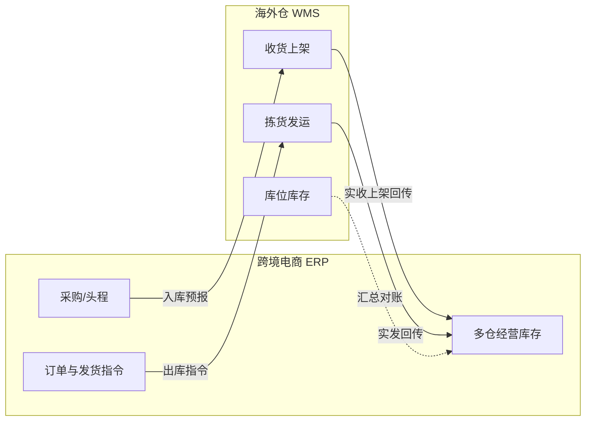

# 05-什么是海外仓 WMS 系统

## 一、海外仓 WMS 是什么

海外仓 WMS（Warehouse Management System，仓储管理系统）是面向**海外实体仓（自营仓或第三方合作仓）**的现场作业系统，用一套后台管理**货在哪里、由谁拣、何时发走**。

它解决的核心问题：头程货到仓后如何收货上架、平台/ERP 下来的订单如何在仓内拣货打包、库存按库位是否准确、退件如何再入库。WMS 管的是**实物与库位、任务与作业节点**，不是管「在哪个平台卖了多少钱」。

核心业务链路：**入库预报（ASN）→ 收货清点 → 质检/量体（可选）→ 上架入位 → 出库指令接收 → 波次/拣货 → 复核打包 → 贴标发运 → 轨迹回传（可选）→ 盘点与退件处理**。

## 二、海外仓 WMS 与跨境电商 ERP、进销存的关系

| 系统 | 核心视角 | 库存粒度 | 典型用户 |
|---|---|---|---|
| **进销存** | 境内贸易进销与往来 | 仓库/逻辑仓 | 内勤、销售、采购、财务 |
| **跨境电商 ERP** | 多平台经营与跨境履约指挥 | 多仓（国内/海外/FBA）经营底账 | 运营、供应链、财务 |
| **海外仓 WMS** | 海外仓内执行与效率 | **库位 / 批次 / LPN（托盘或箱）** | 仓管、拣货员、复核员 |

- **相对跨境电商 ERP**：ERP 是**履约指挥塔**——决定「从哪个海外仓、发哪些 SKU、对应哪张平台订单/货件」；WMS 是**海外仓内的执行引擎**——把指令变成拣货任务、扣减库位库存、回传实发数量与运单号。ERP 侧常见单据：头程入库预报、调拨入库、销售/平台出库指令；WMS 回传：收货结果、上架确认、拣货完成、发运确认。
- **相对进销存**：进销存一般不包含库位与拣货路径。若企业只有国内批发，**不需要独立 WMS**；一旦海外仓需要**多 SKU 混储、按单拣货、退件翻新**，就应把仓内能力从 ERP 拆出或单独建设 WMS（ERP 保留汇总库存即可）。
- **与 FBA**：FBA 仓由平台运营，卖家不建 WMS；自研 WMS 主要针对**第三方海外仓、自营海外仓**。ERP 仍需同步 FBA 库存，但不在自研 WMS 内作业。
- **腾达科技场景**（见 `context/02-腾达科技业务背景.md`）：TikTok Shop、Walmart 等走**合作第三方海外仓**；中长期可「ERP + 仓方 WMS」对接，练手项目可先**自研 WMS 原型**模拟仓内闭环，ERP 以手工或 mock 指令对接（与 `context/03-进销存上下游关联系统.md` 一期无 API 的练手口径可并存：先 WMS 单系统 Demo，再接 ERP）。

## 三、海外仓 WMS 的典型模块

| 模块 | 核心职责 | 典型单据/功能 |
|---|---|---|
| 基础资料 | 仓内共用对象 | 仓库/库区/库位、容器（LPN/周转箱）、SKU 与条码、承运商与服务、作业班组 |
| 入库管理 | 管「进仓」 | 入库预报（ASN）、收货单、质检单（可选）、上架任务、上架确认 |
| 出库管理 | 管「出仓」 | 出库指令、波次计划、拣货任务、复核打包、发运单、面单/箱唛打印 |
| 库内作业 | 管「仓内移转」 | 移库单、补货（拣货位←存储位）、库存冻结/解冻、加工/贴标（可选） |
| 退件管理 | 管「退回」 | 退件预报、退件收货、质检分流、重新上架或报废 |
| 库存与盘点 | 管「库位账」 | 库位库存查询、库存调整、循环盘点、全盘、差异处理 |
| 转运/直邮（扩展） | 跨境仓常见增值 | 中转集货、换标、拆柜、尾程交运（按仓型裁剪） |
| 对接与集成 | 与 ERP/平台 | 指令下发、结果回传、库存快照对账、异常重试队列 |
| 报表与看板 | 管「效率与准确」 | 收货时效、拣货人效、库存准确率、订单履约 SLA |

## 四、海外仓 WMS 的核心业务特征

- **任务驱动 + 单据留痕**：现场以**任务**（上架任务、拣货任务）为操作单元，完成后汇总为**业务单据**（收货单、发运单）回传 ERP，而不是只改一个库存数字。
- **库位是真相**：同一 SKU 可分布在多个库位；拣货按**库位路径**优化；「汇总库存」由库位汇总得出，与 ERP 经营库存对账。
- **指令与执行分离**：ERP（或 OMS）下发出库指令 ≠ 已发货；WMS 内经历**分配库存 → 拣货 → 复核 → 发运确认**后，才回传 ERP 扣减并触发平台回传（若有 API）。
- **批次/效期（可选）**：服装类常按**批次或入库单**追溯；若不做效期，至少保留**入库批次**便于退件与盘点差异追溯。
- **占用与冻结**：库位库存可因**已分配待拣**而锁定，或因**质检待判/客诉冻结**而不可动；与 ERP「订单占用」是不同层级，需对账规则。
- **多货主（可选）**：第三方仓常一仓多客户；练手单货主可先不做货主隔离，但表结构宜预留 `Owner`/`Merchant`。
- **作业优先于界面美观**：拣货员使用**扫码枪、少字段、大按钮**；PC 端做调度与异常处理。

## 五、B 端管理后台的典型页面模式

WMS 在 ERP 通用模式基础上，**作业页占比更高**，列表页强调**任务队列与 SLA**。

### 页面骨架模式

| 页面类型 | 典型结构 | 说明 |
|---|---|---|
| 任务队列页 | 筛选（仓/状态/优先级）+ 任务表格 + 批量领取 | 待收货、待上架、待拣货 |
| 作业页（PDA/PC） | 单号/SKU/库位扫码区 + 当前行明细 + 确认 | 一步一确认，减少误拣 |
| 调度页 | 波次规则 + 待分配订单池 + 生成波次 | 出库高峰时批量释放拣货任务 |
| 详情页 | 指令头 + 行明细 + 作业日志时间轴 | 展示谁在何时从哪个库位拣了多少 |
| 库位可视化（可选） | 库区平面图或货架示意 | 一期可用表格代替 |

### 通用交互规范

- 与 ERP 一致：**状态变更用动作按钮**，不在表单里改状态
- 主数据（库位、SKU 条码）**停用**代替删除
- **短码 + 扫码**优先：库位码、LPN、运单号支持批量粘贴与扫码枪回车
- 发运确认前校验：**已复核数量 = 应发数量**、承运商与服务已选、面单已打印（若本地打印）
- 异常必须可挂起：缺货、破损、条码不符 → **异常备注 + 冻结行**，回传 ERP 或人工处理

### 控件选型指引

| 场景 | 推荐控件 | 说明 |
|---|---|---|
| 库位/SKU | 扫码输入框 + 校验音/色 | 错误库位立即阻断 |
| 波次/承运商筛选 | `Select` / Tab | 按尾程渠道分池 |
| 数量 | 数字键盘式 `NumberInput` | 默认不超过待拣量 |
| 批量单号 | `BatchSearchInput` | 运单号、平台订单号 |

## 六、海外仓 WMS 的关键设计原则

1. **ERP 经营账 + WMS 库位账**：约定对账频率与差异处理（以 WMS 实发为准回写 ERP，或 ERP 为权威仅允许调整单）。
2. **指令下推、结果上抛**：入库/出库以**标准接口或消息**交换（练手期可用 REST + 幂等单号）；禁止两边手工各改一遍库存而无单据。
3. **拣货路径与可用量**：分配时只从**可用库位**扣减；存储位补货到拣货位可作为独立任务类型。
4. **最小闭环优先**：一期先做「ASN 收货上架 → 出库指令拣发 → 库位库存平 → 回传 ERP」，不做复杂计费、多仓路由优化、智能波次算法。
5. **与跨境 ERP 模块映射**：

| ERP（指挥） | WMS（执行） |
|---|---|
| 头程/调拨入库预报 | ASN → 收货 → 上架 |
| 平台订单 / 发货单 | 出库指令 → 拣货 → 发运 |
| 海外仓库存汇总 | 库位库存汇总对账 |
| 盘点计划（可选） | 循环盘点任务 |

## 七、三系统协同示意（中长期）

## 八、相关上下文文档

| 文档 | 用途 |
|---|---|
| `context/01-什么是跨境电商ERP系统.md` | 多平台、多仓、跨境履约与利润 |
| `context/01-什么是进销存系统.md` | 境内进销存地基与两层单据 |
| `context/02-腾达科技业务背景.md` | 海外仓履约平台与仓型 |
| `context/03-进销存上下游关联系统.md` | 练手一期系统边界与无 API 口径 |
| `front-prototype/海外仓WMS/` | WMS 前端原型（入库/出库/退件等导航参考） |
