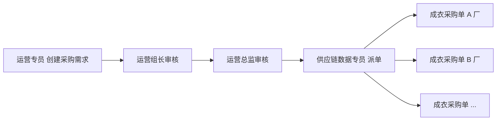

# 02-公司业务背景

> 文档定位：为自研跨境电商 ERP 提供**公司级业务事实与经营语境**，供需求分析、业务设计与 PRD 引用。  
> 公司法定名称：**腾达科技**（下文称「本公司」或「腾达科技」）

---

## 一、公司概况

**腾达科技**是一家**跨境女装品牌商/卖家**，以自有款式开发与品牌运营为主，当前销售与履约聚焦 **Amazon（亚马逊）** 平台。

- **品类**：女装（款式多、尺码色码组合多、季节性与补货节奏强）
- **经营模式**：**设计打版与 BOM 由公司内部产出** → **成衣加工外包** → **国内仓收货与增值作业** → **按 Amazon 规则发运至 FBA 仓** → 平台侧由 FBA 配送履约
- **系统建设背景**：业务此前使用 **领星 ERP** 支撑跨境运营；现启动 **0→1 自研内部 ERP**，按本公司委外生产与国内仓 FBA 备货流程重塑系统，逐步替代领星在核心链路上的依赖
- **系统建设目标**：把「款—产—仓—发—卖—算」串成可留痕、可对账的经营底账，并与 Amazon FBA 备货主链深度贴合

本公司**不自建成衣缝制产线**；生产执行在外部成衣工厂完成。面辅料须从本公司**指定面辅料工厂/供应商**采购或领用，但**面辅料货款由成衣工厂与面辅料厂自行结算**，本公司不参与面辅料往来账。

**一期平台范围**：仅 **Amazon 美国站（amazon.com，Marketplace US）**；在 US 上运营 **约 10 个卖家店铺**（店铺档案在 ERP 维护，Listing/FNSKU/订单/库存按店铺归属）。加拿大/墨西哥等其他站点、TikTok、Walmart **本期不做**。

**Amazon 一期数据范围（已确认）**：**FBA 订单进入 ERP**；同时对接或同步 **FBA 库存** 与 **经营报表**（对接深度见 `03` §3.2）。

**财务币种（已确认）**：**本位币人民币（CNY）**；与成衣厂、物流商等境内结算以人民币为主。**Amazon 平台回款币种为美元（USD）**；USD 折算 CNY **按 Amazon 账单日（按账单日）** 取汇率，用于回款对账与本位币金额展示（汇率档案在系统设置维护）。

---

## 二、销售渠道与履约方式

| 平台 | 一期范围 | 履约路径 | ERP 关注点 |
|---|---|---|---|
| **Amazon** | ✅ 唯一一期渠道；**美国站**、**约 10 个店铺** | 国内仓 FBA 备货 → 头程至 **美国 FBA 仓** → 消费者订单由 FBA 配送 | 店铺档案、货件计划、FNSKU 映射、**FBA 订单**、FBA 库存、报表 |
| **TikTok Shop** | ❌ 本期不做 | — | — |
| **Walmart** | ❌ 本期不做 | — | — |

一期自研 ERP 只打通 **「国内仓 + Amazon FBA 备货 + Amazon 经营数据」** 主链路；不预留多平台订单聚合为一期必达项（见 `03-跨境电商上下游关联系统.md`）。

---

## 三、供应链与生产组织方式

### 3.1 参与方

| 参与方 | 关系 | 在链路中的动作 | 与本公司结算 |
|---|---|---|---|
| **本公司（商品/供应链/运营/仓储/财务）** | 品牌与指挥中枢 | 维护款式与 BOM；**运营提采购需求 → 供应链派单成衣采购单**；**指定**面辅料渠道；收货质检与上架；货件计划；对接 Amazon | — |
| **外部成衣工厂** | 加工外包方 | 按本公司 BOM 与订单，向**指定面辅料厂**自行采买/领料；缝制加工；完工送货至**国内仓** | ✅ **按委外单总价（人民币）结算**；**对账周期 1 个月**（见 §3.4） |
| **指定面辅料工厂/供应商** | 本公司指定渠道（非本公司供应商账） | 向成衣工厂供料；物料规格须符合本公司 BOM | ❌ 与成衣工厂自行结算，**与本公司无关** |
| **外部物流商** | 头程/干线承运 | 接收本公司装箱结果；运输至 Amazon FBA 等目的地；回传运单与轨迹（能力分阶段对接） | 本公司与物流商结算：**人民币**；**对账周期 1 个月** |

### 3.2 款、PLM 与 BOM（一期在 ERP 建模）

- **BOM（物料清单）由本公司内部产出**，是成衣加工与面辅料选用的依据；**一期在 ERP 建设 PLM/BOM 生产制作域**（见 `03` §4.1），不再以 Excel 为唯一真相源。
- **BOM 按色码维度维护**（颜色/尺码或 SKU 维度分 BOM，而非整款仅一套用料）；同一 SPU 下不同色码可对应不同 BOM 版本链。
- **打样/样衣**：**样衣委外单、打样单一期不在系统建单**；量产 BOM 通过升版留痕；**样衣结算**仍 Out Scope（见 §八）。
- **BOM 须保留历史版本号**：每次发布生效生成不可覆盖版本；历史版本只读。新建委外订单默认带**当前生效色码 BOM 版本**，已下达订单**快照**下单时版本。
- 女装 BOM 通常含：面料、里料、辅料（拉链、纽扣、标等）、包装物料；与 **SKU（颜色/尺码）**、工艺/生产制单关联。
- ERP 表达：**SPU → SKU（色码）→ BOM 版本 → BOM 行 → 物料主数据**；委外生产订单挂接 **BOM 版本快照**；用量可展开支撑面辅料协同（本公司仍不参与面辅料货款结算）。
- **可售商品层**（条码/FNSKU、重量尺寸、Amazon 映射等）与领星式商品模块对齐，与 BOM/物料主数据分工见 `03` §4.1。
- **面辅料厂**作为**指定供方档案** + **供应商协同账号**（见 `05`）；**无**本公司对面辅料采购、应付、付款。
- **替代料**：须进系统，由**面辅料管理岗位一人终审**（无多级会签，见 `05` §三）。

### 3.3 面辅料「指定供应」的业务含义

成衣工厂**不得自行随意换料**；须从本公司**指定的面辅料工厂/供应商**拿料。本公司负责：

- 在 ERP **BOM/委外订单**上标明物料与指定供方，并对面辅料协同可见；
- 品质与交期协同（与成衣厂对口）。

本公司**不负责**面辅料采购付款、应付对账；该类结算在**成衣厂 ↔ 面辅料厂**之间完成。

### 3.4 委外需求、审核与派单（已冻结）

> **用语说明**：下文 **「采购需求」「成衣采购单」** 均指 **成衣委外加工** 语境，**不是**本公司对面辅料的采购（面辅料由成衣厂自行结算）。

成衣大货下单采用 **「需求 → 运营审批 → 供应链派单 → 成衣采购单」** 两层单据，与 `01`「计划层 → 执行层」一致：

| 环节 | 责任角色 | 要点 |
|---|---|---|
| **下发采购需求** | **运营专员** | 按补货/备货需要维护需求明细（款色码 SKU、数量、需求交期等）；**不指定成衣厂**、不在此单填加工费总价 |
| **逐级审核** | **运营组长** → **运营总监** | 仅审核通过后的需求方可进入派单池；驳回须记原因 |
| **派单** | **供应链数据专员** | 将**一条或多条已审核需求**拆分为多张 **成衣采购单**（系统内与 **委外生产订单** 同一业务对象，下文可并称） |
| **拆单与多厂** | 供应链数据专员 | **1 条采购需求可拆多张成衣采购单**；不同采购单可指定**不同成衣厂**；各单维护数量、交期、**按单总价（人民币）加工费**、**BOM 版本快照** |
| **数量约束** | — | 同一需求下，各成衣采购单派单数量**累计不得超过该需求核准数量**（部分派单、分批发厂允许，余量可后续再派） |
| **下达工厂** | 供应链 | 采购单审核/下达后，成衣厂在供应商协同区**确认**（见 `05`）；之后送货、入库、对账均**挂采购单** |

### 3.5 委外加工费与成衣厂对账（已冻结）

| 项 | 口径 |
|---|---|
| 计价 | **按委外生产订单总价**（人民币），不按工序拆账为一期必达 |
| 对账周期 | **1 个月**（与物流商月结节奏一致） |
| 工厂侧确认 | 成衣厂在供应商协同区**确认 / 异议**（见 `05`） |
| 异议闭环 | 由**账务**负责闭环处理 |
| 溢装 | 清点数量**多于**委外单数量时，超出部分**不得入库**，须**退回成衣厂**（超交退货/退货出厂留痕） |

---

## 四、国内仓作业（本公司仓库）

本公司 **一期仅一个国内仓**（单仓逻辑；不分多仓调拨）。成衣工厂交货后，货物进入该仓，执行以下标准作业（顺序为业务目标顺序，现场可合并工位）：

| 步骤 | 作业内容 | 业务目的 |
|---|---|---|
| 收货 | 核对送货单/委外订单、承运信息 | 确认「货到了、是谁送的」 |
| 拆包 | 开箱、分款分色分码 | 将工厂整箱交货转为可清点明细 |
| 清点 | 数量清点，登记短少/溢装 | 实收**不超过委外数量**方可进入质检；**溢装须退回工厂** |
| 质检 | 外观、尺寸、工艺等**按比例抽检** | 按到货批量计算抽检件数；不合格品隔离，避免不良品上架或发 FBA |
| 压气 | 蒸汽整烫/去褶皱 | 女装外观品质与包装前状态；**须做工序/批次标记**（与质检批次或入库批次关联） |
| 贴标 | 贴 **FBA/FNSKU 商品标签**（口述「FAB 标签」按 FBA 商品标理解） | 满足亚马逊入仓与拣货识别要求 |
| 上架 | 入库存储位，库存变为可计划 | 运营可见库存，可下 Amazon 货件计划 |

上述环节是**自研 ERP 与国内仓执行层**的重点：库存变动与质量状态应在**执行单据**上留痕，而非仅在领星或表格中维护。

### 4.1 入库质检（按比例抽检，已冻结口径）

- **检验方式**：**按比例抽检**，不做默认全检。
- **抽检比例**：系统初始默认 **10%**；支持按品类/款号覆盖，且可**动态调整**（调整须留痕）；单次质检单记录**当次采用的比例**。
- **抽检数量**：待检数量（通常为清点后的收货数量）× 当次抽检比例，**向上取整**为至少 1 件（数量为 0 时不建质检单）。
- **质检单须记录**：待检总数、抽检比例、抽检件数、合格件数、不合格件数、抽检结论（**合格 / 不合格**）。
- **一期不做**：**加抽**、**让步接收**。
- **抽检结论为不合格时**：该批清点数量**整体冻结**，不得进入压气/上架；由供应链在系统中**择一**发起 **返修单**（返工后再检）或 **退货出厂单**（退回成衣厂），**不设系统自动默认路径**（见 `04` S3）。
- **批次结论与上架**：仅**质检合格**数量进入后续压气、贴标、上架；不合格/待处理数量**不得**计入可用库存。

---

## 五、运营备货与 FBA 发运（国内仓出库段）

上架完成后，**运营**根据 Amazon 销售与补货策略，在系统内下 **FBA 货件计划**（分仓、分箱规则以 Amazon 当前要求为准）。

国内仓侧典型出库作业：

1. **下架 / 拣货**：按货件计划明细从库位取货  
2. **复核**：核对 SKU、数量、标签  
3. **打包 / 装箱**：按亚马逊分箱要求装彩盒 / polybag、入箱  
4. **贴 FBA 箱唛**：外箱箱唛与货件计划一致  
5. **称重**：记录箱重，供物流计费与平台校验  
6. **对接物流**：将货件交接**外部物流商**，发往 Amazon FBA 仓  

ERP 负责**计划层（发什么、分几箱、去哪几个 FC）**与**执行层（实拣、实装、实发）**的衔接。**FBA 改仓 / 改箱**由**运营发起**申请，共用**同一审批单类型**（业务区分改仓/改箱），**运营负责人初审 → 仓储负责人终审**后升版货件计划并重作业（动因见 `03` §七）。**头程在途**与 FBA 部分接收/拒收口径见 `03` §7.1。物流轨迹与平台货件状态可分阶段对接。

---

## 六、组织与角色（业务视角）

| 角色 | 典型职责 | 高频系统触点 |
|---|---|---|
| 商品/版师 | 款式、BOM、工艺/生产制单 | 商品档案、PLM/BOM 模块 |
| 面辅料管理 | 指定供方、**替代料一人终审** | 指定供方档案、替代料审批单、面辅料协同 |
| 运营专员 | **采购需求**创建与提交 | 采购需求 |
| 运营组长 / 运营总监 | **采购需求**逐级审核 | 采购需求审批 |
| 供应链数据专员 | **派单**、成衣采购单、跟单、收货通知单协同 | 委外派单、成衣采购单、到货跟踪、`05` 协同 |
| 系统管理员 | 用户、**供应商账号** | 系统设置 |
| 质检/仓储 | 收货—上架、库存准确 | 入库单、质检单、上架单、库存查询 |
| 运营（备货） | Amazon 补货、货件计划、Listing 与库存策略 | 货件计划、分仓分箱、库存占用；**改仓/改箱申请** |
| 仓管/发货 | 拣货、装箱、贴唛、交接物流 | 出库单、装箱单、物流交接 |
| 账务/财务 | 成衣加工费**月对账**、物流费、Amazon **美元回款**；加工费对账**异议闭环** | 委外对账单、物流费、Amazon 回款对账 |

组织树、部门汇报线：**一期不建模**（权限按业务角色配置即可）。

---

## 七、当前痛点（领星 ERP → 自研内部 ERP）

此前依赖 **领星 ERP** 承载跨境业务；随着本公司 **委外生产 + 国内仓增值 + FBA 备货** 流程固化，通用 SaaS 与内部实操之间的缝隙变大，推动自研 ERP。典型痛点如下：

| 编号 | 痛点 | 影响 |
|---|---|---|
| P01 | 领星以跨境卖家通用能力为主，**委外生产、指定面辅料、成衣厂人民币结算**等链路只能外挂表格或变通字段 | 款单、加工费、到货状态分散，供应链与财务对不上 |
| P02 | **国内仓收货—质检—压气—贴 FNSKU—上架**在领星中难以按本公司工位留痕 | 库存状态粗糙，不良品与可发 FBA 库存混在一起 |
| P03 | **FBA 货件计划与国内实装箱、箱唛、称重、物流单**在领星与现场作业衔接弱 | 改仓、短装、重打箱唛频繁，头程成本与责任难追溯 |
| P04 | BOM、SKU、FNSKU 映射在领星/表格与作业现场**多套维护** | 贴标错误、货件驳回、补货算错款色码；自研须 **BOM 与可售 SKU 同源** |
| P05 | 库存口径（国内可用 vs FBA 可售）在领星侧与运营认知不一致 | 补货计划失真，爆款断货或呆滞 |
| P06 | 成衣厂交货数量与系统入库**差异处理无标准单据** | 与工厂对账靠微信记录，历史难查 |
| P07 | 领星扩展成本高、关键流程无法按本公司**动作驱动状态机**定制 | 无法沉淀为长期数字资产；迭代受产品路线图约束 |
| P08 | 自研切换期若缺乏清晰切分，容易出现**双系统录入或口径不一致** | 切换风险、短期效率下降；**一期产品不承诺领星自动迁移**，切换节奏见下文**第九节**参考建议 |
| P09 | 成衣厂、面辅料厂协同依赖微信/表格，**无统一留痕** | 交期、供料、对账纠纷难举证；一期在 ERP 内以**外部供应商角色**建设（见 `05`） |

---

## 八、自研 ERP 一期范围建议（业务口径）

**优先做（In Scope 建议）**

- 主数据：**物料主数据**、**BOM 版本**、**PLM/生产制单**、可售 **SPU/SKU**（含 FNSKU 映射）、**成衣厂**、**面辅料厂（指定供方）**、国内仓、物流商  
- 委外协同：**采购需求（运营专员）→ 运营组长/总监审核 → 供应链派单 → 成衣采购单/委外生产订单**（可拆单、多厂；按单总价、BOM 快照）→ **供应商协同区** → 工厂交货 → 国内入库（清点、**比例抽检**、**压气批次标记**）  
- **FBA 改仓 / 改箱**：**运营负责人初审 → 仓储负责人终审** + 货件计划多版本、重打箱唛与实装对照（见 `03` §七）  
- 异常：**短少**差异单、**返修单**（单独单据，与入库/委外关联）  
- 国内仓库存：**现存 / 占用 / 可用 / 在途（头程）** 四口径；货件计划占用；上架后国内仓可查  
- **Amazon FBA 货件计划驱动**的拣货、装箱、箱唛、称重、物流交接；出库确认后国内仓扣减并计入**头程在途**  
- **Amazon**：**美国站**、**约 10 店铺**；**平台刊登与铺货（模拟，无 API）**（`11`）、Listing 映射、**平台订单处理**（同步/异常）、**售后**（退款单、FBA 客退）、FBA 库存与报表（对接可分阶段，见 `08`）  
- **国内单仓**  
- **委外加工费**：按单总价、**月对账**；溢装退回工厂  
- **替代料审批**（面辅料管理**一人终审**）  
- **AI 自动补货**：补货建议 → **采购需求草稿**（运营专员编辑后走原审批，见 `07`）  
- **AI 自动派单**：派单方案建议 → 供应链专员确认后 **生成成衣采购单**（见 `07`）  

**明确不做（Out of Scope 建议）**

- **TikTok Shop、Walmart** 及任何非 Amazon 平台对接  
- 本公司与**面辅料厂**的采购、应付、付款与对账（面辅料由成衣厂自行结算）  
- **完整 MRP 自动跑料、打样/量产 BOM 双轨**；创意板/3D 等完整时尚 PLM（一期只做**生产制作**相关能力，见 `03` §4.1）  
- **样衣结算**；**样衣委外/打样单**（不在系统建单）  
- 成衣厂/面辅料厂**独立门户站点**（一期统一在 ERP 内；演进见 `05`）  
- 供应商侧**扫码/PDA、专用移动端**；外部账号**密码策略/合同到期自动冻结**等安全增强  
- **物流拒收/丢箱索赔**流程（一期不考虑）  
- 完整 MES（产线排程、计件工资、设备 OEE）  
- 完整财务总账、凭证、税务申报  
- 海外第三方仓 WMS 级库位路径优化（国内仓可先「逻辑仓 + 简化作业页」，见 `03`）  
- **领星 ERP 历史数据批量迁移、双系统长期并行、自动对账**（切换执行见第九节；**不作为一期开发范围**）

---

## 九、领星 ERP 切换策略（参考建议）

> **定位**：供腾达科技管理层与项目组排期参考。**一期自研 ERP 需求与功能范围不纳入**领星接口、迁移工具与并行期产品能力；上线前按本节在**项目层**执行即可。

### 9.1 原则

| 原则 | 说明 |
|---|---|
| **分域单写** | 同一业务事实只在一个系统**录入**；另一系统若保留，仅**查询/报表**，避免双写 |
| **先主链后全域** | 自研先成为「委外 + 国内仓 + FBA 备货」的**唯一作业系统**；领星暂管尚未自研覆盖的能力 |
| **切换以「新单」为界** | 设定 **Cutover Date**：该日 0 点起，新委外单/新入库/新货件只在自研创建；切点前已开单可在领星收尾或按清单迁开 |
| **在途优先清单** | 切换前 1～2 周盘点：未完结委外单、在途到货、未完成 FBA 货件、未对账加工费；逐项决定「领星收尾」或「自研承接（含期初导入）」 |
| **主数据一次导入** | SPU/SKU、物料、**当前及在途所需 BOM 版本**、成衣厂、面辅料指定供方、FNSKU 映射等做**一次性清洗导入** |
| **库存期初** | 国内仓：切换日盘点 → 自研**期初库存**；FBA：以 Amazon 卖家后台/领星报表为参照录入自研 **FBA 逻辑仓期初**（不要求与领星逐笔一致） |
| **验证再收口** | 并行期仅用于**对照**（库存、在途货件、一周加工费对账），指标对齐后关闭领星对应模块录入权限 |

### 9.2 推荐阶段（示例节奏）

| 阶段 | 自研承担 | 领星承担（临时） | 停用领星录入的时机 |
|---|---|---|---|
| 0 | 主数据、供应商档案、商品映射 | 日常运营不变 | — |
| 1 | 新建委外订单、跟单 | FBA 货件、平台库存、费用报表 | 委外不再在领星开单 |
| 2 | 收货—质检—上架、国内库存 | 同上 | 国内入库不再在领星记 |
| 3 | FBA 货件计划与国内出库 | 可选：仅 Amazon 广告/利润看板 | 备货出库不再在领星记 |
| 4 | 全主链 | 无或仅历史查询 | 合约到期前导出归档 |

### 9.3 不建议的做法

- **长期双系统双写**同一委外单或同一批库存（口径必然漂移）。
- **大爆炸一天全停领星**且未迁在途单与期初库存。
- **一期自研范围外**强行做领星 API 全自动同步（投入大、收益小于分域切换）。

### 9.4 与一期产品的关系

- 自研 ERP **提供**：期初库存录入、主数据维护、单据从 0 跑通。  
- 自研 ERP **不提供（一期）**：领星历史单据自动迁移、切换日对账机器人、双系统实时库存同步。  
- 若 Cutover 后需查领星历史，保留**只读账号**至财务/审计周期结束即可。

---

## 十、相关上下文文档

| 文档 | 说明 |
|---|---|
| `context/跨境电商ERP/01-什么是跨境电商ERP系统.md` | 跨境 ERP 模块与 design 原则 |
| `context/跨境电商ERP/03-跨境电商上下游关联系统.md` | 平台、工厂、物流与系统边界 |
| `context/跨境电商ERP/04-端到端业务主链路.md` | 从款与委外到 FBA 的端到端流程与单据索引 |
| `context/跨境电商ERP/05-供应商协同与门户（一期ERP内）.md` | 成衣厂/面辅料厂外部角色与协同范围 |
| `context/跨境电商ERP/06-系统菜单地图（一期）.md` | 一期导航与菜单框架（内部 + 供应商） |
| `context/跨境电商ERP/07-AI补货与自动派单（一期）.md` | AI 补货建议与派单方案逻辑 |
| `context/跨境电商ERP/08-平台订单与售后（一期）.md` | 平台订单与售后边界（非备货、非工厂退货） |
| `context/跨境电商ERP/09-一期建设优先级与实施步骤.md` | 模块/menu 建设顺序与 MVP 里程碑 |
| `context/进销存/01-什么是进销存系统.md` | 国内仓「两层单据 + 库存口径」地基 |
| `context/海外仓WMS/05-什么是海外仓WMS系统.md` | 若国内仓作业加重，与 WMS 的分工参考 |
