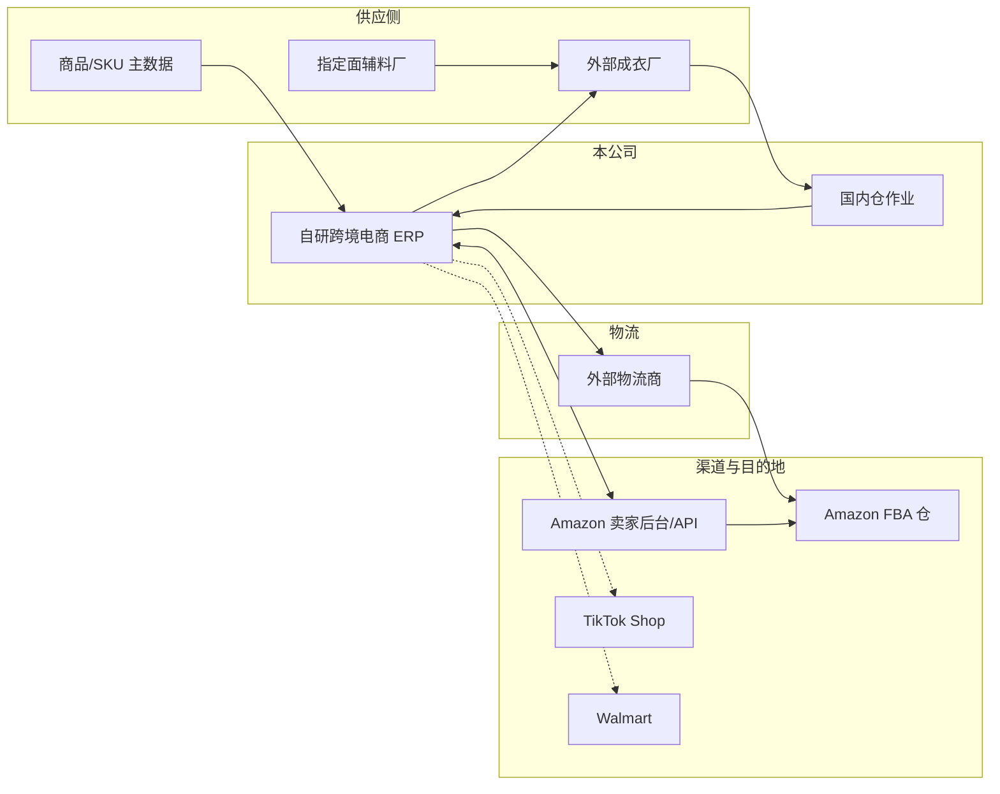
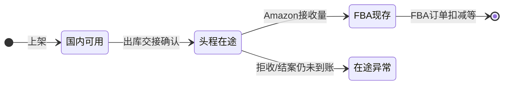

# 03-跨境电商上下游关联系统

> 文档定位：说明本公司跨境女装业务中，**ERP 与外部参与方/外部系统**的边界、数据流向与一期对接策略。  
> **生产制造与可售商品边界以本文 §4.1 为准**（含 PLM/BOM 生产制作域 + 领星式可售商品）。  
> 配套阅读：`02-公司业务背景.md`、`01-什么是跨境电商ERP系统.md`

---

## 一、总览：ERP 在链路中的位置

本公司 ERP 是**经营与履约指挥中枢**，不替代电商平台前台，也不替代成衣厂的缝制产线。典型数据流：

实线为一期应建模的主链；虚线为分阶段对接的平台。

---

## 二、外部参与方清单

| 外部节点 | 类型 | ERP 是否管「对方内部流程」 | ERP 应管什么 |
|---|---|---|---|
| **Amazon** | 销售渠道 + FBA 仓储 | 否 | Listing/SKU 映射、订单（若自发货）、FBA 库存快照、货件计划与入库结果 |
| **TikTok Shop** | 销售渠道 | — | **一期不做**（见 `02`） |
| **Walmart** | 销售渠道 | — | **一期不做**（见 `02`） |
| **外部成衣工厂** | 委外加工 | 否 | 委外订单、**BOM 版本快照**、**ERP 供应商协同**（见 `05`）；到货数量、**加工费（人民币）**；不下发 MES 工序 |
| **指定面辅料厂** | 成衣厂指定供方（非本公司供应商账） | 否 | **指定供方档案** + **供应商协同**（用料行、供料确认、要货领料、可见成衣厂与委外单号）；**无**本公司采购、应付、对账 |
| **外部物流商** | 运输服务 | 否 | 运单号、箱数重量、费用、轨迹（对接深度分阶段） |
| **Amazon FBA 仓** | 平台仓储 | 否 | 货件 Shipment ID、箱唛、接收结果；不在 ERP 做库位级作业 |

---

## 三、与电商平台的关系

### 3.1 平台 vs ERP

| 维度 | 平台 | 自研 ERP |
|---|---|---|
| 商品展示 | Listing 页面、广告 | 本地 SPU/SKU、成本、库存承诺、平台 Listing 映射（口径对齐领星商品模块） |
| 订单 | 消费者下单、平台规则 | **平台订单**同步、列表、异常处理；FBA 履约不在国内仓发货；按**店铺**归属（见 `08`） |
| 售后 | 退款、FBA 退货 | **退款单 / 退货单（售后）** 同步或导入，关联原订单（见 `08`） |
| 库存可售 | 平台可售数量 | 各仓**现存/占用/可用/在途（头程）**；FBA 逻辑仓单独同步；同步策略可配置 |
| 结算 | 平台账单 | 回款对账、费用分摊、毛利 [分期] |

### 3.2 分阶段对接建议（仅 Amazon）

| 阶段 | Amazon |
|---|---|
| **0-1 冷启动** | 主数据与货件计划可在 ERP 维护；平台侧货件创建可**手工在卖家后台完成**，ERP 记录 Shipment ID 与箱唛对应关系；领星切换为**项目层执行**（见 `02` **第九节**），一期产品不做领星对接 |
| **一期目标** | SP-API：**FBA 订单**、FBA 库存、货件/入库状态回写；**经营报表**拉取或导入（接口清单在 Amazon 模块 PRD） |
| **二期** | 自动创建货件、自动上传箱内件数、费用报告拉取等深度自动化 |

其他平台（TikTok、Walmart 等）**不在一期范围**，自研 ERP 不为其预留必达接口。

**原则**：库存变动真相在 ERP **执行层单据**确认后发生；平台同步是**结果推送**，不能代替入库/出库留痕。

---

## 四、与生产供应链的关系

### 4.1 生产制造与可售商品（一期口径）

#### A. PLM / BOM 生产制作域（一期 In Scope）

| 能力域 | ERP 职责 | 说明 |
|---|---|---|
| **物料主数据** | 面料、辅料、包装物料等编码与规格 | 与 BOM 行、指定供方关联 |
| **BOM 版本** | 发布、升版、历史只读 | **按色码/SKU 维度**维护；委外单**快照**下单版本；样衣单一期不建 |
| **BOM 行** | 用量、损耗、色码/SKU 维度 | 可展开为委外/供料协同行（**非本公司面辅料应付**） |
| **生产制单 / 工艺** | 工序说明、工艺要求、附件 | 与 SPU/款号挂接；细节在模块 PRD 定义 |
| **替代料** | 审批流 | **面辅料管理一人终审** |

**一期 Out Scope（生产制造）**：完整时尚 PLM（创意板、3D 等）、**样衣委外/打样单**、**样衣结算**、**全自动 MRP 跑料**、产线 MES、计件工资。

#### B. 可售商品（一期 In Scope，交互对齐领星）

| 能力域 | ERP 职责 | 说明 |
|---|---|---|
| **SPU / SKU** | 可售规格（色、码等） | 与款式/BOM 款号关联；条码、重量尺寸、图片 |
| **平台映射** | MSKU、ASIN、FNSKU 等 | 服务 Amazon Listing 与 FBA 备货 |
| **采购/成本字段** | 默认供应商、参考价等 | 支撑委外选品与成本挂接 |
| **状态与档案** | 启用/停用、分类、品牌 | 主数据**不提供删除** |

#### C. 平台刊登与铺货（一期 In Scope，模拟）

| 能力域 | ERP 职责 | 说明 |
|---|---|---|
| **平台 Listing（模拟）** | 按店铺维护在线商品档案 | 标题、售价等展示字段；状态：草稿 / 已上线（模拟）/ 已停用（模拟） |
| **刊登与改价** | 新建、编辑、**模拟发布**、**保存并模拟同步** | **不对接 SP-API**；详见 `11` |
| **批量铺货** | 多店铺任务 + 模拟执行 | 同一本地 SKU 铺至多店；成功后 **联动 Amazon 映射** |
| **与映射关系** | 发布/铺货写映射表 | 订单同步、贴标、货件仍以映射 + 本地 SKU 为准 |

**采购需求**经运营审批后，由供应链派单生成 **成衣采购单**（委外生产订单），关联 **SKU、数量、交期、按单总价加工费、BOM 版本快照**；面辅料协同行可由 BOM 展开或跟单维护（见 `05`、`02` §3.4）。

### 4.2 成衣工厂（委外加工）

ERP **不下发缝制工序排程**。内部下单路径（已冻结，见 `02` §3.4）：

1. **运营专员**创建 **采购需求** → **运营组长**、**运营总监**逐级审核；  
2. **供应链数据专员** **派单**生成多张 **成衣采购单**（委外生产订单）：可拆单、可多成衣厂；  
3. 采购单含款色码 SKU、数量、交期、**按单总价人民币加工费**、**BOM 版本快照**。

协同与执行：

- 用料与指定面辅料要求通过 **BOM 快照 / 展开行、工艺资料** 与成衣厂协同（结算在成衣厂与面辅料厂之间，本公司不管）；**不做 MES 工序排程**；
- **工厂送货单**与 ERP **委外到货/入库预告**匹配；
- **短少**：清点差异单；**返修**：**单独返修单**（不入可用或入待检，与委外单关联）。

工厂在 **ERP 供应商角色**内协同（见 `05`）；不与工厂 MES API 对接为一期常态。

### 4.3 指定面辅料厂（已冻结口径）

- 成衣厂向本公司**指定**的面辅料厂采买/领料，规格须符合 ERP **BOM** 与替代料审批结果。
- **面辅料货款由成衣厂与面辅料厂自行结算，与本公司无关。**
- 本公司 ERP 维护：**指定供方档案**、委外协同**用料行/附件**、**面辅料厂登录与供料状态**（见 `05`）；**不建**本公司对面辅料厂的采购订单、入库、应付与付款。
- **替代料**须系统内审批，**面辅料管理一人终审**（见 `05` §三）。
- 本公司财务仅与**成衣厂**就委外**加工费**等进行**人民币**结算（见 `02`）。

---

## 4.4 供应商协同（一期在 ERP 内）

| 项 | 口径 |
|---|---|
| 产品形态 | **同一 ERP 后台**，角色 = **外部供应商**（成衣厂 / 面辅料厂） |
| 账号 | 本公司管理员开通；**一厂多账号**；成衣厂数据隔离；面辅料厂可见**多家成衣厂**及委外单号、数量 |
| 留痕 | 对账与纠纷举证级别 |
| 独立门户 | **后续**拆分；一期不单独建站 |
| 移动端/扫码 | 一期 **不做** |

能力清单见 `context/跨境电商ERP/05-供应商协同与门户（一期ERP内）.md`。

---

## 五、与国内仓、WMS 的关系

| 能力 | 跨境电商 ERP | 独立 WMS（可选） |
|---|---|---|
| 库存口径（现存/占用/可用/在途） | ✅ 经营底账 | 可选：库位级明细 |
| 收货、清点、质检结果 | ✅ 至少到单据级 | 任务驱动、扫描枪 |
| 上架库位 | 一期可逻辑仓；二期可库位 | ✅ 强项 |
| FBA 拣货、装箱、箱唛 | ✅ 作业页或出库执行单 | 可分工：WMS 执行、ERP 计划 |

本公司国内仓流程含 **压气、贴 FNSKU、装箱贴箱唛**，带有**增值作业**属性。0-1 可在 **ERP 内做「作业型页面」**；当库位与波次复杂度上升，再评估独立 WMS 或与 `context/海外仓WMS` 能力对齐。

**与进销存的关系**：国内收货与出库段遵循「**计划层 → 执行层**、**库存只随执行层变**」（见 `context/进销存/01-什么是进销存系统.md`）。

---

## 六、与物流商的关系

| 数据项 | 方向 | 说明 |
|---|---|---|
| 货件信息（箱数、重量、尺寸） | ERP → 物流 | 由装箱称重结果汇总 |
| 运单号、提单号 | 物流 → ERP | 回写至货件/出库单，再推平台 |
| 轨迹 | 物流 → ERP | 展示用；异常告警分期 |
| 运费账单 | 物流 → ERP/财务 | 头程成本归集 [分期]；结算 **人民币**，**月对账** |

一期允许 **手工录入运单号**；API 对接物流商为扩展项。**物流拒收/丢箱索赔**一期不做流程。

---

## 七、与 Amazon FBA 的关系（重点）

FBA 仓**不是本公司 WMS 管辖范围**，ERP 需管理的 FBA 相关对象包括：

- **Seller SKU / FNSKU / ASIN** 与本地 SKU 映射；
- **货件计划**（分仓、分箱、每个箱子装哪些 SKU 多少件）；
- **箱唛 Box ID** 与本公司装箱结果一一对应；
- **入库接收数量**与差异（短少、拒收）反馈到库存与补货决策。

平台侧 **分仓分箱算法**以 Amazon 当前规则为准；ERP 应保存**计划版本与实装版本**的对照，并支持 **FBA 改仓 / 改箱**（一期 In Scope）。

**谁决定改仓 / 改箱？**

| 类型 | 典型动因 | 谁主导 | 本公司 ERP 要做什么 |
|---|---|---|---|
| **改仓** | 入库分仓方案变更、货件被拆到多个 **FC**、目的仓与计划不一致 | **以 Amazon 平台规则与卖家后台/API 反馈为主**；卖家须在期限内接受或调整 | 同步/录入新 FC 方案，生成**货件计划新版本**，驱动重拣、重打箱唛、物流信息更新 |
| **改箱（平台驱动）** | 箱内件数/混装不符合平台校验、货件被驳回、分箱上限变化 | **Amazon 校验规则**要求调整 | 按平台要求改箱明细与箱唛，保留版本对照 |
| **改箱（自营驱动）** | 装箱失误、称重不符、合并/拆分箱以省运费、运营主动优化 | **本公司**仓储/运营决策（须在平台允许编辑窗口内同步到卖家后台） | 在 ERP 发起改箱并记**变更原因**，实装与计划对照 |

结论：**改仓几乎都是跟 Amazon 分仓结果走**；**改箱既可能是平台驳回后被迫改，也可能是公司自己改**，但最终须与 **Seller Central / SP-API 货件状态**一致，否则箱唛无效、无法入仓。

**发起与审批（已冻结）**：**运营**发起 **改仓 / 改箱** 申请；**同一审批单类型**，用业务字段区分改仓或改箱。须**运营负责人初审 → 仓储负责人终审**通过后，方可生成新货件计划版本并驱动仓储重作业（拣货、装箱、重打箱唛）；驳回须记原因，全流程留痕。

### 7.1 头程在途与 FBA 接收差异（已冻结口径）

**推荐逻辑（数量守恒）**：国内已经「发走」的货，在 Amazon 正式接收之前，记在 **头程在途**；**只有平台确认接收的数量**才进入 **FBA 逻辑仓**（可售底账）。国内仓、在途、FBA 三处数量之和应与「已发货未丢单」的实物预期一致，**拒收/短收不得计入 FBA 可售**。

**步骤 1 — 国内发出（执行层）**  
物流交接 / 发货出库**确认**：按货件明细每个 SKU，**国内仓现存 − 发货量**，**头程在途 + 发货量**（可按店铺 + 货件 + SKU 维度记账）。

**步骤 2 — Amazon 回传接收（API 或手工，按货件 + SKU 行）**

| 平台结果 | 库存处理 | 说明 |
|---|---|---|
| **已接收（Received）** | 头程在途 **−** 本次接收量；**FBA 逻辑仓** **+** 本次接收量 | 可多次回传，**累计接收** |
| **部分接收** | 已接收部分按上行；**发货量 − 累计接收量** 仍留在**头程在途** | 货件未结案前，在途表示「还在路上或待入仓」 |
| **拒收 / 明确不接收** | **不增加** FBA 可售；对应数量从在途转入 **在途异常**（或拒收差异单） | 一期不做索赔，须留痕、对货件与箱唛 |
| **货件在平台结案（Closed）** | 每条 SKU：**发货量 − 累计接收量 − 已记拒收量 = 0**；若仍有缺口，剩余在途须 **转在途异常并结案**，禁止在途长期挂账 | 与 Seller Central 货件状态对齐 |

**数字示例**：某 SKU 发货 **100 件** → 在途 +100、国内 −100。Amazon 先接收 **60** → 在途 −60、FBA +60，**在途余 40**。再接收 **30** → 在途 −30、FBA +30，**在途余 10**。货件结案且剩余 **10** 为拒收/丢失 → 在途 −10，**在途异常 +10**（或拒收单），FBA 不再增加；**100 = 60 + 30 + 10**。

**与四口径关系**：**在途**统计头程在途 + 在途异常（是否拆两个子口径在库存 PRD 定义）；**FBA 逻辑仓**的现存/可用以接收量为底，再叠平台同步与订单占用。

---

## 八、一期系统边界（练手 / 0-1 默认口径）

与 `context/进销存/01-什么是进销存系统.md` 中「腾达练手」表述对齐，本公司 0-1 可采用：

| 边界项 | 一期默认 |
|---|---|
| 生产制造 | **PLM/BOM 生产制作**（物料、BOM 版本、制单工艺、委外 BOM 快照） |
| 可售商品 | **领星式 SPU/SKU + Amazon 映射** |
| 平台刊登 | **Listing 刊登/改价/铺货（模拟，无 API）**（`11`） |
| 成衣厂 | 档案 + 协同；加工费**按单总价、月对账**；**无 MES API** |
| Amazon | **美国站**、约 **10 店铺**；**平台订单 + 售后 + 库存 + 报表** |
| 国内仓 | **单仓** |
| 面辅料厂 | **指定供方 + 供应商协同**；不参与本公司往来账 |
| 物流商 | 手工运单号 + 费用录入；**人民币月结** |
| 供应商门户 | **一期在 ERP 内**；独立站后续 |
| TikTok / Walmart | **一期不做** |
| 领星 ERP | 切换前可只读参照；**分域单写**策略见 `02` **第九节**；一期不开发领星接口/迁移 |
| 财务 | **本位币 CNY**；Amazon **回款 USD**；USD→CNY **按账单日**汇率；成本与费用挂接单据；不做总账 |
| FBA 异常 | **改仓/改箱**（须**审批**）；加抽/让步质检、物流索赔、FBA 包装规范库 **一期不做** |
| 样衣 | **打样单不建**、**样衣结算**不做；大货委外仍 In Scope |
| 供应商账号安全 | 密码策略/合同到期冻结等 **一期不做** |
| AI 补货 / 派单 | **建议 + 人工确认**；不自动审需求、不自动下达工厂（见 `07`） |
| 平台 API | Amazon 优先；失败时可降级手工维护货件 ID |

当业务要求「必须全自动同步」时，在对应模块 PRD 中显式升级为一期 In Scope。

---

## 九、相关上下文文档

| 文档 | 说明 |
|---|---|
| `context/跨境电商ERP/02-公司业务背景.md` | 公司模式与国内仓作业 |
| `context/跨境电商ERP/04-端到端业务主链路.md` | 单据链与状态衔接 |
| `context/跨境电商ERP/05-供应商协同与门户（一期ERP内）.md` | 外部供应商角色与能力矩阵 |
| `context/跨境电商ERP/01-什么是跨境电商ERP系统.md` | ERP 模块地图与设计原则 |
| `context/海外仓WMS/05-什么是海外仓WMS系统.md` | 仓内任务化作业参考 |
