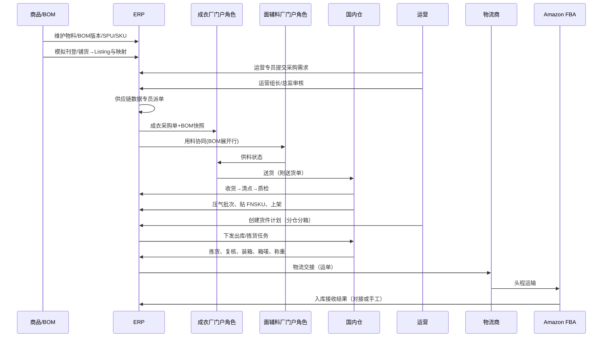

# 04-端到端业务主链路

> 文档定位：从 **款与 BOM 定稿** 到 **FBA 入仓** 的端到端业务路径，供流程推演、模块划分与单据清单索引。  
> 一期含 **PLM/BOM 生产制作域**（见 `03` §4.1）及 **领星式可售商品**；单据名为**业务概念名**，正式英文单据名与状态机在各模块 PRD 中定义。

---

## 一、链路一句话

**ERP 内 BOM 定稿与升版 → 委外下达（BOM 快照）与供应商协同 → 成衣加工（指定面辅料供料）→ 国内仓收货质检、压气批次、贴标上架 → 运营下 Amazon 货件计划 → 国内仓拣货装箱发运（头程在途）→ 物流至 FBA → 平台销售扣减 FBA 库存。**

---

## 二、阶段划分

| 阶段 | 名称 | 主要责任方 | 产出（业务结果） |
|---|---|---|---|
| S1 | 款与 BOM | 商品/版房 | ERP 内可量产 **BOM 版本** + **SPU/SKU** + **模拟刊登/铺货** + 平台映射 |
| S2 | 委外生产 | 供应链 + 成衣厂 + 面辅料厂 | 大货完工并送达国内仓；协同与供料留痕 |
| S3 | 国内入库与增值 | 仓储 + 质检 | 合格品上架，国内仓四口径可计划 |
| S4 | FBA 备货出库 | 运营 + 仓储 + 物流 | 货件离港/离境，**头程在途**；支持改仓/改箱 |
| S5 | 平台销售 | 运营 + 平台 | 消费者订单、FBA 发货 [本文件略述] |

---

## 三、主流程（正常路径）

---

## 四、分阶段说明与关键业务规则

### S1 款与 BOM

| 步骤 | 说明 | 规则要点 |
|---|---|---|
| 创建/更新款式 | SPU 维度：系列、季节、类目 | 主数据停用而非删除 |
| 维护 SKU | 颜色、尺码、条码、重量尺寸等 | 可售主数据 |
| 模拟刊登 / 铺货 | 新建 Listing、改标题/改价、多店铺铺货 | **无 API**；成功后写 **Amazon 映射**（`11`） |
| 维护 / 校对映射 | MSKU、ASIN、FNSKU | 可与刊登联动生成，也可手工补 FNSKU |
| 维护 / 升版 BOM | 面料、辅料、用量、损耗率 | **按色码/SKU 维度**；每次发布**新版本号**；委外单**快照** |
| 生产制单 / 工艺 | 工序与工艺要求 | 与款号/BOM 挂接 |

**不在表单中直接改「生产状态」**；状态由审核、下达、关闭等**动作按钮**驱动（与 `AGENTS.md` 一致）。

### S2 委外生产与指定供料

| 步骤 | 说明 | 规则要点 |
|---|---|---|
| 采购需求 | **运营专员**创建并提交（可来自 **AI 补货建议** 草稿，见 `07`）；款色码 SKU、数量、需求交期等 | 计划层；**不含成衣厂、不含加工费总价** |
| AI 补货建议 | 系统按动销与管道库存计算缺口 | 不直接改库存；采纳后转采购需求草稿 |
| 需求审核 | **运营组长** → **运营总监**逐级审核 | 通过后进入「待派单」 |
| 派单 | **供应链数据专员**将需求拆为多张 **成衣采购单**（可用 **AI 派单方案**，确认后落单，见 `07`） | **1 需求 : N 采购单**；可多厂；派单量累计 ≤ 需求核准量 |
| 成衣采购单 | 成衣厂、数量、交期、**按单总价加工费**、**BOM 快照** | 计划层；下达后工厂可见；**不直接加库存** |
| 成衣厂协同 | 确认、交期、**收货通知单**（审核通过后送货）、进度、对账 | 见 `05`；**无扫码/移动端** |
| 面辅料约仓 | **收货通知单** → 本公司审核 → 通过后发料 | 见 `05` §三.1 |
| 用料协同 | BOM 展开或跟单维护用料行 | 面辅料厂可见**成衣厂、委外单号、数量** |
| 供料 | 成衣厂向**指定**面辅料厂自行采买/领料并结算 | 非指定须**替代料审批**（面辅料管理一人终审） |
| 工厂交货 | 整箱/捆包到仓 | 须可关联委外单明细 |

| 异常 | 处理方向 |
|---|---|
| 延期 | 交期变更留痕；关联运营补货计划 |
| 品质不合格 | 批次冻结；供应链择一：**返修单**（返工后再检）或 **退货出厂单**（退回工厂）；退货须 **发货通知单** 下发供应商（`05` §三.1）；无系统自动默认 |
| 短装 | 清点差异单；按实收≤委外数量入库 |
| 溢装 | 超出委外数量部分**退回成衣厂**，不得上架 |

### S3 国内仓：收货 → 上架

作业顺序与 `02-公司业务背景.md` 一致：

0. **约仓**：供应商 **收货通知单** 经本公司 **审核通过** 后方可送货（`05` §三.1）  
1. **收货**：登记到货时间、工厂、关联 **已通过的通知单** 与委外单  
2. **拆包 / 清点**：明细级实收数量  
3. **质检**：默认抽检比例 **10%**（可动态调整）；结论 **合格 / 不合格**（不做加抽、让步）  
4. **压气**：**工序/批次标记**（与质检或入库批次关联）  
5. **贴 FNSKU**：与 Amazon 商品标要求一致；错标视为重大异常  
6. **上架**：执行层确认后 **增加国内仓现存**，进入可用池  

**库存变动仅发生在上架确认（或约定的入库确认）之后**，清点中数量不计入可用。

### S4 FBA 备货出库

| 步骤 | 说明 | 规则要点 |
|---|---|---|
| 货件计划 | 运营按补货策略创建；含分仓、分箱方案 | 参考 Amazon 规则；保存计划版本 |
| 占用库存 | 计划审核后占用可用量 | 防止超卖同一批现货 |
| **发货单** | 计划下发后的仓储执行单 | **拣货下架及后续作业的任务来源**（`06` §4.7） |
| 下架拣货 | 按 **发货单** 箱明细拣 SKU | 作业菜单 **拣货下架**；可扫 SKU/FNSKU |
| 复核 | 箱内件数与计划一致 | 差异需复核备注或重拣 |
| 装箱 | 按运营与平台要求包装 | **一期不建包装规范主数据库** |
| 贴箱唛 | 外箱 FBA 箱唛 | 与 Shipment/Box ID 对应 |
| 称重 | 毛重录入 | 物流计费与平台校验 |
| 物流交接 | 运单回写 | 出库执行确认后扣减国内仓库存，**计入头程在途** |

| 异常 | 处理方向 |
|---|---|
| **FBA 改仓/改箱** | **运营发起**；**同一审批单类型**区分业务；**运营负责人初审 → 仓储负责人终审** → 货件新版本 → 重作业（见 `03` §七） |
| **FBA 部分接收/拒收** | 按 `03` §7.1：接收量入 FBA 逻辑仓、减在途；拒收不计可售；一期在 **头程在途 / FBA 库存** 手工对齐（无在途异常菜单） |
| 装箱短少 | 调整箱明细或补拣；占用释放与重占 |
| 物流拒收/丢箱 | **一期不做**索赔流程 |

### S5 平台销售（简述）

**平台订单**同步进 ERP，经 **订单异常** 治理（映射等）；**退款/退货（售后）** 关联原单（见 `08`）。配合 **FBA 库存** 与报表。消费者履约由 FBA 完成，**不在国内仓拣货**。回款 **USD**，本位币 **CNY**（按账单日汇率，见 `02`）。

---

## 五、单据概念索引（供 PRD 拆分）

| 计划层（示例） | 执行层（示例） | 库存影响 |
|---|---|---|
| **补货建议单** | — | 无 |
| **采购需求** | — | 无 |
| **派单建议单** | — | 无 |
| **成衣采购单**（委外生产订单） | 委外到货单 / 采购入库单（成衣） | 执行确认 **+** 国内仓 |
| — | 质检单 | 不合格 **不进入** 可用 |
| — | **返修单** / **退货出厂单** / **超交退货** | 与入库/委外关联；溢装退回工厂 |
| — | 上架单 | **+** 可用 |
| **替代料审批单** | — | 驱动 BOM/协同行变更留痕 |
| FBA 货件计划（可多版本） | **发货单**、改仓/改箱**审批单**、拣货/装箱/贴箱唛/称重作业 | 审批通过后升版；发货单驱动拣货占用与作业 |
| — | 发货出库单 / 物流交接单 | **−** 国内仓，**+** 头程在途 |
| — | FBA 入库接收记录 | **+** FBA 逻辑仓（仅接收量）；在途按 `03` §7.1 增减 |

---

## 六、角色泳道（摘要）

| 阶段 | 商品 | 供应链 | 成衣厂 | 面辅料厂 | 仓储 | 运营 | 物流 |
|---|---|---|---|---|---|---|---|
| S1 BOM | ● | ○ | — | — | — | ○ | — |
| S2 需求/派单 | ○ | ●派单 | — | — | — | ●需求/审 | — |
| S2 生产协同 | ○ | ○ | ● | ● | — | ○ | — |
| S3 入库 | — | ○ | ○ | — | ● | — | — |
| S4 发 FBA | — | ○ | — | — | ● | ● | ● |
| S5 销售 | — | — | — | — | — | ● | ○ |

● 主责 ○ 协同

---

## 七、与跨境电商 ERP 模块映射

| 主链路阶段 | ERP 模块（见 01 文档） |
|---|---|
| S1 | 基础资料、**PLM/BOM**、可售商品、**平台刊登（模拟，`11`）** |
| S2 | **采购需求**、派单、成衣采购单、**供应商协同（05）**、替代料审批 |
| S3 | 仓储与库存、质检作业 |
| S4 | 发货履约、平台货件、物流对接 |
| S5 | **平台订单与售后**、报表、财务与利润（部分分期） |

---

## 八、已冻结与一期不做（索引）

| 主题 | 口径 |
|---|---|
| Amazon 回款 **USD → CNY** | **按账单日**取汇率（见 `02`） |
| FBA **改仓 / 改箱** | **运营负责人初审 + 仓储负责人终审**后升版货件计划（见 `03` §七） |
| 质检加抽 / 让步接收 | **一期不做** |
| **样衣打样单 / 样衣结算** | **一期不上** |
| 国内仓 | **单仓** |
| 委外结算 | **按单总价、月对账**；溢装退回工厂 |
| 组织汇报线 / FBA 包装规范库 | **一期不考虑** |
| 头程部分接收/拒收 | 见 `03` §7.1 |

---

## 九、相关上下文文档

| 文档 | 说明 |
|---|---|
| `context/跨境电商ERP/02-公司业务背景.md` | 组织、痛点、一期范围 |
| `context/跨境电商ERP/03-跨境电商上下游关联系统.md` | 外部系统边界、改仓/改箱动因 |
| `context/跨境电商ERP/05-供应商协同与门户（一期ERP内）.md` | 供应商协同能力 |
| `context/跨境电商ERP/01-什么是跨境电商ERP系统.md` | 模块与设计原则 |
