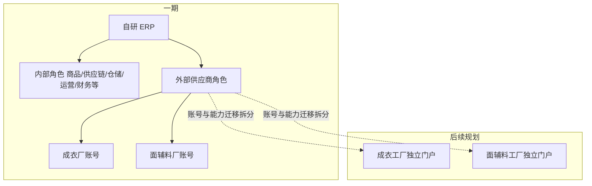
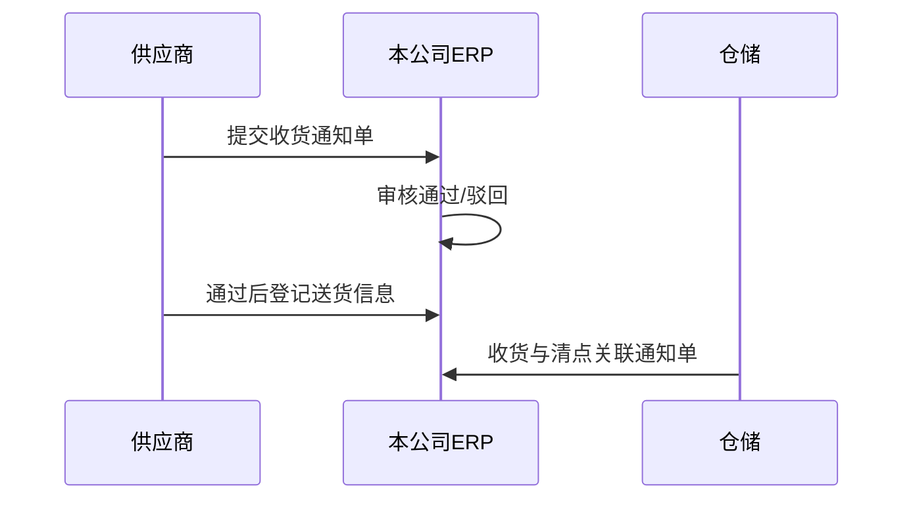

# 05-供应商协同与门户（一期 ERP 内）

> 文档定位：成衣厂、面辅料厂与本公司协同的**一期产品边界**；未来分别建设独立门户网站，一期在**同一自研 ERP** 内以**外部供应商角色**交付能力。  
> 配套阅读：`02-公司业务背景.md`、`03-跨境电商上下游关联系统.md`、`04-端到端业务主链路.md`

---

## 一、演进架构（已确认）

| 维度 | 一期 | 后续 |
|---|---|---|
| 入口 | **同一后台**，登录后按角色展示菜单 | 可拆独立域名/门户，与 ERP 账号体系打通或 SSO |
| 成衣厂 / 面辅料厂 | 两套协同能力，**同一套系统代码** | 物理拆站，数据模型延续 |

---

## 二、账号、权限与留痕（已冻结）

| 规则 | 口径 |
|---|---|
| 账号开通 | 由**本公司系统管理员**创建；支持**一厂多账号**（如跟单、负责人） |
| 登录形态 | 与内部员工**同一 ERP**，通过**角色 = 外部供应商**区分；非独立子域名一期必达 |
| 数据隔离 | 成衣厂**仅可见本厂**相关委外单、送货、对账等；**不可**看到其他成衣厂数据 |
| 面辅料厂可见范围 | 可见**多家成衣厂**名称、**委外单号**、**具体数量**及指定到本厂的用料协同单（本公司仍不参与面辅料货款结算） |
| 操作留痕 | 关键动作（确认订单、改交期、**收货/发货通知单**、供料确认、对账确认/异议、替代料相关协同）须记**操作人、时间、前后状态、附件**；达到**对账与纠纷举证**级别 |

供应商类型在主数据上区分：**成衣厂**、**面辅料厂**（指定供方档案）；账号绑定到具体供应商组织。

---

## 三、与 BOM / 商品的关系（一期）

- **BOM / 生产制单在 ERP 内维护**（见 `03` §4.1）；委外单挂 **BOM 版本快照**。
- 成衣厂在协同区查看 **BOM 行、工艺资料及附件**（与快照版本一致）；面辅料厂查看**指定到本厂的用料行**（含成衣厂、委外单号、数量），可由 BOM 展开生成或跟单维护。
- **替代料**：成衣厂或面辅料厂发起换料诉求时，须走系统内审批，**面辅料管理一人终审**；通过后更新协同可见用料口径并留痕。

---

## 三.1 约仓与退货通知（已冻结）

> **用语**：下文 **「收货通知单」** = 供应商向本公司（上流）预约送货；**「发货通知单」** = 本公司向供应商通知退货发运（非平台消费者售后）。成衣厂、面辅料厂**共用同一套单据类型**，按供应商类型与关联业务行区分。

### 入库约仓：收货通知单（供应商发起 → 本公司审核）

| 步骤 | 责任方 | 规则 |
|:---:|---|---|
| 1 | **供应商** | 在协同区 **新建并提交收货通知单**：关联业务依据（成衣厂→**成衣采购单**；面辅料厂→**用料协同行/委外单号**等）、预计到货时间、数量、箱数、附件（送货单/装箱明细可先草拟） |
| 2 | **本公司仓储** | **单级审核**（通过 / 驳回）；驳回须原因，供应商可修改重提；**不设**供应链二级会签 |
| 3 | **供应商** | **仅「已通过」** 后方可 **登记实际送货**（运单、车牌、到货批次等）；未到审核通过不得视为有效约仓 |
| 4 | **本公司仓储** | **收货与清点**须 **关联已通过的收货通知单**（及委外单）；无单到货按异常处理 |

**面辅料厂口径**：货款仍与成衣厂结算；但 **约仓与审核主体为本公司**，便于指定供料与纠纷举证；物理收货点（国内仓 / 成衣厂交接点）在通知单上写明，PRD 定字段。

### 退货约仓：发货通知单（本公司发起 → 供应商协同）

| 步骤 | 责任方 | 规则 |
|:---:|---|---|
| 1 | **本公司** | 由 **退货出厂单 / 超交退货** 等入库异常驱动或手工创建 **发货通知单**，指定 **供应商**、退货 SKU/物料、数量、原因、预计发出时间 |
| 2 | **本公司** | **下发** 至供应商协同区（动作按钮）；可附物流运单、装箱信息 |
| 3 | **供应商** | 查看通知单，**确认知悉 / 确认收货**（或登记异议）；留痕 |
| 4 | **本公司** | 实发与结案与入库异常单、库存变动规则一致（退货出厂 **不增加** 国内可用） |

成衣厂、面辅料厂均在协同区提供 **「发货通知单（退货）」** 只读/确认能力；**本公司**在 **仓储作业** 菜单维护与下发。

**状态变更**：均通过 **动作按钮**（提交、审核通过、驳回、下发、确认等），不在表单直改状态字段。

---

## 四、成衣厂协同能力（一期 In Scope）

**明确不做**：扫码枪作业、专用移动端 App/H5（现场仍可在 PC 浏览器操作）。

| 能力 | 说明 |
|---|---|
| 查看 / **确认**成衣采购单（委外生产订单） | 派单下达后可见；款色码、数量、交期、按单总价加工费、BOM 快照/附件 |
| 填报 / **变更交期**、异常说明 | 状态留痕，本公司供应链可见 |
| **收货通知单** | **发起 → 待仓储审核**；**通过后** 方可送货并上传/更新送货单、装箱明细；与国内仓收货、委外单匹配（见 §三.1） |
| **发货通知单（退货）** | 查看本公司下发的退货发运通知，**确认知悉/收货**（见 §三.1） |
| 查看本公司下发的 **BOM（快照版本）/ 工艺 / 附件** | 与 ERP PLM/BOM 模块一致，只读 |
| **加工费对账单**查看、**确认 / 异议** | 人民币、**月对账**；异议由本公司**账务**闭环 |
| **生产进度**填报 | 裁床 / 缝制 / 尾整等节点（字段与粒度在模块 PRD 定义） |

本公司内部：**采购需求**（运营专员提交、组长/总监审核）→ **派单**生成 **成衣采购单**（供应链数据专员）；采购单下达、关闭、入库与质检、返修单处理等（见 `02` §3.4、`04`）。成衣厂**仅可见已下达的本厂采购单**，不可见采购需求及其他工厂单据。

---

## 五、面辅料厂协同能力（一期 In Scope）

本公司**不**建设对面辅料厂的采购、应付、付款；协同区用于**指定供料**与状态留痕，货款由**成衣厂 ↔ 面辅料厂**自行结算。

| 能力 | 说明 |
|---|---|
| 指定供方档案与账号 | 管理员开通；一厂多账号 |
| 查看指定到本厂的**用料需求** | 含**成衣厂名称**、**委外单号**、**数量**、物料描述（优先自 **BOM 展开**；跟单可修正行项） |
| **确认可供 / 交期** | 回写供料状态，成衣厂账号可见 |
| **收货通知单** | 向本公司发起约仓；**仓储审核通过后** 方可进入发料环节（§三.1） |
| **发货登记** | **独立菜单**；登记向成衣厂发料运单/批次/数量（须关联 **已通过** 的收货通知单；不参与本公司库存与应付） |
| **发货通知单（退货）** | 本公司退货发运通知的查看与确认 |
| 成衣厂**要货 / 领料申请**，面辅料厂**确认** | 轻量协同单，关联委外单与供方 |
| **品质异议、换料协同** | 与「替代料审批」（面辅料管理一人终审）联动 |

---

## 六、与内部模块的挂接（摘要）

| 内部对象 | 成衣厂可见 | 面辅料厂可见 |
|---|---|---|
| 委外生产订单 | 本厂订单 | 关联订单号、成衣厂、数量及用料行 |
| 收货通知单 | 本厂发起、查看审核结果 | 本厂发起、查看审核结果 |
| 发货通知单（退货） | 确认 | 确认 |
| 委外到货 / 入库 | 送货与实收差异 | 一般不直接操作本公司入库 |
| 返修单 | 本厂相关返修 | 若涉及换料则可见协同部分 |
| 加工费对账单 | 确认 / 异议 | — |
| 替代料审批单 | 只读 / 参与说明 | 只读 / 参与说明 |

---

## 七、一期 Out Scope（供应商侧）

- 独立供应商门户站点（仅规划演进，不一期开发）
- 供应商扫码收货、PDA 仓储作业
- 面辅料厂报价、本公司应付、发票管理
- 与成衣厂 MES / 第三方工厂系统 API 对接（仍以 PDF/Excel/附件 + 协同区为主）
- 外部账号**密码策略、停用策略、合同到期自动冻结**（一期不做，管理员手工停用即可）

---

## 八、相关上下文文档

| 文档 | 说明 |
|---|---|
| `context/跨境电商ERP/02-公司业务背景.md` | 结算边界、国内仓、一期范围 |
| `context/跨境电商ERP/03-跨境电商上下游关联系统.md` | 外部参与方与 ERP 边界 |
| `context/跨境电商ERP/04-端到端业务主链路.md` | 委外→入库→FBA 单据链 |
