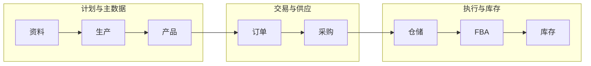

# 06-系统菜单地图（一期）

> **状态：最终版（一期菜单冻结）**  
> **文档定位**：腾达科技自研跨境电商 ERP **一期导航与菜单框架**，供 PRD 分册、权限设计与前端 `sidebarMenu.ts` 维护。菜单名为中文产品名；英文路由/权限码在各模块 PRD 定义。  
> **范围**：`02` §八、`03` §八、`04`、`05`；**Amazon 美国站、约 10 店铺**；**国内单仓**；PLM/BOM、委外、FBA 备货、ERP 内供应商协同。  
> **维护**：以 §零 为准；**不做**编号规则配置菜单、物料需求单独立菜单、FBA 接收/经营报表/同步日志菜单、**在途异常 / 期初库存** 菜单；委外到货跟踪仅在 **成衣采购单详情** 查看。

---

## 零、全量菜单速查（一级 → 二级）

| 一级 | 二级菜单 |
|---|---|
| **首页** | （单页待办） |
| **生产** | BOM 管理 · 生产制单 · 替代料审批 |
| **产品** | 产品管理 · Listing · 批量铺货 |
| **订单** | 平台订单 · 售后单 |
| **采购** | 补货建议 · 采购需求 · 委外派单 · 成衣采购单 · 采购收货通知单 · 成衣采购退货 · 退货发货通知单 |
| **仓储** | 收货 · 拆包清单 · 质检 · 压气贴标 · 上架 · 拣货下架 · 装箱 · 贴箱唛 · 称重 · 出库 · 入库异常 |
| **FBA** | FBA 发货计划 · 发货单 · 改仓/改箱审批 |
| **库存** | 国内仓库存 · 头程在途 · FBA 库存 · 库存流水 |
| **财务** | 委外加工费账单 · 物流费用 · Amazon 回款对账 · 汇率配置 |
| **资料** | 品牌管理 · 分类管理 · 面料管理 · 辅料管理 · 规格管理 · 单位管理 · 库位管理 · 成衣供应商 · 原辅料供应商 · 物流商 · 仓库管理 |
| **设置** | 用户与角色 · 质检规则 · 操作日志 · 补货与派单参数 · 供应商账号 · 店铺与授权 |
| **供应商协同（外部）** | 见 §五 |

---

## 一、导航设计原则

| 原则 | 说明 |
|---|---|
| **一套系统、按角色显隐** | 内部员工与外部供应商同一后台；菜单由角色权限控制（`05`） |
| **计划 vs 作业** | 计划单据（委外单、**FBA 发货计划**）与作业页（收货、质检、**发货单驱动的拣货/装箱**）分菜单（`01`）；**拣货下架**以 **发货单** 为任务来源 |
| **状态用动作改** | 状态变更仅通过动作按钮；表单不直改状态（`AGENTS.md`） |
| **主数据无删除** | 档案统一 **停用** |
| **分期能力** | 标注 **[分期]** 可先占位或手工录入 |
| **侧栏一级 + 二级** | 原型一次展示全部一级（§零）与二级；图标轨见 §二 |
| **资料一项一菜单** | 资料域每个管理对象独立二级菜单（§4.10），不合并展示 |

---

## 二、导航壳层（图标轨 ↔ 侧栏一级）

| 图标轨 | 领星对照 | 侧栏一级 |
|---|---|---|
| 首页 | — | 首页 |
| 生产 | 生产 | 生产 |
| 产品 | 产品 | 产品 |
| 订单 | 销售/客服 | 订单 |
| 采购 | 采购 | 采购 |
| 仓储 | 仓库 | 仓储 |
| FBA | FBA | FBA |
| 库存 | 库存 | 库存 |
| 财务 | 财务 | 财务 |
| 资料 | 资料 | 资料 |
| 设置 | 设置 | 设置 |
| 协同 | — | 供应商协同（§五） |

**不出现在图标轨**：广告；非 Amazon 多平台。

---

## 三、域关系（示意）

---

## 四、内部菜单明细

### 4.1 首页

| 二级 | 做什么 |
|---|---|
| （单页） | 待办：待审 **采购收货通知单**、补货/采购需求、派单、收货/质检/上架、FBA 计划与改仓改箱审批、对账单等 |

### 4.2 生产

| 二级 | 做什么 |
|---|---|
| **BOM 管理** | 按色码/SKU 维护 BOM；发布、升版、历史只读；行引用资料·面料/辅料；委外单 **BOM 快照** |
| **生产制单** | 工艺、工序、附件；挂 SPU/款号 |
| **替代料审批** | 换料申请；面辅料管理 **一人终审**（`05`） |

> 用料展开与协同见 BOM、委外单及面辅料协同（`05`）；**不设**独立「物料需求单」菜单。

### 4.3 产品

| 二级 | 做什么 |
|---|---|
| **产品管理** | SPU/SKU：色码、条码、重量尺寸、图片、启用/停用；关联 BOM 款号 |
| **Listing** | 模拟 Listing + MSKU/ASIN/FNSKU 映射（`11`）；无 SP-API |
| **批量铺货** | 多店铺铺货任务；模拟执行后回写 Listing |

成品选用 **§4.10 资料** 中的品牌、分类、规格、单位等档案。

### 4.4 订单

| 二级 | 做什么 |
|---|---|
| **平台订单** | Amazon US 订单同步/导入；动销数据源（`08`）；FBA 履约、国内仓不发货 |
| **售后单** | 退款、FBA 客退、订单/售后异常等 **合一列表**（Tab 或子类型 PRD 定） |

### 4.5 采购

委外主链：**采购需求（运营审）→ 委外派单 → 成衣采购单**（`02` §3.4）；可叠 AI 补货/派单（`07`）。

| 二级 | 做什么 |
|---|---|
| **补货建议** | 管道库存与动销算缺口；采纳 → 采购需求草稿 |
| **采购需求** | 计划层 SKU、数量、交期；组长/总监审核 |
| **委外派单** | 拆单派厂；可 AI 派单方案后确认 |
| **成衣采购单** | 委外生产订单；BOM 快照、加工费总价；详情含 **到货跟踪**（收货通知状态、在途到货、已收未结，**无独立菜单**） |
| **采购收货通知单** | 供应商约仓；**仓储单审**通过后送货（`05` §三.1） |
| **成衣采购退货** | 溢装、质检退货等；衔接退货发货通知单 |
| **退货发货通知单** | 本公司下发供应商退货发运通知 |

### 4.6 仓储

国内单仓 **入库 + FBA 备货作业**；经营底账见 **§4.8**。

| 二级 | 做什么 |
|---|---|
| **收货** | 到货登记；关联已审收货通知单与委外单 |
| **拆包清单** | 清点明细；短少登记 |
| **质检** | 默认抽检 10%；不合格 → 返修或成衣采购退货 |
| **压气贴标** | **压气**批次、**贴 FNSKU** 作业确认 |
| **上架** | 执行确认；国内仓可用 **+**；可写入 **库位**（见资料·库位管理） |
| **拣货下架** | 按 **发货单**（`§4.7`）明细执行拣货/下架；可扫 SKU/FNSKU |
| **装箱** | 按发货单箱方案装箱；维护箱明细、箱规 |
| **贴箱唛** | 外箱 **FBA 箱唛**；与 Shipment/Box ID、发货单箱号一致 |
| **称重** | 录入箱毛重；供物流计费与平台货件校验 |
| **出库** | 复核出库、物流交接；FBA 场景 **头程在途 +**（`03` §7.1） |
| **入库异常** | 返修单、超交退货等 |

### 4.7 FBA

| 二级 | 做什么 |
|---|---|
| **FBA 发货计划** | 分仓分箱；审核后占用国内可用 |
| **发货单** | 由计划下发/生成的 **仓储执行单**；**驱动拣货下架 → 装箱 → 贴箱唛 → 称重 → 出库** |
| **改仓 / 改箱审批** | 运营发起；运营负责人初审 → 仓储负责人终审 |

> **不设菜单**：FBA 接收记录、经营报表、同步日志、**在途异常**、**期初库存**（一期）。FBA 在途结清、接收量与 FBA 逻辑仓维护在 **头程在途 / FBA 库存** 手工或导入 **[分期 API]**，口径见 `03` §7.1 与库存 PRD。

### 4.8 库存

| 二级 | 做什么 |
|---|---|
| **国内仓库存** | 经营底账：**现存 / 占用 / 可用**；并展示 **产品库位库存**（SKU × 库位）、**产品批次库存**（SKU × 批次/质检批次等，字段 PRD 定）；与上架、拣货下架联动 |
| **头程在途** | 已发未收 FBA；一期在途差异/结案在此或 FBA 库存侧手工对齐（无单独在途异常菜单） |
| **FBA 库存** | 美国站 FBA 逻辑仓可售/现存；与平台或手工维护对照 |
| **库存流水** | 国内、在途、FBA 增减明细 |

### 4.9 财务

| 二级 | 做什么 |
|---|---|
| **委外加工费账单** | 委外单总价月对账；工厂协同确认/异议 |
| **物流费用** | 头程费用；物流商月结 |
| **Amazon 回款对账** | USD 账单；账单日折 CNY |
| **汇率配置** | 汇率档案 |

### 4.10 资料

每个二级为 **独立菜单页**（列表/表单/详情），禁止合并为一个「资料管理」总页。

| 二级 | 做什么 |
|---|---|
| **品牌管理** | 品牌主数据；停用不删 |
| **分类管理** | 商品分类树 |
| **面料管理** | 面料、里料；关联指定供方；BOM 引用 |
| **辅料管理** | 辅料、包装物料等 |
| **规格管理** | 颜色、尺码等规格维度与规格值 |
| **单位管理** | 计量单位及换算 |
| **库位管理** | 国内仓 **库位** 编码与启用/停用；支撑库位库存与上架 |
| **成衣供应商** | 成衣厂档案 |
| **原辅料供应商** | 面辅料指定供方档案 |
| **物流商** | 头程承运商 |
| **仓库管理** | 国内逻辑仓档案（单仓） |

### 4.11 设置

| 二级 | 做什么 |
|---|---|
| **用户与角色** | 内外部角色与权限 |
| **质检规则** | 抽检比例等 |
| **操作日志** | 审计与协同举证 |
| **补货与派单参数** | `07` |
| **供应商账号** | 外部账号（`05`） |
| **店铺与授权** | 10 店档案；SP-API **[分期]** |

---

## 五、供应商协同（外部角色）

图标轨 **协同**；能力详见 `05`。

**成衣厂**：我的成衣采购单 · 交期与异常 · 收货通知单 · 发货通知单（退货） · 生产进度 · 加工费对账单  

**面辅料厂**：用料需求 · 供料确认 · 收货通知单 · **发货登记**（独立） · 发货通知单（退货） · 要货/领料协同 · 换料与异议  

一期不做：扫码/PDA、独立门户站点。

---

## 六、角色可见性（摘要）

| 域 | 版师/商品 | 面辅料 | 供应链 | 仓储 | 运营 | 账务 |
|---|---|---|---|---|---|---|
| 生产/资料 | ● | ● | ○ | ○库位 | ○ | — |
| 产品/订单 | ● | ○ | ○ | — | ● | ○ |
| 采购 | ○ | ○ | ● | 审收货通知 | ● | — |
| 仓储/FBA/库存 | — | — | ○ | ● | ● | ○ |
| 财务 | — | — | ○ | — | ○ | ● |

● 主用　○ 只读/协同

---

## 七、与主链路对照（`04`）

| 阶段 | 菜单 |
|---|---|
| S1 款与 BOM | 生产、资料、产品管理 |
| S2 委外 | 采购（成衣采购单详情到货跟踪）、§五 协同 |
| S3 国内入库 | 采购·收货通知单、仓储（收货→压气贴标→上架） |
| S4 FBA 备货 | FBA（计划→**发货单**）、仓储（拣货下架→装箱→贴箱唛→称重→出库）、库存（头程在途） |
| S5 平台销售 | 产品·Listing、订单、财务回款 |

---

## 八、一期不出现的菜单

| 不出现 | 原因 |
|---|---|
| 多平台、样衣/样衣结算、面辅料应付、国内多仓、MES、物流索赔、独立门户、广告 | 见 `02`/`03` Out Scope |
| **编号规则** 配置页 | 一期不做 |
| **物料需求单** | 不设菜单；用料走 BOM/协同 |
| **委外到货跟踪** 独立菜单 | 仅在 **成衣采购单详情** |
| **移位、审单、存量** | 仓储一期不做 |
| **FBA 接收记录、经营报表、同步日志** | 一期不设菜单；结清方式见 §4.7 说明 |
| **在途异常、期初库存** | 一期不设菜单；在途对齐见 **头程在途/FBA 库存**；切换日底账见 `02` §九 **项目层**导入，非产品菜单 |

---

## 九、相关文档

| 文档 | 用途 |
|---|---|
| `04` | 端到端单据链 |
| `05` | 协同与约仓 |
| `07` | 补货/派单 |
| `08` | 订单/售后 |
| `09` | 实施顺序 |
| `11` | Listing 模拟 |

---

## 十、PRD 包划分

| PRD 包 | § |
|---|---|
| 资料（含库位，一项一菜单） | 4.10 |
| 生产 PLM | 4.2 |
| 产品与刊登 | 4.3、`11` |
| 补货委外与通知单 | 4.5、`07`、`05` |
| 订单售后 | 4.4、`08` |
| 仓储作业 | 4.6 |
| 库存（含库位/批次视图） | 4.8 |
| FBA 计划/发货/审批 | 4.7 |
| 财务 | 4.9 |
| 设置 | 4.11 |
| 外部协同 | 五 |

实施顺序以 `09` 为准。

---

## 十一、前端原型（`front-prototype/跨境ERP`）

**维护入口**：`src/config/sidebarMenu.ts`（二级顺序 = §零）。

### 11.1 路由前缀

| 一级 | path 前缀 |
|---|---|
| 首页 | `/` |
| 生产 | `/mfg/` |
| 产品 | `/product/` |
| 订单 | `/order/` |
| 采购 | `/purchase/` |
| 仓储 | `/warehouse/` |
| FBA | `/fba/` |
| 库存 | `/inventory/` |
| 财务 | `/finance/` |
| 资料 | `/master/` |
| 设置 | `/settings/` |
| 协同 | `/portal/` |

### 11.2 二级 path 命名（示例）

| 二级 | path |
|---|---|
| 产品管理 | `/product/manage` |
| Listing | `/product/listing` |
| 压气贴标 | `/warehouse/press-label` |
| 拣货下架 | `/warehouse/pick-off-shelf` |
| 贴箱唛 | `/warehouse/box-label` |
| 称重 | `/warehouse/weighing` |
| 库位管理 | `/master/location` |
| 国内仓库存 | `/inventory/domestic` |
| 成衣采购单 | `/purchase/garment-po` |
| FBA 发货计划 | `/fba/shipment-plan` |

其余二级按「前缀 + 英文短码」在 PRD 与 §零 对齐。

---

## 附录：一期菜单裁剪记录

| 决策 | 处理 |
|---|---|
| 无物料需求单菜单 | §4.2 |
| 到货跟踪 | **成衣采购单详情** Tab |
| 后整 → **压气贴标** | §4.6 |
| 无移位/审单/存量 | §八 |
| 拣货下单 → **拣货下架**（任务来源 **发货单**） | §4.6、§4.7 |
| 装箱后 **贴箱唛、称重** 独立菜单 | §4.6 |
| 无 **在途异常、期初库存** 菜单 | §4.7、§4.8、§八 |
| 无 FBA 接收/报表/同步日志菜单 | §4.7、§八 |
| 国内仓库存 + **库位库存、批次库存** | §4.8 |
| 资料 **一项一菜单** + **库位管理** | §4.10、§零 |

**仍冻结**：采购收货通知单 **仓储单审**；退货发货通知单在 **采购**；供应商账号、店铺在 **设置**；面辅料 **发货登记** 仅 §五。
