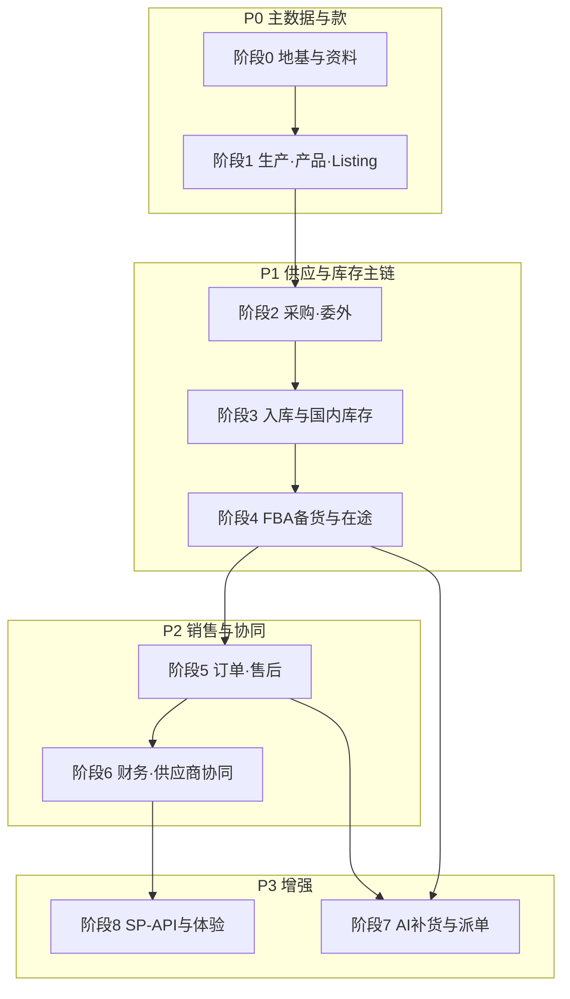

# 09-一期建设优先级与实施步骤

> 文档定位：在 `06` **冻结菜单**基础上，给出 **先做谁、后做谁、为何** 以及 **分阶段交付顺序**，供排期、拆 PRD、切领星（见 `02` §九）使用。  
> **北极星**：自研先成为 **委外 + 国内仓 + FBA 备货** 的**唯一作业系统**（`02` §9.1）；每一波结束都应能 **录单留痕 + 库存口径可核对**。  
> **策略**：**主链路纵向切片（S1→S4）** 优先；销售、财务、协同、AI、API **叠在已跑通的库存与单据之上**，不抢主链排期。

---

## 一、排序原则

| 原则 | 说明 |
|---|---|
| **以 `06` 菜单为准** | 本文档二级菜单名称与分期边界对齐 `06` §零；**不设**编号规则页、FBA 经营报表/同步日志/接收记录菜单、在途异常/期初库存菜单（见 `06` §八） |
| **依赖先行** | 资料档案 → SKU/BOM → 委外选品 → 入库/FBA 占库存 |
| **计划层 → 执行层** | 采购需求 → 成衣采购单 → 收货作业；FBA 发货计划 → **发货单** → 拣货/装箱/出库 |
| **先内部闭环、后外部协同** | 阶段 3 起收货通知等可 **内部代录**；供应商账号与 `06` §五 菜单在阶段 6 统一开通 |
| **先手工、后 API** | Shipment ID、订单、FBA 接收可先录入/导入；SP-API 在阶段 8 **增强**同一业务对象，不改规则 |
| **审批随单据走** | 采购需求（组长/总监）、改仓改箱（运营负责人 → 仓储负责人）在对应波次实现；**状态仅动作按钮**（`AGENTS.md`） |
| **AI 与动销后置** | 补货依赖 **平台订单 + 管道库存**；派单依赖 **成衣厂档案 + 历史派单**（`07`） |
| **领星切换跟主链波次** | 自研阶段 2/3/4 分别对应 `02` §9.2 的「新委外 / 新入库 / 新备货仅自研」 |

---

## 二、优先级总览（P0 → P3）

| 优先级 | 含义 | 覆盖阶段 | 业务结果（一句话） |
|:---:|:---|:---:|---|
| **P0** | 无此无法选品、挂 BOM、模拟刊登 | **0～1** | 主数据 + 款 BOM + Listing 映射就绪 |
| **P1** | 供应链主链：委外 → 国内仓 → FBA 备货 | **2～4** | 国内可用、头程在途、FBA 逻辑仓可维护 |
| **P2** | 销售可见、对账、工厂在线协同 | **5～6** | 订单/售后进系统；月结与外部账号跑通 |
| **P3** | 智能建议 + 平台/物流自动化 + 体验深化 | **7～8** | 减手工录入；首页与报表增强 |

**与主链路（`04`）对应**：P0≈S1；P1≈S2～S4；P2≈S5 + 对账协同；P3 为能力增强层。

---

## 三、分阶段实施步骤（推荐顺序）

### 阶段 0：系统地基与资料底座（P0）

**目标**：能登录、分角色；**资料域最小集**可维护，支撑后续产品与 BOM。

| 顺序 | 菜单/能力（`06`） | 交付要点 |
|:---:|---|---|
| 0.1 | **设置 → 用户管理、角色管理** | 内部角色骨架（9 内置编码）：运营专员/组长/总监、供应链数据专员、仓储、账务、商品版师、面辅料管理、管理员 |
| 0.2 | **首页**（骨架） | 空态 + 待办占位（待审收货通知、采购需求等文案预留） |
| 0.3 | **资料 → 仓库管理** | **国内单仓**一条主逻辑仓 |
| 0.4 | **资料 → 成衣供应商 / 原辅料供应商 / 物流商** | 停用不删；面辅料为 **指定供方** |
| 0.5 | **资料 → 品牌 / 分类 / 规格 / 单位** | 产品管理与 BOM 引用所需最小档案 |
| 0.6 | **设置 → 操作日志**（建议同期） | 关键动作留痕，便于协同与 Cutover 举证 |

**验收**：管理员可建用户；资料可维护且被下游引用。  
**可并行**：无（本阶段为全局前置）。  
**不做**：编号规则配置页（单号规则在 PRD/实现层约定，见 `06` §八）。  
**与领星**：对照 `02` §9.2 **阶段 0 主数据清洗导入**（项目层，非产品菜单）。

---

### 阶段 1：生产、产品与平台映射（P0）

**目标**：色码 SKU、生效 BOM、**单店模拟刊登**；FNSKU/MSKU 可维护，支撑委外与 FBA 贴标。

| 顺序 | 菜单/能力（`06`） | 交付要点 |
|:---:|---|---|
| 1.1 | **资料 → 面料管理 / 辅料管理** | 关联指定供方；供 BOM 行引用 |
| 1.2 | **产品 → 产品管理** | SPU/SKU：色码、条码、重量尺寸、启用/停用 |
| 1.3 | **生产 → BOM 管理** | **色码维度**、发布升版、历史只读 |
| 1.4 | **生产 → 生产制单** | 工艺、工序、附件挂款号 |
| 1.5 | **生产 → 替代料审批** | 面辅料管理 **一人终审** |
| 1.6 | **设置 → 店铺与授权** | 约 10 店档案；SP-API 授权 **可后补**（阶段 8） |
| 1.7 | **产品 → Listing** | 模拟新建/编辑、改标题/价；**模拟发布**；回写 MSKU/ASIN/FNSKU（`11`） |

**验收**：任一款色码 SKU 有 **生效 BOM**；**≥1 店铺** 完成模拟上线且映射可查。  
**依赖**：阶段 0。  
**本阶段不做**：批量铺货（阶段 2）、采购与库存单据。

---

### 阶段 2：委外计划与成衣采购（P1）

**目标**：跑通 **采购需求 → 审批 → 委外派单 → 成衣采购单**；**仍无国内库存变动**。

| 顺序 | 菜单/能力（`06`） | 交付要点 |
|:---:|---|---|
| 2.1 | **采购 → 采购需求** | 运营专员创建/提交 |
| 2.2 | 采购需求 **审批流** | **运营组长 → 运营总监**（动作按钮） |
| 2.3 | **采购 → 委外派单** | 拆单、多厂、BOM 快照、按单总价；派单量累计 ≤ 需求量 |
| 2.4 | **采购 → 成衣采购单** | 下达、关闭；列表/详情/状态机 |
| 2.5 | **成衣采购单详情 · 到货跟踪** | 收货通知状态、在途到货等（**无独立菜单**，见 `06` §八） |
| 2.6 | **设置 → 质检规则** | 默认抽检 10%（供阶段 3） |
| 2.7 | **产品 → 批量铺货** | 多店铺任务、模拟执行、映射批量写入（`11`） |

**验收**：一张需求审完后可派 **2 家厂**、生成 **2 张**成衣采购单；库存无变动；同一 SKU 可铺至 **≥2 店铺**。  
**依赖**：阶段 1（SKU、BOM、成衣供应商）。  
**与领星**：`02` §9.2 **阶段 1 — 新委外单仅自研**。  
**本阶段不做**：AI 补货/派单、补货建议菜单、供应商外部账号。

---

### 阶段 3：国内入库与国内库存底账（P1）

**目标**：工厂货到国内仓，**上架确认后国内现存/可用增加**；采购侧退货与通知闭环。

| 顺序 | 菜单/能力（`06`） | 交付要点 |
|:---:|---|---|
| 3.0 | **资料 → 库位管理** | 库位编码；支撑上架与库位库存展示 |
| 3.1 | **采购 → 采购收货通知单** | 约仓送货；仓储 **审核通过** 后允许收货（`05` §三.1）；无外部账号时 **内部代录** |
| 3.2 | **仓储 → 收货** | 关联 **已审通知单** 与成衣采购单 |
| 3.3 | **仓储 → 拆包清单** | 清点明细；短少登记 |
| 3.4 | **仓储 → 质检** | 合格/不合格；不合格 → 返修或成衣采购退货 |
| 3.5 | **仓储 → 压气贴标** | 压气批次、贴 FNSKU 确认 |
| 3.6 | **仓储 → 上架** | 执行确认；国内 **现存/可用 +**；可落库位 |
| 3.7 | **仓储 → 入库异常** | 返修、超交等异常留痕 |
| 3.8 | **采购 → 成衣采购退货** | 溢装、质检不合格等 |
| 3.9 | **采购 → 退货发货通知单** | 退货发运通知；阶段 6 起由供应商在线确认 |
| 3.10 | **库存 → 国内仓库存 / 库存流水** | 现存、占用、可用；流水可追溯 |

**验收**：采购单 → 收货 → 质检 → 上架后，库存数量与流水可核对；短少/溢装/退货有单据链。  
**依赖**：阶段 2。  
**与领星**：`02` §9.2 **阶段 2 — 国内仓作业仅自研**。

---

### 阶段 4：FBA 备货、在途与 FBA 逻辑仓（P1）

**目标**：国内仓发 FBA；出库后 **国内 −、头程在途 +**；接收后在 **FBA 库存** 维护可售口径。

| 顺序 | 菜单/能力（`06`） | 交付要点 |
|:---:|---|---|
| 4.1 | **FBA → FBA 发货计划** | 计划层；审核后 **占用国内可用** |
| 4.2 | **FBA → 发货单** | 由计划下发；**驱动**仓储备货作业 |
| 4.3 | **仓储 → 拣货下架 / 装箱 / 贴箱唛 / 称重 / 出库** | 均以 **发货单** 为任务源；出库后国内 **−**、在途 **+** |
| 4.4 | **库存 → 头程在途** | 口径见 `03` §7.1；差异在途/FBA 侧 **手工对齐**（无在途异常菜单） |
| 4.5 | **库存 → FBA 库存** | 接收量维护；与卖家后台/导入对照 |
| 4.6 | **FBA → 改仓/改箱审批** | 运营发起；运营负责人 → 仓储负责人 |

**验收**：单票货件从计划 → 出库交接 → 手工维护接收，四口径与 `03` §7.1 示例可手算核对。  
**依赖**：阶段 3（国内可用）、阶段 1（FNSKU/Listing 映射）。  
**与领星**：`02` §9.2 **阶段 3 — FBA 备货出库仅自研**。  
**可简化**：Shipment ID、箱唛 **手工录入**；接收 **导入/手工**；SP-API 放阶段 8。

---

### 阶段 5：平台订单与售后（P2）

**目标**：销售侧数据进系统，支撑运营看数、异常治理；为 **AI 补货（阶段 7）** 提供动销源。

| 顺序 | 菜单/能力（`06`） | 交付要点 |
|:---:|---|---|
| 5.1 | **订单 → 平台订单** | 同步或 **导入**；按店铺查询 |
| 5.2 | **订单 → 售后单** | 退款、FBA 客退、**订单/映射异常** 等合一列表（Tab 或子类型 PRD 定，`08`） |

**验收**：订单行可映射本地 SKU；售后可关联原平台订单号。  
**依赖**：阶段 1（Listing/映射）；阶段 4（FBA 库存对照 **可选**）。  
**排期说明**：**不阻塞**阶段 2～4 上线与领星主链切换；若资源允许，可与阶段 4 **并行**做「仅导入订单」切片。  
**不做**：FBA 经营报表、同步日志 **菜单**（见 `06` §八）；同步失败处理可在阶段 8 以任务/日志能力实现，不设独立报表菜单。

---

### 阶段 6：财务与供应商协同（P2）

**目标**：委外/物流/回款 **月结闭环**；成衣厂、面辅料厂 **ERP 内**外部角色上线。

| 顺序 | 菜单/能力（`06`） | 交付要点 |
|:---:|---|---|
| 6.1 | **财务 → 汇率配置** | 账单日折算 |
| 6.2 | **财务 → 委外加工费账单** | 月结、按单总价；异议闭环 |
| 6.3 | **财务 → 物流费用** | 头程登记 + 月结节奏 |
| 6.4 | **财务 → Amazon 回款对账** | USD 账单；按账单日 CNY |
| 6.5 | **设置 → 供应商账号** | 成衣厂/面辅料厂外部账号 |
| 6.6 | **供应商协同（外部）**（`06` §五） | 确认成衣采购单、收货/退货通知、进度、对账；面辅料供料协同 |

**验收**：至少 **1 家成衣厂** 走通在线确认；一月委外加工费账单可确认或提异议。  
**依赖**：阶段 2～3（采购与入库单据）；阶段 5（回款对账 **建议**在订单导入后）。  
**可并行**：**6.2 委外加工费** 可在阶段 3 后 **提前启动 PRD**（仍以月结验收放在本阶段）。

---

### 阶段 7：AI 补货与自动派单（P3）

**目标**：系统出建议，**人工确认**；不绕过采购需求审批与派单确认。

| 顺序 | 菜单/能力（`06`） | 交付要点 |
|:---:|---|---|
| 7.1 | **设置 → 补货与派单参数** | 覆盖天数、动销权重、周期 L 等（`07`） |
| 7.2 | **采购 → 补货建议** | 管道库存 + 动销算缺口；采纳 → **采购需求草稿** |
| 7.3 | **采购 → 委外派单**（增强） | **AI 生成派单方案** → 确认后生成成衣采购单 |

**验收**：见 `07` §七。  
**依赖**：**阶段 5（平台订单/动销）**、阶段 3～4（国内/FBA/在途库存）、阶段 2（派单与成衣厂档案）。

---

### 阶段 8：平台对接与体验增强（P3）

**目标**：减少手工录入与导入；**不改变**阶段 1～7 已冻结的业务规则与状态机。

| 顺序 | 能力 | 说明 |
|:---:|---|---|
| 8.1 | SP-API：订单、FBA 库存、货件/接收 | 见 `03` §3.2；对接 **既有** 订单/FBA 库存/在途维护能力 |
| 8.2 | SP-API：退款/退货深度同步 | 见 `08` |
| 8.3 | **设置 → 店铺与授权**（增强） | 正式授权与 token 运维 |
| 8.4 | 物流商 API / 轨迹 | 可选 |
| 8.5 | **首页** 指标卡、经营看板深化 | 体验层；不设 `06` §八 禁止的独立报表菜单 |

---

## 四、菜单域 × 建议阶段（对齐 `06` §零）

| 一级菜单域 | 建议阶段 | 优先级 |
|---|:---:|:---:|
| **设置**（用户、质检、操作日志） | 0、2 | P0～P1 |
| **设置**（供应商账号、补货与派单参数、店铺授权增强） | 6、7、8 | P2～P3 |
| **资料**（仓库、供应商、品牌/分类/规格/单位） | 0 | P0 |
| **资料**（面料、辅料） | 1 | P0 |
| **资料**（库位） | 3 | P1 |
| **生产** | 1 | P0 |
| **产品**（产品管理、Listing） | 1 | P0 |
| **产品**（批量铺货） | 2 | P1 |
| **采购**（需求/派单/成衣采购单） | 2 | P1 |
| **采购**（收货通知、退货、退货发货通知） | 3 | P1 |
| **采购**（补货建议） | 7 | P3 |
| **仓储** | 3、4 | P1 |
| **FBA** | 4 | P1 |
| **库存**（国内仓、流水） | 3 | P1 |
| **库存**（头程在途、FBA 库存） | 4 | P1 |
| **订单** | 5 | P2 |
| **财务** | 6 | P2 |
| **供应商协同（外部）** | 6 | P2 |
| **首页**（待办/看板） | 0 骨架 → 8 深化 | P0～P3 |
| **SP-API / 同步任务** | 8 | P3 |

---

## 五、里程碑：MVP 与 Cutover

### 5.1 第一条纵向闭环（MVP 演示）

资源紧时，**最少**做到 **阶段 0→4**（订单可后补）即可对外演示主链：

1. 资料 + SKU + BOM + **单店 Listing/映射** + 成衣供应商  
2. 采购需求 → 审完 → 派单 → **1 张**成衣采购单  
3. 收货 → 质检 → 上架 → **国内库存 +**  
4. FBA 发货计划 → 发货单 → 备货出库 → **在途 +** → 手工 FBA 接收 → **FBA 库存 +**

**MVP 可不包含**：平台订单 API、售后深度、AI、供应商外部账号、财务月结（可用 Excel 过渡）。

### 5.2 Cutover 就绪（对齐领星）

| 自研完成阶段 | Cutover 能力 | 领星侧（`02` §9.2） |
|:---:|---|---|
| 0～1 | 主数据与映射可导入/维护 | 阶段 0 主数据 |
| 2 | 新委外单只在自研创建 | 委外停录 |
| 3 | 新入库与国内库存只在自研 | 国内入库停录 |
| 4 | 新 FBA 备货出库只在自研 | 备货停录；报表可暂留领星至阶段 4 收口 |
| 5～6 | 订单/财务/协同 | 分域只读或停用对应模块 |

**期初库存**：切换日盘点 → **项目层导入**（`02` §9.1），**不设**期初库存菜单（`06` §八）。

---

## 六、与主链路对照

| 主链路（`04`） | 建议完成阶段 | 关键菜单域 |
|---|---|---|
| S1 款与 BOM + 模拟刊登/铺货 | 1～2 | 生产、资料、产品 |
| S2 委外 | 2 | 采购 |
| S3 国内入库 | 3 | 采购（通知/退货）、仓储、库存 |
| S4 FBA 备货 | 4 | FBA、仓储、库存 |
| S5 平台销售与对账 | 5～6 | 订单、财务、协同 |

---

## 七、PRD 编写顺序建议（与研发对齐）

按 **一个迭代主题 ≈ 一个 PRD 包**，推荐书写顺序：

1. 全局约束 + 单据状态机通则（`AGENTS.md`、`01` §五）  
2. 资料 + 设置（阶段 0）  
3. 面料/辅料 + 产品 + BOM + 制单 + 替代料 + Listing + 店铺档案（阶段 1）  
4. 采购需求 + 审批 + 委外派单 + 成衣采购单 + 批量铺货 + 质检规则（阶段 2）  
5. 采购收货/退货链 + 国内仓作业全链 + 库位（阶段 3）  
6. 国内库存口径与流水（阶段 3）；Cutover 期初见 `02` §九 **项目导入**  
7. FBA 计划/发货单 + 备货作业 + 改仓改箱 + 在途/FBA 库存（阶段 4）  
8. 平台订单与售后（`08`）（阶段 5）  
9. 财务 + 供应商协同（`05`）（阶段 6）  
10. AI 补货与派单（`07`）（阶段 7）  
11. SP-API 与首页增强（阶段 8）  

---

## 八、可并行切片（不破坏主链顺序时）

| 切片 | 最早启动 | 说明 |
|---|---|---|
| 平台订单 **仅导入** | 阶段 4 并行 | 不动主链单据；为阶段 7 蓄动销 |
| 委外加工费账单 PRD | 阶段 3 后 | 依赖成衣采购单与入库事实；验收仍放阶段 6 |
| 操作日志 | 阶段 0 | 与首单上线同步更有价值 |
| 店铺 SP-API 授权 | 阶段 8 | 阶段 1 仅需店铺档案 + 手工映射 |

---

## 九、相关上下文文档

| 文档 | 说明 |
|---|---|
| `06-系统菜单地图（一期）.md` | 冻结菜单与分期边界 |
| `04-端到端业务主链路.md` | S1～S5 与单据索引 |
| `02-公司业务背景.md` §八、§九 | 范围与领星切换 |
| `05-供应商协同与门户（一期ERP内）.md` | 阶段 6 外部菜单 |
| `07-AI补货与自动派单（一期）.md` | AI 后置与验收 |
| `08-平台订单与售后（一期）.md` | 阶段 5 |
| `11-平台刊登与铺货（一期模拟）.md` | Listing/铺货、无 API |
