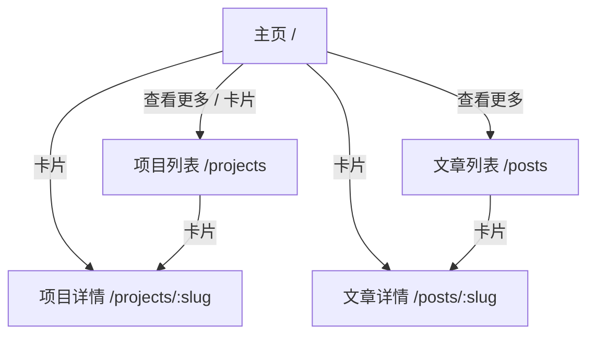

# 个人网站主页主 PRD

> **版本**：V1.1 | 2026-10-02  
> **读者**：产品经理、前端工程师、设计  
> **说明**：首版为 Daniel 个人站；项目与文章均为**站内详情页**，路由由 React Router 管理。域名尚未注册，部署阶段再绑定。

---

## 1. 业务背景

需要一块可对外展示的「个人门面」：访客进入站点后能快速了解 **PM Daniel** 是谁、在做什么，并从主页进入**项目**与**文章**的站内详情页阅读完整介绍。

首版目标：

- 主页作为导航枢纽：自我介绍 + 项目/文章入口（含「查看更多」进入完整列表页）。
- 首版内容：**2 个项目**（跨境 ERP、海外仓 WMS），**0 篇文章**（文章区展示空状态，结构预留后续补充）。
- 技术实现：React + Tailwind CSS + shadcn/ui + React Router；内容以代码侧数据/Markdown 维护，不做后台 CMS。

---

## 2. 功能范围

**In Scope**

- **主页** `/`：自我介绍区、项目预览区、文章预览区。
- **项目列表页** `/projects`：全部已发布项目，按时间排序。
- **项目详情页** `/projects/:slug`：单项目正文与元信息。
- **文章列表页** `/posts`：全部已发布文章，按时间排序（首版可为空列表）。
- **文章详情页** `/posts/:slug`：单篇文章正文（首版无数据，路由与页面骨架仍实现）。
- 全局 **Header** 导航、**Footer**；语言固定**简体中文**。
- 主页各内容区：**展示当前全部已发布条目** + **「查看更多」**跳转至对应列表页（条目增多后仍保持该模式，不在主页做分页）。

**Out Scope（首版不做）**

- 外链作为主跳转（详情一律站内；项目内的 demo/repo 链接可作为详情页内辅助链接，非列表主跳转）。
- 多语言、登录、评论、订阅、站内搜索、标签筛选。
- 后台 CMS、在线编辑器、草稿协作界面（内容状态在数据源中维护即可）。
- 复杂动效、深色模式、RSS、访问统计（可后续迭代）。
- 域名/备案/SEO 深度优化（占位字段保留，绑定域名后再补）。

---

## 3. 产品定位

| 项目 | 内容 |
| :--- | :--- |
| 产品类型 | 个人品牌展示站（Portfolio + Blog 入口） |
| 核心职责 | 聚合自我介绍、项目与文章入口；承担站点默认落地页 |
| 主要用户 | 访客（招聘方、合作方、业务同行） |
| 内容维护方 | Daniel（改项目内 JSON/Markdown 或等价静态数据源） |
| 语言 | `zh-CN` 仅中文 |
| 技术栈 | React、Tailwind CSS、shadcn/ui、React Router |

---

## 4. 典型业务场景

| 场景 ID | 场景 | 类型 | 说明 |
| :--- | :--- | :--- | :--- |
| S01 | 首次访问主页 | 主流程 | 打开 `/`，看到 PM Daniel 介绍、2 个项目卡片、文章空状态 |
| S02 | 查看全部项目 | 主流程 | 主页项目区点击「查看更多」进入 `/projects`，或 Header 导航进入 |
| S03 | 阅读项目详情 | 主流程 | 从主页或列表页点击卡片，进入 `/projects/:slug` |
| S04 | 查看全部文章 | 主流程 | 主页文章区「查看更多」进入 `/posts`；首版列表为空 |
| S05 | 阅读文章详情 | 主流程 | 后续有文章后，从列表进入 `/posts/:slug` |
| S06 | 移动端浏览 | 主流程 | 响应式布局，卡片与导航可用 |
| S07 | 补充内容 | 辅助 | 新增项目/文章数据源条目并设为 `Published`，各页列表自动按时间展示 |

---

## 5. 信息架构与路由

### 5.1 路由表（React Router）

| 路径 | 页面 | 说明 |
| :--- | :--- | :--- |
| `/` | HomePage | 自我介绍 + 项目/文章预览（全量已发布条目 + 查看更多） |
| `/projects` | ProjectListPage | 全部项目，`publishedAt` 降序 |
| `/projects/:slug` | ProjectDetailPage | 站内详情；未知 slug 展示 404 友好页 |
| `/posts` | PostListPage | 全部文章，`publishedAt` 降序 |
| `/posts/:slug` | PostDetailPage | 站内详情；未知 slug 展示 404 友好页 |

### 5.2 跳转规则

| 规则 ID | 规则 |
| :--- | :--- |
| R-Route01 | 列表卡片、标题点击使用 React Router 客户端导航至详情路由，不使用 `linkType=external` 作为主路径。 |
| R-Route02 | 主页「查看更多」：`项目` → `/projects`，`文章` → `/posts`。 |
| R-Route03 | Header 导航与主页区块锚点：首版采用**路由跳转**（如「项目」→ `/projects` 或 `/` 内 `#projects` 二选一；**推荐**主页仍含预览区 id=`projects` / `posts`，Header 在主页时滚锚点、在其他页时链到 `/` 对应区块或列表页——实现时取「首页滚锚点，子页进列表」即可）。 |

---

## 6. 状态机

内容条目为只读展示；发布状态由维护方在数据源中修改，**不提供访客侧状态编辑**。

| 状态 | 含义 | 列表/主页展示 |
| :--- | :--- | :--- |
| `Draft` | 草稿 | 不展示 |
| `Published` | 已发布 | 展示 |
| `Archived` | 已归档 | 不展示 |

| 动作 | Draft | Published | Archived | 说明 |
| :--- | :---: | :---: | :---: | :--- |
| 发布 | ✅→Published | — | — | 维护方改数据源 |
| 撤回草稿 | — | ✅→Draft | — | 从各列表隐藏 |
| 归档 | — | ✅→Archived | — | 长期下线 |
| 删除 | ❌ | ❌ | ❌ | 用 `Archived` 替代物理删除 |

---

## 7. 主页模块与交互规则

### 7.1 页头（Header）

| 规则 ID | 规则 |
| :--- | :--- |
| H01 | 站点名展示 **PM Daniel**（或与 `siteName` 一致），点击回到 `/`。 |
| H02 | 导航含：首页、项目、文章（链到列表页或首页对应区块，见 R-Route03）。 |
| H03 | 若自我介绍区配置社交链接，外链在新标签打开（`rel="noopener"`）。 |

### 7.2 自我介绍区（Hero / About）

| 规则 ID | 规则 |
| :--- | :--- |
| A01 | 必显：`displayName` = **PM Daniel**；必显 `tagline` = **供应链产品经理&AI产品经理**。 |
| A02 | 选显：`avatar`、`bio`、`socialLinks`、`email`（首版可仅占位）。 |
| A03 | 无独立「关于」页；长 `bio` 可在主页区内展示或折叠（首版可短文案）。 |

### 7.3 项目列表区（主页预览）

| 规则 ID | 规则 |
| :--- | :--- |
| P01 | 仅展示 `status = Published` 且 `contentType = Project` 的条目。 |
| P02 | 排序：**仅按 `publishedAt` 降序**（时间排序；不使用 `sortOrder`、不置顶）。 |
| P03 | 主页展示**全部**已发布项目（首版 2 条全展示）。 |
| P04 | 区块底部/右上角提供按钮或文字链 **「查看更多」**，跳转 `/projects`。 |
| P05 | 卡片点击 → `/projects/:slug`；必显 `title`；`summary` 为空时不展示摘要行；可选 `coverImage`、`tags`。 |
| P06 | 无项目时占位「项目整理中」（首版不适用）。 |

### 7.4 文章列表区（主页预览）

| 规则 ID | 规则 |
| :--- | :--- |
| T01 | 仅展示 `status = Published` 且 `contentType = Article` 的条目。 |
| T02 | 排序：`publishedAt` 降序；**不使用 `pinned`**。 |
| T03 | 主页展示全部已发布文章；首版 0 篇时展示空状态文案（如「文章撰写中，敬请期待」）。 |
| T04 | 仍展示 **「查看更多」**，跳转 `/posts`（空列表页与主页文案一致即可）。 |
| T05 | 有文章后，卡片点击 → `/posts/:slug`。 |

### 7.5 列表页（`/projects`、`/posts`）

| 规则 ID | 规则 |
| :--- | :--- |
| L01 | 展示规则与排序同主页对应区块，但为完整列表页布局（可更大卡片/更多信息密度）。 |
| L02 | 无分页要求（首版条目少）；条目显著增多后再迭代分页或虚拟列表（Out Scope）。 |

### 7.6 详情页

| 规则 ID | 规则 |
| :--- | :--- |
| D01 | 展示 `title`、`publishedAt`、`summary`（可选）、正文 `body`（Markdown 渲染建议）。 |
| D02 | 项目详情可展示 `role`、`techStack`；可选 `demoUrl`、`repoUrl` 为页内次要按钮（外链）。 |
| D03 | 提供返回列表或面包屑：项目详情 → 返回 `/projects`。 |

### 7.7 页脚（Footer）

| 规则 ID | 规则 |
| :--- | :--- |
| F01 | 版权文案含当前年份，如 `© {year} PM Daniel`。 |
| F02 | `icpLicense` 占位，有域名备案后再填。 |

---

## 8. 字段清单与首版种子数据

### 8.1 站点级（Site）

| 字段名 | 类型 | 必填 | 首版取值 / 说明 |
| :--- | :--- | :---: | :--- |
| `siteName` | string | 是 | `PM Daniel` |
| `siteDescription` | string | 否 | 待填（绑定域名前可用通用一句介绍） |
| `defaultLocale` | enum | 是 | `zh-CN` |
| `copyright` | string | 否 | `PM Daniel` |
| `icpLicense` | string | 否 | 空，预留 |

### 8.2 作者（Author）

| 字段名 | 类型 | 必填 | 首版取值 / 说明 |
| :--- | :--- | :---: | :--- |
| `displayName` | string | 是 | `PM Daniel` |
| `tagline` | string | 是 | `供应链产品经理&AI产品经理` |
| `avatar` | image URL | 否 | 可选 |
| `bio` | markdown | 否 | 可选，首版可 2～3 句自我介绍 |
| `socialLinks` | array | 否 | 可选 |
| `email` | string | 否 | 可选 |

### 8.3 内容条目（ContentItem）

| 字段名 | 类型 | 必填 | 说明 |
| :--- | :--- | :---: | :--- |
| `id` | string | 是 | 唯一 ID |
| `slug` | string | 是 | 站内路由片段，英文 kebab-case |
| `contentType` | enum | 是 | `Project` \| `Article` |
| `title` | string | 是 | 中文标题 |
| `summary` | string | 否 | 列表摘要 ≤ 120 字；**首版两项目暂空** |
| `body` | markdown | 建议 | 详情正文 |
| `coverImage` | image URL | 否 | 封面 |
| `tags` | string[] | 否 | 如 `ERP`、`WMS` |
| `publishedAt` | datetime | 是 | 排序唯一依据，降序 |
| `status` | enum | 是 | 首版两条项目均为 `Published` |

首版**不再使用**：`linkType`、`url`（主跳转）、`sortOrder`、`pinned`（若代码模型已存在可废弃或忽略）。

### 8.4 首版项目种子（摘要与正文暂空）

| slug | title | summary | body | publishedAt（Mock） |
| :--- | :--- | :--- | :--- | :--- |
| `cross-border-erp` | 跨境 ERP | 空 | 空 | `2026-09-15` |
| `overseas-warehouse-wms` | 海外仓 WMS | 空 | 空 | `2026-08-20` |

详情页 `body` 为空时，前端展示占位：「内容整理中，敬请期待。」（见 Demo PRD）。

### 8.5 文章

首版**无** `Article` 条目；`/posts` 与主页文章区为空状态。

---

## 9. 技术实现约束

| 类别 | 要求 |
| :--- | :--- |
| 框架 | React（建议 Vite 脚手架，PRD 不强制构建工具名） |
| 样式 | Tailwind CSS |
| 组件 | shadcn/ui（Button、Card、Navigation 等） |
| 路由 | React Router（`BrowserRouter`，部署时配置 SPA fallback） |
| 内容 | 静态 import 或 `content/` 下 Markdown/JSON；与 CMS 解耦 |
| 域名 | 开发环境 localhost；生产环境待注册域名后配置 `basename`（若需要）与 HTTPS |

---

## 10. 非功能需求

| 类别 | 要求 |
| :--- | :--- |
| 性能 | 首屏可接受；图片 `loading="lazy"` |
| 兼容 | 现代浏览器 + 移动端宽度 375px 起 |
| 可访问性 | 图片 `alt`、按钮/链接可聚焦、语义化标题层级 |
| SEO | 每页设置 `document.title`；域名就绪后补 description / OG |

---

## 11. 验收标准（V1.0）

1. `/` 展示 PM Daniel 自我介绍区、2 个项目卡片、「查看更多」至 `/projects`、文章空状态 + 「查看更多」至 `/posts`。
2. `/projects` 展示 2 个项目，按 `publishedAt` 降序；点击进入对应详情页。
3. `/projects/cross-border-erp` 与 `/projects/overseas-warehouse-wms` 可访问；非法 slug 有友好 404。
4. `/posts` 为空状态；路由 `/posts/:slug` 已实现，无数据时不崩溃。
5. 全站中文；移动端布局正常。
6. 技术栈符合：React + Tailwind + shadcn/ui + React Router。

---

## 12. 仍待你补充（可选）

| 项 | 说明 |
| :--- | :--- |
| `bio` | 自我介绍段落 |
| 两项目 `summary` / `body` | 正式文案（首版 Demo 可空） |
| 封面与标签 | `coverImage`、`tags` |
| 项目详情内链 | `demoUrl` / `repoUrl` |
| 视觉参考 | shadcn 主题微调参考 |

**前端页面规格**：见《个人网站主页_前端Demo版PRD》《个人网站主页字段清单》。

---

## 13. 修订记录

| 版本 | 日期 | 说明 |
| :--- | :--- | :--- |
| V0.1 | 2026-10-02 | 初步 PRD |
| V1.0 | 2026-10-02 | 确认身份、2 项目 0 文章、站内路由、时间排序、中文、全量预览+查看更多、技术栈 |
| V1.1 | 2026-10-02 | 确认 tagline；项目摘要/正文暂空；输出 Demo PRD 与字段清单 |
