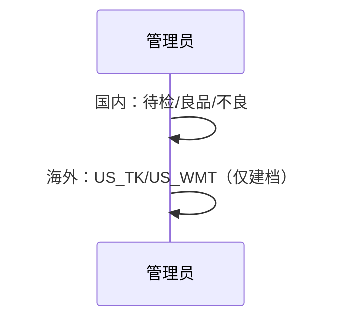
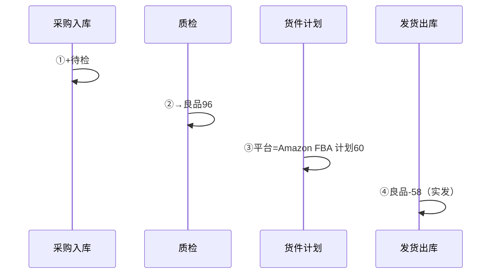

# 仓库档案-业务流程推演

> **覆盖场景（一期）**：实体仓与逻辑仓建档 / 国内 **待检·良品·不良** 三态 / 货件计划（含目标平台） / 发货出库（**仅从良品仓扣减**）  
> **不展开范围（一期）**：国内渠道逻辑仓（AMZ/TK/WMT）、头程在途、海外执行单据、库位管理、平台 API、独立 SRM  
> **参考文档**：《仓库档案字段清单》《context/02-腾达科技业务背景》《context/03-进销存上下游关联系统》  
> **版本**：V1.4 | 2026-09-30

---

## 一、推演范围

### 1.0 已确认业务决策

| 编号 | 决策 |
|---|---|
| D-01 | **后续期**：头程在途逻辑仓 `LOG-CN-IT`；**一期不启用。** |
| D-02 | 海外实体仓下设 `LOG-US-TK`、`LOG-US-WMT`（**一期仅建档**）。 |
| D-03 | 货件计划与库内调拨无联动（一期国内 **不设渠道逻辑仓**，见 D-10）。 |
| D-04 | 一期不做完整海外链路。 |
| D-05 | 短拣未发数量留在 **拣货源逻辑仓**（一期拣货源 **仅为良品仓**）。 |
| D-06 | 一期出库：**仅源逻辑仓按实发扣减**，不记在途。 |
| D-07 | （**已由 D-10 替代**）原「国内 AMZ 逻辑仓」方案废止。 |
| D-08 | 采购入库仅能入 **待检**；须经质检入良品。 |
| D-09 | 停用前该仓库存必须为 0。 |
| **D-10** | **国内合格可发库存只在良品仓 `LOG-CN-GOOD` 记账**；不按 Amazon/TikTok/Walmart 再建国内渠道逻辑仓。发往哪一平台在 **货件计划 / 发货出库单的「目标平台」** 上区分（`AMAZON_FBA` / `TIKTOK` / `WALMART` 等）。 |

### 1.0.1 为何取消国内「亚马逊 / TK / 沃尔玛」逻辑仓？

此前文档把 **质量态**（待检/良品/不良）与 **销售渠道**（AMZ/TK/WMT）都建成了逻辑仓，容易误解为：

- 「只有良品仓能备货」⇒ 可发库存应只在良品仓；
- 若同时又维护三个渠道逻辑仓，会像 **良品 = 三仓之和** 或 **重复记账**。

**正确口径（D-10）**：

| 维度 | 用什么表达 | 不用什么 |
|---|---|---|
| 质量态（待检/合格/不合格） | 国内逻辑仓：`QC` / `GOOD` / `DEF` | — |
| 销售平台（发 FBA / 发 TK 海外仓等） | 货件计划、出库单的 **目标平台** | 国内 **不再** 用 AMZ/TK/WMT 逻辑仓分桶 |
| 海外已在合作仓的库存 | 海外逻辑仓 `US_TK` / `US_WMT`（后续期流水） | 与国内良品仓不是加总关系 |

国内 **合格品总量** = **良品仓库存**（待检、不良品另计）。不存在「良品 = 亚马逊仓 + TK 仓 + 沃尔玛仓」的加总公式。

### 1.1 仓库分层模型（一期）

| 层级 | 示例编码 | 业务含义 | 一期 |
|---|---|---|---|
| 国内实体仓 | `PHY-CN-DG` | 东莞仓 | ✅ |
| 国内逻辑仓 | `LOG-CN-QC` | 待检 | ✅ |
| 国内逻辑仓 | `LOG-CN-GOOD` | **唯一可拣、可发出库** 的合格品池 | ✅ |
| 国内逻辑仓 | `LOG-CN-DEF` | 不良品 | ✅ |
| 国内逻辑仓 | ~~`LOG-CN-AMZ/TK/WMT`~~ | 已废止（D-10） | ❌ |
| 国内逻辑仓 | `LOG-CN-IT` | 头程在途 | ❌ 后续期 |
| 海外实体仓 | `PHY-US-3PL` | 合作海外仓 | ✅ 仅建档 |
| 海外逻辑仓 | `LOG-US-TK` / `LOG-US-WMT` | 货已在海外合作仓后的平台分池 | ✅ 仅建档 |

### 1.2 正向链路（一期）

```
建档（国内：待检/良品/不良；海外：TK/WMT 子仓档案）
  → 采购入库 → 待检
  → 质检 → 良品 / 不良品
  → 货件计划（含目标平台 + 数量，不动库存）
  → 发货出库（源仓=良品，按实发扣减）
```

| 环节 | 库存影响 |
|---|---|
| 采购入库 | +待检 |
| 质检合格 | 待检− / 良品+ |
| 质检不合格 | 待检− / 不良品+ |
| 货件计划 | 不动库存 |
| 发货出库 | **良品−实发**（目标平台记在单据上，不拆逻辑仓） |

### 1.3 演示案例

| 项目 | 数值 |
|---|---|
| 质检后 | 良品 **96** |
| 货件计划 | 目标平台 **Amazon FBA**，计划 60 |
| 发货出库 | 源仓 **良品**，实发 **58** |
| 结果 | 良品 **96−58=38**；短拣 2 件仍留在良品（D-05） |

### 1.4 库内调拨（一期国内）

- **不**为渠道备货做「良品→亚马逊逻辑仓」调拨。
- 待检→良品/不良由 **质检单** 完成，不走库内调拨。
- 若一期实现库内调拨，仅保留 **异常/纠错** 类（待出库 PRD 定义）；默认主链路不依赖调拨。

### 1.5 链路边界说明

- 发货出库一期：**源逻辑仓固定为良品**（或系统默认良品，不可选待检/不良品）。
- 货件计划：必填 **目标平台**；与库存逻辑仓无关。
- 海外仓档案一期仅建档；与国内良品库存 **不合并统计**。

---

## 二、涉及角色

| 角色 | 职责 | 参与节点（一期） |
|---|---|---|
| 供应链 | 采购跟单 | 采购入库 |
| 仓储（东莞） | 收货、质检、上架；从 **良品仓** 拣货出库 | 入库 → 质检 → 出库 |
| 运营 | 录入货件计划（含目标平台） | 货件计划 |
| 管理员 | 仓库建档 | 主数据 |

---

## 三、涉及单据与职责

| 单据/记录 | 库存影响（一期） | 备注 |
|---|---|---|
| 采购入库单 | +待检 | D-08 |
| 质检结果单 | 待检→良品/不良 | 非库内调拨 |
| 货件计划 | 不动库存 | 含 **目标平台** |
| 发货出库单 | **良品−实发** | D-06、D-10 |
| 采购退货出库单 | 不良品− | |
| 库内调拨单 | 一期主链路 **不依赖** | 不做渠道分桶调拨 |

---

## 四、主流程时序图

### 4.1 建档



### 4.2 国内主链路



---

## 五、单据联动规则表

| 上游动作 | 后置影响（一期） |
|---|---|
| 发货出库确认 | **良品仓 −实发**；单据记录目标平台 |
| 停用逻辑仓 | 库存=0（D-09） |

---

## 六、关键异常分支

| 场景 | 处理 |
|---|---|
| 拣货短拣 | 余量留 **良品仓**（D-05） |
| 发不同平台 | 同一良品库存；平台仅出库单/货件计划字段 |

---

## 七、关键设计决策

### 7.1 质量态 vs 平台（D-10）

- 逻辑仓管 **能不能发**（待检不可发、良品可发、不良品退供）。
- 平台管 **发给谁**（FBA / TK 海外仓 / Walmart），不重复建国内渠道逻辑仓。

### 7.2 若曾采用「良品调拨到渠道仓」模型

- 那是把合格品 **拆桶** 到 AMZ/TK/WMT，合格品总量 = 良品 + 三渠道（互斥分区，不是良品等于三仓之和）。
- 与「只有良品仓备货」冲突，故 **废止国内三渠道逻辑仓**。

---

## 八、待确认问题

| 编号 | 状态 |
|---|---|
| WQ-02（国内 AMZ 逻辑仓） | ✅ 废止；用目标平台字段 |
| 其余 D-01～D-09 | ✅ 仍有效 |

---

## 自检

1. ✅ 国内可发库存只在良品仓，不与三渠道逻辑仓加总。  
2. ✅ 平台差异在计划/出库单据，不在国内多建逻辑仓。  
3. ✅ 海外 `US_TK`/`US_WMT` 与国内良品是不同实体仓下的账，非相加关系。
