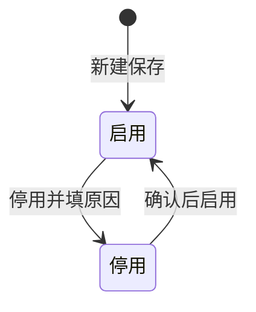
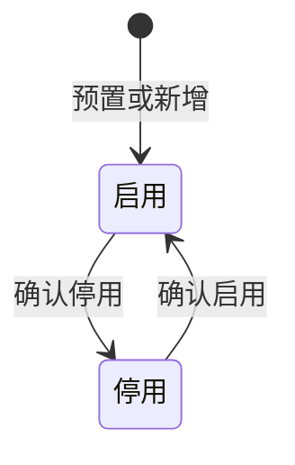

# 用户与角色 — 模块共用规则

> 来源：《用户与角色主PRD》V1.3。在任意本模块页面：标注面板 → **本页规则** → **跨页规则**。

<!-- anno:start id=g-background -->
## 模块背景与链路

### 为什么要有这个模块

跨境电商 ERP 一期要先打好「能登录、能按岗位看菜单」的基础。本模块负责：**公司内部员工账号**、**角色**、**谁拥有哪些角色**、**每个角色能看到哪些二级菜单**。  
外部工厂/供应商账号在别的菜单维护，**不在本模块**。

### 本期要做的功能（一期范围）

| 类别 | 本期包含的能力 |
| :--- | :--- |
| 用户管理 | 新增、查看、编辑内部用户；**不提供「删除用户」**，不用了走 **停用** |
| 用户启停 | 列表/详情可 **启用、停用**；停用须填写 **停用原因**（1～200 字） |
| 用户与角色 | 一个用户可分配 **多个** 角色，也可以 **不分配** 任何角色 |
| 角色管理 | 系统预置 **9 个** 常用角色；管理员还可 **新增** 自定义角色（编码保存后不可改） |
| 角色启停 | 角色可启用、停用；停用时不检查是否还有人挂着该角色 |
| 菜单权限 | 按 **二级菜单** 配置「可见 / 不可见」；登录后侧栏按用户全部角色的可见菜单 **合并显示** |
| 页面入口 | 侧栏两个菜单：**用户管理**、**角色管理**（不是合并成一个页） |

**本期明确不做（别在本模块找）**

- 供应商/外部协同账号、按店铺/仓库的数据权限、每个按钮的细粒度权限配置  
- 密码强度、找回密码、组织架构树  
- 在新增/编辑表单里直接改「启用/停用」（只能在列表或详情点 **启用/停用** 按钮）

### 模块怎么理解

| 项 | 说明 |
| :--- | :--- |
| 性质 | 设置里的 **基础档案**，不是带审批的业务单据 |
| 菜单 | **设置 → 用户管理**、**设置 → 角色管理** |
| 状态 | 用户、角色各自只有 **启用 / 停用** 两种业务状态 |
| 字段细节 | 以《用户与角色字段清单》为准 |

<!-- anno:end id=g-background -->

<!-- anno:start id=g-scenarios -->
## 业务场景（主 PRD §四）

| 场景 | 谁在做 | 要达成什么 |
| :--- | :--- | :--- |
| 新建员工账号 | 管理员 | 填账号、姓名等，可分配多个角色；保存后默认 **启用** |
| 改资料或改角色 | 管理员 | 账号一旦保存 **不能再改**；可增删角色行 |
| 停用员工 | 管理员 | 填停用原因；若他是 **最后一个仍启用的系统管理员**，不允许停用 |
| 重新启用 | 管理员 | 确认后恢复可登录 |
| 新增自定义角色 | 管理员 | 新编码、名称、说明；并带好默认菜单权限模板 |
| 看角色列表 | 管理员 | 看预置与自定义角色、每个角色关联多少人 |
| 改角色名称说明 | 管理员 | 角色编码 **不能改** |
| 配菜单谁能看见 | 管理员 | 在「配置权限」页改各二级菜单可见与否 |
| 停用角色 | 管理员 | 可直接停用，不拦「还有人用这个角色」 |
| 一人多角色登录 | 员工 | 侧栏 = 他所有角色里 **任一角色设为可见** 的菜单加起来 |
| 保住至少一个管理员 | 系统校验 | 不能让系统里 **零个**「启用 + 系统管理员角色」的账号 |

<!-- anno:end id=g-scenarios -->

<!-- anno:start id=g-state -->
## 状态与流转（主 PRD §五）

### 用户：启用 ↔ 停用

| 操作 | 当前为「启用」 | 当前为「停用」 |
| :--- | :--- | :--- |
| 查看、编辑资料 | 允许 | 允许 |
| 停用 | 允许 | 不允许 |
| 启用 | 不允许 | 允许 |
| 删除用户 | 不允许 | 不允许 |

### 角色：启用 ↔ 停用

| 操作 | 当前为「启用」 | 当前为「停用」 |
| :--- | :--- | :--- |
| 查看、编辑、配置权限 | 允许 | 允许 |
| 新增角色（档案） | 允许 | 允许 |
| 删除角色 | 不允许 | 不允许 |

<!-- anno:end id=g-state -->

<!-- anno:start id=g-actions -->
## 列表里能点哪些操作

**用户列表**（当前状态不允许的按钮 **直接不显示**）  
顺序：**查看** → **编辑** → **停用** 或 **启用**

**角色列表**  
顺序：**查看** → **配置权限** → **编辑** → **停用** 或 **启用**

**启停交互（列表/详情一致）**

| 对象 | 启用 | 停用 |
| :--- | :--- | :--- |
| 用户 | 标题「启用用户」；正文「确认启用该账号？」；确认「启用」；成功「已启用」 | 标题「停用用户」；说明「停用后该账号无法登录。」；填停用原因；确认「确认停用」；成功「已停用」 |
| 角色 | 标题「启用角色」；正文「确认启用该角色？」；成功「已启用」 | 标题「停用角色」；正文「确认停用该角色？」；成功「角色已停用」（无需填原因） |

用户停用原因未填：字段标红 +「请填写停用原因（1-200 字）」，弹窗不关闭。

<!-- anno:end id=g-actions -->

<!-- anno:start id=g-rules -->
## 核心业务规则（主 PRD §六）

| 规则 | 说明 |
| :--- | :--- |
| 登录名唯一 | **用户账号** 全系统不能重复，保存后不能改 |
| 可以不配角色 | 角色子表允许 0 行；**零角色也可登录**，侧栏无业务二级菜单 |
| 启停入口 | 只能在列表/详情点按钮，**不能在** 新增/编辑表单里改启用停用 |
| 停用要写原因 | 用户停用必须填停用原因 |
| 停用后不能登录 | 账号为「停用」时拒绝登录；档案保留，历史单据仍可按账号追溯 |
| 至少一名管理员 | 任何时候都要至少有 **1 个**「启用 + 系统管理员角色」的账号；新建用户 **不强制** 必须是管理员 |
| 停角色不拦引用 | 角色停用时不检查是否还有人挂着该角色；历史分配行可保留，但 **已停用角色不参与菜单并集**；**新分配** 时只能选 **启用中** 的角色 |
| 菜单怎么算 | 只配到 **二级菜单**；一人多角色时，同一菜单 **任一角色可见即可见**；一级菜单下没有可见二级则不显示一级 |
| 系统管理员与菜单 | 系统管理员也要受菜单可见性配置约束；**一期没有**「超管绕过菜单表」 |
| 手机、邮箱 | 留空不校验；填了就要格式正确（手机/座机、邮箱各有一套提示文案） |
| 不用删除 | 用户、角色都 **没有删除**，用停用表示失效 |

**保存后跳哪里**

| 页面 | 保存成功后 |
| :--- | :--- |
| 新增/编辑用户、新增/编辑角色 | 提示成功 → 回到 **用户列表** 或 **角色列表** |
| 配置角色权限 | 提示「权限已保存」→ **仍停在本页**，方便连续改多项菜单 |

<!-- anno:end id=g-rules -->

<!-- anno:start id=g-permission -->
## 谁能进这个模块、出错怎么提示

### 访问与维护权限（一期）

一般只有 **系统管理员** 能进「用户管理」「角色管理」并做增删改。其他岗位默认没有这两个设置菜单；若要在别的角色上开放，须在 **配置权限** 里把对应二级菜单设为可见。

**原型说明**：演示环境可能暂未按角色隐藏按钮，正式联调前再对齐。

### 常见拦截与提示

| 情况 | 用户看到什么 |
| :--- | :--- |
| 停用最后一个启用的管理员 | Toast「无法停用：系统须至少保留一名启用的管理员」 |
| 编辑用户去掉管理员且会变成零个管理员 | Toast「须至少保留一名启用的管理员账号」 |
| 用户账号重复 | 用户账号标红 + Toast「用户账号已存在」 |
| 角色编码重复 | 角色编码标红 + Toast「角色编码已存在」 |
| 手机号、邮箱格式不对 | 对应输入框红字 +「请输入有效的手机号或座机号」/「请输入有效的邮箱地址」 |
| 表单还有必填没填 | 红字标字段 + Toast「请完善标红字段后再保存」 |
| 未保存离开（表单/权限页） | 标题「放弃未保存的修改？」；正文「当前有未保存的变更，离开后将丢失。」；按钮「离开」/「继续编辑」 |

<!-- anno:end id=g-permission -->
