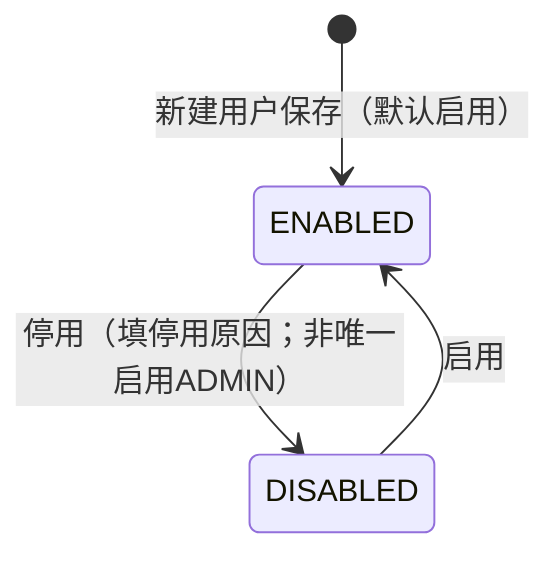
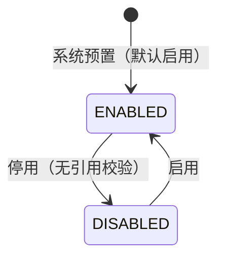

# 用户与角色主PRD

> **版本**：V1.0 | 2026-10-16  
> **读者**：产品经理、前端工程师、后端工程师、测试工程师  
> **说明**：本模块为 **设置域** 基础能力（内部用户、内置角色、菜单可见性）。字段定义以《用户与角色字段清单》V1.4 定稿为准；本文统一业务边界、状态与动作、权限生效、下游引用与验收口径，**不重复定义字段本体**（枚举、必填、控件维度见字段清单）。

---

## 一、业务背景

腾达科技自研跨境电商 ERP 一期以 **阶段 0：系统地基** 为先：在维护资料域之前，须先具备 **可登录、可分角色** 的内部账号与菜单可见性骨架（`09` 阶段 0.1）。

若缺少统一的用户与角色能力，会导致：

- 采购需求审批（运营专员 → 运营组长 → 运营总监）、供应链派单、仓储协同等流程 **无法绑定操作身份**
- 侧栏菜单对所有登录用户一致，无法按 `02` §六 组织职责收敛可见范围
- 外部工厂账号与内部员工账号混在同一套字段里维护，与 `05` 供应商协同边界不清
- 主数据与业务单据上的「操作人」口径不一致，审计与对账举证困难

本模块目标是：**维护本公司内部用户档案、分配内置角色、按角色配置二级菜单可见性**，为全系统 RBAC 与审批身份提供唯一配置入口。外部供应商账号 **不在** 本模块维护。

---

## 二、功能范围

### In Scope

- **内部用户** CRUD（无物理删除）：`用户账号`、`用户姓名`、联系信息、`用户备注`、**用户已分配角色明细**
- 用户 **启用 / 停用**（含 `停用原因`）；**至少保留一名** 启用且持有 `ADMIN` 角色的用户（保底校验）
- **9 个内置角色**系统预置；支持 **新增** 自定义 `角色编码`（保存后不可改）、维护 `角色名称`、`角色说明`、角色 **启用 / 停用**（停用角色 **不做** 关联用户等前置校验）；**不提供** 角色物理删除
- **角色菜单权限**：按 **二级菜单** 配置 `菜单可见性`（`VISIBLE` / `HIDDEN`）；一级菜单展示由二级推导
- 独立页面：`/settings/users`（用户）、`/settings/roles`（角色与权限）
- 列表筛选、详情、系统字段（创建人/时间、最后修改人/时间）；`最后登录时间` 由登录层回写
- 手机号有值时校验 **G-PHONE-REGEX**（引用进销存全局规范）

### Out of Scope

- **外部供应商登录账号**、外部协同角色及菜单（**设置 → 供应商账号**，`05`）
- **数据权限**（店铺、仓库、成衣厂范围等）配置与执行
- **按钮 / 动作级 ACL** 在本模块落库（由各业务 PRD 按 `角色编码` 描述；侧栏仅二级菜单可见性）
- **密码策略**（强度、过期、自助找回等）及本模块内密码相关字段定义
- 角色 **物理删除**；组织树、部门汇报线建模（`02`：一期不建模）
- 用户物理删除；在表单内直接修改 `启停用状态`
- 审批单据上快照 `用户姓名`（业务单据 **仅存 `用户账号`**，姓名展示读档案）
- 操作日志、登录会话明细（**设置 → 操作日志**）

---

## 三、模块定位

| 项目 | 内容 |
| :--- | :--- |
| 模块定位 | **设置域基础能力**；非业务流转单据，**无审核状态机** |
| 菜单入口 | `06` §4.11 **设置 → 用户管理**（`/settings/users`）、**设置 → 角色管理**（`/settings/roles`）；侧栏为两个独立二级菜单 |
| 核心职责 | 内部账号生命周期、内置角色展示名与说明、用户-角色绑定、角色-二级菜单可见性 |
| 直接服务 | 全系统登录与侧栏渲染；采购需求等流程的 **审批身份**（按角色编码判断） |
| 状态管理 | 用户与角色各自 `启停用状态`：`ENABLED` / `DISABLED`；**仅动作按钮**变更（`AGENTS.md`） |
| 字段权威源 | 《用户与角色字段清单》V1.4 定稿 |
| 实施阶段 | `09` 阶段 **0.1**（P0 前置，不可并行绕过） |

### 与关联模块边界

| 模块 | 关系 |
| :--- | :--- |
| 供应商账号 | 外部账号与外部角色 **完全独立** PRD 与菜单；不得引用本模块用户字段 |
| 操作日志 | 用户/角色/权限变更应记日志，字段不在本清单展开 |
| 各业务单据 | 审批、操作人留痕 **只存 `用户账号`**；是否拥有某审批角色查本模块绑定关系 |

---

## 四、业务场景

| 场景ID | 场景 | 类型 | 说明 |
| :--- | :--- | :--- | :--- |
| U01 | 管理员新建内部用户 | 主流程 | 填写账号、姓名等；可分配 0..N 个角色；默认 `启停用状态=ENABLED` |
| U02 | 维护用户资料与角色 | 主流程 | 编辑姓名、手机、邮箱、备注；增删 **用户已分配角色明细** 行 |
| U03 | 停用用户 | 主流程 | 弹窗填写 `停用原因`；若为目标用户为 **唯一启用 ADMIN** 则阻断 |
| U04 | 重新启用用户 | 辅助 | 动作「启用」恢复登录 |
| R01 | 查看角色列表 | 主流程 | 预置与自定义角色；可看 `关联用户数` |
| R00 | 新增角色 | 主流程 | 填写唯一 `角色编码`、`角色名称` 等；默认 `启停用状态=ENABLED`；初始化菜单权限模板 |
| R02 | 调整角色展示名与说明 | 主流程 | 编辑 `角色名称`、`角色说明`（`角色编码` 保存后只读） |
| R03 | 配置角色菜单权限 | 主流程 | 在 `/settings/roles` 权限树维护 §四 `菜单可见性` |
| R04 | 停用角色 | 辅助 | 直接停用，**不校验** 是否仍有用户引用；已分配该角色的用户 **不自动** 移除角色行 |
| R05 | 多角色用户登录 | 主流程 | 侧栏二级菜单 = 各角色 `VISIBLE` 的 **并集** |
| R06 | 审批流识别身份 | 主流程 | 如采购需求：当前用户是否含 `OPS_LEAD` / `OPS_DIRECTOR` 决定可否审单 |
| U05 | 阻断移除最后管理员 | 异常 | 停用用户或去掉其 `ADMIN` 行后，若无其他「启用 + ADMIN」用户则保存失败 |

---

## 五、状态机

本模块含 **两套独立** 启停用状态：**用户**、**角色**。均无草稿/审核态。

### 5.1 用户 `启停用状态`

| 状态 | 枚举 | 含义 |
| :--- | :--- | :--- |
| 启用 | `ENABLED` | 可登录（仍受角色与菜单权限约束） |
| 停用 | `DISABLED` | 不可登录；档案保留 |

| 当前状态 | 动作 | 目标状态 | 前置条件 |
| :--- | :--- | :--- | :--- |
| — | 新建保存 | `ENABLED` | 必填与唯一性校验通过 |
| `ENABLED` | 停用 | `DISABLED` | `停用原因` 已填；**非**「唯一仍启用且持有 `ADMIN`」的用户 |
| `DISABLED` | 启用 | `ENABLED` | 用户确认 |

**用户动作能力矩阵**

| 动作 | 启用 | 停用 | 说明 |
| :--- | :---: | :---: | :--- |
| 查看 | ✅ | ✅ | 列表、详情 |
| 编辑 | ✅ | ✅ | `用户账号` 保存后只读 |
| 停用 | ✅ | ❌ | 弹窗 `停用原因` |
| 启用 | ❌ | ✅ | |
| 删除 | ❌ | ❌ | 不提供 |

### 5.2 角色 `启停用状态`

| 状态 | 枚举 | 含义 |
| :--- | :--- | :--- |
| 启用 | `ENABLED` | 可被 **用户已分配角色明细** 新选 |
| 停用 | `DISABLED` | 不可在新分配中选择；**不强制** 自用户上移除已有行 |

| 当前状态 | 动作 | 目标状态 | 前置条件 |
| :--- | :--- | :--- | :--- |
| `ENABLED` | 停用 | `DISABLED` | **无**（不做关联用户数校验） |
| `DISABLED` | 启用 | `ENABLED` | 用户确认 |

**角色动作能力矩阵**

| 动作 | 启用 | 停用 | 说明 |
| :--- | :---: | :---: | :--- |
| 查看 | ✅ | ✅ | 列表、详情、权限树只读 |
| 编辑名称/说明 | ✅ | ✅ | `角色编码` 不可改 |
| 配置权限 | ✅ | ✅ | 建议停用前由管理员知晓风险；产品不强制阻断 |
| 停用 / 启用 | ✅ | ✅ | 仅动作按钮 |
| 新增角色 | ✅ | ✅ | 自定义 `角色编码` 须全局唯一 |
| 删除角色 | ❌ | ❌ | 仅停用 |

---

## 六、核心业务规则

| 规则ID | 规则 |
| :--- | :--- |
| R01 | **`用户账号`** 全局唯一，保存后 **不可修改**。 |
| R02 | 新建/编辑用户须满足字段清单必填项；**用户已分配角色明细** 允许零行，零行时登录后侧栏无业务二级菜单（实现与验收按空菜单处理）。 |
| R03 | **`启停用状态`**（用户、角色）**不得** 在新增/编辑表单中直接修改，仅能通过 **启用 / 停用** 动作变更。 |
| R04 | 用户 **停用** 须填写 `停用原因`（1–200 字符）。 |
| R05 | **管理员保底**：任意时刻须存在 **≥1** 个用户满足 `启停用状态=ENABLED` 且分配了 `角色编码=ADMIN`；否则阻断：**停用该用户**、**编辑保存时移除其 ADMIN 角色行**、或会导致该条件不成立的保存。**新建用户**不强制分配 `ADMIN`（允许创建无角色或非管理员账号）。 |
| R06 | **角色停用** 不做关联用户数、是否仍被引用等校验。 |
| R07 | 用户可选角色仅限 `启停用状态=ENABLED` 的角色档案（系统预置 + 自定义新增，§三）。 |
| R08 | **菜单可见性** 仅配置到 **二级菜单**；用户拥有多角色时，对同一二级菜单取 **并集**（任一角色 `VISIBLE` 即可见）。 |
| R09 | **一级菜单** 是否展示：其下存在 **至少一个** 二级菜单对该用户计算结果为 `VISIBLE`，则一级展示，否则隐藏。 |
| R10 | `ADMIN` 角色用户可维护本模块（用户、角色、权限配置）；`ADMIN` 自身侧栏仍受 §四 配置约束，**一期无**「超管绕过菜单表」。 |
| R11 | 业务单据审批/操作留痕 **只持久化 `用户账号`**；界面展示操作人姓名时 **实时读取** 用户档案 `用户姓名`。 |
| R12 | `手机号` 有值时须通过 **G-PHONE-REGEX**；空值不校验。`邮箱` 有值时须为标准邮箱格式，失败文案见字段清单。 |
| R13 | 主数据 **不提供删除**；用户与角色均用 **停用** 表达失效（`AGENTS.md`）。 |
| R14 | 菜单权限行与 `06` §十一、`sidebarMenu.ts` 二级项对齐；发布新菜单时由实现侧同步权限树数据源（实现细节不在本 PRD 展开）。 |

### 6.1 一期内置角色编码（与 `02` §六 对齐）

| 角色编码 | 默认名称 | 典型职责摘要 |
| :--- | :--- | :--- |
| `ADMIN` | 系统管理员 | 用户、角色、系统设置 |
| `OPS_SPECIALIST` | 运营专员 | 采购需求创建与提交 |
| `OPS_LEAD` | 运营组长 | 采购需求一级审核 |
| `OPS_DIRECTOR` | 运营总监 | 采购需求二级审核 |
| `SCM_DATA` | 供应链数据专员 | 派单、成衣采购单、跟单 |
| `WH` | 仓储 | 入库、上架、出库作业等 |
| `FIN` | 账务 | 对账、回款等财务触点 |
| `PRODUCT` | 商品版师 | 款式、BOM、生产制单 |
| `MATERIAL_MGR` | 面辅料管理 | 指定供方、替代料审批 |

预置数据由系统初始化写入；`角色名称` 允许管理员改为更贴合现场的展示名，`角色编码` 不变。

---

## 七、权限设计（本模块入口）

| 能力 | 允许角色 | 说明 |
| :--- | :--- | :--- |
| 访问 `/settings/users`、`/settings/roles` | `ADMIN` | 其他角色默认无设置域菜单，除非在 §四 中显式 `VISIBLE` |
| 新建/编辑/启停用户 | `ADMIN` | |
| 编辑角色名称/说明、配置菜单、启停角色 | `ADMIN` | |

一期 **不在** 本 PRD 定义各业务菜单的默认权限矩阵；上线时由实施为 9 个内置角色配置 §四 初始 `菜单可见性`（可另附配置表或种子数据，非本文范围）。

---

## 八、边界与异常处理

| 编号 | 情况 | 处理 |
| :--- | :--- | :--- |
| E01 | 停用唯一启用 `ADMIN` 用户 | 阻断；提示须先为他人分配 `ADMIN` 或启用其他管理员 |
| E02 | 用户零角色登录 | 允许登录；侧栏无业务二级菜单 |
| E03 | 保存用户时移除最后一行 `ADMIN` 且无其他启用 ADMIN 用户 | 阻断（R05） |
| E04 | `用户账号` 重复 | 保存阻断，字段级提示 |
| E05 | 手机号格式非法 | 失焦或保存阻断，引用 G-PHONE-REGEX 文案 |
| E06 | 角色已停用仍挂在用户明细上 | 允许保留历史行；该角色 **不再参与** 菜单并集计算（实现须过滤 `DISABLED` 角色） |
| E07 | 用户已停用 | 拒绝登录；历史单据仍可通过 `用户账号` 追溯 |
| E08 | 审批人姓名与用户档案不一致 | 以档案为准；单据不存姓名快照 |

---

## 九、验收标准

| 验收编号 | 场景 | 前置条件 | 操作 | 预期结果 |
| :--- | :--- | :--- | :--- | :--- |
| AC-01 | 阶段 0.1 地基 | 系统已预置 9 角色与 ADMIN 种子用户 | 使用 ADMIN 登录 | 可进入 `/settings/users`、`/settings/roles` |
| AC-02 | 新建用户 | 已登录 ADMIN | 新建用户并分配 `OPS_SPECIALIST` | 保存成功；列表可见；`启停用状态=ENABLED` |
| AC-03 | 账号只读 | 用户已存在 | 编辑该用户 | `用户账号` 不可改 |
| AC-04 | 停用用户 | 非唯一 ADMIN | 停用并填原因 | 状态 `DISABLED`；该账号无法登录 |
| AC-05 | 管理员保底 | 仅一名启用 ADMIN | 尝试停用该用户 | 阻断并提示 |
| AC-06 | 菜单并集 | 用户拥有 A、B 两角色；A 可见菜单 X，B 可见菜单 Y | 登录 | 侧栏可见 X、Y |
| AC-07 | 二级权限 | 某角色对二级菜单设为 `HIDDEN` | 仅持该角色的用户登录 | 侧栏不展示该二级；一级随规则隐藏 |
| AC-08 | 角色停用无校验 | 角色仍有关联用户 | 停用角色 | 成功；新分配不可选该角色 |
| AC-09 | 审批身份 | 用户仅 `OPS_LEAD` | 进入采购需求审批（业务模块联调） | 可进行组长级审批动作 |
| AC-10 | 审批留痕 | 用户完成审批 | 查看单据 | 仅存 `用户账号`；姓名来自档案 |
| AC-11 | 外部边界 | — | 在用户模块搜外部字段 | 无供应商、工厂绑定字段 |
| AC-12 | 手机校验 | — | 输入非法手机号保存 | 阻断；合法或为空可通过 |

---

## 十、字段清单索引

| 文档 | 路径 | 用途 |
| :--- | :--- | :--- |
| 用户与角色字段清单 V1.4 | 同目录 `用户与角色字段清单.md` | 字段名称、枚举、页面展示、校验备注 **唯一权威源** |

主 PRD 引用字段时只使用清单已定义的中文字段名，不新增同义字段。

---

## 十一、关联文档

| 文档 | 用途 |
| :--- | :--- |
| `context/跨境电商ERP/02-公司业务背景.md` §六 | 组织职责与角色语义 |
| `context/跨境电商ERP/05-供应商协同与门户（一期ERP内）.md` | 外部账号边界 |
| `context/跨境电商ERP/06-系统菜单地图（一期）.md` | 菜单与路由 |
| `context/跨境电商ERP/09-一期建设优先级与实施步骤.md` | 阶段 0.1 验收 |
| `prd-docs/进销存管理系统/全局约束/全局字段校验与反馈规范.md` | G-PHONE-REGEX |
| `AGENTS.md` | 启停用、无删除 |
| `context/跨境电商ERP/12-前端通用交互与表单校验（一期）.md` | 保存跳转、Toast、字段标红 |

---

## 十二、变更记录

| 版本 | 日期 | 变更内容 |
| :--- | :--- | :--- |
| V1.0 | 2026-10-16 | 初版：依据字段清单 V1.1 与 context 阶段 0.1 编制 |
| V1.1 | 2026-10-16 | 菜单拆为「用户管理」「角色管理」两个二级入口；修正 U01 角色条数表述 |
| V1.2 | 2026-10-16 | 放开自定义角色新增；预置 9 编码仍系统初始化 |
| V1.3 | 2026-10-16 | R05 新建用户不强制 ADMIN；R07 含自定义角色；R12 邮箱格式 |

---

## 自检记录

| # | 检查项 | 结果 |
| :---: | :--- | :--- |
| 1 | 未生成字段清单定稿 / 用例推演 / Demo PRD | 是 |
| 2 | 职责未包含供应商账号、密码策略、数据权限 | 是 |
| 3 | 用户/角色状态机有入口、出口；无审核态 | 是 |
| 4 | 引用字段名均来自字段清单 V1.1 | 是 |
