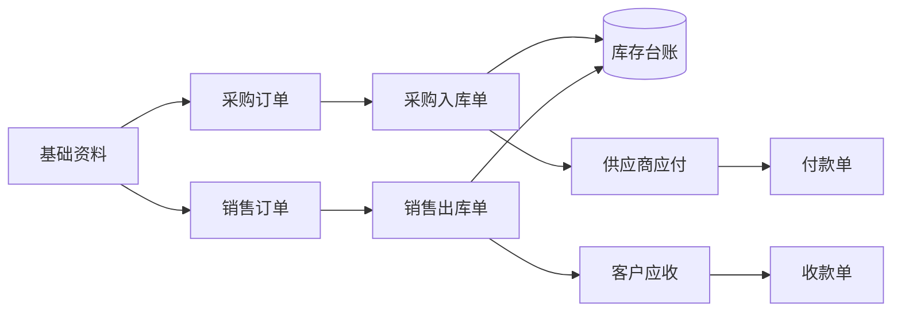

# 进销存（PSS）文档索引

> **产品定位**：境内贸易批发进销存最小闭环——两层单据、库存三口径、应收应付与收付款。  
> **概念基线**：`context/01-什么是进销存系统.md`  
> **一期范围总览**：`进销存一期-主PRD.md`

---

## 一期要跑通什么

用一张图记住最小闭环：



**验收一句话**：能采购入库加库存、能销售出库减库存并占占用、能看客户欠款并登记收款、能看供应商应付并登记付款，且任意 SKU 在单仓上三口径可对账。

---

## 文档资产现状

| 域 | 模块/单据 | 字段清单 | 主PRD | Demo PRD | 推演/走查 | 备注 |
|---|---|:---:|:---:|:---:|:---:|---|
| 基础资料 | 商品档案 | ✅ | ✅ | ✅ | — | `prd-docs/基础资料/商品管理/` |
| 基础资料 | 供应商档案 | ✅ | ✅ | ✅ | — | |
| 基础资料 | 仓库档案 | ✅ | ✅ | ❌ | ✅ 流程+用例 | 文稿含跨境「待检/良品」口径，**纯进销存一期可简化为单逻辑仓「良品」** |
| 基础资料 | 客户档案 | — | — | — | — | **README 曾规划，文件尚未入库，需优先补** |
| 采购 | 采购订单 | ✅ | ✅ | ✅ | ✅ | |
| 采购 | 采购入库单 | — | — | — | — | **待写（采购主PRD 已定义下游）** |
| 销售 | 销售订单 | ✅ | ✅ | ✅ | ✅ | 业务背景为「强盛科技」批发，可沿用 |
| 销售 | 销售出库单 | — | — | — | — | **待写** |
| 库存 | 库存查询/流水 | — | — | — | — | **待写（三口径核心）** |
| 往来 | 应收/应付/收付款 | — | — | — | — | **待写** |
| 需求 | 销售管理需求基线 | — | — | — | — | `product-design-docs/需求设计/` 三层设计已具备 |

---

## 推荐实施顺序（先产品、再原型、再研发）

### 阶段 A：口径冻结（1–2 天）

1. 通读 `context/01-什么是进销存系统.md` + `进销存一期-主PRD.md`
2. 确认练手企业背景：沿用 **强盛科技批发**（`product-design-docs`）或自拟一家贸易公司
3. 仓库策略二选一并写进一期主 PRD 备注：
   - **简化版**：一个实体仓 + 一个逻辑仓（推荐先做这个）
   - **进阶版**：沿用腾达「待检/良品/不良品」逻辑仓（与跨境 ERP 后续接轨）

### 阶段 B：补文档缺口（按依赖顺序）

| 顺序 | 产出 | 模板/提示词 |
|:---:|---|---|
| 1 | 客户档案（字段清单 + 主PRD + Demo PRD） | `templates/PRD模板-主数据.md`、`prompts/PRD生成-主数据.md` |
| 2 | 采购入库单全套 PRD | `prompts/PRD生成-业务单据.md` |
| 3 | 销售出库单全套 PRD | 同上 |
| 4 | 库存台账/库存查询模块 PRD | 定义三口径、流水类型、与出入库回写规则 |
| 5 | 往来（应收、应付、收款、付款）模块 PRD | 挂接入库/出库确认节点 |
| 6 | 各模块用例数据推演 | `templates/用例数据推演模板.md` |

已有 **采购订单、销售订单** 文档可直接作为上下游单据的「计划层」参照，不必重写。

### 阶段 C：前端原型

| 顺序 | 页面 | 参照 |
|:---:|---|---|
| 1 | 进销存门户壳 + 左侧菜单 | `front-prototype/海外仓WMS/index.html` 布局 |
| 2 | 四个主数据列表/表单 | 各 `*_前端Demo版PRD.md` |
| 3 | 采购订单三页 + 采购入库三页 | 已有采购订单 Demo PRD |
| 4 | 销售订单三页 + 销售出库三页 | 已有销售订单 Demo PRD |
| 5 | 库存查询、收款登记 | 往来 PRD 定稿后 |

本地预览：`node server.js` → `http://localhost:3000`（静态目录为 `front-prototype/`）。

### 阶段 D：研发（一期技术建议）

- **先 API + 单据状态机 + 库存流水**，UI 可继续用静态原型对接 Mock
- 表设计围绕：`主数据表` + `订单头/行` + `执行单据头/行` + `inventory_balance` + `inventory_ledger` + `ar_ap` + `payment`
- 所有库存变动只由 **采购入库/销售出库（及退货）** 审核触发，与 `context/01` 两层单据原则一致

---

## 与跨境 ERP 的边界（避免一期做重）

| 一期做 | 一期不做 |
|---|---|
| 手动开单、单本位币 | 平台 API、Listing、多币种利润 |
| 单仓或简单逻辑仓 | 头程在途、FBA、海外 WMS 对接 |
| 应收应付 + 收付款登记 | 总账、凭证、自动银行认款 |

后续做跨境 ERP 时，**采购/销售/库存/往来** 模块可演进复用，再叠平台与多仓能力。

---

## 目录规划（随模块增补）

```text
prd-docs/进销存/
├── README.md                 ← 本文件
├── 进销存一期-主PRD.md
├── 基础资料/                 ← 可选：从 prd-docs/基础资料 做链接说明，不搬文件
├── 采购管理/
├── 销售管理/
├── 库存管理/
└── 往来管理/
```

业务单据 PRD 仍建议放在 `prd-docs/采购管理`、`prd-docs/销售管理` 等平级目录，本文件夹只做**系统级索引与一期范围**。
