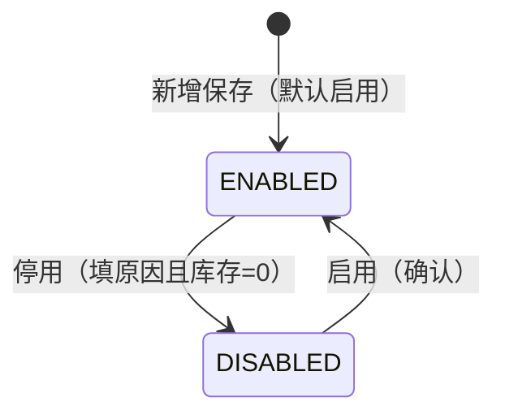

# 仓库档案主PRD

> **版本**：V1.1 | 2026-10-03  
> **读者**：产品经理、前端工程师、测试工程师  
> **说明**：仓库档案属于主数据 CRUD。字段定义以《仓库档案字段清单》V1.3 为准；本文档统一业务边界、启停用规则、下游引用与验收口径，不重复定义字段本体。

---

## 1. 业务背景

强盛科技在批发、零售与采购并行经营后，库存动作（采购入库、销售出库、其他出入库、库存查询）都依赖 **「从哪个仓进、从哪个仓出」** 的稳定识别。

若仓库主数据分散在表格或口头约定里，会出现：

- 同一物理仓在不同单据里名称不一致
- 采购、销售、库存三条链路无法共用同一套仓库编码
- 已关闭的仓仍被新单误选，或历史单据无法追溯原仓信息

因此，仓库档案的目标是：**统一仓库编码、名称、类型与联系信息**，并约束下游单据如何选用仓库（见 §8）。

---

## 2. 功能范围

**In Scope**

- 仓库基础资料维护（单层仓库档案，无逻辑仓分层）
- 仓库类型维护（`MAIN` / `BRANCH` / `STORE`）
- 联系信息维护（地址、负责人、联系电话）
- 启用 / 停用管理（含停用原因、库存为 0 校验）
- 列表、新增、编辑、详情

**Out of Scope**

- 逻辑仓、待检/良品/不良品分区、头程在途仓
- 库位、批次、效期
- 在档案表单内维护或修改库存数量
- 库存汇总字段在档案详情页展示（停用校验依赖库存服务实时查询）
- 审批流（无单据审核态，仅启停用）
- 物理删除档案
- 导入 / 导出

---

## 3. 模块定位

| 项目 | 内容 |
| :--- | :--- |
| 单据定位 | **主数据**；非业务流转单据，无审核状态机 |
| 模块类型 | 主数据 CRUD（单层仓库档案） |
| 核心职责 | 统一仓库识别信息、类型与启停范围 |
| 直接服务 | 采购入库、销售出库、其他入库、其他出库、即时库存查询、库存流水查询 |
| 状态管理 | **启停用状态** `ENABLED` / `DISABLED`（`AGENTS.md`：状态变更仅能通过动作按钮触发） |
| 字段权威源 | 《仓库档案字段清单》V1.3 |

---

## 4. 典型业务场景

| 场景ID | 场景 | 类型 | 说明 |
| :--- | :--- | :--- | :--- |
| S01 | 新增主仓档案 | 主流程 | 如 `WH-CN-DG` 东莞主仓，`MAIN` |
| S02 | 新增分仓/门店仓 | 主流程 | 维护 `BRANCH` 或 `STORE` 类型仓库 |
| S03 | 维护地址与负责人 | 主流程 | 更新 `仓库地址`、`负责人`、`联系电话` 等，不影响历史单据快照 |
| S04 | 停用仓库 | 辅助 | 本仓实时库存合计必须为 0；弹窗填写 `停用原因` |
| S05 | 恢复启用 | 辅助 | 停用仓可重新在新单中选择 |
| S06 | 历史仓追溯 | 辅助 | 已停用仓在历史单据、库存查询仍可见 |

---

## 5. 状态与动作规则

### 5.1 启停用状态定义

| 状态 | 枚举 | 含义 |
| :--- | :--- | :--- |
| 启用 | `ENABLED` | 可在新建采购入库、销售出库、其他出入库等业务单据的仓库选择器中被引用 |
| 停用 | `DISABLED` | 不可在新业务单据中选择；历史数据保留 |

### 5.2 状态流转图

### 5.3 状态流转表

| 当前状态 | 动作 | 目标状态 | 前置条件 |
| :--- | :--- | :--- | :--- |
| — | 新增保存 | `ENABLED` | 必填字段与编码唯一性校验通过 |
| `ENABLED` | 停用 | `DISABLED` | `停用原因` 已填；本仓 **实时库存数量合计 = 0** |
| `DISABLED` | 启用 | `ENABLED` | 用户确认（无需填写原因） |

### 5.4 动作能力矩阵

| 动作 | 启用 | 停用 | 说明 |
| :--- | :---: | :---: | :--- |
| 查看 | ✅ | ✅ | 列表、详情 |
| 编辑 | ✅ | ✅ | 受编码引用、类型锁定约束 |
| 停用 | ✅ | ❌ | 弹窗填 `停用原因`；校验库存（R04） |
| 启用 | ❌ | ✅ | 确认后恢复；记录 `启用人`、`启用时间` |
| 删除 | ❌ | ❌ | 不提供；统一用停用 |

---

## 6. 模块级通用规则

| 规则ID | 规则 |
| :--- | :--- |
| R01 | **仓库编码** 全局唯一；一旦被库存或业务单据引用后 **不可修改**。 |
| R02 | 必填字段以字段清单为准：至少包含 `仓库编码`、`仓库名称`、`仓库类型`、`仓库地址`、`负责人`。 |
| R03 | 新增档案默认 **启用**；新增/编辑表单 **不展示** `启停用状态` 控件，仅通过「启用」「停用」动作变更。 |
| R04 | **停用**须填写 `停用原因`；停用前本仓 `当前库存数量合计`（实时查询）必须为 0，否则阻断。 |
| R05 | 停用仓库 **不可**在新建采购入库、销售出库、其他出入库等业务单据中选择；历史单据仍展示原仓库信息。 |
| R06 | 主数据 **不提供删除**；不再使用统一「停用」以外的清除方式。 |
| R07 | 保存后一期 **不可修改** `仓库类型`；纠错策略：停用旧档案 + 新建正确档案。 |
| R08 | 选择器展示格式：`{仓库编码} {仓库名称}`（见字段清单 §4.2）。 |

---

## 7. 动作级规则

### 7.1 新增

| 规则ID | 规则 |
| :--- | :--- |
| A01 | 须填写字段清单中新增页必填项：`仓库编码`、`仓库名称`、`仓库类型`、`仓库地址`、`负责人`。 |
| A02 | `仓库编码` 保存时做全局唯一性校验，长度 2–32 字符，失败则阻断。 |
| A03 | 保存成功后 `启停用状态` 默认为 `ENABLED`，并写入 `创建人`、`创建时间` 等系统字段。 |
| A04 | `联系电话`、`仓库备注` 为选填；`联系电话` 空时在详情展示 `-`；填写时须符合常规手机或座机格式。 |

### 7.2 编辑

| 规则ID | 规则 |
| :--- | :--- |
| A11 | **未引用**时 `仓库编码` 可编辑并做唯一性校验；已被业务单据或库存流水引用的仓库，**`仓库编码` 不可编辑**，且不触发编码唯一性重复校验。 |
| A12 | **`仓库类型` 保存后只读**，一期不允许修改。 |
| A13 | 启用态下可编辑：`仓库名称`、`仓库地址`、`负责人`、`联系电话`、`仓库备注`。 |
| A14 | 停用态下仍允许编辑上述非锁定字段（不含编码、类型、状态）。 |

### 7.3 停用 / 启用

| 规则ID | 规则 |
| :--- | :--- |
| A21 | 停用必须通过 **停用** 动作按钮；弹窗内 `停用原因` 必填（1–200 字符）。 |
| A22 | 点击「停用」时先查询实时库存合计；大于 0 时 **Toast 阻断且不打开停用弹窗**；等于 0 时再打开弹窗填写 `停用原因`。 |
| A23 | 启用无需填原因；更新 `启用人`、`启用时间`；清空展示用的停用信息逻辑以字段清单为准。 |
| A24 | **启停用不得在编辑表单中以下拉或输入方式修改**（`AGENTS.md`）。 |

---

## 8. 下游引用影响规则

| 引用模块 | 引用方式 | 说明 |
| :--- | :--- | :--- |
| 采购入库 | 选择仓库 | 仅可选 `ENABLED` 仓库；快照 `仓库编码`、`仓库名称`、`仓库类型` |
| 销售出库 | 选择仓库 | 同上 |
| 其他入库 / 其他出库 | 选择仓库 | 同上 |
| 即时库存查询 / 库存流水 | 筛选或展示 | 实时读档案名称；停用仓可查历史余额 |

补充规则：

- 下游单据保存时固化字段见字段清单 §4.4；档案后续改名 **不影响** 已有单据快照中的 `仓库名称`（若单据已快照）
- 停用仓库不影响历史单据与库存查询中的历史展示
- 一期不在仓库档案中展开库位、批次、多仓调拨规划

---

## 9. 异常与边界规则

| 场景 | 处理口径 |
| :--- | :--- |
| 仓库编码重复 | 阻断保存，字段提示「仓库编码已存在」 |
| 停用时未填原因 | 阻断停用，弹窗内提示「停用原因不能为空」 |
| 停用时库存不为 0 | 阻断停用，Toast「当前仓库仍有库存，请先处理后再停用」 |
| 已引用仓库改编码 | 阻断，Toast「该仓库已被业务单据引用，编码不可修改」 |
| 试图修改已保存的 `仓库类型` | 不提供编辑入口（只读） |
| 仓库名称重复、编码不同 | 一期允许，建议人工确认 |
| 联系电话格式不合法 | 阻断保存或失焦提示，字段红字「请输入有效的手机号或座机号」 |
| 在表单中改启停用状态 | 不提供该控件 |

---

## 10. 权限设计

> **课程口径说明**：练手一期默认由 **管理员** 维护仓库档案；仓储、销售、采购等角色以 **查看** 为主。实际企业可把建档权限开放给仓储主管。

| 操作 | 仓储 | 销售 | 采购 | 管理员 |
| :--- | :---: | :---: | :---: | :---: |
| 查看 | ✅ | ✅ | ✅ | ✅ |
| 新增 | ❌ | ❌ | ❌ | ✅ |
| 编辑 | ❌ | ❌ | ❌ | ✅ |
| 启用/停用 | ❌ | ❌ | ❌ | ✅ |

---

## 11. 反馈与验收重点

### 11.1 关键反馈

| 操作 | 反馈方式 | 文案 |
| :--- | :--- | :--- |
| 保存成功 | Toast | 保存成功 |
| 启用成功 | Toast | 仓库已启用 |
| 停用成功 | Toast | 仓库已停用 |
| 编码重复 | 字段红字 | 仓库编码已存在 |
| 已引用不可改编码 | Toast | 该仓库已被业务单据引用，编码不可修改 |
| 停用库存未清零 | Toast | 当前仓库仍有库存，请先处理后再停用 |
| 停用原因为空 | 弹窗红字 | 停用原因不能为空 |

### 11.2 验收标准

| 验收编号 | 场景 | 前置条件 | 操作 | 预期结果 |
| :--- | :--- | :--- | :--- | :--- |
| V01 | 编码唯一 | 已存在 `WH-001` | 新增同编码仓库 | 保存失败，提示编码已存在 |
| V02 | 必填完整 | — | 缺少负责人提交 | 保存失败，定位首个报错字段 |
| V03 | 类型锁定 | 已保存的仓库 | 编辑页查看 `仓库类型` | 只读，不可修改 |
| V04 | 引用后编码锁定 | 仓库已被入库单引用 | 编辑编码 | 不可编辑或保存被阻断并提示 |
| V05 | 启停用路径 | 启用态仓库 | 编辑表单 | 无 `启停用状态` 下拉；仅列表/详情操作按钮可停用 |
| V06 | 停用校验 | 仓库实时库存 &gt; 0 | 点击停用并填原因 | 阻断停用，库存提示 |
| V07 | 停用成功 | 库存 = 0 | 停用并填原因 | 状态变为 `DISABLED`，详情 `停用原因` 有值 |
| V08 | 停用不可新单选 | 仓库已停用 | 新建采购入库选仓 | 选单器中不出现该仓 |
| V09 | 无删除 | 任意仓库 | 全页面 | 无删除入口 |
| V10 | 与字段清单一致 | — | 对照字段清单 V1.3 | 页面字段名、枚举与清单一致 |

---

## 12. 关联文档

| 文档 | 关系 |
| :--- | :--- |
| 《仓库档案字段清单》V1.3 | 字段唯一权威源 |
| 《仓库档案_前端Demo版PRD》 | 页面与控件 |
| `context/01-什么是进销存系统.md` | 进销存场景与仓库角色 |

---

## 13. 待确认事项

| # | 问题 | 影响 |
| :--- | :--- | :--- |
| 1 | `仓库类型` 一期是否仅开放 `MAIN` / `BRANCH`，`STORE` 是否后续再加 | 新增页枚举选项 |
| 2 | 停用校验的库存口径与「即时库存查询」模块 **同一汇总接口**（`当前库存数量合计`） | A22 文案与 Mock 数据；见库存模块 PRD |

字段级待确认见《仓库档案字段清单》§五。

---

## 自检记录

| 检查项 | 结果 |
| :--- | :--- |
| 1. 是否未生成 Demo PRD / 用例推演？ | ✅ 仅主 PRD |
| 2. 字段名是否均来自《仓库档案字段清单》V1.3？ | ✅ |
| 3. 是否未引入逻辑仓、国家或地区等已废止概念？ | ✅ |
| 4. 启停用是否有入口、出口，且仅动作按钮变更？ | ✅ |
| 5. 是否未把库存记账职责写入仓库档案表单？ | ✅ |
