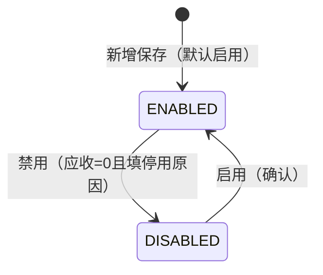

# 客户档案主PRD

> **版本**：V1.0.2 | 2026-10-03  
> **读者**：产品经理、前端工程师、测试工程师  
> **说明**：客户档案属于主数据 CRUD。字段定义以《客户档案字段清单》V1.0.2 定稿为准；本文档统一业务边界、结算联动、启停用规则、下游引用与验收口径，不重复定义字段本体。

---

## 1. 业务背景

强盛科技在批发、零售并行经营后，销售开单、出库与应收都依赖 **「卖给谁、怎么联系、怎么结算」** 的稳定识别。

若客户主数据分散在表格或业务员个人维护里，会出现：

- 同一客户在系统内外名称不一致，对账困难
- 联系人、电话、地址不统一，发货与回访信息错误
- 结算方式、账期、信用口径混乱，超信用发货无法事前约束
- 已不合作的客户仍被新单误选，或历史单据无法追溯原客户信息

因此，客户档案的目标是：**统一客户编码、识别信息、联系地址与结算口径**，并约束下游单据如何选用客户（见 §8）。实时应收余额由往来模块汇总，**不在**本档案替代记账职责。

---

## 2. 功能范围

**In Scope**

- 客户基础资料维护（企业 / 个人类型、A–E 等级）
- 联系人与省 / 市 / 区 / 县、详细地址维护
- 归属业务员、期初欠款 / 期初余额、结算方式、账期天数、**信用额度**（供销售硬控引用）维护
- 启用 / 禁用管理（含停用原因、**禁用前实时应收校验**）
- 列表（多条件筛选、期初金额排序）、新增、编辑、详情

**Out of Scope**

- 客户协同门户、CRM 跟进、公海池分配
- 在档案内展示或维护 **实时应收余额**、账龄明细（由往来 / 应收查询承担；禁用前 **实时查询** 同源接口）
- 在销售订单页 **执行** 信用校验（档案只维护 `信用额度` 阈值）
- 客户评级算法、自动升降级
- 审批流（无单据审核态，仅启停用）
- 物理删除档案
- 导入 / 导出

---

## 3. 模块定位

| 项目 | 内容 |
| :--- | :--- |
| 单据定位 | **主数据**；非业务流转单据，无审核状态机 |
| 模块类型 | 主数据 CRUD |
| 核心职责 | 统一客户识别信息、联系地址、结算口径与启停范围 |
| 直接服务 | 销售订单、销售出库、零售收银（挂客户时）、应收 / 对账查询 |
| 状态管理 | **启停用状态** `ENABLED` / `DISABLED`（`AGENTS.md`：状态变更仅能通过动作按钮触发；原型操作列文案为「启用 / 禁用」） |
| 字段权威源 | 《客户档案字段清单》V1.0.2 定稿 |

---

## 4. 典型业务场景

| 场景ID | 场景 | 类型 | 说明 |
| :--- | :--- | :--- | :--- |
| S01 | 新增企业客户 | 主流程 | 维护编码、名称、`ENTERPRISE`、等级、联系人、省市区与结算方式 |
| S02 | 新增个人客户 | 主流程 | `INDIVIDUAL`，名称可为个人姓名 |
| S03 | 维护地址与联系人 | 主流程 | 更新 `省份` / `城市` / `区/县` / `详细地址`、联系人、电话；不影响历史单据快照 |
| S04 | 维护结算与信用 | 主流程 | 调整 `结算方式`、`账期天数`、`信用额度`；现结与账期联动（R03） |
| S05 | 期初往来录入 | 主流程 | 建档或初始化时填写 `期初欠款`、`期初余额`；后续由销售、收款等单据驱动 |
| S06 | 禁用客户 | 辅助 | **实时应收余额 = 0** 后弹窗填写 `停用原因` 并完成禁用 |
| S07 | 恢复启用 | 辅助 | 禁用客户可重新在新单中选择 |
| S08 | 历史客户追溯 | 辅助 | 已禁用客户在历史销售单、应收查询仍可见 |

---

## 5. 状态与动作规则

### 5.1 启停用状态定义

| 状态 | 枚举 | 含义 |
| :--- | :--- | :--- |
| 启用 | `ENABLED` | 可在新建销售订单、零售收银等业务单据的客户选择器中被引用 |
| 停用 | `DISABLED` | 不可在新业务单据中选择；历史数据保留 |

### 5.2 状态流转图

### 5.3 状态流转表

| 当前状态 | 动作 | 目标状态 | 前置条件 |
| :--- | :--- | :--- | :--- |
| — | 新增保存 | `ENABLED` | 必填字段、编码唯一性、结算联动校验通过 |
| `ENABLED` | 禁用 | `DISABLED` | **实时应收余额 = 0**；`停用原因` 已填（1–200 字符） |
| `DISABLED` | 启用 | `ENABLED` | 用户确认（无需填写原因） |

### 5.4 动作能力矩阵

| 动作 | 启用 | 停用 | 说明 |
| :--- | :---: | :---: | :--- |
| 查看 | ✅ | ✅ | 列表、详情 |
| 编辑 | ✅ | ✅ | 受编码引用锁定约束 |
| 禁用 | ✅ | ❌ | 先校验 **实时应收余额 = 0**；弹窗填 `停用原因` |
| 启用 | ❌ | ✅ | 确认后恢复 |
| 删除 | ❌ | ❌ | 不提供；统一用停用 |

---

## 6. 模块级通用规则

| 规则ID | 规则 |
| :--- | :--- |
| R01 | **客户编码** 全局唯一（2–30 字符）；一旦被销售等业务单据引用后 **不可修改**。 |
| R02 | 必填字段以字段清单为准：至少包含 `客户编码`、`客户名称`、`客户类型`、`客户等级`、`联系人`、`联系电话`、`省份`、`城市`、`区/县`、`结算方式`。 |
| R03 | **结算联动**：`结算方式=ACCOUNT`（账期结算）时 `账期天数` 必填（0–365）；`结算方式=CASH`（现结）时 `账期天数` 自动为 `0` 且只读展示。 |
| R04 | 新增档案默认 **启用**；新增/编辑表单 **不展示** `启停用状态` 控件，仅通过「启用」「禁用」动作变更。 |
| R05 | **禁用**须填写 `停用原因`；禁用前 **实时应收余额必须为 0**（实时查询，口径见字段清单 §5.2）；禁用客户 **不可**在新业务中选择。 |
| R06 | 主数据 **不提供删除**；不再合作统一 **禁用**（`DISABLED`）。 |
| R07 | `期初欠款`、`期初余额` 为建档期初值，参与 **实时应收余额** 计算，**非**档案内存储的汇总字段。 |
| R08 | 选择器展示格式：`{客户编码} {客户名称}`（见字段清单 §4.3）。 |
| R09 | `归属业务员` 空时，列表与详情展示 `-`。 |
| R10 | `联系电话` 填写时须符合常规手机或座机格式。 |
| R11 | **`信用额度` 硬控**：当 `信用额度` **> 0** 时，销售订单（及挂客户的零售收银）保存/提交须满足 **实时应收余额 + 本单拟占用应收金额 ≤ 信用额度**，否则阻断；`信用额度 = 0` 表示不启用硬控。执行在销售模块，阈值读本档案。 |

---

## 7. 动作级规则

### 7.1 新增

| 规则ID | 规则 |
| :--- | :--- |
| A01 | 须填写字段清单中新增页必填项（见 R02）；表单分组为「基础识别信息」「经营与结算信息」。 |
| A02 | `客户编码` 保存时做全局唯一性校验，失败则阻断。 |
| A03 | 保存成功后 `启停用状态` 默认为 `ENABLED`，并写入 `创建人`、`创建时间` 等系统字段。 |
| A04 | `详细地址`、`归属业务员`、`期初欠款`、`期初余额`、`信用额度`、`客户备注` 为选填；金额字段默认 `0.00`。 |
| A05 | `省份` / `城市` / `区/县` 须按级联顺序选择：先选省再选市、区/县；未选上级时下级不可提交有效值。 |

### 7.2 编辑

| 规则ID | 规则 |
| :--- | :--- |
| A11 | **未引用**时 `客户编码` 可编辑并做唯一性校验；已被业务单据引用的客户，**`客户编码` 不可编辑**。 |
| A12 | 启用态下可编辑：除锁定编码外的全部基础识别与经营结算字段（含省市区、详细地址、期初金额、信用额度、结算方式等）。 |
| A13 | 停用态下仍允许编辑上述非编码、非状态字段。 |
| A14 | 切换 `结算方式` 时同步执行 R03 账期联动（现结重置账期为 0 并只读）。 |

### 7.3 停用 / 启用

| 规则ID | 规则 |
| :--- | :--- |
| A21 | 禁用必须通过 **禁用** 动作按钮（列表/详情）。 |
| A22 | 点击「禁用」时 **先** 查询 **实时应收余额**（与应收查询/往来模块 **同一汇总接口**）；若 **> 0**，**Toast 阻断且不打开**停用弹窗；若 **= 0**，再打开弹窗，`停用原因` 必填（1–200 字符）后完成禁用。 |
| A23 | 启用无需填原因；启用后详情 `停用原因` 展示 `-`。 |
| A24 | **启停用不得在编辑表单中以下拉或输入方式修改**（`AGENTS.md`）。 |

### 7.4 列表与筛选

| 规则ID | 规则 |
| :--- | :--- |
| A31 | 列表推荐列与筛选项见字段清单 §4.1、§4.2；`期初欠款`、`期初余额` 支持列排序。 |
| A32 | `客户编码` 筛选支持批量精确匹配；分隔符与最大条数见 §13 待确认。 |
| A33 | 列表操作：查看、编辑、启用或禁用（与当前 `启停用状态` 互斥展示）。 |

---

## 8. 下游引用影响规则

| 引用模块 | 引用方式 | 说明 |
| :--- | :--- | :--- |
| 销售订单 | 选择客户 | 仅可选 `ENABLED` 客户；快照见字段清单 §5.1；**信用硬控 R11**（读 `信用额度` + 实时应收） |
| 销售出库 | 继承订单或选客户 | 继承订单客户快照，或同销售订单快照口径 |
| 零售收银 | 挂客户（若启用） | 快照 `客户编码`、`客户名称`；若挂客户且 `信用额度` > 0，**同 R11 硬控** |
| 应收 / 对账 | 展示与汇总 | 提供 **实时应收余额** 查询，与禁用校验 **同源** |

补充规则：

- 下游单据保存时固化字段见字段清单 §5.1；档案后续改名 **不影响** 已有单据快照中的 `客户名称`（若单据已快照）
- 停用客户不影响历史销售单据与应收查询中的历史展示
- **信用额度硬控** 在销售/零售模块执行，客户档案仅维护额度值（R11）

---

## 9. 异常与边界规则

| 场景 | 处理口径 |
| :--- | :--- |
| 客户编码重复 | 阻断保存，字段提示「客户编码已存在」 |
| 停用时未填原因 | 阻断停用，弹窗内提示「停用原因不能为空」 |
| 禁用时实时应收 &gt; 0 | Toast 阻断且不打开弹窗：「该客户仍有未结清应收，请先收款或对账后再禁用」 |
| 已引用客户改编码 | 阻断，Toast「该客户已被业务单据引用，编码不可修改」 |
| 账期结算未填账期天数 | 阻断保存，字段提示账期天数必填 |
| 现结时手动改账期 | 不提供编辑；展示为 `0` 且只读 |
| 联系电话格式不合法 | 阻断保存或失焦提示，字段红字「请输入有效的手机号或座机号」 |
| 省市区未按级联完整选择 | 阻断保存，定位未填写的行政区字段 |
| 客户名称重复、编码不同 | 一期允许，建议人工确认 |
| 在表单中改启停用状态 | 不提供该控件 |

---

## 10. 权限设计

> **课程口径说明**：练手一期默认 **销售** 可维护客户档案以便开单；**财务** 以查看为主；**启用 / 禁用** 建议限制为 **管理员**。实际企业可把建档权限收紧至销售主管或管理员。

| 操作 | 销售 | 财务 | 管理员 |
| :--- | :---: | :---: | :---: |
| 查看 | ✅ | ✅ | ✅ |
| 新增 | ✅ | ❌ | ✅ |
| 编辑 | ✅ | ❌ | ✅ |
| 启用 / 禁用 | ❌ | ❌ | ✅ |

---

## 11. 反馈与验收重点

### 11.1 关键反馈

| 操作 | 反馈方式 | 文案 |
| :--- | :--- | :--- |
| 保存成功 | Toast | 保存成功 |
| 启用成功 | Toast | 客户已启用 |
| 禁用成功 | Toast | 客户已停用 |
| 编码重复 | 字段红字 | 客户编码已存在 |
| 已引用不可改编码 | Toast | 该客户已被业务单据引用，编码不可修改 |
| 停用原因为空 | 弹窗红字 | 停用原因不能为空 |
| 禁用应收未清零 | Toast | 该客户仍有未结清应收，请先收款或对账后再禁用 |
| 结算方式切换 | 联动更新 | 现结时账期置 0 且只读 |
| 联系电话格式非法 | 字段红字 | 请输入有效的手机号或座机号 |
| 账期结算未填账期 | 字段红字 | 请填写账期天数 |

> **UI 与 Toast 用词**：操作按钮对齐原型用 **「禁用」**；成功 Toast 用 **「客户已停用」** 表述 `DISABLED` 结果，二者语义一致。

### 11.2 验收标准

| 验收编号 | 场景 | 前置条件 | 操作 | 预期结果 |
| :--- | :--- | :--- | :--- | :--- |
| V01 | 编码唯一 | 已存在 `CUST-0001` | 新增同编码客户 | 保存失败，提示编码已存在 |
| V02 | 必填完整 | — | 缺少 `结算方式` 提交 | 保存失败，定位首个报错字段 |
| V03 | 账期联动 | 结算方式=账期结算 | 不填账期天数保存 | 保存失败，账期天数必填 |
| V04 | 现结账期 | 结算方式=现结 | 查看编辑页 `账期天数` | 值为 0 且只读 |
| V05 | 引用后编码锁定 | 客户已被销售单引用 | 编辑编码 | 不可编辑或保存被阻断并提示 |
| V06 | 启停用路径 | 启用态客户 | 编辑表单 | 无 `启停用状态` 下拉；仅列表/详情操作按钮可停用 |
| V07 | 禁用成功 | 实时应收 = 0 | 禁用并填原因 | 状态变为 `DISABLED`，详情 `停用原因` 有值 |
| V07a | 禁用阻断 | 实时应收 &gt; 0 | 点击禁用 | Toast 阻断，不打开弹窗 |
| V08 | 停用不可新单选 | 客户已停用 | 新建销售订单选客户 | 选单器中不出现该客户 |
| V09 | 无删除 | 任意客户 | 全页面 | 无删除入口 |
| V10 | 与字段清单一致 | — | 对照字段清单 V1.0.2 | 页面字段名、枚举与清单一致 |
| V13 | 信用硬控 | 客户 `信用额度` &gt; 0 | 销售订单保存超额度 | 阻断保存（销售模块验收，读档案额度） |
| V11 | 列表筛选 | 有多条客户 | 按类型、等级、结算方式筛选 | 结果与条件一致 |
| V12 | 期初列排序 | 列表有多条 | 点击期初欠款或期初余额排序 | 金额列排序正确 |

---

## 12. 关联文档

| 文档 | 关系 |
| :--- | :--- |
| 《客户档案字段清单》V1.0.2 定稿 | 字段唯一权威源 |
| 《客户档案_前端Demo版PRD》v1.0.2 | 页面与控件 |
| 《客户档案-PRD套件交叉走查报告》 | 套件一致性记录 |
| `context/01-什么是进销存系统.md` | 进销存场景与客户 / 往来角色 |

---

## 13. 待确认事项

| # | 问题 | 影响 |
| :--- | :--- | :--- |
| 1 | `期初欠款` / `期初余额` 建档后是否允许修改 | A12、编辑页 |
| 2 | `省份` / `城市` / `区/县` 是否接入国标全集或允许手工录入 | A05 |
| 3 | 列表是否增加 `启停用状态` 列及筛选 | A31 |
| 4 | `归属业务员` 是否改为引用业务员档案 SelectWithSearch | 主数据一致性 |
| 5 | `客户编码` 批量精确筛选的分隔符与最大条数 | A32 |
| 6 | **实时应收余额** 汇总接口与「客户应收查询」模块 **强制同源**（禁用 A22、销售 R11 联调） | A22、R11、应收模块 PRD |

**已定稿（2026-10-03）**：禁用前须 **实时应收余额 = 0**；`信用额度` **> 0** 时销售开单 **硬控**（R11，字段清单 §4.6）。

字段级待确认见《客户档案字段清单》§六。

---

## 自检记录

| 检查项 | 结果 |
| :--- | :--- |
| 1. 是否未生成 Demo PRD / 用例推演？ | ✅ 仅主 PRD |
| 2. 字段名是否均来自《客户档案字段清单》V1.0？ | ✅ |
| 3. 是否未把销售出库、收款、实时应收记账职责写入客户档案？ | ✅ |
| 4. 启停用是否有入口、出口，且仅动作按钮变更？ | ✅ |
| 5. 结算方式 / 账期联动是否与字段清单 §4.5 一致？ | ✅ |
| 6. 禁用应收校验、信用硬控是否与字段清单 §4.6 一致？ | ✅ |
