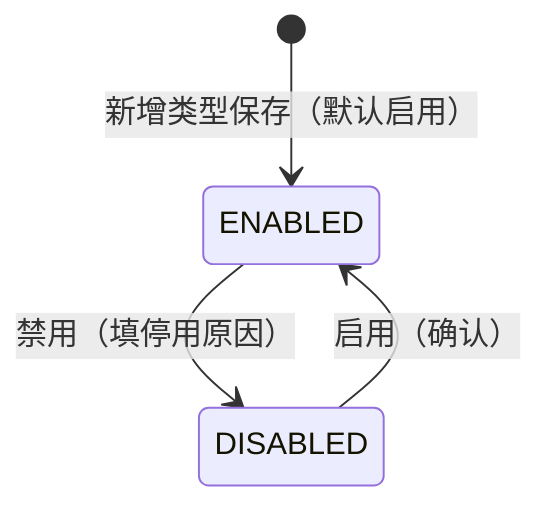
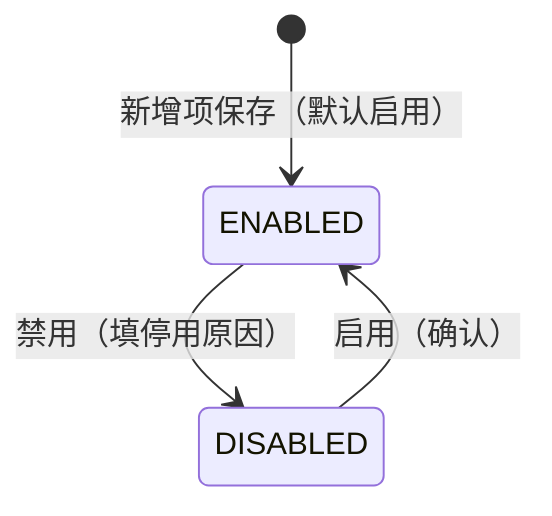

# 数据字典主PRD

> **版本**：V1.0 | 2026-10-03  
> **读者**：产品经理、前端工程师、测试工程师  
> **说明**：数据字典维护 **字典类型** 与 **字典项** 两类配置数据，供客户档案、商品档案及业务单据下拉引用。字段定义以《数据字典字段清单》V1.0 定稿为准；本文档统一业务边界、双实体启停规则、树形与下游引用口径，不重复定义字段本体。

---

## 1. 业务背景

强盛科技进销存中，除客户/供应商/商品/仓库/物流等 **主体档案** 外，仍有大量 **可枚举、可扩展** 的基础口径（商品分类、计量单位、客户等级、退货原因标签等）。若分散在 Excel、各模块硬编码或口头约定中，会导致下拉不一致、扩展需发版、树形分类无法约束「只选叶子」等问题。

数据字典在 **基础资料** 下提供统一入口：支持 **系统预置 + 用户自定义** 字典类型，并在类型下维护字典项（平铺或 **最多二级树**）。业务模块通过 **类型编码** 读取选项；**客户档案 `客户等级`** 已确认改读预置类型 `CUSTOMER_GRADE`，不再使用固定 A–E 枚举。

一期 **手工维护**，不对接外部 MDM/ERP 字典同步；**无审核流**，保存即生效；**不提供物理删除**（`AGENTS.md`：统一 **启用/禁用** 下线）。

---

## 2. 功能范围

**In Scope**

- 字典 **类型** 维护：列表、筛选、新增、编辑、详情；预置 + 自定义
- 字典 **项** 维护：在选定类型下平铺表或 **二级树表**；新增、编辑、详情
- 类型与项的 **使用状态** `ENABLED` / `DISABLED`（含 `停用原因`；**仅动作按钮**变更）
- 对外 **只读查询**：按类型编码返回 **启用** 项；树形 **仅叶子** 可选（见字段清单 §5.2）
- 一期预置初始化：`PRODUCT_CATEGORY`（树）、`UNIT`（平铺）、`CUSTOMER_GRADE`（平铺）及 Demo 种子项（字段清单 §1.1、§5.5）
- 左栏类型、右栏项/树的 **单页主从布局**（Demo 路由 `#/master/dictionaries`）

**Out of Scope**

- 用字典替代客户/供应商/商品/仓库/物流 **主体档案**
- 字典变更 **审批流**、版本号、生效日期
- 与外部系统 **自动同步** 字典
- 字典项上维护金额、库存、往来等业务量
- 一期 **批量导入/导出**
- 物理 **删除** 类型或项
- 树形 **三级及以下**
- 多组织/多租户字典隔离
- 禁用项/类型前的 **引用占用强校验**（业务功能一览表 DF12 为 P2；一期默认 **不阻断**，见 §9）
- 操作日志独立模块（DF13 P2；一期可不实现）

---

## 3. 模块定位

| 项目 | 内容 |
| :--- | :--- |
| 单据定位 | **配置类主数据**；非业务流转单据，无「待提交/待审核」状态机 |
| 模块类型 | 双实体 CRUD（字典类型 + 字典项） |
| 核心职责 | 集中维护可引用选项的类型与项；约束启停与树形叶子引用 |
| 直接服务 | 客户档案（`CUSTOMER_GRADE`）、商品档案（`PRODUCT_CATEGORY`、`UNIT`，待各模块 PRD 挂载）、后续业务单据扩展类型 |
| 状态管理 | 类型、项各自 **使用状态**；变更 **仅** 通过「启用/禁用」动作（`AGENTS.md`） |
| 字段权威源 | 《数据字典字段清单》V1.0 定稿 |

---

## 4. 典型业务场景

| 场景ID | 场景 | 类型 | 说明 |
| :--- | :--- | :--- | :--- |
| S01 | 初始化预置类型 | 主流程 | 系统带入分类/单位/客户等级三类及种子项 |
| S02 | 自定义新类型 | 主流程 | 如新增 `RETURN_REASON` 平铺类型，保存后左栏可选 |
| S03 | 维护客户等级项 | 主流程 | 在 `CUSTOMER_GRADE` 下新增 `F/F级` 等，客户建档下拉可见 |
| S04 | 维护二级商品分类 | 主流程 | `PRODUCT_CATEGORY` 下一级「数码」、二级「手机」（叶子） |
| S05 | 一级分类无子节点 | 主流程 | 一级项无子项时 `是否叶子=true`，可被商品直接引用 |
| S06 | 禁用字典项 | 辅助 | 填 `停用原因` 后禁用；新单不可选；历史档案/单据保留原值 |
| S07 | 禁用整个类型 | 辅助 | 类型 `DISABLED` 后其下所有项 **均不可** 被新单引用（即使项仍为启用） |
| S08 | 下游选单 | 主流程 | 客户档案选等级：仅 `CUSTOMER_GRADE` + 启用类型 + 启用 **叶子** 项 |
| S09 | 编码纠错 | 边缘 | 类型/项编码保存后一期不可改；策略为禁用旧记录 + 新建 |

---

## 5. 状态与动作规则

数据字典存在 **两套独立** 的使用状态：字典类型、字典项。均无审核态。

### 5.1 字典类型 — 使用状态

| 状态 | 枚举 | 含义 |
| :--- | :--- | :--- |
| 启用 | `ENABLED` | 该类型下 **启用态** 的字典项可被新业务引用（项本身还须满足叶子与启用） |
| 禁用 | `DISABLED` | 该类型下 **全部项** 不可被新业务引用 |

| 当前状态 | 动作 | 目标状态 | 前置条件 |
| :--- | :--- | :--- | :--- |
| — | 新增保存 | `ENABLED` | 类型必填校验通过 |
| `ENABLED` | 禁用 | `DISABLED` | `停用原因` 1–200 字符；一期 **不强制** 引用校验（待确认 Q05） |
| `DISABLED` | 启用 | `ENABLED` | 用户确认 |

| 动作 | 启用 | 禁用 |
| :--- | :---: | :---: |
| 查看类型 | ✅ | ✅ |
| 编辑类型 | ✅ | ✅ | 锁定字段见 §6 R07 |
| 禁用类型 | ✅ | ❌ | 弹窗填 `停用原因` |
| 启用类型 | ❌ | ✅ | |
| 删除 | ❌ | ❌ | |

### 5.2 字典项 — 使用状态

| 状态 | 枚举 | 含义 |
| :--- | :--- | :--- |
| 启用 | `ENABLED` | 且所属类型为 `ENABLED`、且 `是否叶子=true` 时，可被新业务引用 |
| 禁用 | `DISABLED` | 不可在新业务中选择；历史保留 |

| 当前状态 | 动作 | 目标状态 | 前置条件 |
| :--- | :--- | :--- | :--- |
| — | 新增保存 | `ENABLED` | 项必填校验通过；树形层级 ≤2 |
| `ENABLED` | 禁用 | `DISABLED` | `停用原因` 已填；一期 **不强制** 引用占用校验 |
| `DISABLED` | 启用 | `ENABLED` | 用户确认；若所属类型为 `DISABLED`，项仍 **不可** 被引用直至类型启用 |

| 动作 | 项启用 | 项禁用 |
| :--- | :---: | :---: |
| 查看/编辑项 | ✅ | ✅ |
| 禁用项 | ✅ | ❌ |
| 启用项 | ❌ | ✅ |
| 删除 | ❌ | ❌ |

> **组合规则**：业务可选条件 = 类型 `ENABLED` ∧ 项 `ENABLED` ∧ 项 `是否叶子=true`（平铺项恒为叶子）。

---

## 6. 模块级通用规则

| 规则ID | 规则 |
| :--- | :--- |
| R01 | 字典类型 **类型编码** 须符合 `[A-Z][A-Z0-9_]{1,31}`，**全局唯一**；**保存后不可修改**（预置与自定义均锁定）。 |
| R02 | 字典类型 **结构类型** `FLAT` / `TREE` 在 **新增时** 选定，**保存后不可修改**；`TREE` 表示字典项 **最多 2 级**。 |
| R03 | 用户可 **自定义新增** 字典类型；一期 **不限制** 类型数量（待确认见 §13）。 |
| R04 | 字典项 **项编码** 在同一 `所属类型编码` 下唯一；已被客户/商品/单据 **引用后不可修改** `项编码`。 |
| R05 | 树形：`父项编码` 仅指向 **一级** 项；**二级项** 必填父项；**不允许** 三级及以下。 |
| R06 | **是否叶子** 由系统计算：`FLAT` 恒 `true`；`TREE` 有子节点的一级为 `false`，无子一级与全部二级为 `true`；业务引用 **仅叶子**（字段清单 §5.2）。 |
| R07 | 类型启用态可编辑：`类型名称`、`类型说明`；项启用态可编辑：`项名称`、`排序号`、`项备注`（及未锁定的 `父项编码`）；锁定见字段清单 §5.4。 |
| R08 | 新增类型/项默认 **使用状态=ENABLED**；新增/编辑主表单 **不展示** 使用状态控件。 |
| R09 | **禁用** 类型或项须填写 `停用原因`（1–200 字符）。 |
| R10 | **不提供物理删除**；下线统一 **禁用**。 |
| R11 | 列表筛选：类型侧见字段清单 §5.1；文本类默认 **模糊 contains**；枚举 Select **精确**。 |
| R12 | 下游单据/档案保存时建议快照 **项编码 + 项名称**；客户等级存储项编码 vs 双字段见 §13 待确认。 |

---

## 7. 动作级规则

### 7.1 字典类型 — 新增

| 规则ID | 规则 |
| :--- | :--- |
| T-A01 | 必填：`类型编码`、`类型名称`、`结构类型`。 |
| T-A02 | 保存成功后默认 `使用状态=ENABLED`，`是否预置=false`，写入系统字段。 |
| T-A03 | `类型说明` 选填。 |

### 7.2 字典类型 — 编辑

| 规则ID | 规则 |
| :--- | :--- |
| T-A11 | `类型编码`、`结构类型`、`是否预置` **只读**。 |
| T-A12 | 可编辑：`类型名称`、`类型说明`（启用/禁用态均可，除非产品后续限制禁用态不可编辑）。 |
| T-A13 | `停用原因` 仅禁用弹窗维护；详情只读；启用态展示 `-`。 |

### 7.3 字典项 — 新增 / 编辑

| 规则ID | 规则 |
| :--- | :--- |
| I-A01 | `所属类型编码` 由左栏选中类型带出，只读。 |
| I-A02 | 必填：`项编码`、`项名称`；树形二级必填 `父项编码`。 |
| I-A03 | 保存时校验：同类型下 **项编码** 不重复；树形 **层级 ≤2**；父项必须是一级项。 |
| I-A04 | 若在一级项下 **新增第一个子项**，保存后该一级项 `是否叶子` 由 `true` 变为 `false`，且 **不可再被业务直接引用**。 |
| I-A05 | 已被引用后 `项编码` 只读；已有子项的一级项 `父项编码` 对其自身不适用，且该一级项作为父节点时 **不可** 再改层级关系（有子项后父项编码字段对其子项维护，一级项本身无父项）。 |
| I-A06 | `排序号` 默认 `0`；`项备注` 选填。 |

### 7.4 启用 / 禁用（类型与项）

| 规则ID | 规则 |
| :--- | :--- |
| E-A01 | 禁用必须通过 **禁用** 动作；**不得** 在编辑表单改 `使用状态`。 |
| E-A02 | 禁用前弹窗，`停用原因` 必填。 |
| E-A03 | 禁用成功写入 `禁用人`、`禁用时间`；启用写入 `启用人`、`启用时间`。 |
| E-A04 | 一期 **不实现** DF12 引用占用阻断；禁用后仅依赖「新单不可选」规则。 |

---

## 8. 下游引用影响规则

| 下游场景 | 字典类型编码 | 引用规则 | 快照建议 |
| :--- | :--- | :--- | :--- |
| 客户档案 — `客户等级` | `CUSTOMER_GRADE` | SelectWithSearch；类型+项均启用；平铺全为叶子 | 存 **项编码**（展示读名称）；待确认 §13 |
| 商品档案 — 分类 | `PRODUCT_CATEGORY` | 树形选单 **仅叶子** | `分类项编码`、`分类项名称` |
| 商品档案 — 单位 | `UNIT` | 平铺启用项 | `单位项编码`、`单位项名称` |
| 自定义类型 | 用户定义 CODE | 由各业务 PRD 挂载 DF10 同源 API | 按模块约定 |

补充：

- 档案/单据保存后改名 **不影响** 已快照的项名称（若已快照）
- 禁用项/类型不影响历史数据展示；新单选单器过滤掉不可选项
- **客户档案改造**：废弃固定 A–E；旧数据若存 `A` 等，兼容策略：按同编码匹配字典项或展示原值 + 待维护（见字段清单 §6）

**对外查询（DF10）口径**：

- 入参：`类型编码`、可选关键字
- 出参：仅 `使用状态=ENABLED` 且类型 `ENABLED` 的项；`TREE` 类型 **仅返回 `是否叶子=true` 的项**
- Demo：`listEnabledDictionaryItems(typeCode)` 与 Mock 存储同源

---

## 9. 异常与边界规则

| 场景 | 处理口径 |
| :--- | :--- |
| 类型编码格式错误或重复 | 保存失败，字段红字/Toast |
| 项编码同类型重复 | 保存失败 |
| 树形选父项为非一级 | 保存失败，「父项必须是一级节点」 |
| 试图保存三级节点 | 阻断，「树形字典最多 2 级」 |
| 禁用未填原因 | 弹窗内阻断 |
| 所属类型已禁用项仍为 ENABLED | 允许；但 **不可** 被新单引用 |
| 非叶子项被业务误引用 | 选单器层过滤；若历史脏数据，展示只读 |
| 修改已引用项编码 | 编辑页只读 |
| 预置类型删除 | 无删除入口 |
| 在表单改使用状态 | 不提供该控件 |

---

## 10. 权限设计

> 练手一期默认 **管理员** 维护字典；其他角色可 **查看**（供业务理解选项来源）。实际企业可将类型维护与项维护拆分权限。

| 操作 | 仓储 | 销售 | 采购 | 管理员 |
| :--- | :---: | :---: | :---: | :---: |
| 查看字典页 | ✅ | ✅ | ✅ | ✅ |
| 新增/编辑类型 | ❌ | ❌ | ❌ | ✅ |
| 类型启用/禁用 | ❌ | ❌ | ❌ | ✅ |
| 新增/编辑项 | ❌ | ❌ | ❌ | ✅ |
| 项启用/禁用 | ❌ | ❌ | ❌ | ✅ |

---

## 11. 反馈与验收重点

### 11.1 关键反馈

| 操作 | 反馈方式 | 文案 |
| :--- | :--- | :--- |
| 保存成功 | Toast | 保存成功 |
| 类型已启用 | Toast | 字典类型已启用 |
| 类型已禁用 | Toast | 字典类型已禁用 |
| 项已启用 | Toast | 字典项已启用 |
| 项已禁用 | Toast | 字典项已禁用 |
| 停用原因为空 | 弹窗红字 | 停用原因不能为空 |
| 树形超层级 | Toast | 树形字典最多 2 级 |

### 11.2 验收标准

| 验收编号 | 场景 | 前置条件 | 操作 | 预期结果 |
| :--- | :--- | :--- | :--- | :--- |
| V01 | 预置初始化 | 首次进入 | 打开数据字典 | 左栏含 `PRODUCT_CATEGORY`、`UNIT`、`CUSTOMER_GRADE` |
| V02 | 自定义类型 | — | 新增类型 `RETURN_REASON` 平铺 | 保存成功，默认启用，编码锁定 |
| V03 | 结构类型锁定 | 已保存类型 | 编辑 | `结构类型` 只读 |
| V04 | 二级分类 | `PRODUCT_CATEGORY` | 一级+二级各一条 | 二级为叶子；一级有子后非叶子 |
| V05 | 叶子引用 | 树形类型 | 调用 DF10 查询 | 仅返回叶子且启用项 |
| V06 | 客户等级 | `CUSTOMER_GRADE` 有 F 级 | 客户建档 | 下拉含 F 级（客户模块挂载后验收） |
| V07 | 禁用项 | 项启用 | 禁用并填原因 | 项 `DISABLED`；新单不可选 |
| V08 | 禁用类型 | 类型启用 | 禁用类型 | 类型下项均不可被新单引用 |
| V09 | 无删除 | 任意 | 全页 | 无删除入口 |
| V10 | 状态变更路径 | 启用项 | 编辑表单 | 无 `使用状态` 下拉 |
| V11 | 字段一致 | — | 对照字段清单 V1.0 | 字段名、枚举一致 |
| V12 | 编码锁定 | 项已被客户引用 | 编辑项 | `项编码` 只读 |

---

## 12. 关联文档

| 文档 | 关系 |
| :--- | :--- |
| 《数据字典字段清单》V1.0 定稿 | 字段唯一权威源 |
| 《数据字典_前端Demo版PRD》V1.0 | 页面与控件 |
| 《数据字典需求规格说明书》v1.0 | 需求基线 |
| 《数据字典业务功能需求一览表》v1.0 | 功能点 DF01–DF13 |
| 《客户档案主PRD》/ 字段清单 | `客户等级` 改读 `CUSTOMER_GRADE`（待同步） |
| `context/01-什么是进销存系统.md` | 基础资料职责 |

---

## 13. 待确认事项

| # | 问题 | 影响 |
| :--- | :--- | :--- |
| 1 | 客户档案存 **项编码** 还是编码+名称快照 | 客户字段清单、列表展示 |
| 2 | 是否允许 **禁用预置类型**（如 `UNIT`） | 全局开单与空选项 |
| 3 | 自定义类型 **数量上限** | 性能与运维 |
| 4 | 禁用项/类型前是否 **校验引用**（DF12） | 禁用弹窗与阻断 Toast |

字段级待确认见《数据字典字段清单》§6。

### 13.1 产品定稿（2026-10-03）

| 定稿项 | 口径 |
| :--- | :--- |
| 树形层级 | **最多 2 级**；业务 **仅引用叶子** |
| 预置类型 | `PRODUCT_CATEGORY`、`UNIT`、`CUSTOMER_GRADE` + 用户自定义 |
| 客户等级 | 改读 `CUSTOMER_GRADE`，不再固定 A–E |
| 删除 | 不提供；统一禁用 |

---

## 14. 字段清单引用

实现与测试以《数据字典字段清单》V1.0 定稿为准：

- **字典类型**：`类型编码`、`类型名称`、`结构类型`、`类型说明`、`是否预置`、`使用状态`、`停用原因` + §三系统字段
- **字典项**：`所属类型编码`、`项编码`、`项名称`、`父项编码`、`层级`、`是否叶子`、`排序号`、`项备注`、`使用状态`、`停用原因` + §四系统字段
- **展示与引用**：§5.1–§5.5

---

## 自检记录

| 检查项 | 结果 |
| :--- | :--- |
| 1. 是否包含业务背景、In/Out Scope、定位、场景、状态机、规则、验收？ | ✅ |
| 2. 字段名是否均来自《数据字典字段清单》？ | ✅ |
| 3. 是否无审核流、无删除、启停仅动作按钮？ | ✅ |
| 4. 是否明确双实体状态与客户等级读字典？ | ✅ |
| 5. 是否未重复编写字段表？ | ✅ |
