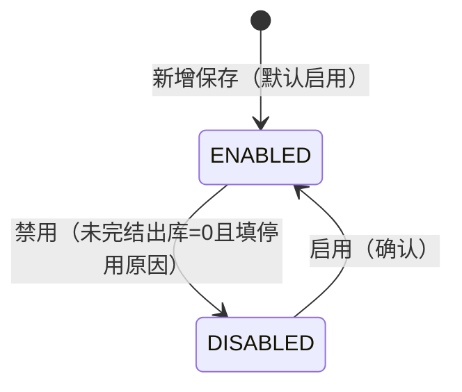

# 物流管理主PRD

> **版本**：V1.1 | 2026-10-03  
> **读者**：产品经理、前端工程师、测试工程师  
> **说明**：物流档案（物流方式）属于主数据 CRUD。字段定义以《物流管理字段清单》V1.0.2 定稿为准；本文档统一业务边界、使用状态规则、下游引用与验收口径，不重复定义字段本体。

---

## 1. 业务背景

强盛科技在批发、零售与采购并行经营后，销售出库、零售发货等环节都依赖 **「用什么方式把货交给客户」** 的稳定识别。

若物流方式分散在表格、口头约定或出库单临时手填里，会出现：

- 同一承运渠道在不同单据里名称不一致，对账与统计困难
- 快递、干线物流、门店自提混用同一套模糊叫法，报表无法按类型汇总
- 已停用的物流方式仍被新单误选，或历史出库无法追溯当时选用的方式

进销存一期以 **手工维护物流档案** 为主（见 `context/01-什么是进销存系统.md`），不在本模块对接承运商 API、电子面单或轨迹回传。

因此，物流管理的目标是：**统一物流编码、名称、类型与服务商信息**，并约束下游单据如何选用物流方式（见 §8）。运单号、运费、轨迹状态等 **履约执行信息** 归属出库/发货单据，**不在**本档案维护。

---

## 2. 功能范围

**In Scope**

- 物流方式基础资料维护（`EXPRESS` 快递 / `FREIGHT` 物流 / `SELF_PICKUP` 自提）
- 物流编码 **系统自动编号**（`LOG-{4位序号}`）
- `物流服务商`（**文本**，不升级为枚举主数据）、`物流备注` 维护
- 启用 / 禁用管理（含 `停用原因`、**禁用前未完结出库单校验**；列表列标题为 **使用状态**）
- 列表（五条件筛选）、新增、编辑、详情
- 下游选择器引用规则与快照字段口径（见字段清单 §3.6）

**Out of Scope**

- 运单号、子母单、面单打印、运费模板、保价规则
- 承运商 API 下单、轨迹订阅、签收状态回写
- 在档案内维护或修改 **出库执行进度**、**物流费用结算**
- 物流服务商独立主数据、承运商枚举档案（一期 **`物流服务商` 为文本 Input**）
- 审批流（无单据审核态，仅启用/禁用）
- 物理删除档案
- 导入 / 导出

---

## 3. 模块定位

| 项目 | 内容 |
| :--- | :--- |
| 单据定位 | **主数据**；非业务流转单据，无审核状态机 |
| 模块类型 | 主数据 CRUD（物流方式档案） |
| 核心职责 | 统一物流识别信息、类型分类与可用范围（`使用状态`） |
| 直接服务 | 销售出库、零售发货；采购退货出库（若业务单挂物流方式） |
| 状态管理 | **使用状态** `ENABLED` / `DISABLED`（`AGENTS.md`：状态变更 **仅** 能通过动作按钮触发；原型操作列为「启用 / 禁用」） |
| 字段权威源 | 《物流管理字段清单》V1.0.2 定稿 |

---

## 4. 典型业务场景

| 场景ID | 场景 | 类型 | 说明 |
| :--- | :--- | :--- | :--- |
| S01 | 新增快递方式 | 主流程 | 如 `LOG-0001` 顺丰特快，`EXPRESS`，`物流服务商` 填「顺丰」 |
| S02 | 新增干线/零担物流 | 主流程 | `FREIGHT`，如德邦定制仓配、西南专线联盟 |
| S03 | 新增门店自提 | 主流程 | `SELF_PICKUP`，如「门店自提」；`物流服务商` 通常留空，列表展示 `-` |
| S04 | 维护名称与备注 | 主流程 | 更新 `物流名称`、`物流服务商`、`物流备注`；不影响历史单据快照 |
| S05 | 禁用物流方式 | 辅助 | **未完结销售出库单 = 0** 后弹窗填写 `停用原因` 并禁用 |
| S06 | 恢复启用 | 辅助 | 禁用方式可重新在新单选择器中出现 |
| S07 | 历史方式追溯 | 辅助 | 已禁用方式在历史出库单仍可见（读单据快照或当时引用信息） |

---

## 5. 状态与动作规则

### 5.1 使用状态定义

| 状态 | 枚举 | 含义 |
| :--- | :--- | :--- |
| 启用 | `ENABLED` | 可在新建销售出库、零售发货等业务单据的物流选择器中被引用 |
| 禁用 | `DISABLED` | 不可在新业务单据中选择；历史数据保留 |

> 字段名为 **使用状态**；与其它基础资料「启停用状态」语义一致，枚举同为 `ENABLED` / `DISABLED`。

### 5.2 状态流转图

### 5.3 状态流转表

| 当前状态 | 动作 | 目标状态 | 前置条件 |
| :--- | :--- | :--- | :--- |
| — | 新增保存 | `ENABLED` | 必填字段校验通过；**保存时系统生成** `物流编码` |
| `ENABLED` | 禁用 | `DISABLED` | 引用该方式的 **未完结销售出库单 = 0**；`停用原因` 已填（1–200 字符） |
| `DISABLED` | 启用 | `ENABLED` | 用户确认（无需填写原因） |

### 5.4 动作能力矩阵

| 动作 | 启用 | 禁用 | 说明 |
| :--- | :---: | :---: | :--- |
| 查看 | ✅ | ✅ | 列表、详情 |
| 编辑 | ✅ | ✅ | 受编码引用、类型锁定约束 |
| 禁用 | ✅ | ❌ | 先校验未完结出库；=0 时弹窗填 `停用原因` |
| 启用 | ❌ | ✅ | 确认后恢复；记录 `启用人`、`启用时间` |
| 删除 | ❌ | ❌ | 不提供；统一用禁用 |

---

## 6. 模块级通用规则

| 规则ID | 规则 |
| :--- | :--- |
| R01 | **物流编码** 由系统在 **首次保存时** 按 `LOG-{4位序号}` 自动递增生成，全局唯一；**用户不可录入或修改**。 |
| R02 | 必填字段以字段清单为准：至少包含 `物流名称`、`物流类型`（`物流编码` 为系统自动）。 |
| R03 | 新增档案默认 **启用**（`使用状态=ENABLED`）；新增/编辑表单 **不展示** `使用状态` 控件，仅通过「启用」「禁用」动作变更。 |
| R04 | **禁用**须填写 `停用原因`（1–200 字符）。 |
| R05 | **禁用**前须查询该 `物流编码` 的 **未完结销售出库单** 数量（实时查询，口径见字段清单 §3.7）；**> 0** 阻断禁用；**= 0** 且填写 `停用原因` 后方可禁用。禁用后 **不可**在新建业务单选择器中选中。 |
| R06 | 主数据 **不提供删除**；不再使用的物流方式统一通过 **禁用** 动作下线（`AGENTS.md` 停用口径在本模块 UI 文案为「禁用」）。 |
| R07 | 保存后一期 **不可修改** `物流类型`；纠错策略：禁用旧档案 + 新建正确档案。 |
| R08 | 选择器展示格式：`{物流编码} {物流名称}`（见字段清单 §3.3）。 |
| R09 | `物流服务商` 为选填 **文本**（一期 **不** 改为枚举）；`SELF_PICKUP` 时通常为空，列表/详情空值展示 `-`。 |
| R10 | 列表筛选项：`物流编码`、`物流名称`、`物流类型`、`物流服务商`、`使用状态`；文本类筛选一期默认 **模糊匹配**（contains）。 |

---

## 7. 动作级规则

### 7.1 新增

| 规则ID | 规则 |
| :--- | :--- |
| A01 | 须填写新增页必填项：`物流名称`、`物流类型`。 |
| A02 | 保存成功时系统分配 **下一个** `物流编码`（`LOG-xxxx`）；若并发冲突则重试序号；失败则阻断保存。 |
| A03 | 保存成功后 `使用状态` 默认为 `ENABLED`，并写入 `创建人`、`创建时间`、`物流编码` 等系统字段。 |
| A04 | `物流服务商`、`物流备注` 为选填；新增页 **不展示** 可编辑编码框，可只读提示「保存后自动生成物流编码」。 |
| A05 | 表单分组标题为 **基础识别信息**；与字段清单一致，无第二业务分组。 |

### 7.2 编辑

| 规则ID | 规则 |
| :--- | :--- |
| A11 | **`物流编码` 编辑页始终只读**（系统生成，不可改）。 |
| A12 | **`物流类型` 保存后只读**，一期不允许修改。 |
| A13 | 启用态下可编辑：`物流名称`、`物流服务商`、`物流备注`。 |
| A14 | 禁用态下仍允许编辑上述非锁定字段（不含编码、类型、使用状态）。 |
| A15 | `停用原因` 不在编辑主表单维护；详情只读展示；启用态展示 `-`。 |

### 7.3 禁用 / 启用

| 规则ID | 规则 |
| :--- | :--- |
| A21 | 禁用必须通过 **禁用** 动作按钮；点击时 **先** 查询未完结销售出库单数量。 |
| A22 | 未完结数量 **> 0** 时 **Toast 阻断且不打开** 停用原因弹窗；**= 0** 时打开弹窗，`停用原因` 必填。 |
| A23 | 禁用成功后更新 `使用状态`、`禁用人`、`禁用时间`；列表「使用状态」展示为禁用。 |
| A24 | 启用无需填原因；更新 `启用人`、`启用时间`。 |
| A25 | **使用状态不得在编辑表单中以下拉或输入方式修改**（`AGENTS.md`）。 |

---

## 8. 下游引用影响规则

| 引用模块 | 引用方式 | 说明 |
| :--- | :--- | :--- |
| 销售出库 | 选择物流方式 | 仅可选 `ENABLED`；快照 `物流编码`、`物流名称`、`物流类型`、`物流服务商` |
| 零售发货 | 选择物流方式 | 同上 |
| 采购退货出库 | 选择物流方式（若启用） | 同上 |

补充规则：

- 下游单据保存时固化字段见字段清单 §3.6；档案后续改名 **不影响** 已有单据快照中的 `物流名称`（若单据已快照）
- 禁用方式不影响历史出库单中的展示与统计追溯
- 本模块 **不** 承担填写运单号、回写轨迹的职责；该类字段在销售出库 / 发货执行 PRD 中定义

---

## 9. 异常与边界规则

| 场景 | 处理口径 |
| :--- | :--- |
| 物流编码重复（系统层） | 阻断保存，Toast「物流编码生成失败，请重试」 |
| 禁用时未填原因 | 阻断禁用，弹窗内提示「停用原因不能为空」 |
| 禁用时存在未完结出库单 | 阻断禁用，Toast「存在未完结的销售出库单引用该物流方式，请先处理后再禁用」 |
| 试图修改 `物流编码` | 编辑页只读，不提供修改入口 |
| 试图修改已保存的 `物流类型` | 不提供编辑入口（只读） |
| 物流名称重复、编码不同 | 一期允许，建议人工确认 |
| 在表单中改使用状态 | 不提供该控件 |
| 自提方式无服务商 | 允许保存；列表/详情 `物流服务商` 展示 `-` |
| 将运单号、运费写入物流档案 | 不提供字段；提示在出库单维护（Out of Scope） |

---

## 10. 权限设计

> **课程口径说明**：练手一期默认由 **管理员** 维护物流档案；仓储、销售等角色以 **查看** 为主。实际企业可把维护权限开放给仓储主管。

| 操作 | 仓储 | 销售 | 采购 | 管理员 |
| :--- | :---: | :---: | :---: | :---: |
| 查看 | ✅ | ✅ | ✅ | ✅ |
| 新增 | ❌ | ❌ | ❌ | ✅ |
| 编辑 | ❌ | ❌ | ❌ | ✅ |
| 启用/禁用 | ❌ | ❌ | ❌ | ✅ |

---

## 11. 反馈与验收重点

### 11.1 关键反馈

| 操作 | 反馈方式 | 文案 |
| :--- | :--- | :--- |
| 保存成功 | Toast | 保存成功 |
| 启用成功 | Toast | 物流方式已启用 |
| 禁用成功 | Toast | 物流方式已禁用 |
| 编码重复 | 字段红字 | 物流编码生成失败，请重试 |
| 未完结出库阻断禁用 | Toast | 存在未完结的销售出库单引用该物流方式，请先处理后再禁用 |
| 停用原因为空 | 弹窗红字 | 停用原因不能为空 |

> **UI 用语**：行/详情按钮为「禁用」；弹窗字段名为「停用原因」；成功 Toast 为「物流方式已禁用」，与 `DISABLED` 枚举一致。

### 11.2 验收标准

| 验收编号 | 场景 | 前置条件 | 操作 | 预期结果 |
| :--- | :--- | :--- | :--- | :--- |
| V01 | 自动编码 | 当前最大为 `LOG-0004` | 新增保存 | 新档案编码为 `LOG-0005` |
| V02 | 必填完整 | — | 缺少 `物流名称` 提交 | 保存失败，定位首个报错字段 |
| V03 | 类型锁定 | 已保存的档案 | 编辑页查看 `物流类型` | 只读，不可修改 |
| V04 | 编码只读 | 任意档案 | 编辑页查看 `物流编码` | 只读，不可编辑 |
| V05 | 状态变更路径 | 启用态档案 | 编辑表单 | 无 `使用状态` 下拉；仅列表/详情操作按钮可禁用 |
| V06 | 禁用成功 | 未完结出库 = 0 | 禁用并填 `停用原因` | `使用状态` 变为 `DISABLED` |
| V06a | 禁用阻断 | 存在未完结出库 | 点击禁用 | Toast 阻断，不打开弹窗 |
| V07 | 禁用不可新单选 | 档案已禁用 | 新建销售出库选物流 | 选单器中不出现该方式 |
| V08 | 自提无服务商 | — | 新增 `SELF_PICKUP` 且服务商为空 | 保存成功，列表服务商列展示 `-` |
| V09 | 无删除 | 任意档案 | 全页面 | 无删除入口 |
| V10 | 与字段清单一致 | — | 对照《物流管理字段清单》V1.0.2 | 页面字段名、枚举与清单一致 |
| V11 | 列表筛选 | 存在多条档案 | 按 `物流类型=快递` 筛选 | 仅展示 `EXPRESS` 记录 |
| V12 | 职责边界 | — | 物流档案页 | 无运单号、运费、轨迹字段 |

---

## 12. 关联文档

| 文档 | 关系 |
| :--- | :--- |
| 《物流管理字段清单》V1.0.2 定稿 | 字段唯一权威源 |
| 《物流管理_前端Demo版PRD》V1.0.2 | 页面与控件 |
| `context/01-什么是进销存系统.md` | 进销存场景与手工维护物流口径 |

---

## 13. 待确认事项

| # | 问题 | 影响 |
| :--- | :--- | :--- |
| 1 | `物流名称` 是否要求全局唯一 | 重复数据治理 |
| 2 | 未完结销售出库 **状态枚举** 与查询接口 | 与《销售出库》主 PRD、Demo Mock **同源**（字段清单 §3.7） |
| 3 | 下游快照是否额外存储物流类型中文展示值 | 出库单打印/详情 |

字段级待确认见《物流管理字段清单》§四。

### 13.1 产品定稿（2026-10-03）

| 定稿项 | 口径 |
| :--- | :--- |
| 物流编码 | 保存时系统自动生成 `LOG-{4位序号}`，用户不可改 |
| 物流服务商 | 保持 **文本 Input**，不改为枚举 |
| 禁用校验 | 未完结销售出库单 **= 0** 方可禁用 |

---

## 14. 字段清单引用

本 PRD 不重复定义字段取值与页面列配置。实现与测试以《物流管理字段清单》V1.0.2 定稿为准，至少包含：

- **基础识别**：`物流编码`、`物流名称`、`物流类型`、`物流服务商`、`物流备注`、`使用状态`、`停用原因`
- **系统字段**：`创建人`、`创建时间`、`最后修改人`、`最后修改时间`、`禁用人`、`禁用时间`、`启用人`、`启用时间`

---

## 自检记录

| 检查项 | 结果 |
| :--- | :--- |
| 1. 是否未生成 Demo PRD / 用例推演？ | ✅ 仅主 PRD |
| 2. 字段名是否均来自《物流管理字段清单》V1.0.2？ | ✅ |
| 3. 是否未混入运单号、运费、轨迹等履约字段？ | ✅ |
| 4. 使用状态是否有入口、出口，且仅动作按钮变更？ | ✅ |
| 5. 是否未把出库执行、费用结算职责写入物流档案？ | ✅ |
| 6. 是否包含 AGENTS 要求的业务背景、范围、定位、场景、状态机、字段清单引用？ | ✅ |
