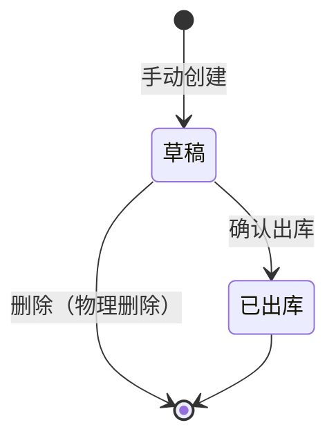

# 其他出库单模块共用规则

> 来源：《其他出库主PRD》《其他出库-业务流程推演》《其他出库字段清单》V1.0。在任意其他出库页面：右侧标注 → **本页规则**（含下方「跨页规则」）或 **全屏阅读器**。

<!-- anno:start id=g-background -->
## 模块背景与链路

### 业务背景

其他出库单处理**非销售、非采购退货**路径的出库（盘亏、报废、领用等）。无上游订单，**确认出库后库存减少并写入库存流水**。

### 单据定位

| 项目 | 内容 |
| --- | --- |
| 层级 | 执行层（库存调整） |
| 上游 | 无（手动创建） |
| 下游 | 库存流水 |
| 单号 | `OOUT{YYYYMMDD}-{4位}` |

字段结构对齐采购入库/出库，但**无上下游订单号**。

<!-- anno:end id=g-background -->

<!-- anno:start id=g-state -->
## 状态与流转

状态枚举：`DRAFT`（草稿）→ 确认出库 → `SHIPPED`（已出库，终态）。状态变更仅通过动作按钮触发，不在表单直接改状态字段。

<!-- anno:end id=g-state -->

<!-- anno:start id=g-actions -->
## 动作能力矩阵

不可用操作**不渲染**。

| 动作 | 草稿 | 已出库 |
| --- | :---: | :---: |
| 编辑 / 保存 | ✅ | ❌ |
| 删除（物理） | ✅ | ❌ |
| 确认出库 | ✅ | ❌ |
| 查看 / 导出 | ✅ | ✅ |

<!-- anno:end id=g-actions -->

<!-- anno:start id=g-rules -->
## 核心业务规则

| 项 | 规则 |
| --- | --- |
| 出库原因 | 盘亏 / 报废 / 领用等（主 PRD 未枚举固定值，**待确认**） |
| 数量 | 本次出库数量非负整数；至少一行 > 0 方可确认（细节**待确认**） |
| 动账 | 确认出库后库存 −N 并写库存流水 |
| 日期 | 出库日期默认当天（上限规则**待确认**） |

> 其他出库为独立调整单据，无上游订单与数量回写；是否校验库存充足、完整金额口径主 PRD/Demo 未展开，标**待确认**，不按惯例补齐。

<!-- anno:end id=g-rules -->

<!-- anno:start id=g-permission -->
## 权限与校验反馈

主 PRD/Demo 未单列权限矩阵与反馈文案；数据范围、按钮级权限与提示文案**待确认**。确认出库沿用「确认后减少库存」二次确认。

<!-- anno:end id=g-permission -->
