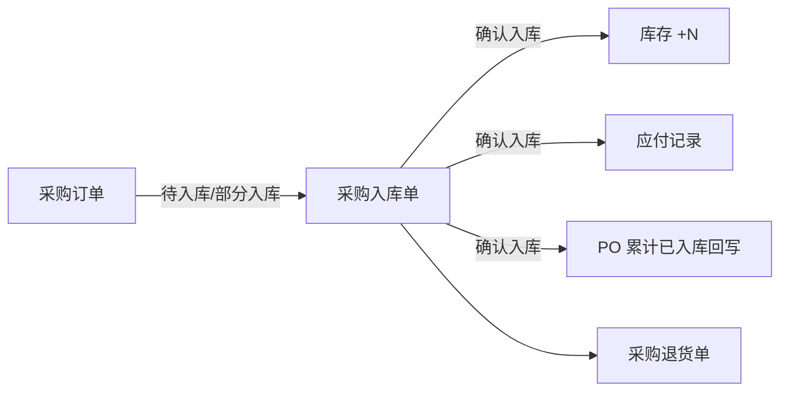
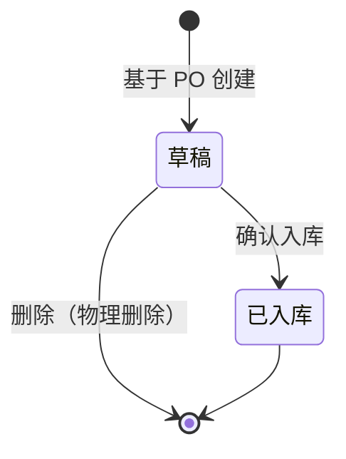

# 采购入库单模块共用规则

> 来源：《采购入库单主PRD》V1.0.1。在任意采购入库单页面：右侧标注 → **本页规则**（含下方「跨页规则」）或 **全屏阅读器**，无需下载。

<!-- anno:start id=g-background -->
## 模块背景与链路

### 业务背景（§1）

采购入库单是采购链路的**执行层单据**，解决「货到仓库、验货合格多少、何时入账增加库存与应付」。**确认入库是唯一动账入口**；一期必须关联**已审核采购订单**创建，已入库后的数量纠错走采购退货，不在入库单上改数。

### 功能范围（§2）

**In**：基于 PO 手动创建、草稿保存/编辑/物理删除、录入本次实收与入库数量及差异原因、确认入库（库存 +、生成应付、PO 回写）、列表/详情查询与导出、PO 关闭后对草稿的确认阻断。
**Out**：无 PO 直接入库、入库单独立多级审批、已入库作废/红字冲销界面、批次效期序列号、完整付款核销。

### 单据定位（§3）

| 项目 | 内容 |
| --- | --- |
| 层级 | 第 2 层——业务执行层 |
| 上游 | 采购订单（待入库 / 部分入库，审核通过后手动创建） |
| 下游 | 库存流水、应付记录；采购退货单（逆向） |

| 关系 | 说明 |
| --- | --- |
| 采购订单 : 采购入库单 | **1:N**（分批到货多张入库单） |
| PO 明细行 : 入库明细行 | **1:N**（同一商品行多次入账） |
| 入库单 : 应付记录 | **1:1**（一次确认生成一条基础应付） |

<!-- anno:end id=g-background -->

<!-- anno:start id=g-scenarios -->
## 业务场景（§4）

| 场景 | 类型 | 说明 |
| --- | --- | --- |
| S01 单次全量合格入库 | 主流程 | 创建 → 确认，实收=入库，PO 可能一次完成 |
| S02 分批多次入库 | 主流程 | 同一 PO 多张入库单累计至完成或缺量关闭 |
| S03 实收大于合格 | 主流程 | 入库 < 实收，差额不计库存与应付 |
| S04 保存草稿稍后确认 | 支线 | 不动账、不回写 PO |
| S05 超收阻断 | 支线 | 入库 > PO 未入库数量，保存/确认失败 |
| S06 PO 缺量关闭后草稿阻断 | 支线 | 确认入口禁用，需删草稿 |
| S07 已入库后退货 | 支线 | 从入库单发起退货，不改入库单数量 |

<!-- anno:end id=g-scenarios -->

<!-- anno:start id=g-state -->
## 状态与流转（§5）

状态枚举：`DRAFT`（草稿）→ `STOCKED_IN`（已入库，终态）；`VOIDED`（已作废）仅供后台数据修复，一期不提供前台作废。

| 当前 | 动作 | 前置 | 结果 | 后置影响 |
| --- | --- | --- | --- | --- |
| — | 创建 | PO 为待入库/部分入库 | 草稿 | 带出 PO 头与明细快照 |
| 草稿 | 保存 | 满足宽松校验 | 草稿 | 无下游影响 |
| 草稿 | 删除 | 无限制 | 物理消失 | 二次确认，不可恢复 |
| 草稿 | 确认入库 | 满足严格校验且非确认阻断 | 已入库 | 库存 +N、生成应付、PO 回写、PO 状态可能变更 |
| 已入库 | — | — | 已入库 | 全单只读 |

状态 Tag 配色：草稿灰、已入库绿、已作废红（仅数据兜底）。

<!-- anno:end id=g-state -->

<!-- anno:start id=g-actions -->
## 动作能力矩阵（§6）

不可用操作**不渲染**（非灰色禁用）。

| 动作 | 草稿 | 已入库 | 已作废 |
| --- | :---: | :---: | :---: |
| 编辑 | ✅ | ❌ | ❌ |
| 保存 | ✅ | ❌ | ❌ |
| 删除（物理） | ✅ | ❌ | ❌ |
| 确认入库 | ✅（条件） | ❌ | ❌ |
| 发起退货 | ❌ | ✅ | ❌ |
| 查看 / 导出 | ✅ | ✅ | ✅ |

「确认入库」在确认阻断=true 时不允许；采购员不展示该动作，仅仓管、管理员可确认。

<!-- anno:end id=g-actions -->

<!-- anno:start id=g-rules -->
## 核心业务规则（§7）

| ID | 规则 |
| --- | --- |
| R01 | 仅 PO 为「待入库」或「部分入库」时可创建入库单 |
| R02 | 创建带出 PO 头快照与全部明细行，**不可**增删商品或改单价/税率 |
| R04 | 从 PO「创建入库单」跳转须预填关联采购单号并锁定不可改 |
| R05 | 保存草稿允许部分行入库为 0；已填行须实收/入库为非负整数且入库 ≤ 实收 |
| R06 | 确认入库须至少一行本次入库数量 > 0 |
| R07 | 入库日期默认当天，允许过去（补录），**不允许未来** |
| R08 | 本次入库 ≤ PO 行当前未入库数量，超出阻断 |
| R09 | 本次入库 ≤ 本次实收数量，超出阻断 |
| R10 | 破损拒收数量 = 实收 − 入库；**不**回写 PO、**不**增库存、**不**进应付 |
| R11/R12 | 确认后按行累加 PO 累计已入库并重算未入库；全部归零则 PO 自动「已完成」 |
| R13 | 确认入库接口幂等，重复提交不重复累加 |
| R20–R22 | 行入库金额=本次入库 × 含税单价快照；单据总额=各行之和；应付按合格入库口径生成 |
| R14–R16 | PO 缺量关闭后该 PO 下草稿置确认阻断，禁止确认；已入库单不受影响，阻断下仍可查看/删除草稿 |
| R30/R31 | 仅草稿可物理删除；一期不提供已入库作废入口，纠错走采购退货 |

数量口径：采购数量（PO）/ 本次实收数量 / 本次入库数量三者禁止混用（§7.7）。

<!-- anno:end id=g-rules -->

<!-- anno:start id=g-permission -->
## 权限与校验反馈（§8–§9）

**数据范围**：仓管见本人管辖仓库的入库单；采购员见本人创建的 PO 关联单及本人创建的入库单；管理员全部。

**操作权限**：确认入库仅**仓管、管理员**；采购员可建草稿/删草稿/导出，列表与详情不展示「确认入库」。

**校验反馈**：确认入库失败时滚动至首个报错 + 字段/行内/区域红字，Toast `确认失败，{字段名}不满足条件`；超收 `本次入库数量不能超过未入库数量`；入库大于实收 `本次入库数量不能大于本次实收数量`；阻断 `关联采购订单已关闭，无法确认入库`。

**离开**：新增/编辑页有未保存改动时离开弹确认「当前有未保存的内容，确认离开？」。

<!-- anno:end id=g-permission -->
