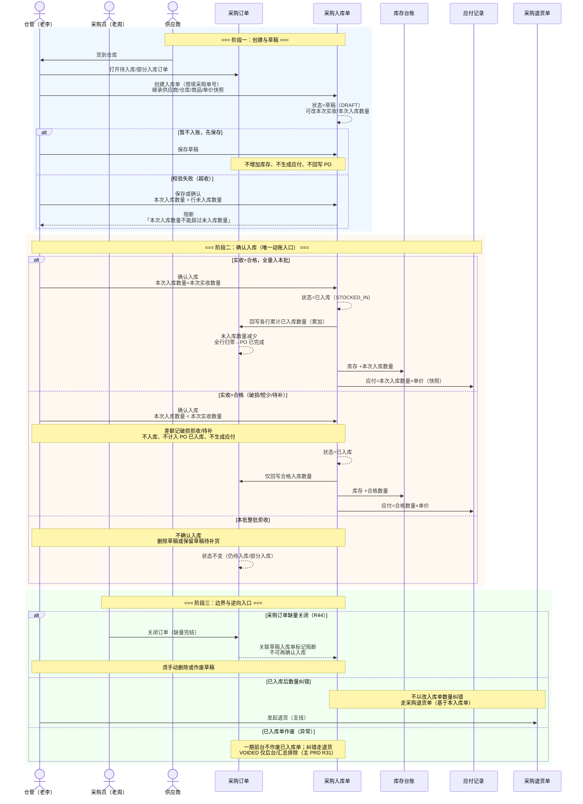

# 采购入库单-业务流程推演

> **版本**：V1.0 | 2026-10-07  
> **定位**：采购执行层（入库）的流程逻辑权威源。以采购入库单为主视角，说明其如何承接采购订单、驱动库存与应付，并与退货支线衔接。  
> **读者**：PM（编写主 PRD / 字段清单时的地图）、业务方（对齐仓管收货口径）、研发与测试（联动与异常边界）  
> **参考文档**：《采购订单主PRD》《采购订单-业务流程推演》《采购订单-用例数据推演》

---

## 一、推演范围

从仓管基于**已审核采购订单**创建采购入库单开始，到**确认入库**触发库存增加、应付生成、采购订单数量回写结束。覆盖正常路径 + 5 个关键异常/边界分支。

**前置条件**：关联采购订单状态为 `PENDING_STOCK_IN`（待入库）或 `PARTIAL_STOCK_IN`（部分入库）；供应商、入库仓库、商品行及单价已在订单审核时锁定。

**涉及系统模块**：采购管理 → 库存管理 → 往来管理  

**涉及单据**：采购订单（意图层）→ **采购入库单（执行层）** → 应付记录；逆向（本文仅标出入口，不展开规则）：采购入库单 → 采购退货单 → 采购退货出库单 → 库存回冲  

**不展开范围**：采购订单审核前流程、付款登记核销、采购退货单状态机细节、批次/效期（一期可选）。

---

## 二、涉及角色

| 角色 | 职责 | 参与节点 |
|---|---|---|
| 仓管（老李） | 收货、验货、录入实收/合格入库数量、确认入库 | 创建入库单、保存草稿、确认入库 |
| 采购员（老周） | 提供采购单号、协调补货或缺量完结 | 从订单发起「创建入库单」、PO 关闭后处理残留草稿 |
| 老板/审核人（林强） | 不直接操作入库单 | — |
| 财务 | 查看应付、后续付款 | 确认入库后应付记录生成 |
| 系统 | 回写 PO、校验超收、汇总有效入库单 | 确认入库、PO 关闭阻断 |

---

## 三、Mermaid 时序图



---

## 四、采购入库单状态与动作（摘要）

| 状态 | 枚举建议 | 含义 | 可编辑字段 | 允许动作 |
|---|---|---|---|---|
| 草稿 | `DRAFT` | 已创建未确认 | 实收/入库数量、入库日期、备注等 | 保存、确认入库、删除（物理删除） |
| 已入库 | `STOCKED_IN` | 已动账，终态（正常） | 只读 | 查看；发起退货（下游） |
| 已作废 | `VOIDED` | 无效凭证，不参与 PO 汇总 | 只读 | 一期无前台入口，见《采购入库单主PRD》R31 |

> **说明**：列表/详情 Demo 展示「草稿 / 已入库」；`VOIDED` 与 PO §9.4 汇总排除规则一致，冲销与界面见主 PRD。

**动作与状态变更必须通过按钮触发**（如「确认入库」「删除」），不在表单中直接改状态字段。

---

## 五、单据联动规则表

| 单据/记录 | 单据职责 | 核心字段 | 上游触发条件 | 下游联动 | 字段继承/快照规则 |
|---|---|---|---|---|---|
| 采购订单 | 采购意图与可入库余量 | 采购单号、未入库数量、订单状态 | — | 允许创建 N 张入库单 | — |
| **采购入库单** | 本批次实收与合格入库 | 入库单号、关联采购单号、入库仓库、本次实收数量、本次入库数量、状态 | PO 为待入库/部分入库；仓管手动创建 | 确认→库存 +N、应付、PO 回写 | 供应商、入库仓库、商品名称、单价（含税）、税率等自 PO **快照**，后续档案变更不影响本单 |
| 库存台账/流水 | 实物库存 | 仓库、SKU、数量 | 入库单确认 | — | 流水关联入库单号；业务类型=采购入库 |
| 应付记录 | 应付账款 | 应付单号、关联入库单号、应付金额 | 入库单确认 | 付款登记（另模块） | 应付金额=Σ行（本次入库数量×单价快照）；破损拒收部分不计入 |
| 采购退货单 | 已入库商品的退货意图 | 关联入库单号、退货数量 | 已入库的采购入库单 | 退货出库→库存减少 | 供应商/商品/单价自入库单快照继承 |

### 5.1 数量校验（与采购订单 R25 对齐）

| 校验点 | 规则 | 失败处理 |
|---|---|---|
| 行级超收 | 本次入库数量 ≤ 对应 PO 行「未入库数量」 | 保存/确认阻断 |
| 实收与合格 | 本次入库数量 ≤ 本次实收数量 | 阻断或红字提示 |
| 破损差额 | 本次实收数量 − 本次入库数量 = 破损拒收/待补数量（可记原因） | 差额不入库、不回写 PO、不生成应付 |
| PO 关闭后 | 关联 PO 已缺量完结且草稿被阻断 | 禁止确认入库 |

### 5.2 回写逻辑（PO R23）

```
FOR EACH 入库单明细行（关联 PO 行） DO
    PO行.累计已入库数量 += 本行.本次入库数量   // 仅合格入库数量
    PO行.未入库数量 = PO行.采购数量 - PO行.累计已入库数量
END FOR

PO.订单状态：
    IF 存在任一 PO行.未入库数量 > 0 AND 存在已确认入库 THEN 部分入库
    ELSE IF 全部 PO行.未入库数量 = 0 THEN 已完成（自动）
    ELSE 待入库
```

同一入库单号重复提交回写时，以**最新确认值覆盖**，不重复累加（PO §9.3 幂等口径）。

---

## 六、关键异常分支（清单）

| 编号 | 场景 | 入库单侧表现 | 对 PO / 库存 / 应付 |
|---|---|---|---|
| E01 | 分批到货 | 一张 PO 多张 PI（1:N） | 每次确认累加；PO 可能长期部分入库 |
| E02 | 破损拒收/待补 | 实收 60、入库 55 | 库存 +55；应付 +55 口径；PO +55；差额 5 待补或后续缺量完结 |
| E03 | 超收 | 入库 101、未入库 100 | 阻断，不产生草稿外的动账 |
| E04 | 仅保存草稿 | 状态保持草稿 | 无任何下游影响 |
| E05 | PO 关闭时存在草稿 PI | 确认被阻断 | 已入库 PI 不受影响；草稿需人工删除 |
| E06 | 已入库需纠错 | 不改历史 PI 数量 | 走退货支线；已作废 PI 不参与 PO 汇总（冲销细节待定义） |

---

## 七、关键设计决策

### 7.1 为什么库存变动只发生在「确认入库」？

与进销存「计划层 / 执行层」分离一致：**采购订单审核不碰库存**；只有仓管确认本批合格数量后，才写入库存流水与成本口径，避免「供应商还没到货账面已有库存」。

### 7.2 为什么区分「本次实收数量」与「本次入库数量」？

实收反映**物理到货**（含不良品）；入库数量反映**验货合格入账**数量。差额用于破损拒收/待补叙事，且**不进入应付**（与用例推演一致：应付按合格入库口径）。是否单独落「差异记录表」见 §八待确认。

### 7.3 为什么入库单必须关联采购订单创建（一期）？

- 价格与供应商以 PO 审核结果为唯一来源，应付可对账到「哪张订单、什么单价」。  
- 未入库数量在 PO 上集中计算，防止多单合计超收。  
- 一期不做无 PO 的「直接采购入库」；若未来支持，需单独定义价格与应付来源。

### 7.4 草稿与删除

草稿不产生任何回写，允许仓管货到后先录数、稍后再确认。草稿支持**物理删除**（与采购订单草稿删除风格一致）；已入库单不应物理删除，应通过退货或作废+冲销处理。

### 7.5 与采购订单流程推演的关系

《采购订单-业务流程推演》描述整条采购链路；**本文是其中「阶段二：收货入库」的执行层展开**。PO 侧「缺量完结」「作废」对 PI 的约束（R44、R33）在本文阶段三体现。

---

## 八、设计结论（原待确认项）

| 编号 | 结论 | 依据文档 |
|---|---|---|
| Q01 | 已入库一期**不作废**；纠错走采购退货；`VOIDED` 仅后台与汇总排除 | 主 PRD R31 |
| Q02 | 行级「破损拒收数量」「差异原因」，不落独立差异单 | 字段清单 §二 |
| Q03 | 无独立审核，**确认入库**即终审 | 主 PRD §2 Out of Scope |
| Q04 | **入库日期**默认当天，可补录过去、不可未来 | 主 PRD R07 |
| Q05 | 带出 PO 全部行；允许行级本次入库为 0；确认时至少一行 > 0 | 主 PRD R05、R06 |

---

## 九、PRD 套件索引

| 文档 | 状态 |
|---|---|
| 《采购入库单主PRD》 | 已编写 |
| 《采购入库单字段清单》 | 已编写 |
| 《采购入库单-用例数据推演》 | 已编写 |
| Demo PRD（列表/表单/详情） | 已编写 |
