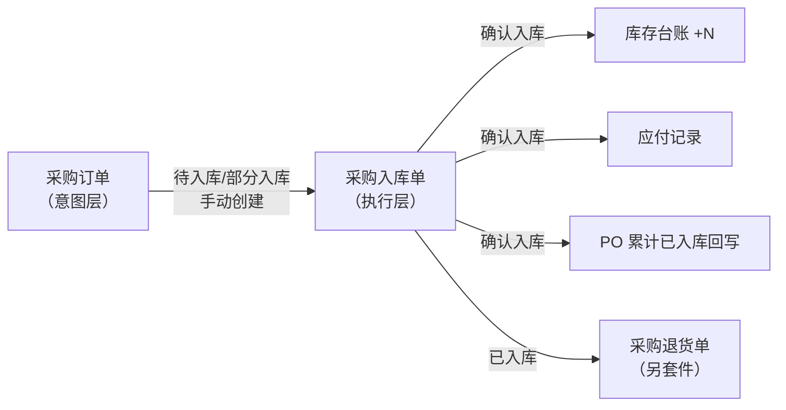
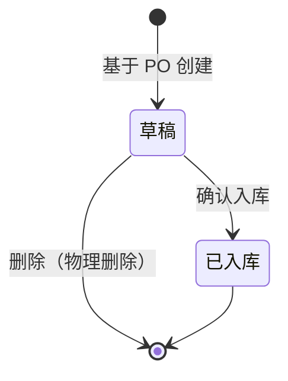

# 采购入库单主PRD

> **版本**：V1.0.1 | 2026-10-07  
> **读者**：研发工程师、测试工程师、产品复核  
> **依据**：《采购入库单-业务流程推演》《采购订单主PRD》§7.3、§7.8、§9；《采购入库单字段清单》

---

### 1. 业务背景

采购入库单是采购链路的**执行层单据**，解决「货到了仓库、验货合格多少、何时入账增加库存与应付」的问题。

没有统一的采购入库单：
- 仓库收货与财务应付脱节，不知道账面库存何时增加
- 分批到货、破损拒收无法按批次留痕
- 采购订单上的「未入库数量」无法与实物对齐
- 应付无法按实际合格入库计价

一期入库单**必须关联已审核采购订单**创建；确认入库是唯一动账入口。已入库后的数量纠错通过采购退货处理，不在入库单上改数。

---

### 2. 功能范围

**In Scope**：

- 基于采购订单创建采购入库单（手动，可预填采购单号）
- 草稿保存、编辑、物理删除
- 录入本次实收数量、本次入库数量、差异原因
- 确认入库：库存增加、应付生成、采购订单数量回写
- 列表/详情查询、导出
- 关联采购订单关闭（缺量完结）后对草稿入库单的确认阻断

**Out of Scope**：

- 无采购订单的直接采购入库（一期不支持）
- 入库单独立多级审批（确认入库即终审）
- 已入库单据作废及红字冲销界面（一期不开放；数据层保留 `VOIDED` 与 PO 汇总排除规则）
- 批次/效期/序列号管理（库存增强模块）
- 完整付款核销（应付模块）
- 采购退货单、退货出库（另套件，仅保留入口说明）

---

### 3. 单据定位

#### 3.1 在系统中的位置

| 项目 | 内容 |
| :--- | :--- |
| 单据层级 | **第2层——业务执行层** |
| 核心职责 | 记录本批次实收与合格入库数量，驱动库存与应付 |
| 单据来源 | 采购订单审核通过后，仓管/采购员手动创建 |
| 上游单据 | 采购订单（`PENDING_STOCK_IN` / `PARTIAL_STOCK_IN`） |
| 下游单据/记录 | 库存流水、应付记录；采购退货单（逆向） |
| 实体关系 | 一张采购订单对应**多张**采购入库单（1:N）；一张入库单对应**一个**采购订单 |

#### 3.2 系统链路图

#### 3.3 实体关系说明

| 关系 | 说明 |
| :--- | :--- |
| 采购订单 : 采购入库单 | **1:N** |
| 采购订单明细行 : 采购入库单明细行 | **1:N**（同一商品行可多张入库单分批入账） |
| 采购入库单 : 应付记录 | **1:1**（一次确认生成一条基础应付，一期简化） |
| 采购入库单 : 采购退货单 | **1:N**（已入库后可分批退货） |

---

### 4. 业务场景

| 场景ID | 场景 | 类型 | 说明 |
| :--- | :--- | :--- | :--- |
| S01 | 单次到货全量合格入库 | **主流程** | 创建→确认，实收=入库，PO 可能一次完成 |
| S02 | 分批多次入库 | **主流程** | 同一 PO 多张 GR，累计至 PO 完成或缺量关闭 |
| S03 | 实收大于合格（破损拒收/待补） | **主流程** | 入库数量 < 实收，差额不计库存与应付 |
| S04 | 保存草稿稍后确认 | **支线** | 不动账、不回写 PO |
| S05 | 超收阻断 | **支线** | 入库数量 > PO 未入库数量，保存/确认失败 |
| S06 | PO 缺量关闭后草稿阻断 | **支线** | 确认入口禁用，需删草稿 |
| S07 | 已入库后退货 | **支线** | 从入库单发起退货，不改入库单数量 |

---

### 5. 状态机

#### 5.1 单据状态

| 状态 | 枚举 | 含义 | 是否终态 |
| :--- | :--- | :--- | :---: |
| 草稿 | `DRAFT` | 已创建未确认，可编辑 | 否 |
| 已入库 | `STOCKED_IN` | 已动账，全单只读 | **是**（正常） |
| 已作废 | `VOIDED` | 无效凭证，不参与 PO 汇总 | **是** |

> 一期用户界面仅实现草稿、已入库的状态流转；`VOIDED` 供数据修复与 PO §9.4 汇总口径预留，不提供前台作废已入库单。

#### 5.2 状态机图

#### 5.3 状态流转表

| 当前状态 | 动作 | 前置条件 | 结果状态 | 二次确认 | 后置影响 | 失败处理 |
| :--- | :--- | :--- | :--- | :--- | :--- | :--- |
| — | 创建 | 关联 PO 为待入库/部分入库 | 草稿 | 无 | 带出 PO 头与明细快照 | PO 状态不符则阻断 |
| 草稿 | 保存 | 满足 R05；若填写入库日期则满足 R07 | 草稿 | 无 | 无下游影响 | 校验失败红字 |
| 草稿 | 删除 | 无限制 | 物理消失 | 「删除后不可恢复，确认删除？」 | 无 | — |
| 草稿 | 确认入库 | 满足 R06–R09、R07；`确认阻断=false`（R14） | 已入库 | 「确认后将增加库存并生成应付，是否继续？」 | 库存+N、应付、PO 回写、PO 状态可能变更 | Toast/红字 |
| 已入库 | — | — | 已入库 | — | 只读 | — |

---

### 6. 动作能力矩阵

| 动作 | 草稿 | 已入库 | 已作废 |
| :--- | :----: | :----: | :----: |
| 编辑 | ✅ | ❌ | ❌ |
| 保存 | ✅ | ❌ | ❌ |
| 删除（物理） | ✅ | ❌ | ❌ |
| 确认入库 | ✅（条件） | ❌ | ❌ |
| 查看 | ✅ | ✅ | ✅ |
| 导出 | ✅ | ✅ | ✅ |
| 发起退货 | ❌ | ✅（下游套件） | ❌ |

> 「确认入库」在 `确认阻断=true` 时视为不允许（按钮禁用或点击提示原因）。

---

### 7. 核心业务规则

#### 7.1 创建与关联规则

| 规则ID | 规则 |
| :--- | :--- |
| R01 | 仅当关联采购订单状态为「待入库」或「部分入库」时可创建入库单（对齐 PO R21）。 |
| R02 | 创建时自动带出 PO 头部快照（供应商、入库仓库）及全部商品明细行；**不允许**在入库单中增删商品或改单价/税率。 |
| R03 | 一张采购订单可创建多张入库单（对齐 PO R22）。 |
| R04 | 从采购订单详情/列表「创建入库单」跳转新增页时，须预填「关联采购单号」并锁定不可改。 |

#### 7.2 草稿保存规则

| 规则ID | 规则 |
| :--- | :--- |
| R05 | **保存草稿**时允许部分行本次入库数量为 0；若某行填写了本次实收或入库数量，则须满足：实收、入库均为非负整数，入库 ≤ 实收。 |
| R06 | **保存草稿**时不校验「至少一行入库 > 0」；**确认入库**时须至少一行「本次入库数量」> 0。 |
| R07 | 入库日期默认为当天；允许修改为过去日期（补录），**不允许**未来日期（对齐 PO 日期约束精神）。 |

#### 7.3 确认入库与数量规则

| 规则ID | 规则 |
| :--- | :--- |
| R08 | **本次入库数量**不得超过对应 PO 行当前「未入库数量」（对齐 PO R25）；超出阻断并提示「本次入库数量不能超过未入库数量」。 |
| R09 | **本次入库数量**不得超过**本次实收数量**；超出阻断。 |
| R10 | **破损拒收数量**= 本次实收数量 − 本次入库数量（当实收 > 入库）；该数量**不**回写 PO、**不**增加库存、**不**进入应付。 |
| R11 | 确认入库后，按行将「本次入库数量」累加至 PO 对应行「累计已入库数量」，并重算「未入库数量」（对齐 PO R23）。 |
| R12 | 当 PO 所有行未入库数量均为 0 时，PO 自动变为「已完成」（对齐 PO R24）。 |
| R13 | 同一入库单「确认入库」接口须幂等：重复提交不重复累加 PO、不重复写库存与应付。 |

#### 7.4 金额与应付规则

| 规则ID | 规则 |
| :--- | :--- |
| R20 | 行「入库金额（含税）」= 本次入库数量 × 单价（含税）快照。 |
| R21 | 单据「入库总金额（含税）」= 各行入库金额之和。 |
| R22 | **应付金额按合格入库口径**：确认入库时生成应付记录，应付含税金额 = 入库总金额（含税）；破损拒收数量对应金额不生成应付。 |
| R23 | 单价、税率取自 PO 快照，入库单上不可改价；价格争议按 PO R55 在订单层处理。 |

#### 7.5 采购订单关闭与阻断

| 规则ID | 规则 |
| :--- | :--- |
| R14 | 当 PO 执行「关闭订单（缺量完结）」且用户确认后，该 PO 下所有**草稿**入库单置 `确认阻断=true`，禁止确认入库（对齐 PO R44）。 |
| R15 | 已入库状态的入库单不受 PO 关闭影响，数据保留；PO 不再接受新的入库单创建。 |
| R16 | 阻断状态下允许查看、删除草稿；删除后记录消失。 |

#### 7.6 删除与作废

| 规则ID | 规则 |
| :--- | :--- |
| R30 | 仅**草稿**支持物理删除；已入库单不可删除。 |
| R31 | 一期**不提供**已入库作废入口；纠错走采购退货。`VOIDED` 状态仅用于后台数据修复场景，且须重算 PO 累计已入库（与 PO §9.4 一致）。 |

#### 7.7 数量口径说明

与《采购订单主PRD》§7.8 一致：**采购数量**（PO） / **本次实收数量**（PI） / **本次入库数量**（PI）三者禁止混用。

---

### 8. 权限设计

#### 8.1 数据可见范围

| 角色 | 可见范围 |
| :--- | :--- |
| 仓管 | 入库仓库属于本人管辖范围的入库单 |
| 采购员 | 本人创建的 PO 关联的入库单 + 本人创建的入库单 |
| 管理员 | 全部 |

#### 8.2 操作权限矩阵

| 操作 | 采购员 | 仓管 | 管理员 |
| :--- | :----: | :----: | :----: |
| 查看 | ✅ | ✅ | ✅ |
| 创建/保存草稿 | ✅ | ✅ | ✅ |
| 确认入库 | ❌ | ✅ | ✅ |
| 删除草稿 | ✅ | ✅ | ✅ |
| 导出 | ✅ | ✅ | ✅ |

> 课程简化：采购员可建草稿，**确认入库**以仓管为主；企业可按上表收紧。

---

### 9. 边界与异常处理

#### 9.1 并发

| 场景 | 处理 |
| :--- | :--- |
| 两张草稿同时对同一 PO 行确认，合计超收 | 以确认时 PO 实时未入库数量校验，后到者阻断 |
| 确认入库提交中 PO 被关闭 | 若关闭已完成，确认失败并提示刷新 |

#### 9.2 与 PO 不一致

| 场景 | 处理 |
| :--- | :--- |
| PO 显示部分入库，某张入库单为 `VOIDED` | 汇总 PO 累计已入库时排除该单（PO §9.4） |
| 草稿长期未确认 | 不占用 PO 已入库数量；可删除 |

#### 9.3 校验提示（示例）

| 场景 | 提示文案 |
| :--- | :--- |
| 超收 | 本次入库数量不能超过未入库数量 |
| 入库 > 实收 | 本次入库数量不能大于本次实收数量 |
| 确认阻断 | 关联采购订单已关闭，无法确认入库 |
| 无有效行 | 请至少填写一行本次入库数量 |

---

### 10. 验收重点

| # | 验收项 | 输入条件 | 预期结果 |
| :--- | :--- | :--- | :--- |
| V01 | 创建前置 | PO 为已完成 | 不可创建入库单 |
| V02 | 全量合格入库 | 实收=入库=40，PO 未入库 100 | PI 已入库；PO 部分入库 40/100；库存+40；应付=40×单价 |
| V03 | 破损差额 | 实收 60、入库 55 | 破损 5；库存+55；应付按 55；PO +55 |
| V04 | 超收阻断 | 入库 61，未入库 60 | 确认失败 |
| V05 | 草稿不动账 | 仅保存草稿 | PO 数量不变，无库存/应付 |
| V06 | 分批累加 | 两次确认 40+55 | PO 累计 95 |
| V07 | PO 关闭阻断 | PO 缺量关闭后点确认草稿 PI | 阻断并提示 |
| V08 | 删除草稿 | 草稿删除 | 列表不可查 |
| V09 | 快照 | 确认后改商品档案价 | 入库单单价不变 |
| V10 | 幂等确认 | 重复提交同一确认请求 | 不重复累加 |

---

### 修订记录

| 日期 | 变更摘要 |
| :--- | :--- |
| 2026-10-07 | V1.0 初版，闭合业务流程推演 Q01–Q05：无独立审核、入库日期默认当天、行级破损字段、部分行可为 0、已入库不作废 |
| 2026-10-07 | V1.0.1 修正 §5.3 保存/确认入库前置条件规则编号引用（走查 S-05、S-06） |
