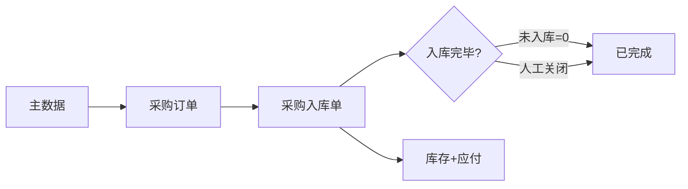
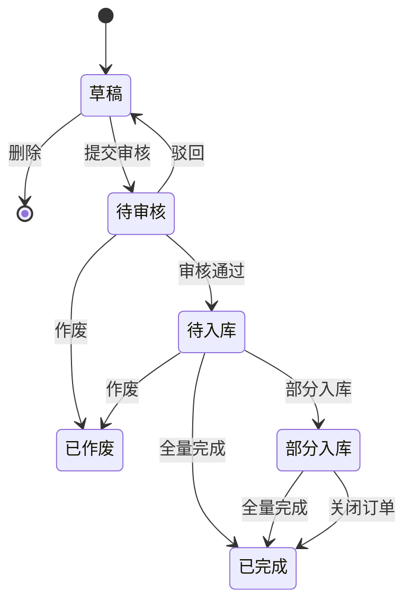

# 采购订单模块共用规则

> 来源：《采购订单主PRD》V1.1。在任意采购订单页面：右侧标注 → **本页规则**（含下方「跨页规则」）或 **全屏阅读器**，无需下载。

<!-- anno:start id=g-background -->
## 模块背景与链路

### 业务背景（§1）

采购订单是采购链路的**起点控制单据**：计划买什么、买多少、向谁买、什么价格；**审核通过后**作为执行与应付的原始凭据。审核前可编辑，审核后关键字段锁定，变更须驳回重提或走下游单据。

### 功能范围（§2 摘要）

**In**：手动创建/编辑、提交与审核、多次入库追踪、缺量关闭、待审核/待入库作废、草稿物理删除。  
**Out**：采购计划自动补货、供应商协同、多级价格审批、合同价控、完整应付结算、批量导入。

### 单据定位与实体关系（§3）

| 项目 | 内容 |
| --- | --- |
| 层级 | 第 1 层——业务订单层（意图/计划） |
| 下游 | 采购入库单（审核通过后手动创建，**1:N** 分批到货） |

| 关系 | 说明 |
| --- | --- |
| 采购订单 : 采购入库单 | **1:N** |
| 采购订单 : 供应商 / 仓库 | 各 **N:1** |
| 明细行 : 入库明细行 | **1:N**（分行多次入库） |

<!-- anno:end id=g-background -->

<!-- anno:start id=g-scenarios -->
## 业务场景（§4）

| 场景ID | 场景 | 类型 | 说明 |
| :--- | :--- | :--- | :--- |
| S01 | 一次性全量入库 | 主流程 | 草稿→审核→入库全量→已完成 |
| S02 | 分批多次入库 | 主流程 | 多次入库单累计至全量自动完成 |
| S03 | 缺量完结 | 主流程 | 部分入库后「关闭订单」→已完成 |
| S04 | 驳回后重提 | 支线 | 待审核→草稿→改单再提交 |
| S05 | 草稿物理删除 | 支线 | 记录消失，非已作废 |
| S06 | 待审核/待入库作废 | 支线 | →已作废，可查询 |
| S07 | 已完成后退货 | 支线 | 基于入库单退货，与 PO 状态无关 |

<!-- anno:end id=g-scenarios -->

<!-- anno:start id=g-state -->
## 状态与流转（§5）

### 5.1 单据状态

| 状态 | 枚举 | 含义 | 终态 |
| :--- | :--- | :--- | :---: |
| 草稿 | `DRAFT` | 未提交，可编辑 | 否 |
| 待审核 | `PENDING_AUDIT` | 已提交待审 | 否 |
| 待入库 | `PENDING_STOCK_IN` | 审核通过待到货 | 否 |
| 部分入库 | `PARTIAL_STOCK_IN` | 已有入库确认，未全量 | 否 |
| 已完成 | `COMPLETED` | 全量入库或缺量关闭 | **是** |
| 已作废 | `VOIDED` | 失效不可恢复 | **是** |

### 5.2 状态机图

### 5.3 状态流转表

| 当前状态 | 动作 | 前置条件 | 结果状态 | 二次确认 | 后置影响 |
| :--- | :--- | :--- | :--- | :--- | :--- |
| 草稿 | 提交审核 | 供应商/仓库已选；≥1 有效行；**无重复商品编码**；每行数量>0、单价≥0 | 待审核 | Demo 有确认弹窗（主PRD 表写「无」，待对齐） | — |
| 草稿 | 删除 | — | 物理消失 | 确认删除 | 记录移除 |
| 待审核 | 驳回 | — | 草稿 | 无 | 可再编辑 |
| 待审核 | 审核通过 | — | 待入库 | 无 | 关键字段锁定 |
| 待审核/待入库 | 作废 | 无已确认入库 | 已作废 | 确认作废 | 只读 |
| 待入库/部分入库 | （系统）部分入库 | 入库确认且未入库>0 | 部分入库 | 自动 | 回写累计数量 |
| 待入库/部分入库 | （系统）全量完成 | 未入库数量=0 | 已完成 | 自动 | 终态 |
| 部分入库 | 关闭订单 | 未入库>0 | 已完成 | 确认关闭 | 终态，余量不再收 |

<!-- anno:end id=g-state -->

<!-- anno:start id=g-actions -->
## 动作能力矩阵（§6）

> ✅ 允许；❌ 不允许（**不展示入口**）；条件见 §7。

| 动作 | 草稿 | 待审核 | 待入库 | 部分入库 | 已完成 | 已作废 |
| :--- | :---: | :---: | :---: | :---: | :---: | :---: |
| 编辑 | ✅ | ❌ | ❌ | ❌ | ❌ | ❌ |
| 提交审核 | ✅ | ❌ | ❌ | ❌ | ❌ | ❌ |
| 删除（物理） | ✅ | ❌ | ❌ | ❌ | ❌ | ❌ |
| 驳回 | ❌ | ✅ | ❌ | ❌ | ❌ | ❌ |
| 审核通过 | ❌ | ✅ | ❌ | ❌ | ❌ | ❌ |
| 作废 | ❌ | ✅ | ✅ | ❌ | ❌ | ❌ |
| 创建入库单 | ❌ | ❌ | ✅ | ✅ | ❌ | ❌ |
| 关闭订单 | ❌ | ❌ | ❌ | ✅ | ❌ | ❌ |
| 查看 / 导出 | ✅ | ✅ | ✅ | ✅ | ✅ | ✅ |

<!-- anno:end id=g-actions -->

<!-- anno:start id=g-rules -->
## 核心业务规则（§7）

### 7.1 创建与提交

| ID | 规则 |
| :--- | :--- |
| R01 | **保存草稿**宽松：供应商/仓库/明细可空；已选商品行数量>0、单价≥0，否则阻断保存 |
| R01b | **提交审核**须供应商、入库仓库、≥1 有效明细，且满足 R02 |
| R02 | 每行：商品、数量>0、单价≥0 |
| R03 | **提交审核**时同一商品编码不可重复；草稿保存不校验重复 |
| R04 | 下单日期默认当天，不可未来日期 |

### 7.2 审核与锁定

| ID | 规则 |
| :--- | :--- |
| R11 | 审核通过后锁定：供应商、仓库、商品行、数量、单价、税率 |
| R12 | 审核后仍可改：采购备注、行备注、预计到货日期（**待确认**：本原型详情无编辑入口） |
| R13 | 驳回回草稿，字段恢复可编辑 |

### 7.3 入库追踪

| ID | 规则 |
| :--- | :--- |
| R21 | 仅待入库/部分入库可创建入库单 |
| R22 | 一张 PO 多张入库单（1:N） |
| R23 | 入库确认累加「累计已入库」，更新未入库 |
| R24 | 路径①：未入库全归零→自动已完成 |
| R25 | 默认禁止超收 |

### 7.4 作废

| ID | 规则 |
| :--- | :--- |
| R31 | 草稿物理删除，非已作废 |
| R32 | 待审核/待入库可作废 |
| R33 | 已有确认入库后不可作废 PO |

### 7.5 关闭（缺量完结）

| ID | 规则 |
| :--- | :--- |
| R41 | 路径②：部分入库可「关闭订单」→已完成 |
| R42 | 关闭不可撤销；未入库量保留可查 |
| R43 | 待入库无人工关闭，可作废 |
| R44 | 关闭时若有草稿入库单须提示并阻断确认 |

### 7.6 作废 vs 关闭

| 维度 | 作废 | 关闭（缺量完结） |
| :--- | :--- | :--- |
| 适用 | 待审核、待入库（无已确认入库） | 部分入库 |
| 结果状态 | 已作废 | 已完成 |
| 含义 | 放弃未发生意图 | 封存现状，余量不再收 |

### 7.7 价格（§7.7）

R51 默认采购价可带出可改；R53 审核后单价锁定须驳回改价；R55 数量差异与价格差异分开处理。

<!-- anno:end id=g-rules -->

<!-- anno:start id=g-permission -->
## 权限与数据范围（§8）

### 8.1 数据可见（正式环境）

| 角色 | 范围 |
| :--- | :--- |
| 采购员 | 本人创建的 PO |
| 仓管 | 管辖仓库相关 PO |
| 管理员 | 全部 |

**原型说明**：当前 Demo **未实现**行级数据过滤，联调前对齐。

### 8.2 操作权限（摘要）

采购员：新增/编辑草稿/提交/关闭/作废（限状态）；仓管：创建入库单；管理员：含审核/驳回。详见主 PRD §8.2 表。

<!-- anno:end id=g-permission -->
