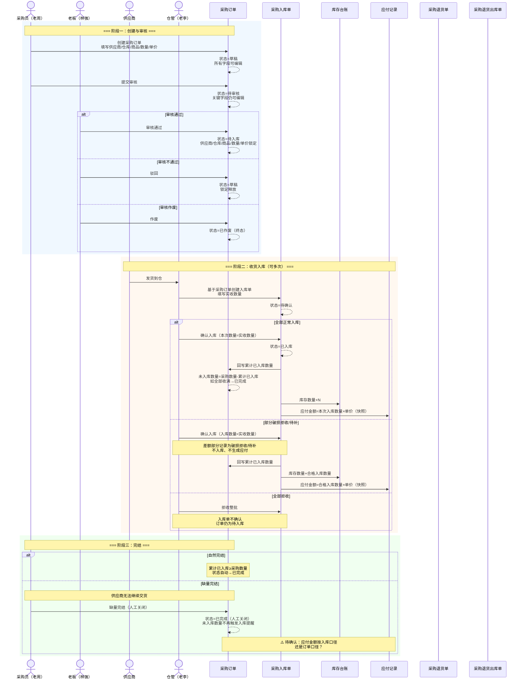

# 采购订单-业务流程推演

> **版本**：V1.0 | 2026-06-02
> **定位**：整条采购链路的流程逻辑权威源。不是单单据视角，而是跨单据、跨模块的全局视角。
> **读者**：PM 自己（写主 PRD 时的地图）、业务方（对齐整体流程）

---

## 一、推演范围

从采购员创建采购订单开始，到仓管入库完成、应付记录生成结束。覆盖正常路径 + 4 个关键异常分支。

**涉及系统模块**：采购管理 → 库存管理 → 往来管理
**涉及单据**：采购订单（意图层）→ 采购入库单（执行层）→ 应付记录；逆向：采购入库单 → 采购退货单 → 采购退货出库单 → 库存回冲

---

## 二、Mermaid 时序图

---

## 三、单据联动规则表

| 单据 | 单据职责 | 核心字段 | 上游触发条件 | 下游联动 | 字段继承规则 |
|---|---|---|---|---|---|
| 采购订单 | 记录采购意图：买什么、向谁买、多少数量、什么价格 | 采购单号、供应商、入库仓库、商品明细、采购数量、单价（含税）、订单状态 | 采购员手动创建 | 审核通过后可用于创建采购入库单 | — |
| 采购入库单 | 记录实际到货：这次到了多少、合格入库多少 | 入库单号、关联采购单号、本次实收数量、本次入库数量、入库仓库 | 采购订单审核通过后，仓管手动创建 | 确认入库→库存增加 + 应付生成 + 采购订单回写 | 供应商（快照）、商品名称（快照）、单价（快照）——均从采购订单继承 |
| 采购退货单 | 记录退货意图：退什么、退多少、为什么退 | 退货单号、关联入库单号、退货数量、退货原因 | 已入库的采购入库单 | 审核后可创建采购退货出库单 | 供应商（快照）、商品名称（快照）、单价（快照）——均从采购入库单继承 |
| 采购退货出库单 | 记录退货出库执行：货已经退给供应商了 | 出库单号、关联退货单号、出库数量、物流信息 | 采购退货单审核通过 | 确认出库→库存减少 | 退货数量从退货单继承 |
| 应付记录 | 记录应付账款 | 应付单号、关联入库单号、应付金额、已付金额 | 采购入库单确认 | 财务付款登记 | 应付金额=本次入库数量×采购订单单价（快照） |

---

## 四、关键设计决策

### 4.1 为什么入库单是手动创建而非自动生成？

与行业常见做法不同，强盛一期选择**采购入库单手动创建**。原因：
- 强盛作为贸易商行，到货情况多变（分批发、破损、短少），自动生成会频繁产生"废单"
- 一期不做供应商协同，供应商的发货通知不会进系统，缺少自动生成的触发源
- 先让基础流程跑通，后续可迭代为"采购订单发货通知→自动生成待确认的入库单"

### 4.2 为什么退货基于入库单而非采购订单？

- 已入库的货才能退——退货的实物来源是仓库而不是订单
- 入库单记录了"这批货什么时候入库的、批次是什么"——退货出库需要这些信息
- 如果退货基于采购订单，会出现"订单已关闭但货还在仓库"的数据不一致

### 4.3 缺量完结 vs 作废

| | 缺量完结 | 作废 |
|---|---|---|
| 状态终点 | 已完成 | 已作废 |
| 已入库数据 | 保留 | 不允许已有确认入库 |
| 触发人 | 采购员（供应商确认无法交货后） | 采购员/审核人（发现订单错误或采购意图失效） |
| 适用时机 | 已发生部分入库，但剩余数量不再接收 | 未产生确认入库前终止订单 |

---
