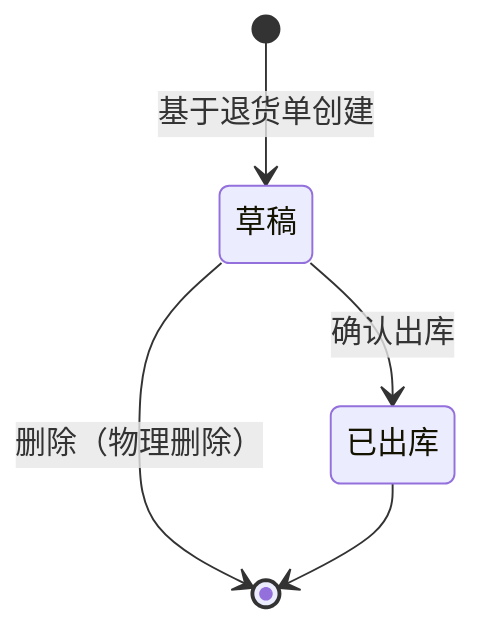

# 采购退货出库单模块共用规则

> 来源：《采购退货出库单主PRD》V1.0。在任意采购退货出库单页面：右侧标注 → **本页规则**（含下方「跨页规则」）或 **全屏阅读器**。

<!-- anno:start id=g-background -->
## 模块背景与链路

### 业务背景（§1–§2）

采购退货出库单是逆向**执行层**单据：「确认出库」时库存减少，并回写退货单与入库单的累计已退数量。
**In**：基于审核通过的采购退货单创建、草稿、确认出库、删除草稿、列表详情。**Out**：已出库作废/红冲界面、WMS 下架任务。

### 单据定位（§3）

| 项目 | 内容 |
| --- | --- |
| 层级 | 执行层（逆向） |
| 上游 | 采购退货单（待出库 / 部分出库） |
| 下游 | 库存流水 |
| 关系 | 采购退货单 : 退货出库单 = 1:N |

<!-- anno:end id=g-background -->

<!-- anno:start id=g-scenarios -->
## 业务场景（§6）

| 场景 | 说明 |
| --- | --- |
| 正常出库 | 基于待出库退货单创建 → 确认出库，库存 −N |
| 分批出库 | 一张退货单分多张出库单累计至完成 |
| 超退阻断 | 出库数量 > 退货行未出库数量，阻断 |
| 幂等确认 | 重复提交不重复减库存 |

<!-- anno:end id=g-scenarios -->

<!-- anno:start id=g-state -->
## 状态与流转（§4）

状态枚举：`DRAFT`（草稿）→ 确认出库 → `STOCKED_OUT`（已出库，终态）；草稿可物理删除。

<!-- anno:end id=g-state -->

<!-- anno:start id=g-actions -->
## 动作能力矩阵

不可用操作**不渲染**。

| 动作 | 草稿 | 已出库 |
| --- | :---: | :---: |
| 编辑 / 保存 | ✅ | ❌ |
| 删除（物理） | ✅ | ❌ |
| 确认出库 | ✅（条件） | ❌ |
| 查看 / 导出 | ✅ | ✅ |

<!-- anno:end id=g-actions -->

<!-- anno:start id=g-rules -->
## 核心业务规则（§5）

| ID | 规则 |
| --- | --- |
| R01 | 仅待出库 / 部分出库的采购退货单可创建退货出库单 |
| R02 | 带出退货单明细，不可改价 |
| R03 | 出库数量 ≤ 退货行未出库数量，超出阻断 |
| R04 | 确认出库幂等，重复提交不重复减库存 |
| R05 | 出库日期默认当天，不可未来 |
| R06 | 至少一行出库数量 > 0 方可确认 |

确认出库后库存 −N，退货单与入库单累计已退 +N（§6）。

<!-- anno:end id=g-rules -->

<!-- anno:start id=g-permission -->
## 权限与校验反馈

主 PRD 未单列权限矩阵与完整文案；数据范围、按钮级权限与失败提示文案**待确认**，确认出库沿用「确认后减少库存」二次确认。

<!-- anno:end id=g-permission -->
