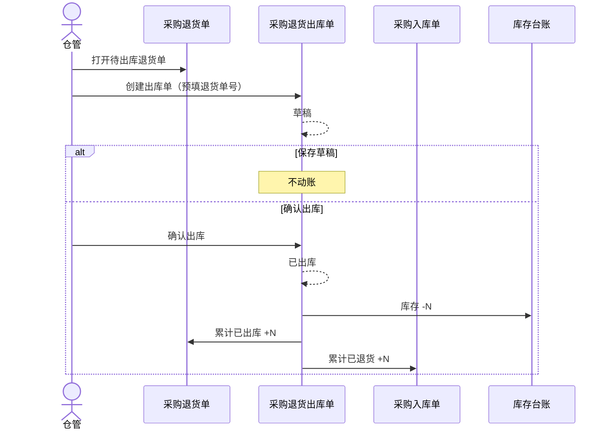

# 采购退货出库单-业务流程推演

> **版本**：V1.0 | 2026-10-07  
> **定位**：采购逆向链路「执行层」流程权威源。以退货出库单为主视角，承接审核通过的退货单并驱动库存减少。  
> **参考文档**：《采购退货单-业务流程推演》《采购入库单-业务流程推演》

---

## 一、推演范围

从仓管基于**待出库/部分出库**状态的采购退货单创建退货出库单，到**确认出库**触发库存减少、回写退货单与入库单累计已退数量。

**前置条件**：关联采购退货单已审核通过（`PENDING_OUTBOUND` / `PARTIAL_OUTBOUND`）。

**涉及单据**：采购退货单（意图）→ **采购退货出库单（执行）** → 库存流水

---

## 二、Mermaid 时序图

---

## 三、状态摘要

| 状态 | 枚举 | 说明 |
|---|---|---|
| 草稿 | `DRAFT` | 可编辑、可删除 |
| 已出库 | `STOCKED_OUT` | 终态，只读 |

---

## 四、联动规则

| 触发 | 目标 | 回写字段 |
|---|---|---|
| PRO 确认出库 | PRT 行 | 累计已出库数量；头状态→部分出库/已完成 |
| PRO 确认出库 | PI 行 | 累计已退货数量（可退数量减少） |
| PRO 确认出库 | 库存 | 流水类型=采购退货出库 |

---

## 五、设计决策

- 与采购入库单对称：**确认出库**为唯一减库存入口。  
- 默认不支持超退出库：`本次出库数量 ≤ 退货行未出库数量`。  
- 一期不提供已出库作废；纠错走补录退货单/出库单（需审批，Out of Scope）。

---

## 六、PRD 套件索引

| 文档 | 状态 |
|---|---|
| 主 PRD / 字段清单 / 用例推演 / Demo | 已编写 |
