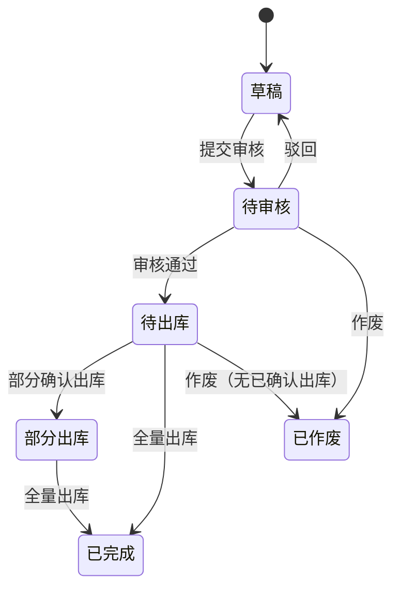

# 采购退货单模块共用规则

> 来源：《采购退货单主PRD》V1.0。在任意采购退货单页面：右侧标注 → **本页规则**（含下方「跨页规则」）或 **全屏阅读器**。

<!-- anno:start id=g-background -->
## 模块背景与链路

### 业务背景（§1–§2）

采购退货单记录「哪些已入库商品、退多少、为何退」，**审核通过后**驱动退货出库与库存减少，必须关联**已入库**采购入库单。
**In**：基于 PI 创建、草稿/审核/作废、数量追踪、关联出库单、列表详情导出。**Out**：无入库单直接退货、供应商门户、应付红冲界面细节、修改已审核数量。

### 单据定位（§3）

| 项目 | 内容 |
| --- | --- |
| 层级 | 意图层（逆向） |
| 上游 | 采购入库单（`STOCKED_IN`） |
| 下游 | 采购退货出库单 |
| 关系 | 入库单 : 退货单 = 1:N；退货单 : 退货出库单 = 1:N |

<!-- anno:end id=g-background -->

<!-- anno:start id=g-scenarios -->
## 业务场景（§8）

| 场景 | 说明 |
| --- | --- |
| 正常退货 | 基于已入库单创建 → 审核 → 退货出库减库存 |
| 分批出库 | 一张退货单分多张退货出库单累计 |
| 超退阻断 | 退货数量 > 可退数量，阻断 |
| 审核锁定 | 审核通过后数量/单价锁定 |
| 作废阻断 | 已有确认出库后不可作废退货单 |

<!-- anno:end id=g-scenarios -->

<!-- anno:start id=g-state -->
## 状态与流转（§4）

状态流转：`DRAFT`（草稿）→ 提交 → `PENDING_AUDIT`（待审核）→ 审核 → `PENDING_OUTBOUND`（待出库）→ 退货出库确认 → `PARTIAL_OUTBOUND`（部分出库）/ `COMPLETED`（已完成）。驳回回 `DRAFT`；待审核/待出库且无已确认出库可作废为 `VOIDED`。

<!-- anno:end id=g-state -->

<!-- anno:start id=g-actions -->
## 动作能力矩阵（§5）

不可用操作**不渲染**。

| 动作 | 草稿 | 待审核 | 待出库 | 部分出库 | 已完成 | 已作废 |
| --- | :---: | :---: | :---: | :---: | :---: | :---: |
| 编辑 / 删除 | ✅ | ❌ | ❌ | ❌ | ❌ | ❌ |
| 提交审核 | ✅ | ❌ | ❌ | ❌ | ❌ | ❌ |
| 审核 / 驳回 / 作废 | ❌ | ✅ | ❌ | ❌ | ❌ | ❌ |
| 创建出库单 | ❌ | ❌ | ✅ | ✅ | ❌ | ❌ |
| 查看 | ✅ | ✅ | ✅ | ✅ | ✅ | ✅ |

<!-- anno:end id=g-actions -->

<!-- anno:start id=g-rules -->
## 核心业务规则（§6）

| ID | 规则 |
| --- | --- |
| R01 | 仅 `STOCKED_IN` 入库单可创建退货单 |
| R02 | 创建带出 PI 头与明细快照，不可增删商品 |
| R03 | 行本次退货数量 ≤ 行参考可退数量 |
| R04 | 可退数量 = PI 行入库数量 − 累计已退货出库（有效退货出库单） |
| R05 | 提交审核须至少一行退货数量 > 0，头部「退货原因」必填 |
| R06 | 审核通过后数量/单价锁定 |
| R07 | 退货出库确认后累加「累计已出库」并更新未出库 |
| R08 | 全部行未出库 = 0 且已有出库 → `COMPLETED` |
| R09 | 已有确认出库后不可作废退货单 |
| R10 | 应付冲减口径：按退货出库数量 × 单价快照（往来模块引用） |

<!-- anno:end id=g-rules -->

<!-- anno:start id=g-permission -->
## 权限与校验反馈（§7）

**权限（一期简化）**：采购员创建/提交/查看；仓管创建出库单入口同查看；管理员审核。

**校验反馈**：超退阻断提示退货数量不能超过可退数量；提交审核失败字段红字 + Toast `提交失败，{字段名}不满足条件`（对齐采购订单口径）。详细文案与数据范围主 PRD 未展开，**待确认**。

<!-- anno:end id=g-permission -->
