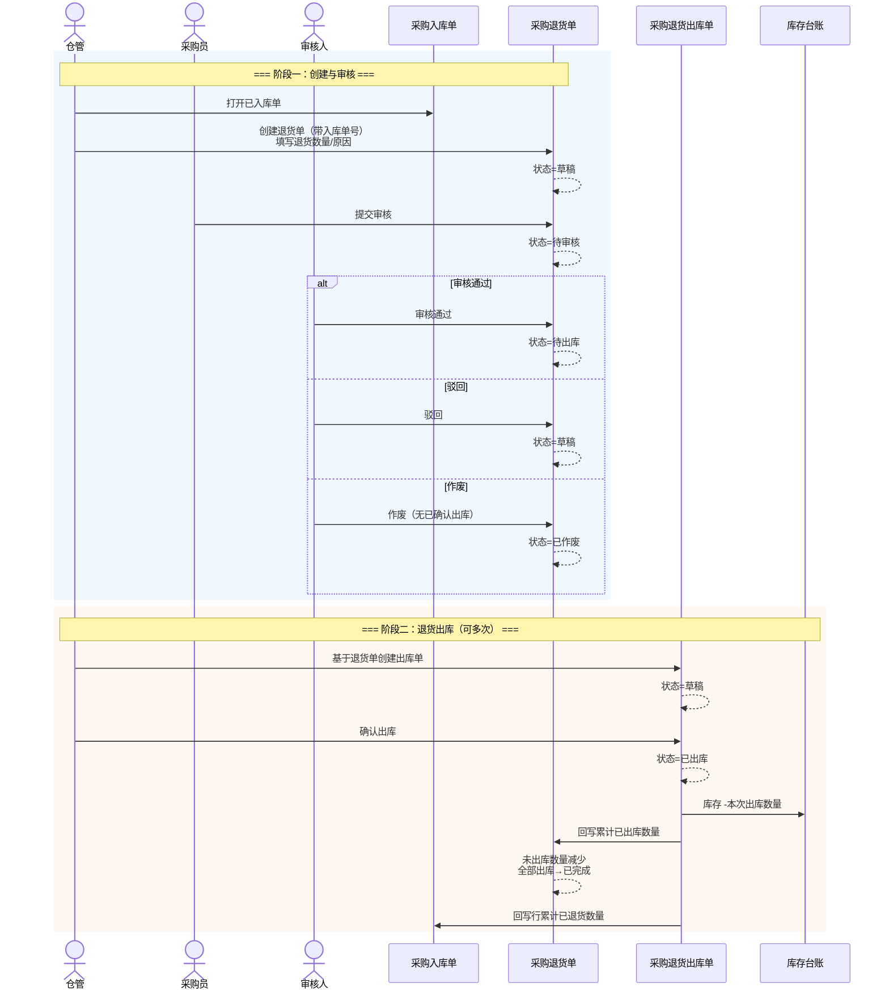

# 采购退货单-业务流程推演

> **版本**：V1.0 | 2026-10-07  
> **定位**：采购逆向链路「意图层」流程权威源。说明如何基于已入库单发起退货、审核后驱动退货出库与库存/应付冲减。  
> **读者**：PM、业务方、研发与测试  
> **参考文档**：《采购入库单主PRD》《采购订单-业务流程推演》

---

## 一、推演范围

从仓管/采购员基于**已入库**采购入库单创建采购退货单开始，到审核通过、退货出库单确认出库、库存减少结束。覆盖正常路径 + 4 个关键异常分支。

**前置条件**：关联采购入库单状态为 `STOCKED_IN`；行上存在可退数量（入库数量 − 累计已退货出库数量 > 0）。

**涉及模块**：采购管理 → 库存管理 → 往来管理（应付冲减一期简化）

**涉及单据**：采购入库单（来源）→ **采购退货单（意图）** → 采购退货出库单（执行）→ 库存流水

**不展开范围**：采购订单状态回退、供应商协同、物流跟踪对接、红字发票。

---

## 二、涉及角色

| 角色 | 职责 | 参与节点 |
|---|---|---|
| 仓管 | 发起退货、创建退货出库 | 创建退货单、确认出库 |
| 采购员 | 协调供应商、补全退货原因 | 创建/编辑草稿、提交审核 |
| 老板/管理员 | 审核退货 | 审核通过/驳回 |
| 系统 | 回写可退数量、汇总已出库 | 出库确认后 |

---

## 三、Mermaid 时序图

---

## 四、状态与动作（摘要）

| 状态 | 枚举 | 含义 | 主要动作 |
|---|---|---|---|
| 草稿 | `DRAFT` | 可编辑 | 保存、提交审核、删除 |
| 待审核 | `PENDING_AUDIT` | 等待审核 | 审核通过、驳回、作废 |
| 待出库 | `PENDING_OUTBOUND` | 审核通过待实物退出 | 创建退货出库单 |
| 部分出库 | `PARTIAL_OUTBOUND` | 已有出库未退满 | 继续创建出库单 |
| 已完成 | `COMPLETED` | 退货数量已全部出库 | 只读 |
| 已作废 | `VOIDED` | 无效 | 只读 |

---

## 五、单据联动规则表

| 单据 | 职责 | 上游 | 下游 | 库存/往来 |
|---|---|---|---|---|
| 采购入库单 | 退货实物来源 | PO/PI | 采购退货单 | 已入库 +N |
| **采购退货单** | 退货意图与数量 | 已入库 PI | 采购退货出库单 | 审核后待出库 |
| 采购退货出库单 | 实物退出仓 | 审核通过 PRT | — | 确认出库 −N |
| 应付记录 | 冲减（一期简化） | PRO 确认 | — | 按出库数量冲减含税金额 |

### 5.1 数量校验

| 校验 | 规则 |
|---|---|
| 行级超退 | 本次退货数量 ≤ 入库行可退数量 |
| 出库超退 | 本次出库数量 ≤ 退货行未出库数量 |
| 可退计算 | 可退 = 入库数量 − 累计已退货出库（有效 PRO） |

---

## 六、关键异常分支

| 编号 | 场景 | 处理 |
|---|---|---|
| E01 | 分批退货 | 一张 PI 多张 PRT；一张 PRT 多张 PRO |
| E02 | 审核后改不了数量 | 须驳回或作废后重建 |
| E03 | 超退阻断 | 保存/提交/出库时校验失败 |
| E04 | 已有出库后作废 PRT | 阻断，走逆向调整（一期不支持作废已出库） |

---

## 七、关键设计决策

1. **必须关联已入库单**：与 PO 推演 §4.2 一致，实物与批次可追溯。  
2. **退货单需要审核**：与采购订单对称，避免误退。  
3. **出库单单独执行**：库存只在「确认出库」动账，与入库单对称。  
4. **应付冲减**：按合格出库数量 × 单价快照冲减（对齐入库应付口径）。

---

## 八、PRD 套件索引

| 文档 | 状态 |
|---|---|
| 《采购退货单主PRD》 | 已编写 |
| 《采购退货单字段清单》 | 已编写 |
| 《采购退货单-用例数据推演》 | 已编写 |
| Demo PRD | 已编写 |
| 《采购退货出库单》套件 | 见同级目录 |
