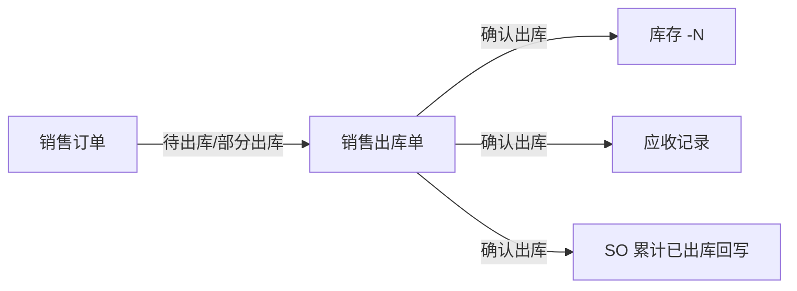
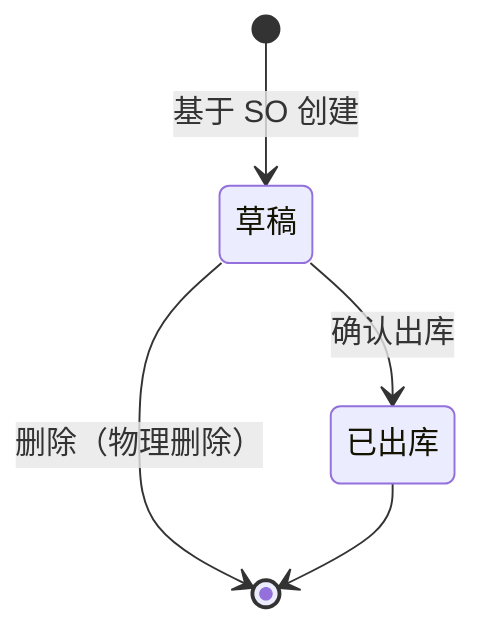

# 销售出库单模块共用规则

> 来源：《销售出库主PRD》V1.0（规则 R01–R06 对称采购入库，状态 `SHIPPED`、单号 `DO`）、《销售出库_Demo_》V1.1。在任意销售出库页面：右侧标注 → **本页规则**（含下方「跨页规则」）或 **全屏阅读器**。

<!-- anno:start id=g-background -->
## 模块背景与链路

### 业务背景

销售出库单是销售链路的**执行层**单据：确认出库时扣减库存、写入应收引用，并回写销售订单的累计已出库数量。必须关联**审核通过**的销售订单。

### 单据定位

| 项目 | 内容 |
| --- | --- |
| 层级 | 执行层 |
| 上游 | 销售订单（待出库 / 部分出库） |
| 下游 | 库存流水、应收记录；销售退货单（逆向） |
| 关系 | 销售订单 : 销售出库单 = 1:N（分批发货） |

<!-- anno:end id=g-background -->

<!-- anno:start id=g-scenarios -->
## 业务场景

| 场景 | 说明 |
| --- | --- |
| 一次全量出库 | 创建 → 确认出库，SO 可能一次完成 |
| 分批出库 | 同一 SO 多张出库单累计至完成或缺量完结 |
| 超发阻断 | 本次出库 > SO 未出库数量，阻断 |
| 草稿不动账 | 仅保存草稿，不扣库存、不回写 SO |

<!-- anno:end id=g-scenarios -->

<!-- anno:start id=g-state -->
## 状态与流转

状态枚举：`DRAFT`（草稿）→ 确认出库 → `SHIPPED`（已出库，终态）；草稿可物理删除。

<!-- anno:end id=g-state -->

<!-- anno:start id=g-actions -->
## 动作能力矩阵

不可用操作**不渲染**。

| 动作 | 草稿 | 已出库 |
| --- | :---: | :---: |
| 编辑 / 保存 | ✅ | ❌ |
| 删除（物理） | ✅ | ❌ |
| 确认出库 | ✅（条件） | ❌ |
| 查看 / 导出 | ✅ | ✅ |

<!-- anno:end id=g-actions -->

<!-- anno:start id=g-rules -->
## 核心业务规则（R01–R06 对称采购入库）

| ID | 规则（出库口径） |
| --- | --- |
| R01 | 仅待出库 / 部分出库的销售订单可创建出库单 |
| R02 | 创建带出 SO 头与明细快照，不可增删商品或改价 |
| R03 | 本次出库数量 ≤ SO 行当前未出库数量，超出阻断 |
| R04 | 确认出库幂等，重复提交不重复扣库存 |
| R05 | 出库日期默认当天，不可未来 |
| R06 | 至少一行出库数量 > 0 方可确认 |

确认出库后扣减库存、生成应收引用、回写 SO 累计已出库并重算未出库；SO 全部出库完成或缺量完结后不再接受新出库单。应收口径按销售订单单价快照。

<!-- anno:end id=g-rules -->

<!-- anno:start id=g-permission -->
## 权限与校验反馈

主 PRD 为对称精简版，未单列权限矩阵与完整文案；数据范围、按钮级权限与失败提示文案**待确认**。确认出库沿用「确认后减少库存」二次确认，失败字段红字 + Toast。

<!-- anno:end id=g-permission -->
