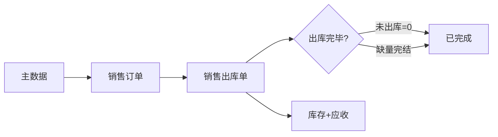
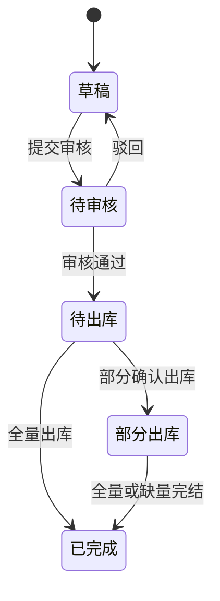

# 销售订单模块共用规则

> 来源：《销售订单主PRD》V1.0、《销售订单字段清单》、《销售订单_Demo_》；与采购订单对称处已标注。在任意销售订单路由：标注 → **本页规则** → **跨页规则** 或全屏阅读器。

<!-- anno:start id=g-background -->
## 模块背景与链路

### 业务背景（§1）

销售订单是销售链路的**起点控制单据**：记录卖什么、卖多少、卖给谁、什么价格；**审核通过后**作为出库执行与应收的原始凭据。审核前可编辑，审核后关键字段锁定，变更须驳回重提或走下游单据。

### 功能范围（§2）

**In**：手动创建/编辑、提交与审核、多次出库追踪、缺量完结、待审核/待出库作废、草稿物理删除；客户须启用；信用额度校验（引用客户档案 mock 应收）。  
**Out**：平台订单拉单、完整收款登记界面。

### 单据定位

| 项目 | 内容 |
| --- | --- |
| 层级 | 业务订单层（销售意图） |
| 下游 | 销售出库单（审核通过后手动创建，**1:N** 分批发货） |

<!-- anno:end id=g-background -->

<!-- anno:start id=g-scenarios -->
## 业务场景（对称采购 §4）

| 场景 | 说明 |
| --- | --- |
| S01 一次全量出库 | 草稿→审核→出库全量→已完成 |
| S02 分批出库 | 多张出库单累计至全量自动完成 |
| S03 缺量完结 | 部分出库后「缺量完结/关闭」→已完成 |
| S04 驳回重提 | 待审核→草稿→改单再提交 |
| S05 草稿删除 | 物理删除，非已作废 |
| S06 作废 | 待审核/待出库（无已确认出库）→已作废 |
| S07 退货 | 基于出库单退货，与 SO 终态只读查看 |

<!-- anno:end id=g-scenarios -->

<!-- anno:start id=g-state -->
## 状态与流转（§3）

状态枚举与采购订单对称：`DRAFT` → `PENDING_AUDIT` → `PENDING_STOCK_OUT`（待出库）→ `PARTIAL_SHIPPED`（部分出库）→ `COMPLETED` / `VOIDED`。

**待确认**：各状态中文 Tag 与 Tab 计数规则以《销售订单_Demo_》及列表实现为准。

<!-- anno:end id=g-state -->

<!-- anno:start id=g-actions -->
## 动作能力矩阵（§4）

与采购订单对称：**不可用操作不渲染**。

| 动作 | 草稿 | 待审核 | 待出库 | 部分出库 | 已完成 | 已作废 |
| --- | :---: | :---: | :---: | :---: | :---: | :---: |
| 编辑 | ✅ | ❌ | ❌ | ❌ | ❌ | ❌ |
| 提交审核 | ✅ | ❌ | ❌ | ❌ | ❌ | ❌ |
| 删除 | ✅ | ❌ | ❌ | ❌ | ❌ | ❌ |
| 驳回 / 审核 | ❌ | ✅ | ❌ | ❌ | ❌ | ❌ |
| 作废 | ❌ | ✅ | ✅ | ❌ | ❌ | ❌ |
| 创建出库单 | ❌ | ❌ | ✅ | ✅ | ❌ | ❌ |
| 缺量完结 | ❌ | ❌ | ❌ | ✅ | ❌ | ❌ |
| 查看 | ✅ | ✅ | ✅ | ✅ | ✅ | ✅ |

<!-- anno:end id=g-actions -->

<!-- anno:start id=g-rules -->
## 核心业务规则（§5）

| ID | 规则 |
| --- | --- |
| R01 | 客户须 **启用** |
| R02 | 至少一行销售数量 &gt; 0 |
| R03 | 审核后锁定客户、出库仓库、商品行、数量、单价 |
| R04 | 行累计出库 ≤ 销售数量（禁止超卖） |
| R05 | 信用额度 &gt; 0：实时应收 + 本单金额 ≤ 额度（Demo 用客户 mock） |
| R06 | 缺量完结后未出库行不可再出库 |
| R07 | 应收口径 = 已确认出库 × 单价快照 |

草稿保存宽松、提交严格校验口径 **对称采购订单** 与《全局字段校验与反馈规范》（销售侧待全局合并，见走查 D-04）。

<!-- anno:end id=g-rules -->

<!-- anno:start id=g-permission -->
## 权限与校验反馈

**原型**：未实现行级数据权限；按钮级权限与采购 Demo 一致为占位。

**提交失败**：字段/行内红字 + Toast `提交失败，{字段名}不满足条件`（对称 PO）。  
**保存失败**：首错定位，不以 Toast 替代字段校验（全局规范）。  
**离开**：未保存变更离开确认 — 见 Demo §八（若实现）。

<!-- anno:end id=g-permission -->
