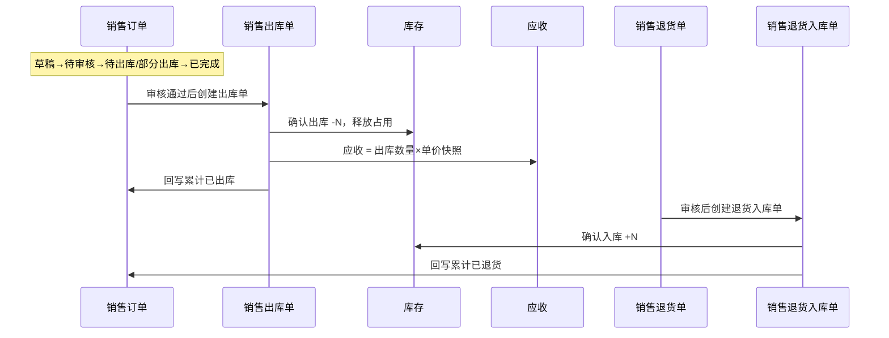

# 销售订单-业务流程推演

> **版本**：V1.0 | 2026-10-07  
> **定位**：销售链路流程权威源（跨单据视角）  
> **读者**：PM、业务、研发测试

---

## 一、推演范围

从销售员创建销售订单开始，到出库完成、应收形成结束。覆盖正常路径与审核驳回、缺量完结、退货逆向。

**模块**：销售管理 → 库存管理 → 往来管理  
**单据**：销售订单（意图）→ 销售出库单（执行）→ 应收；逆向：销售出库单 → 销售退货单 → 销售退货入库单

**前置**：客户、商品、仓库主数据可用；审核通过后可占用库存（一期原型可简化记账）。

---

## 二、时序图（摘要）

---

## 三、联动规则

| 单据 | 职责 | 触发 | 下游 |
|---|---|---|---|
| 销售订单 | 卖什么、卖给谁、价格数量 | 手工创建 | 审核→可出库 |
| 销售出库单 | 本次实发数量 | 待出库/部分出库 SO | 确认→库存、应收、SO 回写 |
| 销售退货单 | 退多少、原因 | 已出库 DO | 审核→可退货入库 |
| 销售退货入库单 | 实物退回 | 待入库 SRT | 确认→库存、应收冲减 |

---

## 四、异常分支

| 编号 | 场景 | 处理 |
|---|---|---|
| E01 | 审核驳回 | 回草稿 |
| E02 | 信用额度不足 | 提交/审核阻断（读客户档案） |
| E03 | 出库超卖 | 行出库≤未出库数量 |
| E04 | 缺量完结 | 人工关闭 SO，未出库不再提醒 |
| E05 | 已有退货入库后作废 SRT | 阻断 |

---

## 五、设计结论

1. 单号：`SO{YYYYMMDD}-{4位}`。  
2. 状态：草稿 / 待审核 / 待出库 / 部分出库 / 已完成 / 已作废。  
3. 审核通过锁定价格与客户快照；出库仅在出库单确认动账。  
4. 应付对称：应收按**合格出库数量×单价快照**。

---

## 六、PRD 套件索引

| 文档 | 状态 |
|---|---|
| 销售订单主PRD、字段清单、用例推演、Demo×3、走查报告 | 已编写 |
| 销售出库/退货/退货入库 | 见同级目录 |
