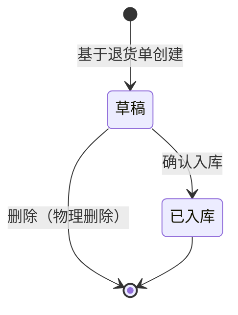

# 销售退货入库单模块共用规则

> 来源：《销售退货入库主PRD》V1.0（逆向执行层，与采购退货出库对称）、《销售退货入库_Demo_》V1.1。在任意销售退货入库页面：右侧标注 → **本页规则**（含下方「跨页规则」）或 **全屏阅读器**。

<!-- anno:start id=g-background -->
## 模块背景与链路

### 业务背景

销售退货入库单是逆向**执行层**单据：「确认入库」时库存增加，并回写销售退货单与原销售出库单行的已退入库数量（`returnedQty`）。基于**审核通过**的销售退货单创建。

### 单据定位

| 项目 | 内容 |
| --- | --- |
| 层级 | 执行层（逆向） |
| 上游 | 销售退货单（待入库 / 部分入库） |
| 下游 | 库存流水 |
| 关系 | 销售退货单 : 退货入库单 = 1:N |

<!-- anno:end id=g-background -->

<!-- anno:start id=g-scenarios -->
## 业务场景

| 场景 | 说明 |
| --- | --- |
| 正常入库 | 基于待入库退货单创建 → 确认入库，库存 +N |
| 分批入库 | 一张退货单分多张入库单累计至完成 |
| 超退阻断 | 入库数量 > 退货行未入库数量，阻断 |
| 幂等确认 | 重复提交不重复增库存 |

<!-- anno:end id=g-scenarios -->

<!-- anno:start id=g-state -->
## 状态与流转（对称采购退货出库）

状态枚举：`DRAFT`（草稿）→ 确认入库 → `STOCKED_IN`（已入库，终态）；草稿可物理删除。

<!-- anno:end id=g-state -->

<!-- anno:start id=g-actions -->
## 动作能力矩阵

不可用操作**不渲染**。

| 动作 | 草稿 | 已入库 |
| --- | :---: | :---: |
| 编辑 / 保存 | ✅ | ❌ |
| 删除（物理） | ✅ | ❌ |
| 确认入库 | ✅（条件） | ❌ |
| 查看 / 导出 | ✅ | ✅ |

<!-- anno:end id=g-actions -->

<!-- anno:start id=g-rules -->
## 核心业务规则（对称采购退货出库）

| ID | 规则（退货入库口径） |
| --- | --- |
| R01 | 仅待入库 / 部分入库的销售退货单可创建退货入库单 |
| R02 | 带出退货单明细，不可改价 |
| R03 | 入库数量 ≤ 退货行未入库数量，超出阻断 |
| R04 | 确认入库幂等，重复提交不重复增库存 |
| R05 | 入库日期默认当天，不可未来 |
| R06 | 至少一行入库数量 > 0 方可确认 |

确认入库后库存 +N，回写销售退货单累计已入库与原出库单行 `returnedQty`。

<!-- anno:end id=g-rules -->

<!-- anno:start id=g-permission -->
## 权限与校验反馈

主 PRD 为对称精简版，未单列权限矩阵与完整文案；数据范围、按钮级权限与失败提示文案**待确认**。确认入库沿用「确认后增加库存」二次确认，失败字段红字 + Toast。

<!-- anno:end id=g-permission -->
