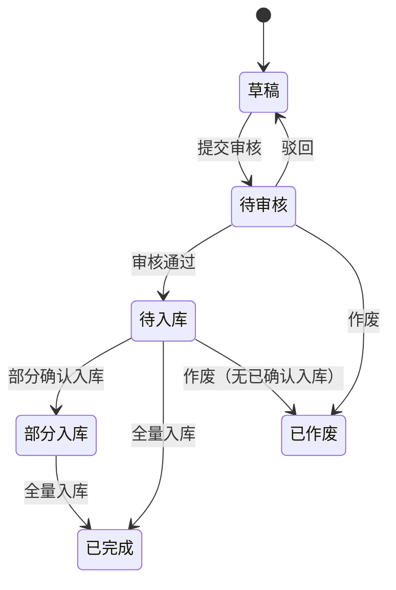

# 销售退货单模块共用规则

> 来源：《销售退货单主PRD》V1.0（规则与采购退货单对称，可退 = 出库 − 已退入库）、《销售退货单_Demo_》V1.1。在任意销售退货单页面：右侧标注 → **本页规则**（含下方「跨页规则」）或 **全屏阅读器**。

<!-- anno:start id=g-background -->
## 模块背景与链路

### 业务背景

销售退货单记录「客户退哪些已出库商品、退多少、为何退」，**审核通过后**创建销售退货入库，驱动库存增加。基于**已出库**销售出库单创建。

### 单据定位

| 项目 | 内容 |
| --- | --- |
| 层级 | 意图层（逆向） |
| 上游 | 销售出库单（已出库 `SHIPPED`） |
| 下游 | 销售退货入库单 |
| 关系 | 出库单 : 退货单 = 1:N；退货单 : 退货入库单 = 1:N |

<!-- anno:end id=g-background -->

<!-- anno:start id=g-scenarios -->
## 业务场景

| 场景 | 说明 |
| --- | --- |
| 正常退货 | 基于已出库单创建 → 审核 → 退货入库增库存 |
| 分批入库 | 一张退货单分多张退货入库单累计 |
| 超退阻断 | 退货数量 > 可退数量，阻断 |
| 审核锁定 | 审核通过后数量/单价锁定 |
| 作废阻断 | 已有确认入库后不可作废退货单 |

<!-- anno:end id=g-scenarios -->

<!-- anno:start id=g-state -->
## 状态与流转（对称采购退货单）

状态流转：`DRAFT`（草稿）→ 提交 → `PENDING_AUDIT`（待审核）→ 审核 → `PENDING_INBOUND`（待入库）→ 退货入库确认 → `PARTIAL_INBOUND`（部分入库）/ `COMPLETED`（已完成）。驳回回 `DRAFT`；待审核/待入库且无已确认入库可作废为 `VOIDED`。

> 状态中文 Tag 与具体枚举以《销售退货单_Demo_》及列表实现为准，**待确认**。

<!-- anno:end id=g-state -->

<!-- anno:start id=g-actions -->
## 动作能力矩阵（对称采购退货单）

不可用操作**不渲染**。

| 动作 | 草稿 | 待审核 | 待入库 | 部分入库 | 已完成 | 已作废 |
| --- | :---: | :---: | :---: | :---: | :---: | :---: |
| 编辑 / 删除 | ✅ | ❌ | ❌ | ❌ | ❌ | ❌ |
| 提交审核 | ✅ | ❌ | ❌ | ❌ | ❌ | ❌ |
| 审核 / 驳回 / 作废 | ❌ | ✅ | ❌ | ❌ | ❌ | ❌ |
| 创建入库单 | ❌ | ❌ | ✅ | ✅ | ❌ | ❌ |
| 查看 | ✅ | ✅ | ✅ | ✅ | ✅ | ✅ |

<!-- anno:end id=g-actions -->

<!-- anno:start id=g-rules -->
## 核心业务规则（对称采购退货单）

| ID | 规则（退货入库口径） |
| --- | --- |
| R01 | 仅已出库销售出库单可创建退货单 |
| R02 | 创建带出出库单头与明细快照，不可增删商品 |
| R03 | 行本次退货数量 ≤ 行参考可退数量 |
| R04 | 可退数量 = 出库数量 − 累计已退货入库（有效退货入库单） |
| R05 | 提交审核须至少一行退货数量 > 0，头部「退货原因」必填 |
| R06 | 审核通过后数量/单价锁定 |
| R07 | 退货入库确认后累加「累计已入库」并更新未入库 |
| R08 | 全部行未入库 = 0 且已有入库 → `COMPLETED` |
| R09 | 已有确认入库后不可作废退货单 |

<!-- anno:end id=g-rules -->

<!-- anno:start id=g-permission -->
## 权限与校验反馈

主 PRD 为对称精简版，未单列权限矩阵与完整文案；数据范围、按钮级权限与失败提示文案**待确认**。提交审核失败字段红字 + Toast，超退阻断提示退货数量不能超过可退数量。

<!-- anno:end id=g-permission -->
