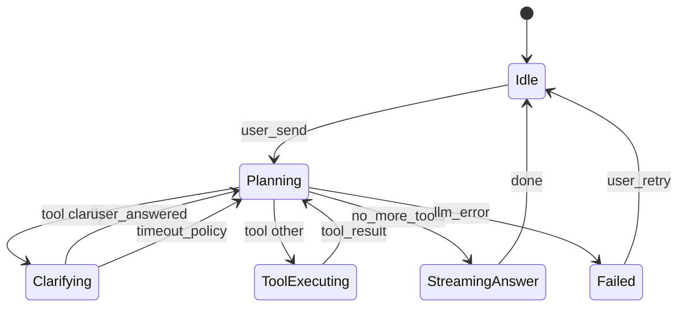

# 进销存首页 Agent — 技术方案

> **关联文档**：[首页Agent方案设计](./首页Agent方案设计.md)  
> **落地工程**：`front-prototype/进销存`（React 19 + Vite 8 + TypeScript + Ant Design 5 + React Router 7）  
> **设计参照**：**Codex**（代码/报告产物 + 预览）、**Hermes**（`clarify` 工具：指令不清时结构化追问，批量澄清，低stakes 默认自行决策）

---

## 1. 技术目标

| 目标 | 说明 |
| :--- | :--- |
| 纯前端 Agent 壳 | API Key 与上传数据默认留在浏览器；直连用户配置的 OpenAI 兼容端点 |
| 双模式能力 | **数据分析**（本地表 + 图表/HTML 产物）与 **系统操作**（Tool 调进销存路由/Storage） |
| 可控的不确定性 | 用户指令含糊、缺参、有歧义时 **先澄清再执行**，避免猜错后大面积改数据 |
| 可扩展 Tool 面 | 与 `routes.ts`、各 `features/*/storage.ts` 解耦注册，按模块增量接入 |

---

## 2. 总体架构

```text
┌──────────────────────────────────────────────────────────────────┐
│ HomeAgentPage                                                     │
│  ┌─────────────┐  ┌────────────────────────────────────────────┐ │
│  │ Settings    │  │ ChatPanel + ArtifactRenderer                │ │
│  │ Panel       │  │  · MessageList (markdown)                   │ │
│  │ (localStorage)│ │  · ClarifyCard (Hermes-like UI)            │ │
│  └─────────────┘  │  · chart / html 预览 (Codex-like)          │ │
│  ┌─────────────┐  └────────────────────────────────────────────┘ │
│  │ DatasetTray │                                                  │
│  │ (parse local)│                                                 │
│  └─────────────┘                                                  │
└────────────────────────────┬─────────────────────────────────────┘
                             │
                    ┌────────▼────────┐
                    │ AgentRuntime     │
                    │  · turn loop     │
                    │  · tool dispatch │
                    │  · clarify gate  │
                    └────────┬────────┘
         ┌───────────────────┼───────────────────┐
         ▼                   ▼                   ▼
  OpenAICompatClient   ToolRegistry      ContextBuilder
  (stream/fetch)       (erp + data +      (system + datasets
                        clarify)           + tools + history)
```

### 2.1 核心模块划分（建议目录）

```text
src/features/homeAgent/
├── types.ts                 # Message, ToolCall, ClarifyRequest, AgentConfig
├── config/
│   ├── providers.ts         # 厂商默认 baseURL、模型列表
│   └── defaultSystemPrompt.ts
├── storage/
│   └── agentConfigStorage.ts # localStorage 读写与版本迁移
├── datasets/
│   ├── parseCsv.ts
│   ├── parseExcel.ts        # 依赖 xlsx (sheetjs)
│   ├── parseJson.ts
│   └── summarizeDataset.ts  # 列统计、采样行、token 预算摘要
├── llm/
│   ├── openaiCompatClient.ts
│   └── streamParser.ts      # SSE / delta 解析
├── agent/
│   ├── runtime.ts           # 多轮 tool loop
│   ├── contextBuilder.ts
│   └── policies.ts          # 澄清策略、危险操作策略
├── tools/
│   ├── registry.ts
│   ├── clarifyTool.ts       # 对齐 Hermes clarify 语义
│   ├── navigateTool.ts      # react-router navigate + query
│   ├── queryStorageTool.ts  # 只读查 localStorage 业务数据
│   └── runAnalysisTool.ts   # 可选：沙箱内聚合（见 §6）
├── artifacts/
│   ├── extractBlocks.ts     # 从 assistant 文本抽 chart/html fence
│   ├── ChartArtifact.tsx    # ECharts option JSON 渲染
│   └── HtmlArtifact.tsx     # sandbox iframe
└── components/
    ├── HomeAgentPage.tsx
    ├── SettingsPanel.tsx
    ├── ChatPanel.tsx
    ├── ClarifyCard.tsx
    └── DatasetUpload.tsx
```

路由建议：在 `src/router.tsx` 将 `/` 或独立 `/agent` 挂载 `HomeAgentPage`（与方案设计「首页工作台」一致时优先 `/`）。

---

## 3. Agent 运行循环（Codex + Hermes 融合）

### 3.1 单轮 Turn 状态机



- **Planning**：向 LLM 发送 `messages + tools`；支持 `tool_calls`（OpenAI 兼容）。
- **Clarifying**：仅当模型调用内置 `clarify` Tool 时进入；**阻塞**后续 `navigate` / 写操作类 Tool，直到用户作答或触发超时策略。
- **ToolExecuting**：前端执行 Tool，将结果以 `role: tool` 消息回灌，继续 Planning。
- **StreamingAnswer**：最终自然语言 + 产物块（图表/HTML）流式展示。

### 3.2 与 Codex 对齐：产物（Artifact）管线

| 阶段 | 行为 |
| :--- | :--- |
| 约定输出 | System Prompt 要求：图表用 ` ```chart`（ECharts option JSON）；报告用 ` ```html`（静态 HTML，无外链脚本） |
| 流式阶段 | 边收 token 边用 `extractBlocks` 增量识别完整 fence |
| 渲染 | `ChartArtifact`：`JSON.parse` + `echarts-for-react`；失败显示源码与错误行 |
| HTML | `iframe` + `sandbox="allow-same-origin"`（**禁止** `allow-scripts` 除非后续白名单方案） |
| UI | 每条产物：**预览 / 源码** Tab、折叠、复制、导出 `.html` |

Codex 体验要点：**分析结论与可执行/可预览代码同屏**，用户可核对逻辑而非只看结论。

### 3.3 与 Hermes 对齐：`clarify` Tool

前端向模型注册 **`clarify`**，Schema 与行为参考 Hermes（见 [clarify_tool 说明](https://github.com/eddielueng/hermes-agent-zh/blob/main/tools/clarify_tool.py)）：

**何时必须调用 `clarify`（写入 System Prompt + `policies.ts` 硬规则）**

| 场景 | 示例 | 澄清要点 |
| :--- | :--- | :--- |
| 分析维度不明 | 「帮我看看销售」 | 时间范围、口径（订单额/出库额）、粒度（SKU/客户/平台） |
| 数据源不明 | 「算一下毛利」 | 用上传文件还是系统内采购/销售数据；币种 |
| 操作对象不明 | 「把采购单处理了」 | 单号、目标动作（审核/关闭/导出）、范围 |
| 互斥方案 | 「优化库存」 | 清滞销 vs 补安全库存 vs 调仓 — 需用户选方向 |
| 缺必填 Tool 参数 | `navigate` 缺筛选条件 | 列出缺失字段，给选项或开放式补充 |

**何时不要滥用 `clarify`**

- 简单 yes/no 的危险操作：用独立 **`confirm`** UI（非 clarify 挤在一个问题里）。
- 低风险、可逆、有合理默认：模型 **先说明假设** 再执行，并在回复中标注「已按默认：近 30 天」。

**`clarify` 参数设计（OpenAI function JSON Schema）**

```json
{
  "name": "clarify",
  "description": "向用户提问以消除歧义或补齐信息。支持单题、批量独立题、选择题或开放式。",
  "parameters": {
    "type": "object",
    "properties": {
      "question": { "type": "string", "description": "单个问题（与 questions 二选一）" },
      "choices": {
        "type": "array",
        "items": { "type": "string" },
        "maxItems": 4,
        "description": "最多 4 项；UI 自动追加「其他（自行输入）」。省略则为开放式。"
      },
      "questions": {
        "type": "array",
        "maxItems": 5,
        "items": {
          "type": "object",
          "properties": {
            "id": { "type": "string" },
            "question": { "type": "string" },
            "choices": { "type": "array", "items": { "type": "string" }, "maxItems": 4 },
            "allowMultiple": { "type": "boolean" }
          },
          "required": ["id", "question"]
        },
        "description": "2–5 个彼此独立的问题，一次展示（Hermes 批量 clarify）。若某题答案会改变另一题，应拆成多轮 clarify。"
      },
      "recommendedChoiceIndex": {
        "type": "integer",
        "description": "仅 UI 展示 Recommended，回灌模型时 strip"
      }
    }
  }
}
```

**`ClarifyCard` UI 行为**

| 能力 | 说明 |
| :--- | :--- |
| 单选 / 多选 | `allowMultiple` 为 true 时 Checkbox 组 |
| 其他 | 第 5 项「其他」展开 TextArea |
| 批量题 | 一屏展示最多 5 题，已答锁定；支持「提交全部」 |
| Recommended | 首项或 `recommendedChoiceIndex` 标 `(Recommended)`，**不**写入 tool result |
| 超时 | 可配置 `clarifyTimeoutMs`（默认 600000）；超时返回 `{ timed_out: true, answers: partial }`，由模型决定继续或降级默认 |
| 阻塞 | `runtime` 在 `Clarifying` 状态拒绝执行非 `clarify` 的 tool_calls |

**Tool 回灌格式（给模型的 `tool` 消息）**

```json
{
  "tool_call_id": "...",
  "content": "{\"resolved\":true,\"answers\":{\"time_range\":\"近30天\",\"metric\":\"订单金额\"},\"timed_out\":false}"
}
```

### 3.4 指令清晰度：双层防护

除模型自主调用 `clarify` 外，建议增加 **轻量规则层**（`policies.ts`），降低「模型瞎猜」概率：

| 层级 | 实现 | 成本 |
| :--- | :--- | :--- |
| L1 规则 | 用户消息命中「分析/查询/打开/导出」等意图但正则未抽到时间、单号、模块名 → **注入 developer 提示**：「必须先 clarify」 | 零 LLM |
| L2 小模型/同模型预审（可选） | 首轮 `response_format: json` 输出 `{ "needs_clarify": boolean, "missing": string[] }` | 多一次调用 |
| L3 执行前校验 | Tool 参数 JSON Schema `required` 不满足 → 不执行，自动构造 `clarify` 请求 | 零 LLM |

**推荐首期**：L1 + L3 + 完整 `clarify` Tool（Hermes 路径），L2 后续按需开启。

---

## 4. LLM 接入（OpenAI 兼容）

### 4.1 请求形态

- 端点：`POST {baseURL}/v1/chat/completions`
- Header：`Authorization: Bearer {apiKey}`
- Body：`model`, `messages`, `tools`, `tool_choice: "auto"`, `stream: true`

### 4.2 厂商预设（`providers.ts`）

| provider | 默认 baseURL | 备注 |
| :--- | :--- | :--- |
| deepseek | `https://api.deepseek.com` | |
| openai | `https://api.openai.com/v1` | |
| qwen | `https://dashscope.aliyuncs.com/compatible-mode/v1` | 通义兼容模式 |
| zhipu | `https://open.bigmodel.cn/api/paas/v4` | |
| moonshot | `https://api.moonshot.cn/v1` | |
| siliconflow | `https://api.siliconflow.cn/v1` | 硅基流动 |
| custom | 用户填写 | |

### 4.3 流式与 Tool Call 拼接

- 使用 `streamParser` 累积 `delta.tool_calls[].function.arguments` 片段，JSON 完整后再 dispatch。
- 若某厂商流式 tool 支持不佳：对该 provider 降级为 **非流式** 仅 Planning 轮次，最终回答仍流式（按实测开关 `featuresFlags.streamToolCalls`）。

### 4.4 连接测试

- `model` 当前选中项，`max_tokens: 5`，`messages: [{role:user, content:ping}]`，成功即绿灯。

---

## 5. 上下文构建与 Token 预算

`contextBuilder.ts` 组装顺序：

1. **system**：用户 `systemPrompt` + 固定「进销存全局约束」摘要（状态机、主数据停用不删）
2. **system（工具）**：当前会话可用 Tool 列表摘要（名称 + 一句话）
3. **system（数据）**：每个 dataset 的 `summarizeDataset()`：文件名、行列数、列名+推断类型、前 N 行采样、简单统计（min/max/null 比例）
4. **history**：最近 K 轮对话（可配置）；超长时摘要旧轮
5. **user**：当前输入

**Token 控制**

| 策略 | 说明 |
| :--- | :--- |
| 采样上限 | 单文件默认最多 50 行采样进 prompt；全量分析走 `runAnalysisTool` 在前端 DuckDB/SQL 或纯 JS 聚合（见 §6） |
| 列裁剪 | 超过 30 列时仅传用户点名的列 + 主键列 |
| 系统数据 | `queryStorageTool` 返回聚合结果而非整表 dump |

---

## 6. 本地数据解析与分析

### 6.1 依赖建议

| 包 | 用途 |
| :--- | :--- |
| `xlsx` | Excel 解析 |
| `papaparse` | CSV |
| 原生 `JSON.parse` | JSON 数组/对象 |
| `echarts` + `echarts-for-react` | 图表产物 |
| `react-markdown` + `remark-gfm` | 消息 Markdown |
| `@duckdb/duckdb-wasm`（可选二期） | 大表 SQL 分析，结果再喂给 LLM |

### 6.2 内存模型

```ts
type DatasetRef = {
  id: string
  name: string
  columns: { name: string; inferredType: string }[]
  rowCount: number
  rows: Record<string, unknown>[] // 或 ArrayBuffer + 懒加载
}
```

会话级保存在 `useRef` / Zustand；**不**默认写入 localStorage（仅配置写入）。

### 6.3 `runAnalysisTool`（可选）

模型传入「伪 SQL」或结构化 spec（filter/group/agg），前端在沙箱内对 `DatasetRef` 执行，返回小 JSON 结果。避免把万行数据塞进 prompt。

---

## 7. 进销存 Tool 设计（首期）

### 7.1 只读 Tool 清单（建议）

| Tool | 作用 | 实现要点 |
| :--- | :--- | :--- |
| `navigate` | 跳转模块并带 query | `useNavigate()` + 与列表页 `FilterField` 对齐的 query key |
| `query_master_list` | 查商品/客户/供应商/仓库列表 | 读对应 `storage.ts`，支持 filter/limit |
| `query_inventory` | 即时库存、流水 | 读 inventory 相关 storage（有则接，无则 clarify 告知未接入） |
| `get_route_catalog` | 返回 `routeMetaList` 可去页面 | 供模型选对 path |
| `clarify` | 澄清 | §3.3 |
| `confirm_action` | 写操作前确认 | Modal；用户确认后才执行写 Tool |

### 7.2 写操作（后续）

- 不暴露「直接改 status 字段」的 Tool。
- 仅暴露与 UI 等价的 **动作**（如 `submit_purchase_order_audit`），内部调用与页面按钮同一 `validate` + storage 方法。

### 7.3 参数校验

每个 Tool 使用 **JSON Schema**；`runtime` 在 `ajv` 校验失败时：

1. 不执行；
2. 自动生成 `clarify`（列出 `missingFields` + 建议选项）。

---

## 8. 配置持久化（localStorage）

### 8.1 Key 与结构

```ts
const STORAGE_KEY = 'inventory.homeAgent.config.v1'

type HomeAgentConfigV1 = {
  configVersion: 1
  provider: string
  baseURL: string
  model: string
  apiKeys: Record<string, string> // 按 provider 分槽，避免单 key 覆盖
  systemPrompt: string
  clarifyTimeoutMs: number
  ui: { settingsCollapsed?: boolean }
}
```

### 8.2 安全

- UI 明示：Key 仅存本机，清除浏览器数据即丢失。
- 可选「导出配置」时 **脱敏** apiKey。
- 禁止把 Key 打进 `console.log` 或错误上报。

---

## 9. 安全与合规

| 风险 | 对策 |
| :--- | :--- |
| XSS（HTML 报告） | iframe sandbox；禁止内联 script；CSP 在 `index.html` 对 agent 路由可加严 |
| 图表 option 注入 | 仅 `JSON.parse`，不 `eval` |
| 越权操作 | Tool 层校验「原型无登录则全员可写」需在 PRD 标明；接真 API 后加 token |
| Prompt 注入（上传 CSV） | 数据块用明确分隔符标注为 untrusted data；指令写在 system 层 |
| 误操作 | 写操作必经 `confirm_action`；clarify 与 confirm 职责分离（对齐 Hermes 建议） |

---

## 10. 关键交互时序（澄清优先）

```text
User: 「分析一下采购情况」
  → L1 规则: 缺时间范围/口径
  → LLM 调用 clarify(questions: [
       { id: 'range', question: '统计时间范围？', choices: ['近7天','近30天','本季度','其他'] },
       { id: 'scope', question: '分析对象？', choices: ['按供应商','按SKU','按仓库'] }
     ])
  → UI: ClarifyCard 批量展示
User: 提交答案
  → tool result 回灌
  → LLM 调用 query_storage 或读 dataset
  → LLM 流式回复 + ```chart``` / ```html```
```

```text
User: 「打开库存偏低的商品」
  → LLM 调用 clarify: 「偏低」阈值？ [安全库存以下, 近7天无出库, 其他]
  → 用户选择后 navigate + query
```

---

## 11. 与现有工程集成要点

| 项 | 说明 |
| :--- | :--- |
| 布局 | 复用 `AppLayout`；左侧 Settings 可用 `antd` `Sider` 或 `Splitter` |
| 导航 | `tools/navigateTool` 统一读 `src/config/routes.ts`，避免硬编码 path |
| 数据 | 与 `features/*/storage.ts` 只读接口对齐，避免重复 mock |
| 样式 | Tailwind + Ant Design 混用与现有列表页一致 |

### 11.1 建议新增依赖（package.json）

```json
{
  "xlsx": "^0.18.5",
  "papaparse": "^5.5.2",
  "echarts": "^5.6.0",
  "echarts-for-react": "^3.0.2",
  "react-markdown": "^10.1.0",
  "remark-gfm": "^4.0.1",
  "ajv": "^8.17.1"
}
```

---

## 12. 可观测性与调试

| 能力 | 说明 |
| :--- | :--- |
| Dev 面板 | 展示每轮 messages 快照、tool_calls、clarify 状态（仅 `import.meta.env.DEV`） |
| 错误分类 | 网络 / 401 / 模型不存在 / JSON 解析 / Tool 执行 |
| 重试 | 单轮 LLM 失败可重试，不清空 clarify 已答内容 |

---

## 13. 分期实施建议

| 阶段 | 交付 |
| :--- | :--- |
| **P0** | Settings + localStorage + OpenAI 兼容流式对话 + Markdown |
| **P1** | 上传解析 + dataset 摘要 + chart/html 产物渲染（Codex） |
| **P2** | `clarify` Tool + ClarifyCard + L1/L3 策略（Hermes） |
| **P3** | `navigate` + `query_*` 只读 Tool + `confirm_action` 骨架 |
| **P4** | DuckDB 大表分析、写操作 Tool 按模块 PRD 接入 |

---

## 14. 默认 System Prompt 片段（澄清策略，实现时并入 `defaultSystemPrompt.ts`）

```markdown
你是进销存系统的 AI 分析师与操作助手。

【澄清优先 — 对齐 Hermes clarify】
- 当用户目标、时间范围、统计口径、操作对象或数据源任一不明确时，必须调用 clarify 工具提问，不要猜测。
- 多个彼此独立的不确定点，使用 clarify.questions 一次最多问 5 题。
- 选择题最多 4 个选项；需要自由补充时使用开放式（省略 choices）或「其他」。
- 低风险可逆场景可先声明假设并继续；涉及导出、批量、写操作前必须 clarify 或 confirm_action。

【产物格式 — 对齐 Codex】
- 需要图表时输出 ```chart 代码块，内容为 ECharts option 的 JSON。
- 需要报告时输出 ```html 代码块，仅静态 HTML/CSS，无 script。

【进销存约束】
- 不直接修改单据 status 字段；写操作仅通过已注册动作 Tool，且需用户确认。
- 主数据删除不可用，仅停用。
```

---

## 修订记录

| 版本 | 日期 | 说明 |
| :--- | :--- | :--- |
| v0.1 | 2026-10-06 | 初稿：架构、Agent 循环、Codex 产物、Hermes clarify、Tool 与存储 |
