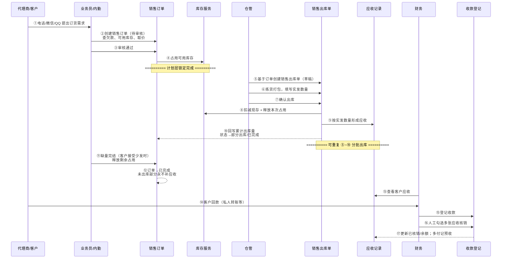
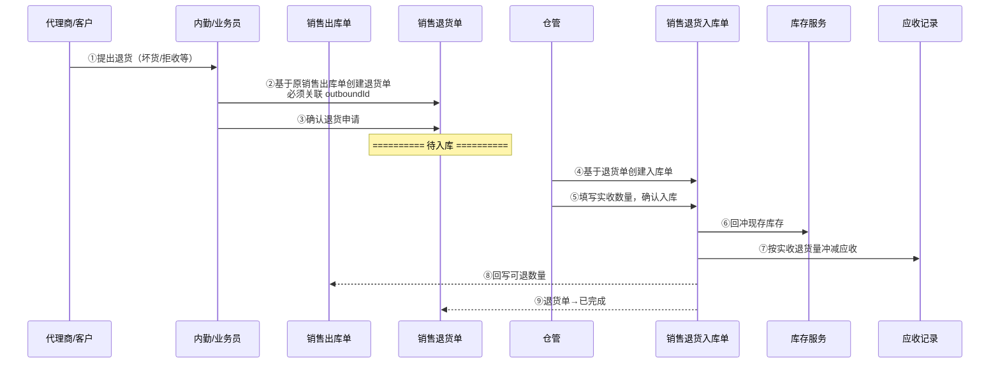

# 销售订单-业务流程推演

> **覆盖场景**：代理商批发销售正向履约 / 分批出库与缺量完结 / 销售退货逆向闭环 / 收款登记与人工核销  
> **不展开范围**：零售收银、采购链路、完整财务总账与自动认款、信用额度硬拦截、电商代发  
> **参考文档**：《销售管理需求规格说明书》《销售管理业务架构》《销售管理业务流程推演》《销售管理流程设计》《context/04-销售订单演示口径》  
> **版本**：V1.0 | 2026-06-05

---

## 一、推演范围

本文件以**销售订单**为起点，推演批发销售主链路的完整数据流转与单据联动，覆盖计划层、执行层、结算层三层挂接。

### 1.1 正向链路

```
销售订单 → 库存占用 → 销售出库 → 应收形成 → 收款登记
```

| 环节 | 业务含义 | 库存影响 | 往来影响 |
|---|---|---|---|
| 销售订单（审核通过） | 记录客户购买意图，锁定履约承诺 | **占用**可用库存 | 不形成应收 |
| 销售出库（确认出库） | 记录仓库实际发货 | **扣减**现存、**释放**本次占用 | 按实发数量**形成**应收 |
| 收款登记 | 记录客户回款 | 无 | 人工核销应收，余额可记预收 |

### 1.2 逆向链路

```
销售出库 → 销售退货 → 销售退货入库 → 库存回冲 / 应收冲减
```

| 环节 | 业务含义 | 库存影响 | 往来影响 |
|---|---|---|---|
| 销售退货单 | 基于已出库结果发起退货申请 | 不直接动库存 | 申请冲减应收 |
| 销售退货入库单（确认入库） | 记录退货实物入库 | **回冲**现存 | 按实收退货量**冲减**应收 |

### 1.3 链路边界说明

- 本文件关注**整条销售订单链路**，不单列销售订单这张单据的内部字段与状态机细节（状态机见《销售管理流程设计》）。
- 销售出库、收款登记、销售退货是链路中的**必要上下游**，其职责在本文件推演清楚，但不写成销售订单自身的功能。
- 零售收银走独立模块，与销售订单共用库存底账，不纳入本推演。

### 1.4 演示固定案例（数据校验锚点）

课堂推演可引用以下案例验证数量与金额闭环（来源：`context/04-销售订单演示口径`）：

| 项目 | 数值 |
|---|---|
| 客户 | 深圳华南代理商 |
| 商品 | 蓝牙耳机保护壳 |
| 订单数量 | 100 件 |
| 含税单价 | ¥50 |
| 第一次出库 | 40 件 → 应收 ¥2,000 |
| 第二次计划出库 | 60 件，实发 55 件 → 应收 ¥2,750 |
| 累计出库 | 95 件 |
| 缺量完结 | 5 件（**不计入应收**） |
| 累计应收 | **¥4,750** |

---

## 二、涉及角色

| 角色 | 职责 | 参与节点 |
|---|---|---|
| 代理商/客户 | 提出订货需求；确认少发/退货；私人转账回款 | 下单（系统外）→ 收货确认 → 回款 |
| 业务员 | 维护客户关系；创建销售订单；录单前查库存与欠款；跟进履约进度 | 创建订单 → 查询跟进 → 协调退货 |
| 内勤/跟单 | 录单协调；审核销售订单；查询全部订单；发起缺量完结 | 审核订单 → 跟单查询 → 缺量完结 → 创建退货单 |
| 仓管 | 拣货打包；基于订单创建并确认销售出库；登记发货异常；确认退货入库 | 创建出库单 → 确认出库 → 异常登记 → 退货入库 |
| 财务 | 查看客户应收；登记收款；人工勾选应收核销；处理预收余额 | 应收查询 → 收款登记 → 人工核销 |
| 老板/负责人（林强） | 经营决策；异常裁定；全链路数据查看 | 查询监督（大额改价裁定等） |

---

## 三、涉及单据与职责

| 单据/记录 | 层级 | 核心职责 | 上游 | 下游 | 库存/往来影响 |
|---|---|---|---|---|---|
| 销售订单 | 计划层 | 记录客户购买意图、价格、数量、交付计划；审核后占用库存 | 客户档案、商品档案、价格体系 | 销售出库单 | 审核通过→**占用**可用库存；取消/缺量完结→**释放**占用；不形成应收 |
| 销售出库单 | 执行层 | 记录仓库实际发货动作；支持分批出库 | 已审核销售订单 | 应收记录、销售退货单、发货异常登记 | 确认出库→**扣减**现存、**释放**占用；按实发**形成**应收 |
| 应收记录/应收查询 | 结算层 | 记录客户因销售出库产生的待收款；支撑录单前查欠款、发货后看应收 | 已确认销售出库单 | 收款登记 | 无库存影响；出库确认后**新增**应收；退货入库后**冲减**应收 |
| 收款登记 | 结算层 | 记录客户回款；人工关联应收核销 | 客户回款信息、待核销应收 | 客户往来余额 | 无库存影响；核销后减少应收余额，多付部分记**预收** |
| 销售退货单 | 逆向申请层 | 基于已出库结果记录退货申请与原因；不允许无单创建 | 已确认销售出库单 | 销售退货入库单 | 不直接动库存；驱动后续应收冲减 |
| 销售退货入库单 | 逆向执行层 | 记录退货商品实际入库 | 销售退货单 | — | 确认入库→**回冲**现存；触发应收**冲减** |
| 发货异常登记 | 支撑记录 | 漏发/坏货等异常留痕，关联原出库单 | 已确认销售出库单 | 补开出库单或销售退货单 | 漏发补出库追加库存扣减与应收；坏货走退货链路 |

---

## 四、主流程时序图

### 4.1 正向主链路



### 4.2 逆向退货链路



---

## 五、单据联动规则表

| 上游动作 | 触发条件 | 下游单据/记录 | 继承/传递数据 | 后置影响 | 待确认 |
|---|---|---|---|---|---|
| 创建销售订单 | 客户、商品档案有效；至少一行明细 | 销售订单（待审核） | 客户、商品、数量、单价快照、仓库 | 无库存/应收影响 | 否 |
| 审核通过销售订单 | 状态=待审核；有审核权限 | 库存占用指令 | 按明细数量占用可用库存 | 状态→待出库；锁定关键字段 | 可用库存不足时是否仍允许审核通过（见 §八 TC-01） |
| 基于订单创建出库单 | 订单=待出库/部分出库；可出库余量>0 | 销售出库单（草稿） | sourceOrderId、客户、商品、单价快照、计划出库量 | 无即时库存扣减 | 否 |
| 确认销售出库 | 出库单=草稿；实发>0；实发≤可出库余量 | 应收记录 | 客户、来源出库单、实发数量×单价快照 | 扣减现存；释放本次占用；回写订单累计出库量 | 否 |
| 分批再次出库 | 订单=部分出库；仍有可出库余量 | 新的销售出库单 | 同上 | 应收按各次实发累计 | 否 |
| 缺量完结 | 订单=部分出库；已有≥1次已确认出库 | —（订单状态变更） | 记录缺量完结数量 | 释放剩余占用；状态→已完成；未出库部分永不补应收 | 否 |
| 作废销售订单 | 待审核/待出库；无已确认出库 | — | — | 释放全部占用（待出库时）；状态→已作废 | 否 |
| 出库确认后形成应收 | 出库单→已出库 | 应收记录 | 客户、出库单号、应收金额、账龄起算 | 客户欠款余额增加 | 否 |
| 创建销售退货单 | 出库单=已出库；有可退数量 | 销售退货单（草稿） | outboundId、客户、可退上限、退货原因 | 无即时库存/应收变动 | 否 |
| 确认退货入库 | 退货入库单=草稿；实收≤退货申请量 | — | 实收数量 | 回冲现存；冲减应收；更新出库单可退数量 | 否 |
| 登记收款 | 财务权限；金额>0 | 收款登记 | 客户、收款金额、方式、日期 | 生成待核销收款单 | 无法识别客户时是否设待认款状态（见 §八 TC-02） |
| 人工核销应收 | 收款单已保存 | 应收记录更新 | 勾选的应收行、核销金额 | 减少应收余额；余额记预收 | 否 |

---

## 六、关键异常分支

### 6.1 库存不足，只能部分出库

| 维度 | 说明 |
|---|---|
| 发生节点 | 创建出库单 / 确认出库 |
| 典型场景 | 审核时可用库存充足，但拣货时发现实物不足；或同一 SKU 被零售/其他订单占用 |
| 处理方式 | 仓管按**实发数量**确认出库，不按计划数量强行出库；差额不自动补发 |
| 对销售订单 | 订单保持**部分出库**状态；可继续下推新出库单 |
| 对库存 | 仅按实发扣减现存、释放对应占用 |
| 对应收 | 仅按实发数量形成应收，不按计划数量 |
| 后续选择 | 跟单协调再次出库，或客户接受少发时走**缺量完结** |

**演示案例**：订单 100 件，第一次实发 40 件，第二次计划 60 件实发 55 件，累计 95 件。

### 6.2 客户接受少发，销售订单缺量完结

| 维度 | 说明 |
|---|---|
| 发生节点 | 已有部分出库后，剩余数量不再发货 |
| 典型场景 | 库存长期不足且客户同意减单；短少且客户不再追发 |
| 处理方式 | 内勤发起**缺量完结**，须客户口头确认（一期不做复杂审批） |
| 数量约束 | 累计出库 + 缺量完结数量 = 订单原数量 |
| 对库存 | 释放剩余未出库部分的占用 |
| 对应收 | 已形成应收**不冲回**；未出库部分**永不补应收** |
| 对订单 | 状态→已完成 |

**演示案例**：100 件订单，出库 95 件后缺量完结 5 件，应收 = 95 × ¥50 = ¥4,750，**不是** ¥5,000。

### 6.3 客户退货

| 维度 | 说明 |
|---|---|
| 发生节点 | 已确认出库之后 |
| 前置约束 | **不允许**直接取消销售订单；**不允许**无单退货 |
| 处理方式 | 内勤基于原**销售出库单**创建销售退货单 → 仓管确认退货入库 |
| 数量约束 | 累计退货数量 ≤ 原出库单实发数量 |
| 对库存 | 退货入库确认后回冲现存 |
| 对应收 | 冲减金额 = 实收退货数量 × 原出库单价快照 |
| 与发货异常关系 | 坏货走退货链路；漏发走异常登记 + 补开出库 |

### 6.4 收款无法识别或一笔款对应多笔单

| 维度 | 说明 |
|---|---|
| 发生节点 | 财务收款登记 / 核销环节 |
| 典型场景 | 代理商私人转账，付款备注不清；一笔转账对应多张销售出库形成的应收 |
| 处理方式 | 财务人工核对付款备注，或由业务员确认客户身份后入账；核销时**手工勾选**多张应收行 |
| 系统约束 | 一期**不做**银行流水自动认款；**不做**自动分摊 |
| 多付处理 | 核销总额 < 收款金额时，差额记**预收余额**，挂客户往来 |
| 待确认 | 暂时无法识别付款客户时，是否设「待认款」中间状态（见 §八 TC-02） |

---

## 七、关键设计决策

### 7.1 为什么销售订单和销售出库单要分离

| 维度 | 销售订单（计划层） | 销售出库单（执行层） |
|---|---|---|
| 业务现实 | 客户下单是**意图**，不代表货已发出 | 仓库发货是**实际动作**，决定库存变动 |
| 批发特征 | 一张订单常分多次发货 | 每次发货需独立记录实发数量 |
| 系统约束 | 库存变动只发生在执行层（`context/01` 两层单据架构） | 出库确认才扣减现存 |
| 组织分工 | 业务员/内勤负责录单与审核 | 仓管负责拣货与发货确认 |

**结论**：分离后，销售可先行承诺（占用库存），仓库按实发履约，两者职责清晰，账实可追溯。

### 7.2 为什么应收应基于销售出库结果形成

| 若基于销售订单 | 若基于销售出库（本期采用） |
|---|---|
| 未出库部分也形成应收，与客户实际收货不符 | 应收 = 实际发出的货，符合「货权转移」业务语义 |
| 缺量完结、部分出库时应收口径混乱 | 分批出库自然累计，缺量部分永不补应收 |
| 退货时难以与实发批次对齐 | 应收挂接出库单，退货冲减有据可查 |

**结论**：应收是结算层概念，应挂接在执行层结果上，不按计划层数量形成（`context/04`、`SBR-006`）。

### 7.3 为什么销售退货优先基于销售出库单发起

| 维度 | 说明 |
|---|---|
| 业务现实 | 只有实际发出的货才可能退回；订单层数量与实发可能不一致 |
| 库存追溯 | 退货入库可精确回冲到对应出库批次 |
| 财务准确 | 冲减金额 = 退货实收 × 原出库单价，与已形成应收对齐 |
| 审计要求 | 出库单记录实发，退货有据可查；一期不允许无单退货 |

**结论**：已出库后禁止直接取消销售订单，须走「销售退货单 → 销售退货入库单」逆向链路（`SBR-011`、`SBR-012`）。

### 7.4 为什么完整财务核销不在本次销售订单 PRD 套件中展开

| 属于本期进销存 | 不属于本期（外部/后续） |
|---|---|
| 应收形成与查询 | 财务总账、凭证、科目核算 |
| 收款登记与人工核销 | 银行/支付流水自动认款 |
| 客户欠款提醒（不硬拦截） | 复杂分摊规则、税务申报 |
| 预收余额挂客户往来 | 完整经营分析与对账报表 |

**结论**：强盛科技一期目标是「录得进、查得到、流转得通」的最小闭环。私人转账、一笔款对应多单等场景由财务人工处理即可满足；自动认款和完整核销需要银行接口、匹配规则等额外设计，明确不在一期范围（`context/03`、`context/04` §四）。

---

## 八、待确认问题

| 问题编号 | 问题 | 影响文件 | 建议确认对象 |
|---|---|---|---|
| TC-01 | 销售订单审核时，可用库存不足是否仍允许审核通过？当前业务设计倾向「预警 + 允许通过」，但占用可能失败 | 销售订单-主 PRD、销售订单-字段清单、库存联动规则 | 内勤/老板：是否接受「先承诺后协调」 |
| TC-02 | 收款登记时暂时无法识别付款客户，是否设「待认款」中间状态？还是财务线下核对后再录入 | 收款登记相关 PRD、往来管理模块 | 财务：私人转账认款实际操作习惯 |
| TC-03 | 发货异常登记（漏发/坏货）是否纳入销售订单 PRD 套件关联推演，还是仅在销售出库 PRD 中展开 | 销售出库-业务流程推演、发货异常登记 PRD | 产品/讲师：演示粒度取舍 |

---

## 自检记录

| 检查项 | 结果 |
|---|---|
| 1. 是否没有提前生成主 PRD、字段清单、Demo PRD？ | ✅ 仅输出业务流程推演 |
| 2. 正向链路和逆向链路是否都闭环？ | ✅ 订单→占用→出库→应收→收款；出库→退货→退货入库→库存回冲/应收冲减 |
| 3. 库存影响和应收影响是否说清楚？ | ✅ 各单据职责表、联动规则表、异常分支均已标注库存/往来影响 |
