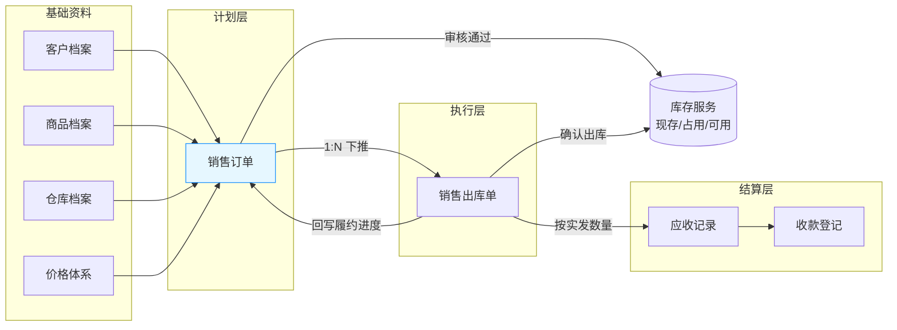
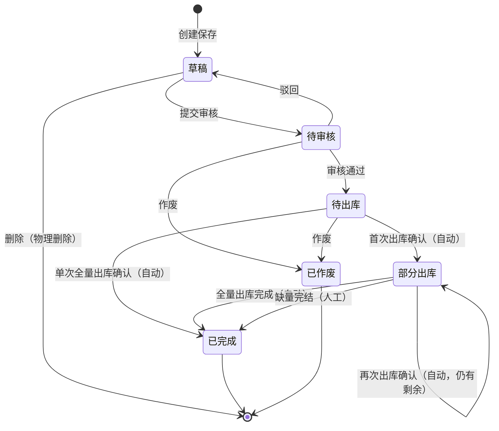

# 销售订单主PRD

> **版本**：V1.1 | 2026-06-05（走查修复：税率公式、备注编辑态、缺量完结交互 R41–R43）  
> **读者**：研发工程师、测试工程师、产品复核  
> **字段命名依据**：《销售订单字段清单》（定稿版 V1.1）  
> **上游依据**：三层设计产物、《销售订单-业务流程推演》

---

## 一、业务背景

销售订单是强盛科技批发销售链路的**计划层起点单据**，解决「客户要买什么、买多少、什么价格、何时交付」的统一留痕与协同问题。代理商通过电话、微信、QQ 下单占日单量约 80%，若销售意图无法系统化记录，仓库无法按单发货，财务也无法看清客户欠款。

没有统一的销售订单管理时，会出现以下痛点：

- 录单前需人工问价格、问库存、问客户欠款，开单慢且报价不一致
- 订单录入后状态不透明，内勤跟单、仓储发货、财务收尾各自为政
- 销售认为「有货」，仓库实际发不出，库存口径不一致
- 分批发货、少发减单没有标准处理口径，履约进度无法追溯
- 客户欠款看不清，放货决策缺少依据

销售订单的职责是**记录销售意图与计划、审核后占用库存、承接下游出库回写**；实际发货、应收形成、收款登记由下游模块承担，不在本单据职责范围内。

---

## 二、功能范围

**In Scope**：

- 销售订单的创建、保存草稿、提交审核、驳回、审核通过、作废
- 销售订单列表查询、详情查看、导出
- 录单时关联客户、发货仓库、商品明细，维护价格与金额
- 录单前展示客户欠款与可用库存提醒（只读，不阻断）
- 审核通过后占用可用库存
- 待出库/部分出库状态下提供「创建出库单」入口（跳转下游模块）
- 接收销售出库单确认后的履约回写（`已出库数量`、`累计已出库数量`、`订单状态`）
- 部分出库后的缺量完结（释放剩余占用，未出库部分不再履约）
- 跟单备注维护（审核后仍可编辑）

**Out of Scope**：

- 销售出库单的创建、拣货、确认出库（属于销售出库模块）
- 应收记录的形成与查询、收款登记与核销（属于往来管理模块）
- 销售退货单、销售退货入库单的创建与确认（属于销售退货模块；本 PRD 仅定义订单侧约束）
- 无销售订单直接创建销售出库单（一期批发强制先订单后出库）
- 零售收银（零售管理模块独立承载，共用库存底账）
- 信用额度自动硬拦截、银行流水自动认款、完整财务总账
- 复杂审批流、多级售价审批、电商代发接口

---

## 三、单据定位

### 3.1 在系统中的位置

| 项目 | 内容 |
|---|---|
| 单据层级 | 第 1 层：计划层（记录客户购买意图与交付计划） |
| 核心职责 | 承接代理商批发需求，形成可审核、可跟单、可下推出库的计划层单据；审核通过后占用库存 |
| 单据来源 | 业务员/内勤手动创建 |
| 下游单据 | 销售出库单（1:N 分批下推）；间接关联应收记录（由出库确认触发，非订单直接生成） |
| 实体关系 | 一张销售订单可对应多张销售出库单；累计 `已出库数量` ≤ `订货数量` − `缺量完结数量` |

### 3.2 系统链路图

### 3.3 实体关系说明

| 关系 | 说明 |
|---|---|
| 客户 : 销售订单 | **1:N**，一个客户可有多张销售订单；`客户`须为启用状态档案 |
| 销售订单 : 销售出库单 | **1:N**，须已审核且存在 `可出库余量`>0 方可下推 |
| 销售订单 : 库存服务 | 审核通过占用；作废/缺量完结释放占用；**不直接扣减现存** |
| 销售订单 : 应收记录 | **无直接形成关系**；应收由销售出库确认触发，订单不保存应收金额 |

### 3.4 与销售出库、收款登记的职责边界

| 能力 | 销售订单负责 | 下游模块负责 |
|---|---|---|
| 记录客户购买意图 | ✅ | — |
| 审核与库存占用 | ✅ | — |
| 实际发货与库存扣减 | 提供下推入口与回写承接 | 销售出库单 |
| 应收形成 | 不形成、不存储应收金额 | 销售出库确认后由往来模块生成 |
| 客户回款与核销 | 不处理 | 收款登记模块 |
| 已出库后逆向处理 | 禁止直接作废订单 | 销售退货链路 |

---

## 四、业务场景

| 场景ID | 场景 | 类型 | 说明 |
|---|---|---|---|
| S01 | 标准销售接单 | **主流程** | 业务员/内勤录入 `客户`、`发货仓库`、商品明细，提交审核；内勤审核通过后 `订单状态`→待出库，占用库存 |
| S02 | 审核驳回重改 | **支线** | 内勤驳回待审核订单→`订单状态`回草稿；创建人修改后重新提交 |
| S03 | 分批出库 | **主流程** | 仓管基于待出库/部分出库订单多次下推销售出库单；每次出库确认后回写 `已出库数量`，`订单状态`→部分出库，直至全量或缺量完结 |
| S04 | 缺量完结 | **支线** | 客户接受少发，内勤对部分出库订单执行缺量完结→写入 `缺量完结数量`，释放剩余占用，`订单状态`→已完成；未出库部分不再履约 |
| S05 | 库存不足预警 | **异常** | 录单或审核时可用库存不足，系统展示预警；是否仍允许审核通过待确认（SAR-012） |
| S06 | 客户欠款/信用预警 | **异常** | 录单前展示客户欠款余额与账龄提醒；一期仅提醒，不自动阻断下单或审核 |
| S07 | 订单作废 | **支线** | 待审核或待出库（无已确认出库）时内勤/创建人作废→`订单状态`→已作废，释放占用 |
| S08 | 已出库后不可直接取消 | **异常** | 已有确认出库的销售订单不允许作废；须通过销售退货模块处理，订单侧阻断作废入口 |

**演示案例参照**（`context/04`）：订单 `订货数量` 100 件、`含税单价` ¥50，两次出库 40+55 件，缺量完结 5 件；订单 `订单含税总金额` ¥5,000，实际应收由出库模块按 95 件形成 ¥4,750。

---

## 五、状态机

### 5.1 状态定义

| 状态 | 枚举值 | 含义 | 是否终态 |
|---|---|---|---|:---:|
| 草稿 | `DRAFT` | 已创建未提交，可编辑、可物理删除 | 否 |
| 待审核 | `PENDING_AUDIT` | 已提交，等待内勤审核 | 否 |
| 待出库 | `PENDING_SHIP` | 审核通过，已占用库存，尚无已确认出库 | 否 |
| 部分出库 | `PARTIAL_SHIPPED` | 已有至少一次已确认出库，仍有 `可出库余量` | 否 |
| 已完成 | `COMPLETED` | 全部出库完成或已缺量完结 | **是** |
| 已作废 | `VOIDED` | 订单失效，仅可查询 | **是** |

> `订单状态` 字段仅由动作按钮触发变更，不允许在表单中直接修改。

### 5.2 状态流转图

### 5.3 状态流转表

| 当前状态 | 动作 | 前置条件 | 结果状态 | 二次确认 | 后置影响 | 失败处理 |
|---|---|---|---|---|---|---|
| 草稿 | 提交审核 | `客户`、`发货仓库`、至少一行明细；每行 `商品`、`订货数量`、`含税单价`>0 | 待审核 | 无 | 记录 `提交人`、`提交时间` | Toast：「提交失败，{字段}不满足条件」 |
| 草稿 | 删除 | 无 | 物理消失 | 「删除后不可恢复，确认删除？」 | 记录移除 | — |
| 待审核 | 驳回 | 有审核权限 | 草稿 | 无 | 解锁编辑 | — |
| 待审核 | 审核通过 | 有审核权限；可用库存不足时预警（SAR-012 待确认） | 待出库 | 无 | 锁定关键字段；按明细 `订货数量` 占用库存；记录 `审核人`、`审核时间` | 占用失败：Toast「库存占用失败，请检查可用库存」 |
| 待审核 | 作废 | 无已确认出库 | 已作废 | 「作废后不可恢复，确认作废？」 | 只读；记录 `作废人`、`作废时间` | — |
| 待出库 | 作废 | 无任何已确认出库单 | 已作废 | 同上 | **释放全部占用** | 存在已确认出库：阻断，提示走退货 |
| 待出库 | 创建出库单 | `可出库余量`>0 | 待出库 | 无 | 跳转下游生成销售出库单草稿 | 无余量：阻断 |
| 待出库/部分出库 | —（出库确认事件） | 下游销售出库单确认成功 | 部分出库/已完成 | 系统自动 | 回写 `已出库数量`、`累计已出库数量`；更新 `行关闭状态`；释放本次占用（库存服务） | 见销售出库 PRD |
| 部分出库 | 缺量完结 | 已有≥1 次已确认出库；`可出库余量`>0；无草稿出库单 | 已完成 | 缺量完结弹窗录入各行数量 → 二次确认 | 按行写入 `缺量完结数量`；释放剩余占用；记录 `缺量完结人`、`缺量完结时间` | 无已确认出库：阻断；存在草稿出库单：阻断（R43） |
| 部分出库 | 创建出库单 | `可出库余量`>0 | 部分出库 | 无 | 跳转下游生成出库单草稿 | — |
| 已完成 | 查看/导出 | — | 已完成 | — | 无 | — |
| 已作废 | 查看/导出 | — | 已作废 | — | 无 | — |

### 5.4 动作能力矩阵

| 动作 | 草稿 | 待审核 | 待出库 | 部分出库 | 已完成 | 已作废 |
|---|:---:|:---:|:---:|:---:|:---:|:---:|
| 查看 | ✅ | ✅ | ✅ | ✅ | ✅ | ✅ |
| 编辑 | ✅ | ❌ | ❌ | ❌ | ❌ | ❌ |
| 删除（物理） | ✅ | ❌ | ❌ | ❌ | ❌ | ❌ |
| 提交审核 | ✅ | ❌ | ❌ | ❌ | ❌ | ❌ |
| 驳回 | ❌ | ✅ | ❌ | ❌ | ❌ | ❌ |
| 审核通过 | ❌ | ✅ | ❌ | ❌ | ❌ | ❌ |
| 作废 | ❌ | ✅ | ✅ | ❌ | ❌ | ❌ |
| 创建出库单 | ❌ | ❌ | ✅ | ✅ | ❌ | ❌ |
| 缺量完结 | ❌ | ❌ | ❌ | ✅ | ❌ | ❌ |
| 编辑备注/跟单备注 | ✅ | ❌ | ✅ | ✅ | ✅ | ❌ |
| 导出 | ✅ | ✅ | ✅ | ✅ | ✅ | ✅ |

### 5.5 作废 vs 缺量完结对比

| 维度 | 作废 | 缺量完结 |
|---|---|---|
| 含义 | 撤销未发生的业务意图 | 终止剩余发货，已出库部分保留 |
| 适用状态 | 待审核、待出库（无已确认出库） | 部分出库 |
| 结果状态 | 已作废 | 已完成 |
| 库存影响 | 待出库时释放全部占用 | 释放剩余未出库部分的占用 |
| 应收影响 | 无 | 已形成应收不冲回；未出库部分永不补应收 |
| 已有确认出库后 | **不允许** | 允许（客户接受少发） |

---

## 六、核心业务规则

### 6.1 客户、商品、仓库引用规则

| 规则ID | 规则 |
|---|---|
| R01 | 创建销售订单时，`客户`、`发货仓库`、明细行 `商品` 必须引用**启用状态**的主数据档案 |
| R02 | 选择 `客户` 后，系统带出并快照存储 `客户名称`；选择 `发货仓库` 后，快照存储 `仓库名称` |
| R03 | 选择明细行 `商品` 后，系统带出并快照存储 `商品编码`、`商品名称`、`规格型号`、`单位` |
| R04 | 主数据停用后不可新建引用；历史销售订单保留完整快照数据 |
| R05 | 主数据不提供物理删除，统一用停用处理 |

### 6.2 价格与金额计算规则

| 规则ID | 规则 |
|---|---|
| R06 | 录单取价优先级：`客户批发价` → `标准批发价` → 手工修改 `含税单价` |
| R07 | 手工修改 `含税单价` 时，须填写 `改价原因`（选填留痕，一期不做改价审批） |
| R08 | `不含税单价` = `含税单价` ÷ (1 + `税率`/100)；`税率` 为百分比数值（如 13 表示 13%） |
| R09 | 行级 `价税合计` = `含税单价` × `订货数量`；`金额` = `不含税单价` × `订货数量`；`税额` = `价税合计` − `金额`（差额法）；`价税合计` 与 `金额`+`税额` 允许 ±0.01 尾差 |
| R10 | `订单不含税总金额` = Σ 行 `金额`；`订单税额合计` = Σ 行 `税额`；`订单含税总金额` = Σ 行 `价税合计` |
| R11 | `商品种数` = 明细行数；`订货总数量` = Σ 行 `订货数量` |
| R12 | 单据内价格字段均为快照存储，商品档案调价不影响已保存订单 |

### 6.3 库存占用规则

| 规则ID | 规则 |
|---|---|
| R13 | 销售订单**审核通过**后，按各行 `订货数量` 调用库存服务占用 `发货仓库` 的可用库存 |
| R14 | 草稿、待审核状态不占用库存 |
| R15 | 待出库状态整单作废时，释放全部占用 |
| R16 | 缺量完结时，释放剩余未出库部分对应的占用（`可出库余量` 对应的占用量） |
| R17 | 销售订单**不直接扣减现存库存**；现存扣减发生在销售出库确认环节 |
| R18 | 录单/审核时若可用库存不足，系统展示预警；是否仍允许审核通过见 SAR-012（**待确认**） |

### 6.4 出库回写规则

| 规则ID | 规则 |
|---|---|
| R19 | 销售出库单确认后，按商品行回写 `已出库数量`；汇总回写 `累计已出库数量`、`累计已出库总数量` |
| R20 | `可出库余量` = `订货数量` − `已出库数量` − `缺量完结数量`；系统实时计算 |
| R21 | 当 `已出库数量` + `缺量完结数量` = `订货数量` 时，行 `行关闭状态` → 已关闭 |
| R22 | 当所有明细行 `行关闭状态` = 已关闭时，`订单状态` 自动 → 已完成 |
| R23 | 首次出库确认后，若仍有 `可出库余量`，`订单状态` 自动 → 部分出库 |
| R24 | 单次全量出库确认（累计出库 = 订货数量）后，`订单状态` 自动 → 已完成 |
| R25 | 销售订单不存储、不计算应收金额；应收由出库模块按实发数量形成 |

### 6.5 缺量完结规则

| 规则ID | 规则 |
|---|---|
| R26 | 缺量完结仅允许在 `订单状态` = 部分出库时触发 |
| R27 | 须已有至少一次已确认出库；无已确认出库时应走作废而非缺量完结 |
| R28 | 缺量完结写入各行 `缺量完结数量`，汇总至 `缺量完结总数量`（字段清单 §三） |
| R29 | 约束：Σ `已出库数量` + Σ `缺量完结数量` = Σ `订货数量` |
| R30 | 缺量完结的未出库部分**永不补履约、不形成应收** |
| R31 | 缺量完结不冲减已形成的应收（应收冲减走销售退货链路） |
| R41 | 缺量完结通过详情页/列表页入口打开**缺量完结弹窗**；按明细行展示 `可出库余量`，默认将各行 `可出库余量` 全额填入 `缺量完结数量`，用户可逐行调减但不得超额 |
| R42 | 提交时须满足 Σ 行 `缺量完结数量` = Σ 行 `可出库余量`（一次关闭全部剩余待发）；校验通过后写入各行 `缺量完结数量`，`订单状态` → 已完成 |
| R43 | 缺量完结前须校验该订单无关联的**草稿状态**销售出库单；存在则阻断，Toast：「存在未完成的出库单，请先处理或删除」 |

### 6.6 销售退货关联规则（订单侧约束）

| 规则ID | 规则 |
|---|---|
| R32 | 已有确认出库后，**不允许**对销售订单执行作废、编辑关键字段、物理删除 |
| R33 | 已出库商品的退回须基于**销售出库单**创建销售退货单，不允许在销售订单上直接处理 |
| R34 | 销售订单不提供「取消已出库部分」能力；逆向闭环由销售退货模块承接 |
| R35 | 销售退货导致的 `已出库数量` 变更不在订单层回写（可退数量维护在出库单层） |

### 6.7 字段锁定规则

| 规则ID | 规则 |
|---|---|
| R36 | `订单状态` 不可在表单中直接修改，仅能通过动作按钮触发变更 |
| R37 | 审核通过后锁定：`客户`、`客户名称`、`发货仓库`、`仓库名称`、明细行 `商品` 及商品快照、`订货数量`、`含税单价`、`税率` 及全部计算金额字段 |
| R38 | `备注`、`跟单备注`：草稿态在编辑页维护；待出库/部分出库/已完成态通过详情页「编辑备注」维护；已作废态只读 |
| R39 | `已出库数量`、`缺量完结数量`、`累计已出库数量`、`可出库余量`、`行关闭状态` 由系统回写或计算，用户不可手工修改 |
| R40 | 系统字段（`创建人`、`创建时间`、`审核人`、`审核时间` 等）均由系统自动记录，用户不可编辑 |

---

## 七、权限设计

### 7.1 数据可见范围

| 角色 | 可见数据范围 | 说明 |
|---|---|---|
| 业务员 | 本人负责客户相关的销售订单 | 可创建、查看、跟进 |
| 内勤/跟单 | 全部销售订单 | 可审核、作废、缺量完结、查询 |
| 仓管 | 待出库/部分出库的销售订单（只读） | 可查看订单明细以创建出库单；不可编辑订单 |
| 财务 | 全部销售订单（只读） | 查看履约进度，应收处理在往来模块 |
| 老板/负责人 | 全部销售订单 | 查询与监督 |

### 7.2 操作权限矩阵

| 操作 | 业务员 | 内勤/跟单 | 仓管 | 财务 | 老板 |
|---|:---:|:---:|:---:|:---:|:---:|
| 新增销售订单 | ✅ | ✅ | ❌ | ❌ | ❌ |
| 编辑草稿 | ✅ | ✅ | ❌ | ❌ | ❌ |
| 提交审核 | ✅ | ✅ | ❌ | ❌ | ❌ |
| 审核通过/驳回 | ❌ | ✅ | ❌ | ❌ | ❌ |
| 作废 | ❌ | ✅ | ❌ | ❌ | ❌ |
| 缺量完结 | ❌ | ✅ | ❌ | ❌ | ❌ |
| 创建出库单（入口） | ❌ | ❌ | ✅ | ❌ | ❌ |
| 编辑备注/跟单备注 | ✅ | ✅ | ❌ | ❌ | ❌ |
| 查看/导出 | ✅ | ✅ | ✅ | ✅ | ✅ |

> 一期不做复杂权限系统实现；上表为角色与操作边界定义，具体权限码在系统设置模块配置。

---

## 八、边界与异常处理

### 8.1 库存不足

| 场景 | 处理方式 |
|---|---|
| 录单时可用库存不足 | 展示各行可用库存预警，允许保存草稿；是否阻断提交待产品确认 |
| 审核时可用库存不足 | 当前倾向预警后仍允许审核（SAR-012 **待确认**）；若占用服务返回失败，保持待审核状态并提示 |
| 出库时实发少于订货数量 | 由销售出库模块按实发确认；订单保持部分出库，差额不自动补发 |
| 完全无货 | 不确认出库；跟单协调换货、延期，或对未出库部分作废/缺量完结 |

### 8.2 已出库后不可直接取消销售订单

| 场景 | 处理方式 |
|---|---|
| 部分出库后点击作废 | 阻断，Toast：「已有出库记录，请通过销售退货处理」 |
| 已完成订单要求取消 | 阻断作废；已出库部分走销售退货，未出库部分已在缺量完结或全量出库中处理完毕 |
| 用户尝试编辑已锁定字段 | 字段只读，不展示保存入口 |

### 8.3 重复出库 / 超量出库

| 场景 | 处理方式 |
|---|---|
| 同一订单多次下推出库 | 允许，常态分批出库 |
| 单次出库量 > `可出库余量` | 下游出库模块阻断；订单层 `可出库余量` 作为校验上限 |
| 累计 `已出库数量` > `订货数量` | 系统阻断，不允许回写 |
| 订单已完成后再下推出库 | 阻断创建出库单入口 |

### 8.4 应收口径与待确认处理

| 场景 | 处理方式 |
|---|---|
| 订单 `订单含税总金额` 与实收应收不一致 | **预期行为**：应收不按订单原始数量形成；以出库模块按 `已出库数量` × `含税单价` 快照累计为准 |
| 缺量完结后是否补应收 | 不补；未出库的 `缺量完结数量` 永不形成应收 |
| 审核时库存不足是否阻断 | **待确认**（TC-01 / SAR-012），主 PRD 暂按「预警 + 占用失败则阻断审核」实现 |
| 收款无法识别客户 | 不属于销售订单职责；往来模块待确认是否设「待认款」状态（TC-02） |

### 8.5 并发与幂等

| 场景 | 处理方式 |
|---|---|
| 两人同时审核同一订单 | 后提交者收到「状态已变更」提示，操作失败 |
| 出库回写与缺量完结并发 | 缺量完结前校验无在途草稿出库单；有则阻断并提示先处理出库单 |
| 重复点击审核通过 | 幂等处理，已待出库则不再重复占用 |

---

## 九、验收标准

| 验收编号 | 场景 | 前置条件 | 操作 | 预期结果 |
|---|---|---|---|---|
| AC-01 | 标准接单并审核 | 客户/商品/仓库档案启用；有库存 | 创建订单→填写明细→提交审核→审核通过 | `订单状态`=待出库；库存占用成功；关键字段锁定 |
| AC-02 | 提交校验阻断 | 订单缺 `客户` 或明细 `订货数量`=0 | 点击提交审核 | 阻断；Toast 提示缺失字段 |
| AC-03 | 审核驳回重改 | 订单=待审核 | 内勤点击驳回 | `订单状态`=草稿；可重新编辑并再次提交 |
| AC-04 | 草稿物理删除 | 订单=草稿 | 点击删除并确认 | 记录物理移除 |
| AC-05 | 待出库作废 | 订单=待出库；无已确认出库 | 点击作废并确认 | `订单状态`=已作废；占用全部释放 |
| AC-06 | 分批出库回写 | 订单 100 件已审核 | 下游两次出库确认 40 件、55 件 | `已出库数量` 累计 95；`订单状态`=部分出库；`可出库余量`=5 |
| AC-07 | 缺量完结 | 订单=部分出库；已出库 95 件 | 内勤缺量完结 5 件 | `缺量完结数量`=5；`订单状态`=已完成；剩余占用释放；不补应收 |
| AC-08 | 全量出库自动完成 | 订单 100 件待出库 | 一次出库确认 100 件 | `订单状态`=已完成；各行 `行关闭状态`=已关闭 |
| AC-09 | 库存不足预警 | 某行可用库存 < `订货数量` | 录单或审核 | 展示库存不足预警（是否阻断审核见 AC-14） |
| AC-10 | 欠款预警不阻断 | 客户欠款超阈值 | 创建并提交订单 | 展示欠款提醒；允许提交与审核 |
| AC-11 | 已出库后禁止作废 | 订单=部分出库 | 点击作废 | 入口不可用或阻断提示走退货 |
| AC-12 | 超量出库阻断 | `可出库余量`=5 | 下游尝试出库 10 件 | 出库模块阻断；订单 `已出库数量` 不变 |
| AC-13 | 取价与金额计算 | 客户有专属批发价 | 选择客户和商品 | `含税单价` 按客户价带出；`价税合计` 计算正确 |
| AC-14 | 审核占用失败 | 可用库存=0（待确认场景） | 审核通过 | 保持待审核；Toast「库存占用失败」 |
| AC-15 | 备注审核后可编辑 | 订单=待出库 | 修改 `跟单备注` 并保存 | 保存成功；关键字段仍锁定 |
| AC-16 | 停用档案阻断 | 客户已停用 | 新建订单选择该客户 | 阻断选择 |
| AC-17 | 演示案例金额口径 | 100 件×¥50，出库 95 件，缺量 5 件 | 完成出库+缺量完结 | 订单 `订单含税总金额`=¥5,000；应收由出库形成 ¥4,750（不在订单上体现） |
| AC-18 | 状态不可表单修改 | 任意状态订单 | 尝试在编辑页修改 `订单状态` | 表单不展示状态下拉；无法直接修改 |

---

## 自检记录

| 检查项 | 结果 |
|---|---|
| 1. 是否没有提前生成字段清单定稿、用例数据推演或 Demo PRD？ | ✅ 仅输出主 PRD |
| 2. 销售订单职责是否清晰，没有吞掉销售出库和收款登记职责？ | ✅ 出库/应收/收款边界在 §三、§六 明确 |
| 3. 状态机是否有入口、出口和终态？ | ✅ 入口：草稿；终态：已完成、已作废；物理删除出口 |
| 4. 主 PRD 中引用的字段名是否都来自字段清单粗纲？ | ✅ 全部引用《销售订单字段清单》已定义字段名 |
