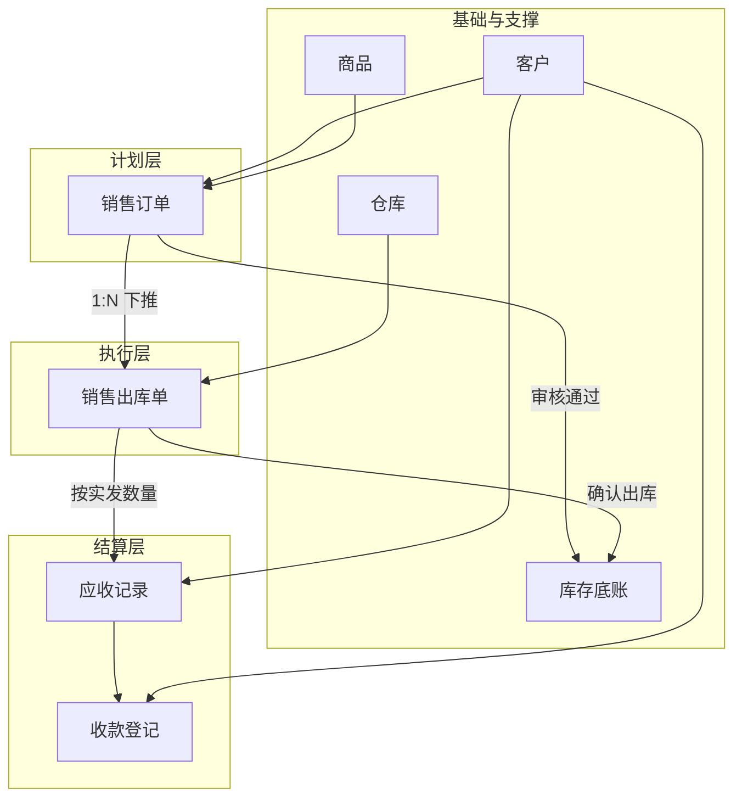
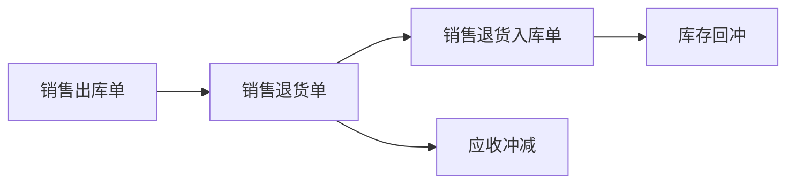

# 销售管理业务架构

> 文档定位：业务设计层产出，描述销售管理模块的业务全貌、角色分工、单据链路与模块边界。  
> 版本：v1.0 | 状态：待评审  
> 输入依据：需求设计 SRS v1.1、`context/05-销售管理演示Mock口径.md`

---

## 一、业务场景总览

| 场景编号 | 业务场景 | 参与角色 | 涉及单据/对象 | 业务目标 | 优先级 |
|---|---|---|---|---|---|
| SC01 | 代理商批发接单 | 代理商、业务员、内勤 | 销售订单、客户、商品、库存查询 | 将电话/微信/QQ 订货需求录入系统，形成可跟单的计划层单据 | P0 |
| SC02 | 销售订单审核与库存承诺 | 内勤、仓管（查询） | 销售订单、库存占用 | 审核通过后锁定库存占用，避免同一库存被重复承诺 | P0 |
| SC03 | 仓库销售出库 | 仓管、内勤（跟单） | 销售订单、销售出库单、库存 | 按已审核订单拣货发货，库存扣减挂接在执行层 | P0 |
| SC04 | 分批出库与缺量完结 | 仓管、内勤、代理商 | 销售订单、销售出库单 | 支持多次出库；客户接受少发时完结剩余未出库数量 | P0 |
| SC05 | 销售应收形成与查询 | 财务、业务员、内勤 | 销售出库单、应收记录 | 按实际出库形成应收，支撑录单前查欠款、发货后看应收 | P0 |
| SC06 | 客户收款登记与核销 | 财务、代理商 | 收款登记、应收记录、客户往来 | 登记回款并人工关联应收，不自动认款 | P0 |
| SC07 | 销售退货 | 代理商、内勤、仓管、财务 | 销售出库单、销售退货单、销售退货入库单 | 已出库商品退回，库存回冲、应收冲减 | P1 |
| SC08 | 发货异常处理 | 仓管、内勤 | 销售出库单、发货异常登记 | 漏发补发、坏货走退货，短少走缺量完结 | P1 |
| SC09 | 销售跟单与往来查询 | 业务员、内勤、财务、老板 | 销售订单、销售出库单、客户往来 | 查单、跟进度、基础对账 | P1 |

> 零售收银（档口现场成交）不纳入本架构主链路，由零售管理模块独立承载，与销售管理共用库存底账。

---

## 二、角色与职责

| 角色 | 业务职责 | 在销售链路中的动作 | 关注点 |
|---|---|---|---|
| 代理商/客户 | 提出订货需求、确认少发/退货、回款 | 电话/微信/QQ 下单；确认分批到货；私人转账付款 | 价格是否一致、能否按时发货、欠款是否清晰 |
| 业务员 | 维护客户关系、接单报价、跟进履约 | 创建销售订单；录单前查库存与欠款；跟进订单执行进度 | 报价准确、客户不流失、本人负责客户订单可见 |
| 内勤/跟单 | 录单协调、审核订单、跟单透明 | 创建/修改未审核订单；审核销售订单；查询全部订单；登记跟单备注 | 订单状态清楚、销售与仓库信息一致 |
| 仓管 | 实物收发、拣货打包、发货确认 | 查看待出库任务；基于已审核订单创建出库单；确认出库；登记发货异常 | 按单发货、账实一致、异常有留痕 |
| 财务 | 往来管理、收款核销 | 查看客户应收；收款登记；人工勾选应收核销；处理预收余额 | 应收准确、回款可追溯、不做自动认款 |
| 老板/负责人（林强） | 经营决策、异常裁定 | 查询全链路数据；大额改价订单裁定（Mock） | 现金流、欠款风险、主链路是否跑通 |

---

## 三、核心单据链路

### 3.1 正向主链路

销售管理采用**计划层 → 执行层 → 结算层**三层挂接：

- **计划层**：销售订单（记录购买意图、价格、数量、交付计划）
- **执行层**：销售出库单（记录实际发货，驱动库存扣减）
- **结算层**：应收记录、收款登记（挂接在执行结果上，不按未出库数量形成应收）

### 3.2 逆向链路（退货）

已出库后**不可直接取消销售订单**，须基于执行结果走退货：

### 3.3 链路要点

| 单据 | 业务定位 | 对库存的影响 | 对往来的影响 |
|---|---|---|---|
| 销售订单 | 计划层，记录客户购买意图 | 审核通过后**占用**可用库存 | 不形成应收 |
| 销售出库单 | 执行层，记录实际发货 | 确认后**扣减**现存、**释放**占用 | 按实发数量**形成**应收 |
| 销售退货单 | 逆向申请，须关联原出库单 | 不直接动库存 | 申请冲减应收 |
| 销售退货入库单 | 逆向执行，记录实收退货 | **回冲**库存 | 确认后**冲减**应收 |
| 收款登记 | 结算动作 | 无 | 核销应收或形成预收余额 |

---

## 四、业务边界

### 4.1 与基础资料

| 边界 | 销售管理负责 | 基础资料负责 |
|---|---|---|
| 主数据维护 | 引用客户、商品、仓库 | 客户档案、商品档案、仓库档案的创建与停用 |
| 价格 | 录单时取价、手工改价留痕 | 标准批发价、客户批发价的维护 |
| 依赖关系 | 无有效客户/商品/仓库则无法创建销售订单 | 主数据停用后不可新建引用，历史单据保留 |

### 4.2 与库存管理

| 边界 | 销售管理负责 | 库存管理负责 |
|---|---|---|
| 库存变动触发 | 销售订单审核占用；销售出库扣减；退货入库回冲 | 统一库存底账、现存/占用/可用三口径 |
| 其他库存动作 | 不直接处理 | 采购入库、零售扣减、调拨、盘点、报损 |
| 约束 | 出库数量不得超过订单可出库余量；占用不得超过可用库存 | 所有模块共用同一库存台账 |

### 4.3 与往来管理

| 边界 | 销售管理负责 | 往来管理负责 |
|---|---|---|
| 应收形成 | 销售出库确认后触发应收（业务语义） | 应收台账汇总、客户/供应商往来查询 |
| 收款 | 销售场景下触发收款需求 | 收款登记、付款登记、人工核销、预收余额 |
| 不做 | 凭证、科目、总账 | 完整财务核算 |

### 4.4 与零售管理

| 边界 | 说明 |
|---|---|
| 流程独立 | 零售收银走轻量成交流程，不经过销售订单 |
| 数据共享 | 共用商品档案、仓库档案、库存底账 |
| 本期策略 | 零售需求基线单独维护，不写入销售管理主链路 |

### 4.5 与完整财务系统

| 属于进销存（本期） | 不属于进销存（外部/后续） |
|---|---|
| 应收形成与查询 | 财务总账、凭证生成 |
| 收款登记与人工核销 | 银行流水自动认款 |
| 客户欠款提醒（不硬拦截） | 信用额度自动强控 |
| 基础销售往来查询 | 复杂经营分析、税务申报 |

---

*下一步：详见《销售管理业务流程推演.md》步骤级推演；《销售管理数据设计.md》实体与术语定义。*
