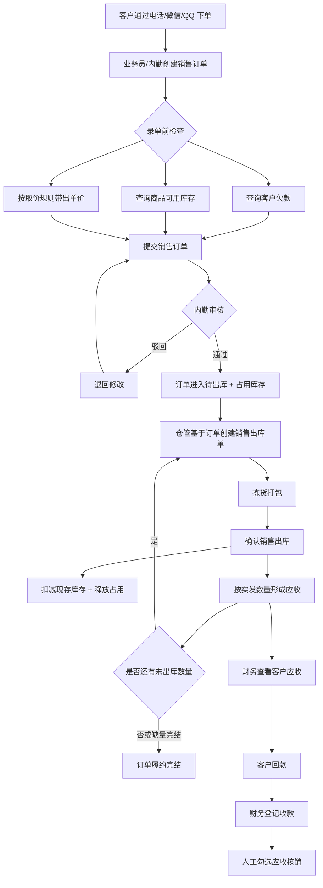
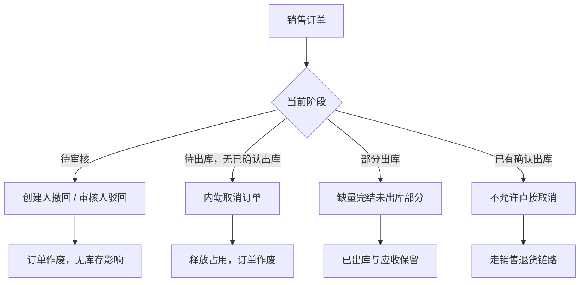
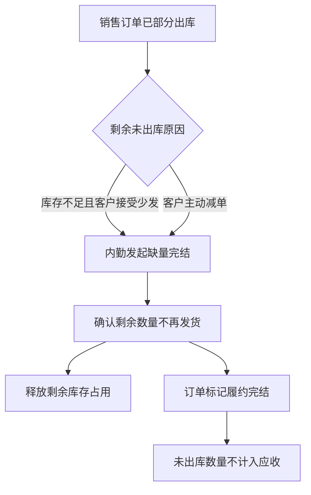
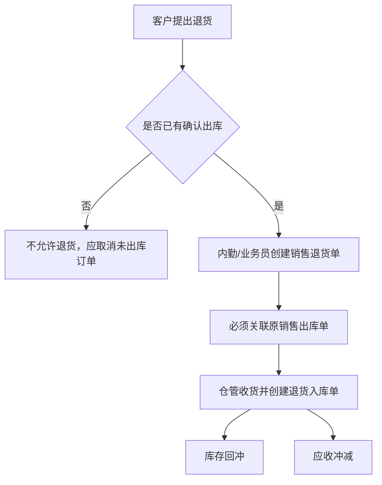

# 销售管理业务流程推演

> 业务背景：强盛科技批发销售占日单量约 80%，一期需跑通「订单 → 出库 → 应收 → 收款」主链路及基础退货闭环。  
> 关联单据：销售订单、销售出库单、应收记录、收款登记、销售退货单、销售退货入库单、发货异常登记  
> 版本：v1.0 | 输入依据：需求设计 SRS v1.1、`context/05` Mock 口径

---

## 一、正常流程

### 1.1 流程图

### 1.2 步骤明细

| 步骤 | 操作人 | 操作内容 | 上游输入 | 产出物/输出 | 业务规则 | 备注 |
|---|---|---|---|---|---|---|
| 1 | 代理商 | 提出订货需求（品项、数量、交期） | 电话/微信/QQ 沟通 | 口头订单需求 | 一期无自助下单门户 | 外部动作，系统不直接承接 |
| 2 | 业务员/内勤 | 创建销售订单 | 客户需求、客户档案、商品档案 | 销售订单（待审核） | 取价：客户批发价 → 标准批发价 → 手工改价留痕 | 见 SBR-003 |
| 3 | 业务员/内勤 | 录单前查询 | 客户、商品、仓库 | 欠款余额、可用库存、参考单价 | 信用仅提醒，不硬拦截 | 见 SBR-010 |
| 4 | 内勤 | 审核销售订单 | 待审核销售订单 | 销售订单（待出库）或驳回 | 单级审核；通过后占用库存 | 见 SBR-001、SBR-004 |
| 5 | 仓管 | 创建销售出库单 | 已审核销售订单、待出库余量 | 销售出库单（待确认） | 必须基于订单；一期不允许无单直出 | 见 SBR-002 |
| 6 | 仓管 | 拣货打包 | 出库单明细 | 实物备货 | 出库仓库默认民房后仓 | Mock：WH01 |
| 7 | 仓管 | 确认销售出库 | 实发数量 | 销售出库单（已确认）、库存扣减 | 应收按**实发数量**形成，不按订单原始数量 | 见 SBR-005、SBR-006 |
| 8 | 系统/业务 | 回写订单履约进度 | 累计出库数量 | 订单状态更新（部分出库/已完结） | 一张订单可多次出库 | 见 SBR-007 |
| 9 | 财务 | 查看客户应收 | 已确认出库单 | 应收明细、客户欠款汇总 | 应收挂接在执行层结果 | 见 SBR-006 |
| 10 | 财务 | 登记收款 | 客户回款凭证 | 收款登记单 | 财务独占录入 | 见 SBR-009 |
| 11 | 财务 | 人工核销应收 | 收款单、待核销应收 | 已核销应收、预收余额（如有） | 可勾选多张应收；不自动分摊 | 见 SBR-008 |

**Mock 案例参照**（`context/05` §四）：SO-20260405-001，100 件分两次出库 40+55，缺量完结 5 件，累计应收 ¥4,750。

---

## 二、取消/撤回流程

### 2.1 可取消/撤回节点与后果

| 节点 | 可执行操作 | 操作人 | 业务条件 | 业务后果 | 对下游影响 |
|---|---|---|---|---|---|
| 待审核 | 撤回/作废 | 创建人（业务员/内勤） | 尚未审核 | 订单作废，不占用库存 | 无下游单据 |
| 待审核 | 驳回 | 内勤（审核人） | 信息有误 | 退回修改，仍不占用库存 | 无下游单据 |
| 待出库（已审核未出库） | 取消订单 | 内勤 | 尚未产生任何已确认出库单 | 释放全部库存占用；订单作废 | 无应收 |
| 待出库（已审核未出库） | 修改订单 | 内勤 | 尚未产生已确认出库单 | 重新占用库存（按新明细） | 无应收 |
| 部分出库后 | 取消剩余未出库 | 内勤 + 客户确认 | 已有部分出库 | **缺量完结**剩余数量；已出库部分保留 | 已形成应收不冲回 |
| 已有确认出库 | 直接取消订单 | — | **不允许** | 须走退货或修正链路 | 已出库部分已有应收 |

### 2.2 取消/撤回流程图

---

## 三、关闭/缺量完结流程

### 3.1 关闭与取消的区别

| 维度 | 取消 | 缺量完结（关闭剩余） |
|---|---|---|
| 适用时机 | 尚未产生执行结果，或整单作废 | 已部分出库，客户接受不再发货 |
| 对已出库部分 | 不涉及 | 保留已出库记录与应收 |
| 对未出库部分 | 全部放弃 | 明确完结，**不再形成应收** |
| 库存影响 | 释放占用 | 释放剩余未出库部分的占用 |

### 3.2 缺量完结流程

### 3.3 缺量完结业务规则

| 规则 | 说明 |
|---|---|
| 触发条件 | 已有至少一次已确认出库；剩余数量不再执行 |
| 确认人 | 内勤操作，须客户接受少发（业务上口头确认，一期不做复杂审批） |
| 数量约束 | 累计出库 + 缺量完结数量 = 订单原数量 |
| 金额约束 | 应收仅按累计实发计算；缺量部分永不补应收 |
| Mock 验证 | 100 件订单，出库 95 件，缺量 5 件 → 应收 = 95 × 单价 |

### 3.4 库存不足时的处理

| 场景 | 业务处理 |
|---|---|
| 审核时可用库存不足 | 一期允许审核通过但给出预警（推导-需确认：是否允许超卖占用）；Mock 演示假设审核前已检查可用库存 |
| 出库时实发少于计划 | 按实发确认出库；差额不自动补发，由跟单决定是否再次出库或缺量完结 |
| 完全无货 | 不确认出库；跟单协调换货、延期或取消剩余（未出库部分可取消或缺量完结） |

---

## 四、销售退货流程

### 4.1 为什么退货基于销售出库单，而非销售订单

| 维度 | 基于销售订单 | 基于销售出库单（本期采用） |
|---|---|---|
| 业务现实 | 订单只是意图，不代表货已发出 | 只有实际发出的货才可能退回 |
| 库存影响 | 无法确定退的是哪批实物 | 退货入库可精确回冲到对应出库批次 |
| 财务影响 | 未出库部分本就不形成应收 | 应收冲减金额 = 实际退货数量 × 出库单价 |
| 审计追溯 | 订单层数量与实发可能不一致 | 出库单记录实发，退货有据可查 |

### 4.2 退货流程图

### 4.3 退货规则摘要

- 一期**不允许无单退货**（无关联 OUT 单号不可创建 RT 单）
- 已出库后**不可直接取消销售订单**
- 退货数量不得超过原出库单可退数量（累计退货 ≤ 原出库实发）
- Mock 案例：OUT-20260408-001 中 5 件坏货 → RT-20260410-001 → 冲减应收 ¥250、回冲库存 5 件

---

## 五、异常分支

| 异常编号 | 异常场景 | 发生节点 | 业务处理方式 | 对流程的影响 | 待确认 |
|---|---|---|---|---|---|
| EX01 | 可用库存不足 | 录单/审核 | 录单时提示可用库存；审核前业务判断是否减单或换仓 | 可能降低订单数量或延期审核 | 否（Mock 已约定审核前检查） |
| EX02 | 客户欠款超阈值 | 录单/审核 | 展示欠款余额与账龄提醒；**不自动拦截**下单或审核 | 业务人工决定是否继续放货 | 否（`context/01` 价格与信用分离） |
| EX03 | 部分出库 | 出库确认 | 按实发数量确认；订单保持部分出库状态；可继续下推出库 | 应收按分批实发累计 | 否 |
| EX04 | 短少（客户接受少发） | 出库/跟单 | **缺量完结**剩余未出库数量 | 未出库部分不形成应收 | 否 |
| EX05 | 漏发 | 出库后 | 发货异常登记 + 补开销售出库单补发 | 追加应收（按补发数量） | 否（Mock §五） |
| EX06 | 坏货 | 出库后/客户收货后 | 发货异常登记 + 销售退货链路 | 库存回冲、应收冲减 | 否 |
| EX07 | 客户退货 | 售后 | 基于原出库单创建退货单 → 退货入库 | 逆向闭环 | 否 |
| EX08 | 收款无法识别客户 | 收款登记 | 财务人工核对付款备注/业务员确认后入账 | 暂挂待认款池（推导-需确认：一期是否单独设待认款状态） | 是 |
| EX09 | 一笔款对应多单 | 收款核销 | 财务手工勾选多张应收行核销；余额记预收 | 不自动分摊 | 否 |
| EX10 | 录单改价 | 创建订单 | 允许手工改价，须留痕；一期不做改价审批 | 影响该行应收计算基数 | 否（Mock Q03） |

---

## 六、业务规则汇总

| 规则编号 | 规则内容 | 来源 | 状态 |
|---|---|---|---|
| SBR-001 | 销售订单须单级审核通过后，方可创建销售出库单 | `context/05` Q01；需求 SRS §三 | 已确认（Mock） |
| SBR-002 | 一期批发销售不允许无销售订单直接创建销售出库单 | `context/05` Q02；需求 SRS §三 | 已确认（Mock） |
| SBR-003 | 录单取价优先级：客户批发价 → 标准批发价 → 手工改价（留痕） | `context/05` Q03；`context/01` §六 | 已确认（Mock） |
| SBR-004 | 销售订单审核通过后占用可用库存；取消/缺量完结时释放对应占用 | `context/04`、`context/05`；`context/01` 库存三口径 | 已确认（Mock） |
| SBR-005 | 库存变动只发生在执行层：销售出库确认扣减现存，退货入库确认回冲 | `context/01` 两层单据 + 财务结算 | 已确认 |
| SBR-006 | 应收按销售出库**实发数量**形成，不按销售订单原始数量形成 | `context/04`；`context/05` §四 | 已确认（Mock） |
| SBR-007 | 一张销售订单可多次下推销售出库单（分批出库为常态） | `context/05` Q04 | 已确认（Mock） |
| SBR-008 | 收款可人工勾选多张应收核销；余额记预收；不自动认款、不自动分摊 | `context/05` Q07、§六 | 已确认（Mock） |
| SBR-009 | 收款登记由财务独占录入；业务员/内勤仅可查看欠款 | `context/05` §二 | 已确认（Mock） |
| SBR-010 | 一期信用额度仅查询与提醒，不做超额度自动硬拦截 | `context/01` §六；需求 SRS §三 | 已确认 |
| SBR-011 | 已确认出库后不允许直接取消销售订单，须走销售退货链路 | `context/04`、`context/05` Q06 | 已确认（Mock） |
| SBR-012 | 销售退货必须关联原销售出库单；不允许无单退货 | `context/05` Q06、§五 | 已确认（Mock） |
| SBR-013 | 缺量完结的未出库数量不再形成应收 | `context/04`、`context/05` §四 | 已确认（Mock） |
| SBR-014 | 漏发：异常登记后可补开销售出库单；坏货：走退货链路 | `context/05` Q05、§五 | 已确认（Mock） |
| SBR-015 | 商品信息在单据中为快照存储，与商品档案变化解耦 | `AGENTS.md`；`context/01` §五 | 已确认 |
| SBR-016 | 主数据不提供删除，统一停用；停用后不可新建引用 | `AGENTS.md` | 已确认 |
| SBR-017 | 审核时可用库存不足是否仍允许审核通过 | 推导-需确认 | 待确认 |
| SBR-018 | 收款暂时无法识别付款客户时，是否设「待认款」中间状态 | 推导-需确认 | 待确认 |

---

*本流程推演为应用设计/PRD 的上游输入。系统状态机、操作按钮、字段清单在后续阶段展开。*
