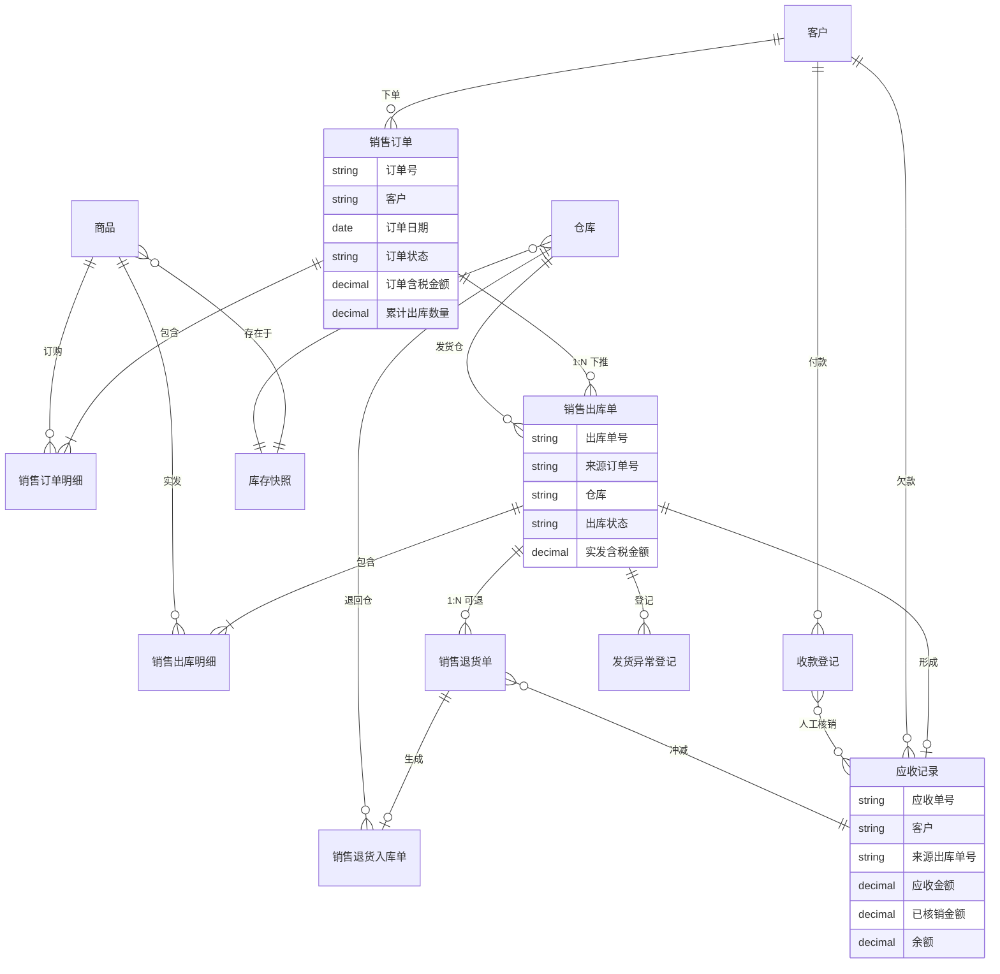

# 销售管理数据设计

> 文档定位：业务设计层产出，描述销售管理涉及的业务实体、概念关系与术语。  
> 版本：v1.0 | 状态：待评审  
> 说明：本文只写业务概念，不写页面字段完整定义、控件类型、数据库表结构。

---

## 一、业务实体清单

| 实体名称 | 业务含义 | 关键属性（业务层） | 关联实体 | 备注 |
|---|---|---|---|---|
| 客户 | 批发销售对象，主要为地级市代理商 | 客户编码、名称、结算方式、欠款余额 | 销售订单、应收记录、收款登记 | 主数据由基础资料维护 |
| 商品 | 销售标的物，3C 配件等 SKU | 商品编码、名称、规格、单位、标准批发价 | 销售订单明细、出库明细 | 单据内价格为快照 |
| 仓库 | 实物存放与发货地点 | 仓库编码、名称、仓库类型 | 销售出库单、退货入库单 | 批发默认民房后仓 WH01 |
| 销售订单 | 计划层单据，记录客户购买意图 | 订单号、客户、订单日期、明细（商品/数量/单价/金额）、订单状态、累计出库数量 | 客户、商品、销售出库单 | 审核后占用库存 |
| 销售订单明细 | 订单行项目 | 商品、订货数量、含税单价、含税金额、已出库数量、缺量完结数量 | 商品、销售订单 | 驱动分批出库余量计算 |
| 销售出库单 | 执行层单据，记录实际发货 | 出库单号、来源订单号、仓库、出库日期、明细（实发数量/单价/金额）、出库状态 | 销售订单、仓库、应收记录 | 库存扣减发生在此 |
| 销售出库明细 | 出库行项目 | 商品、计划出库数量、实发数量、单价、金额 | 商品、销售出库单 | 实发数量是应收形成依据 |
| 应收记录 | 客户因销售出库产生的待收款 | 应收单号、客户、来源出库单、应收金额、已核销金额、余额、账龄 | 客户、销售出库单、收款登记 | 不按未出库数量形成 |
| 收款登记 | 客户回款记录 | 收款单号、客户、收款金额、收款方式、收款日期、已核销金额、预收余额 | 客户、应收记录 | 财务独占录入 |
| 销售退货单 | 客户退货申请，基于已出库结果 | 退货单号、客户、来源出库单号、退货原因、退货数量/金额 | 销售出库单、销售退货入库单 | 不允许无单创建 |
| 销售退货入库单 | 退货实物入库凭证 | 入库单号、来源退货单号、仓库、实收数量 | 销售退货单、仓库 | 触发库存回冲 |
| 发货异常登记 | 漏发/坏货等异常留痕 | 异常单号、关联出库单、异常类型、异常数量、处理结论 | 销售出库单 | 一期不做复杂赔付规则 |
| 库存快照 | 某仓库某商品的库存口径视图 | 现存、占用、可用 | 商品、仓库 | 由库存管理统一维护底账 |

---

## 二、概念 ER 图

---

## 三、实体关系说明

| 关系 | 说明 | 业务约束 |
|---|---|---|
| 客户 → 销售订单 | 一个客户可有多张销售订单 | 客户须为有效（未停用）档案 |
| 销售订单 → 销售订单明细 | 1:N 行项目 | 至少一行有效商品明细 |
| 销售订单 → 销售出库单 | 1:N 分批下推 | 须已审核；累计实发 ≤ 订单数量 − 缺量完结数量 |
| 销售出库单 → 销售出库明细 | 1:N 行项目 | 实发数量 ≤ 本次计划出库数量 |
| 销售出库单 → 应收记录 | 确认出库后形成 | 应收金额 = Σ(实发数量 × 出库单价快照) |
| 收款登记 ↔ 应收记录 | N:M 人工核销 | 一期不自动分摊；核销总额 ≤ 收款金额 |
| 销售出库单 → 销售退货单 | 1:N 可多次退货 | 累计退货数量 ≤ 原出库实发数量 |
| 销售退货单 → 销售退货入库单 | 1:1 或 1:N（分批退） | 实收入库 ≤ 退货申请数量 |
| 销售退货 → 应收记录 | 冲减 | 冲减金额按退货实收数量 × 原出库单价 |
| 销售订单 → 库存快照 | 审核占用可用库存 | 占用量随出库确认释放、随取消/缺量完结释放 |
| 销售出库单 → 库存快照 | 确认扣减现存 | 扣减数量 = 实发数量 |
| 销售退货入库单 → 库存快照 | 确认回冲现存 | 回冲数量 = 实收入库数量 |

---

## 四、关键业务概念与术语

| 术语 | 定义 | 使用场景 | 备注 |
|---|---|---|---|
| 计划层单据 | 记录业务意图与计划，不直接驱动库存扣减与应收 | 销售订单 | 对应 `context/01` 两层单据 |
| 执行层单据 | 记录实际发生的业务动作，驱动库存变动 | 销售出库单、销售退货入库单 | 库存变动只发生在执行层 |
| 结算层 | 挂接在执行结果上的往来与收付款环节 | 应收记录、收款登记 | 独立于订单层 |
| 库存三口径 | 现存（实际有的）、占用（已承诺未出库）、可用（还能承诺的） | 录单前查库存、审核占用、出库扣减 | 三口径缺一不可 |
| 可用库存 | 现存 − 占用（− 其他模块占用，如零售） | 审核前判断是否可承诺 | 与仓库实物可能仍有差异时需盘点校正 |
| 分批出库 | 一张销售订单多次生成销售出库单 | 批发履约常态 | Mock 案例 40+55 |
| 缺量完结 | 客户接受少发，明确放弃剩余未出库数量 | 短少、减单收尾 | 未出库部分不形成应收 |
| 应收形成 | 基于销售出库实发数量生成客户待收款 | 出库确认后 | 不按订单原始数量 |
| 人工核销 | 财务手工勾选应收行与收款关联 | 一笔款对应多单 | 不做自动认款 |
| 预收余额 | 收款金额大于本次核销总额的部分 | 多付、先款后货 | 挂客户往来，不自动分配 |
| 价格快照 | 单据保存时的单价，不随商品档案调价自动变化 | 订单行、出库行 | 保证历史单据可追溯 |
| 客户批发价 | 客户档案中为特定 SKU 维护的专属价 | 录单取价第一优先级 | Mock：CUS-SZ-001 的 ¥48 |
| 标准批发价 | 商品档案中的默认批发价 | 无客户价时使用 | Mock：¥50 |
| 发货异常 | 漏发、坏货等偏离计划发货的情况 | 出库后处理 | 短少走缺量完结，非异常单 |
| 无单退货 | 不关联销售出库单创建退货 | — | **一期不允许** |
| 停用 | 主数据逻辑失效，不可新建引用 | 客户/商品/仓库 | 不提供物理删除 |

---

## 五、关键路由概念枚举（业务层）

> 以下为驱动业务流程走向的业务概念枚举，完整字段级枚举由 PRD 字段清单承接。

### 5.1 销售订单状态（业务概念）

| 状态 | 含义 | 可发生的业务动作 |
|---|---|---|
| 待审核 | 已创建，未审核 | 修改、撤回、审核、驳回 |
| 待出库 | 已审核，占用库存，尚无或尚有可出库余量 | 下推出库、取消（若无已确认出库）、缺量完结 |
| 部分出库 | 已有确认出库，仍有可出库余量 | 继续下推出库、缺量完结 |
| 已完结 | 全部出库或缺量完结完成 | 查询；已出库部分走退货 |
| 已取消 | 整单作废（未产生已确认出库） | 仅查询 |

### 5.2 销售出库单状态（业务概念）

| 状态 | 含义 |
|---|---|
| 待确认 | 已创建，仓管拣货中 |
| 已确认 | 出库完成，库存已扣减，应收已形成 |
| 已作废 | 未确认前作废，无库存与应收影响 |

### 5.3 发货异常类型（业务概念）

| 类型 | 典型处理方式 |
|---|---|
| 漏发 | 异常登记 + 补开出库单 |
| 坏货 | 异常登记 + 销售退货 |
| 短少（客户接受） | 不走异常单，走订单缺量完结 |

---

*实体与规则变更时，须同步回扫《销售管理业务流程推演.md》及后续应用设计、PRD。*
