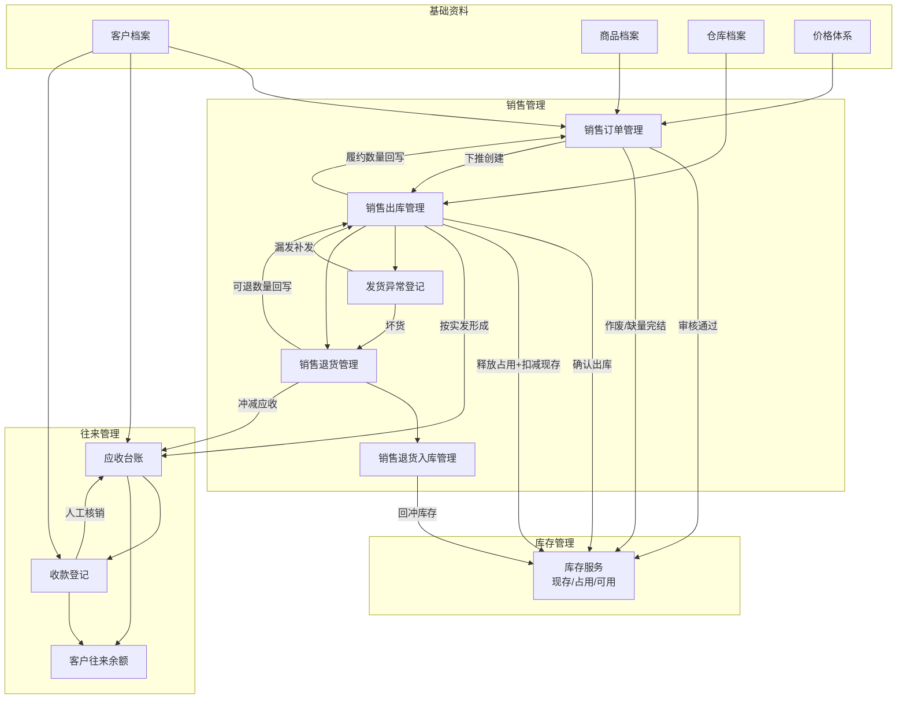

# 销售管理应用架构

> 文档定位：应用设计层产出，描述销售管理模块的系统划分、数据流向与集成边界。  
> 版本：v1.0 | 状态：待评审  
> 输入依据：需求设计 v1.1、业务设计 v1.0、`context/05` Mock 口径

---

## 一、应用模块划分

| 模块 | 核心职责 | 主要用户 | 上游输入 | 下游输出 | 是否本期 |
|---|---|---|---|---|---|
| 销售订单管理 | 销售订单 CRUD、提交/审核/驳回/作废、缺量完结、履约进度回写 | 业务员、内勤 | 客户/商品/价格（基础资料）、可用库存与欠款查询 | 已审核订单、库存占用指令、下推出库入口 | 是 |
| 销售出库管理 | 基于订单创建出库单、拣货确认、出库确认、发货异常登记 | 仓管、内勤（查询） | 已审核销售订单、待出库余量、仓库档案 | 库存扣减指令、占用释放、应收形成触发、订单履约回写 | 是 |
| 销售退货管理 | 基于出库单创建退货单、退货原因与数量维护 | 内勤、业务员 | 已确认销售出库单、可退数量 | 退货入库下推入口、应收冲减触发 | 是 |
| 销售退货入库管理 | 退货实物收货确认、库存回冲 | 仓管 | 销售退货单 | 库存回冲指令、退货完成回写、应收冲减确认 | 是 |
| 应收查询（销售场景） | 按客户/出库单查看应收明细与欠款汇总 | 财务、业务员、内勤 | 已确认出库形成的应收 | 核销候选列表（供收款模块引用） | 是 |
| 收款登记（销售场景） | 登记客户回款、人工勾选应收核销、预收余额处理 | 财务 | 客户回款信息、待核销应收 | 客户往来更新、应收余额减少 | 是 |
| 销售查询统计 | 订单/出库/客户往来列表查询与导出 | 全员（按权限） | 各模块业务数据 | 查询结果、导出文件 | 是（P1） |
| 发货异常登记 | 漏发/坏货异常留痕，关联出库单 | 仓管 | 已确认出库单 | 补发出库或退货流程入口 | 是（P1） |

> 零售收银、采购、完整总账不在本架构内；零售与批发共用库存服务，但流程模块独立。

---

## 二、模块间数据流向

**关键联动摘要**

| 触发点 | 库存服务 | 应收台账 | 订单回写 |
|---|---|---|---|
| 销售订单审核通过 | 按明细占用可用库存 | 无 | 状态 → 待出库 |
| 销售订单作废（无已确认出库） | 释放全部占用 | 无 | 状态 → 已作废 |
| 销售出库确认 | 扣减现存 + 释放本次占用 | 按实发数量新增应收 | 累计出库量；可能 → 部分出库 |
| 缺量完结 | 释放剩余占用 | 无（未出库部分永不补应收） | 状态 → 已完成 |
| 退货入库确认 | 回冲现存 | 按退货量冲减应收 | 更新出库单可退数量 |
| 收款核销 | 无 | 减少应收余额 | 无 |

---

## 三、与外部模块的集成边界

| 外部模块 | 联动点 | 传递数据 | 触发时机 | 注意事项 |
|---|---|---|---|---|
| 基础资料 | 录单选客户/商品/仓库；取价 | 客户编码/名称、商品编码/规格/单位、标准价/客户价、仓库编码 | 创建/编辑销售订单、创建出库单时 | 停用档案不可新建引用；单据内价格为快照 |
| 库存管理 | 占用、扣减、释放、回冲 | 仓库、商品、数量、三口径（现存/占用/可用） | 订单审核、作废、缺量完结、出库确认、退货入库确认 | 销售模块不直接改库存底账，统一调用库存服务 |
| 往来管理 | 应收形成、应收查询、收款核销 | 客户、来源出库单、应收金额、已核销/余额、收款金额、预收余额 | 出库确认、退货入库确认、收款保存 | 不做凭证/总账；不自动认银行流水 |
| 系统设置 | 权限、单据编号、操作日志 | 角色权限矩阵、单号规则、操作人/时间 | 所有写操作 | 状态变更必须记日志；单号全局唯一 |
| 零售管理（外部流程） | 共用库存底账 | 零售扣减/回冲请求 | 零售成交时 | 与销售订单占用同一可用库存池；零售模块独立 |
| 采购管理（弱关联） | 共用库存底账 | 入库增加现存 | 采购入库确认时 | 影响销售可用库存，无直接单据链路 |

---

*模块状态机与交互细节见《销售管理流程设计.md》；角色操作用例见《销售管理系统用例.md》。*
