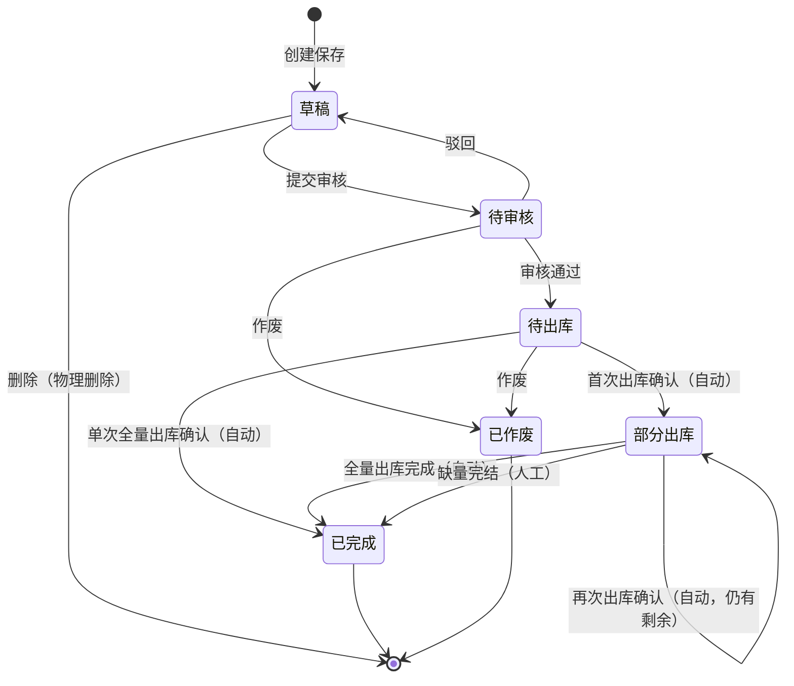
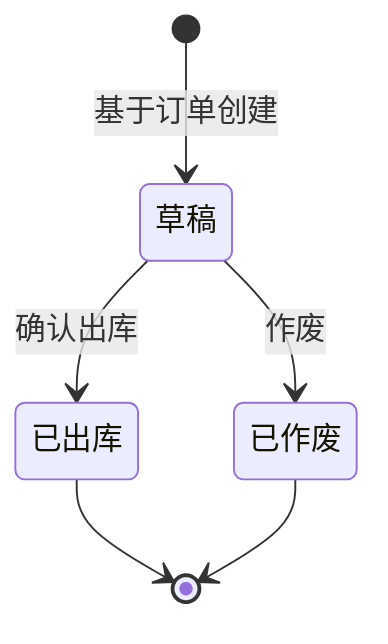

# 销售管理流程设计

> 文档定位：应用设计层产出，将业务设计翻译为系统状态机、交互流程与系统规则。  
> 版本：v1.0 | 输入依据：业务设计流程推演、`templates/状态机设计模板.md`

---

## 一、销售订单状态机

### 1.1 状态定义

| 状态 | 枚举值 | 含义 | 是否终态 | 进入条件 | 离开条件 |
|---|---|---|---|---|---|
| 草稿 | `DRAFT` | 已创建未提交，可编辑 | 否 | 保存销售订单 | 提交审核 / 物理删除 |
| 待审核 | `PENDING_AUDIT` | 已提交，等待内勤审核 | 否 | 提交审核成功 | 审核通过 / 驳回 / 作废 |
| 待出库 | `PENDING_SHIP` | 审核通过，尚未产生已确认出库 | 否 | 审核通过 | 首次出库确认 / 作废（无已确认出库） |
| 部分出库 | `PARTIAL_SHIPPED` | 已有至少一次已确认出库，仍有可出库或待完结余量 | 否 | 首次出库确认（系统自动） | 全部出库完成（自动）/ 缺量完结 |
| 已完成 | `COMPLETED` | 全部出库完成或已缺量完结 | **是** | 累计出库+缺量完结=订单量（自动或人工） | — |
| 已作废 | `VOIDED` | 订单失效，仅可查询 | **是** | 待审核/待出库作废确认 | — |

### 1.2 状态流转图

### 1.3 状态流转表

| 当前状态 | 动作 | 前置条件 | 结果状态 | 二次确认 | 后置影响 | 失败处理 |
|---|---|---|---|---|---|---|
| 草稿 | 提交审核 | 客户、发货仓库、至少一行明细；每行商品/数量/单价>0 | 待审核 | 无 | 无 | Toast：「提交失败，{字段}不满足条件」 |
| 草稿 | 删除 | 无 | 物理消失 | 「删除后不可恢复，确认删除？」 | 记录移除 | — |
| 待审核 | 驳回 | 审核权限 | 草稿 | 无 | 解锁编辑 | — |
| 待审核 | 审核通过 | 审核权限；可用库存不足时仅预警不阻断（SBR-017 待确认） | 待出库 | 无 | 锁定客户/明细数量/单价等关键字段；**占用库存** | 占用失败：Toast「库存占用失败，请检查可用库存」 |
| 待审核 | 作废 | 无已确认出库单 | 已作废 | 「作废后不可恢复，确认作废？」 | 只读 | — |
| 待出库 | 作废 | 无任何已确认出库单 | 已作废 | 同上 | **释放全部占用** | 存在已确认出库：阻断，提示走退货 |
| 待出库 | 创建出库单 | 存在待出库余量>0 | 待出库 | 无 | 生成出库单草稿（下游模块） | 无余量：阻断 |
| 待出库/部分出库 | — | 出库确认事件 | 部分出库/已完成 | 系统自动 | 回写累计出库量；释放本次占用、扣减现存；可能形成应收 | 见出库状态机 |
| 部分出库 | 缺量完结 | 已有≥1次已确认出库；剩余可出库量>0；无草稿出库单 | 已完成 | 弹窗录入各行缺量数量后二次确认 | **释放剩余占用**；按行写入缺量完结数量 | 无已确认出库：阻断；存在草稿出库单：阻断 |
| 部分出库 | 创建出库单 | 剩余可出库量>0 | 部分出库 | 无 | 生成出库单草稿 | — |
| 已完成 | 查看/导出 | — | 已完成 | — | 无 | — |
| 已作废 | 查看/导出 | — | 已作废 | — | 无 | — |

### 1.4 动作能力矩阵

| 动作 | 草稿 | 待审核 | 待出库 | 部分出库 | 已完成 | 已作废 |
|---|:---:|:---:|:---:|:---:|:---:|:---:|
| 查看 | ✅ | ✅ | ✅ | ✅ | ✅ | ✅ |
| 编辑 | ✅ | ❌ | ❌ | ❌ | ❌ | ❌ |
| 删除（物理） | ✅ | ❌ | ❌ | ❌ | ❌ | ❌ |
| 提交审核 | ✅ | ❌ | ❌ | ❌ | ❌ | ❌ |
| 驳回 | ❌ | ✅ | ❌ | ❌ | ❌ | ❌ |
| 审核通过 | ❌ | ✅ | ❌ | ❌ | ❌ | ❌ |
| 作废 | ❌ | ✅ | ✅ | ❌ | ❌ | ❌ |
| 创建出库单 | ❌ | ❌ | ✅ | ✅ | ❌ | ❌ |
| 缺量完结 | ❌ | ❌ | ❌ | ✅ | ❌ | ❌ |
| 编辑备注/跟单备注 | ✅ | ❌ | ✅ | ✅ | ✅ | ❌ |
| 导出 | ✅ | ✅ | ✅ | ✅ | ✅ | ✅ |

### 1.5 逆向操作规则

| 维度 | 作废 | 缺量完结（关闭剩余） |
|---|---|---|
| 含义 | 撤销未发生的业务意图 | 终止剩余发货，已出库部分保留 |
| 适用状态 | 待审核、待出库（无已确认出库） | 部分出库 |
| 状态变化 | → 已作废 | → 已完成 |
| 库存影响 | 待出库时释放全部占用；待审核无占用 | 释放剩余未出库部分的占用 |
| 应收影响 | 无 | 已形成应收不冲回 |
| 已有确认出库后 | **不允许作废** | 允许（客户接受少发） |
| 弹窗文案 | 「作废后不可恢复」 | 「剩余数量将不再发货，未出库部分不形成应收」 |

**已出库后禁止**：直接作废订单、编辑关键字段、删除。须通过销售退货模块处理。

---

## 二、销售出库单状态机

> 执行层单据：无审核流，核心为草稿 → 已出库。

### 2.1 状态定义

| 状态 | 枚举值 | 含义 | 是否终态 | 进入条件 | 离开条件 |
|---|---|---|---|---|---|
| 草稿 | `DRAFT` | 已创建，拣货中，可调整计划出库量 | 否 | 基于订单下推创建 | 确认出库 / 作废 |
| 已出库 | `SHIPPED` | 出库已确认，库存与应收已联动 | **是** | 确认出库成功 | — |
| 已作废 | `VOIDED` | 未出库前作废 | **是** | 作废确认 | — |

### 2.2 状态流转图

### 2.3 状态流转表

| 当前状态 | 动作 | 前置条件 | 结果状态 | 二次确认 | 后置影响 | 失败处理 |
|---|---|---|---|---|---|---|
| 草稿 | 确认出库 | 实发数量>0；实发≤计划出库；实发≤订单可出库余量；仓库/商品有效 | 已出库 | 「确认出库后不可直接撤销，确认？」 | ①扣减现存 ②释放本次占用 ③按实发形成应收 ④回写订单累计出库量 ⑤更新订单状态（部分出库/已完成） | 库存不足：阻断+提示实发量 |
| 草稿 | 作废 | 未确认出库 | 已作废 | 「确认作废此出库单？」 | 无库存/应收影响 | — |
| 已出库 | 查看/导出/发起退货 | — | 已出库 | — | 退货走独立模块 | 已出库不可作废 |

### 2.4 动作能力矩阵

| 动作 | 草稿 | 已出库 | 已作废 |
|---|:---:|:---:|:---:|
| 查看 | ✅ | ✅ | ✅ |
| 编辑计划数量 | ✅ | ❌ | ❌ |
| 确认出库 | ✅ | ❌ | ❌ |
| 作废 | ✅ | ❌ | ❌ |
| 登记发货异常 | ❌ | ✅ | ❌ |
| 创建退货单 | ❌ | ✅ | ❌ |
| 导出 | ✅ | ✅ | ✅ |

### 2.5 逆向操作规则

| 逆向操作 | 允许状态 | 系统行为 | 备注 |
|---|---|---|---|
| 作废 | 草稿 | 单据作废，不影响库存/应收 | 物理删除不做，保留审计 |
| 撤销已出库 | — | **不允许** | 须走销售退货入库冲回 |
| 修改实发数量 | 已出库 | **不允许** | 差错通过退货+补发处理 |

---

## 三、销售退货单与销售退货入库单状态建议

### 3.1 是否需要独立状态机

| 单据 | 建议 | 原因 |
|---|---|---|
| 销售退货单 | **需要简化状态机** | 有审批/收货不同步场景；需控制可下推退货入库的时机 |
| 销售退货入库单 | **需要更简状态机** | 与出库单同级执行层，草稿→已入库即可 |

### 3.2 销售退货单（建议状态）

| 状态 | 枚举值 | 含义 |
|---|---|---|
| 草稿 | `DRAFT` | 已关联出库单，维护退货明细 |
| 待入库 | `PENDING_RETURN` | 已确认退货申请，等待仓管收货 |
| 已完成 | `COMPLETED` | 关联退货入库已确认，库存与应收已冲减 |
| 已作废 | `VOIDED` | 未入库前取消 |

**不单独展开完整矩阵的原因**：一期退货频次 P1，主链路演示聚焦订单→出库→应收；退货状态机在 PRD 阶段按本建议补全即可。

### 3.3 销售退货入库单（建议状态）

| 状态 | 枚举值 | 含义 |
|---|---|---|
| 草稿 | `DRAFT` | 基于退货单创建，维护实收数量 |
| 已入库 | `RECEIVED` | 确认收货，库存回冲、应收冲减 |
| 已作废 | `VOIDED` | 确认前作废 |

**关键约束**：必须关联销售退货单；实收入库 ≤ 退货申请量；累计退货 ≤ 原出库实发量。

---

## 四、系统交互流程

| 操作 | 前置条件 | 用户动作 | 系统响应 | 后置影响 | 失败处理 |
|---|---|---|---|---|---|
| 提交销售订单 | 状态=草稿；必填完整 | 点击「提交审核」 | 校验→状态改待审核 | 不可编辑关键字段 | Toast 列缺失项 |
| 审核销售订单 | 状态=待审核；有审核权限 | 点击「审核通过」 | 校验→状态改待出库→调用库存占用 | 锁定字段；占用可用库存 | 占用失败提示；SBR-017 不足时当前为预警后继续 |
| 驳回销售订单 | 状态=待审核 | 点击「驳回」 | 状态改草稿 | 可重新编辑 | — |
| 创建销售出库单 | 订单状态=待出库或部分出库；有余量 | 点击「创建出库单」 | 带出订单头/明细默认值；生成草稿出库单 | 出库单关联 sourceOrderId | 无余量/订单未审核：阻断 |
| 确认销售出库 | 出库单=草稿；实发合法 | 填写实发数量→「确认出库」 | 事务：扣库存+释放占用+写应收+回写订单 | 订单可能→部分出库/已完成；应收按实发 | 库存/余量不足：阻断 |
| 缺量完结 | 订单=部分出库；有剩余量 | 点击「缺量完结」→确认 | 释放剩余占用；写缺量完结量；状态→已完成 | 未出库部分永不补应收 | 无已确认出库：阻断 |
| 创建销售退货单 | 出库单=已出库；有可退数量 | 选择出库单→创建退货单 | 校验关联→生成退货草稿 | 带出可退上限 | 无单/超可退：阻断 |
| 确认退货入库 | 退货入库单=草稿 | 填写实收→「确认入库」 | 事务：回冲库存+冲减应收+完结退货单 | 更新出库单可退数量 | 实收>申请量：阻断 |
| 登记收款 | 财务权限 | 录入客户/金额/方式→保存 | 生成收款单（草稿或已确认） | 待核销状态 | 金额≤0：阻断 |
| 核销应收 | 收款单已保存 | 勾选应收行→「确认核销」 | 更新应收已核销/余额；写预收余额 | 客户往来余额变化 | 核销额>收款额：阻断 |

---

## 五、关键系统规则

| 规则编号 | 系统规则 | 来源业务规则 | 影响模块 | 待确认 |
|---|---|---|---|---|
| SAR-001 | 状态变更仅能通过动作按钮触发，表单不可直接改状态字段 | AGENTS.md；单据规范 §2.4 | 全部 | 否 |
| SAR-002 | 销售订单审核通过后，按明细数量调用库存服务占用可用库存 | SBR-004 | 销售订单、库存 | 否 |
| SAR-003 | 仅待出库/部分出库状态允许下推创建出库单；须关联 sourceOrderId | SBR-001、SBR-002 | 销售订单、销售出库 | 否 |
| SAR-004 | 出库确认时：实发数量驱动库存扣减与占用释放，须同一事务 | SBR-005 | 销售出库、库存 | 否 |
| SAR-005 | 应收记录由出库确认事件生成，金额=Σ(实发×单价快照)，不读订单原数量 | SBR-006 | 销售出库、往来 | 否 |
| SAR-006 | 订单累计出库量回写后，若累计+缺量完结=订单量则自动→已完成 | SBR-007、SBR-013 | 销售订单、销售出库 | 否 |
| SAR-007 | 缺量完结仅释放剩余占用，不冲减已形成应收 | SBR-013 | 销售订单、库存 | 否 |
| SAR-008 | 已出库状态的出库单不可作废；逆向仅能通过退货入库 | SBR-011 | 销售出库、退货 | 否 |
| SAR-009 | 退货单创建必须携带 outboundId；无关联拒绝创建 | SBR-012 | 销售退货 | 否 |
| SAR-010 | 收款核销为人工多选应收行；系统不自动分摊；余额写预收 | SBR-008 | 往来 | 否 |
| SAR-011 | 取价服务：客户价→标准价→手工价；保存时快照到明细行 | SBR-003、SBR-015 | 销售订单 | 否 |
| SAR-012 | 审核时可用库存不足：当前实现为预警+允许通过（占用按实际可用或失败） | SBR-017 | 销售订单、库存 | **是** |
| SAR-013 | 收款暂无法识别客户：建议收款单增加「待认款」子状态 | SBR-018 | 往来 | **是** |
| SAR-014 | 单据审核后关键字段锁定，仅备注类可编辑 | context/01 §五 | 销售订单 | 否 |
| SAR-015 | 所有写操作记录操作日志（操作人、时间、动作、单号） | 系统设置 | 全部 | 否 |

---

*状态枚举与操作矩阵为 PRD 字段清单、Demo PRD 操作区的权威上游。字段级定义在 PRD 阶段展开。*
