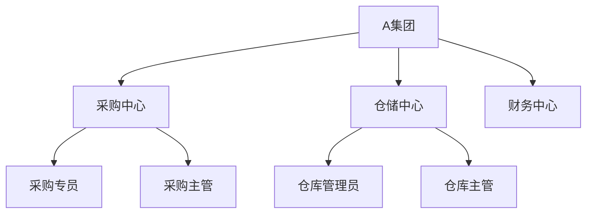

# 业务架构

本目录存放系统的**业务全貌描述**：组织有哪些角色、哪些部门、权责是什么，从宏观视角交代清楚"生意是怎么做的"。

---

## 应该放什么

| 产出物 | 说明 | 典型形式 |
| --- | --- | --- |
| **组织架构图** | 各集团、部门、岗位的层级关系和汇报线 | Mermaid graph / 组织结构图 |
| **业务总流程图** | 所有业务场景的高层路径汇总（端到端，不展开每个场景的细节） | 泳道图 / 高层流程图 |
| **业务权限模型** | 哪些角色有权做什么业务操作（业务视角，非系统权限） | 权限矩阵表 |
| **业务场景目录** | 列出所有需要详细流程推演的业务场景，作为流程模型的索引 | 场景清单表 |

## 不应该放什么

| 内容 | 应该放哪里 |
| --- | --- |
| 单个场景的详细流程推演 | 业务设计/流程模型/ |
| 系统模块划分和调用关系 | 应用设计/应用架构/ |
| 系统级角色和操作权限 | 应用设计/系统机制/（权限体系） |
| 字段定义、页面原型 | PRD / 应用设计/界面设计/ |

---

## 与相关目录的边界

| 对比项 | 业务架构（本目录） | 应用架构（应用设计层） |
| --- | --- | --- |
| 视角 | 业务组织 | 系统模块 |
| 回答的问题 | 谁（组织/角色）做什么业务 | 哪些系统模块怎样协作 |
| 典型产出 | 组织架构图、业务总流程图、业务角色清单 | 应用模块图、系统集成边界、数据流向 |
| 变更频率 | 低（组织调整时） | 中（功能迭代时） |

---

## 文档模板

```markdown
# [项目名称]业务架构

## 一、业务背景

简要说明本项目的业务领域和核心目标（3-5 句话）。例如："本系统服务于 XX 集团的采购与供应链管理业务，覆盖从采购需求发起到入库结算的端到端流程。"

---

## 二、组织架构

### 2.1 组织层级

| 层级 | 名称 | 说明 |
| --- | --- | --- |
| 集团 | A集团 | 总部，统一管理和决策 |
| 业务单元 | 采购中心、仓储中心、财务中心 | 各业务线的执行部门 |
| 门店/网点 | XX门店 | 一线业务执行点 |

### 2.2 组织架构图



---

## 三、业务角色

| 角色名称 | 所属组织 | 核心职责 | 涉及业务场景 |
| --- | --- | --- | --- |
| 采购专员 | 采购中心 | 创建、提交采购订单，跟踪订单执行 | 采购下单、采购跟踪 |
| 采购主管 | 采购中心 | 审核采购订单，管理供应商关系 | 采购审核、供应商管理 |
| 仓库管理员 | 仓储中心 | 收货、入库、库存盘点 | 入库管理、库存管理 |
| 仓库主管 | 仓储中心 | 审核入库单，管理仓库运营 | 入库审核、库存调整 |

---

## 四、业务总流程

> 端到端的业务全景图，展示各业务场景之间的上下游关系。


---

## 五、业务场景目录

> 列出所有需要详细流程推演的场景，每个场景对应流程模型中的一份文档。

| 场景编号 | 场景名称 | 涉及角色 | 上下游场景 | 流程文档 |
| --- | --- | --- | --- | --- |
| SC-001 | 采购正向流程 | 采购专员、采购主管 | 上游：采购需求；下游：供应商发货 | 采购正向业务流程.md |
| SC-002 | 采购取消流程 | 采购专员、采购主管 | 依赖：采购正向流程 | 采购取消流程.md |
| SC-003 | 采购红冲修正流程 | 采购专员、采购主管、财务人员 | 依赖：采购正向流程 | 采购红冲修正流程.md |
| SC-004 | 仓库收货流程 | 仓库管理员、仓库主管 | 上游：供应商发货 | 仓库收货流程.md |

---

## 六、业务权限模型

> 从业务管理角度说明哪些角色有权做什么操作（适用于制定系统权限的参考基线）。

| 业务操作 | 采购专员 | 采购主管 | 仓库管理员 | 仓库主管 | 财务人员 |
| --- | --- | --- | --- | --- | --- |
| 创建采购订单 | 是 | 是 | 否 | 否 | 否 |
| 审核采购订单 | 否 | 是 | 否 | 否 | 否 |
| 取消采购订单 | 是（仅本人） | 是（所有） | 否 | 否 | 否 |
| 创建入库单 | 否 | 否 | 是 | 是 | 否 |
| 审核入库单 | 否 | 否 | 否 | 是 | 否 |

> 注：此表为业务视角的权限基线，系统级权限（字段可见性、数据可见范围等）在应用设计/系统机制中细化。
```

---

## 文档命名建议

```
[项目名称]业务架构.md         例：物料二期业务架构.md
```
