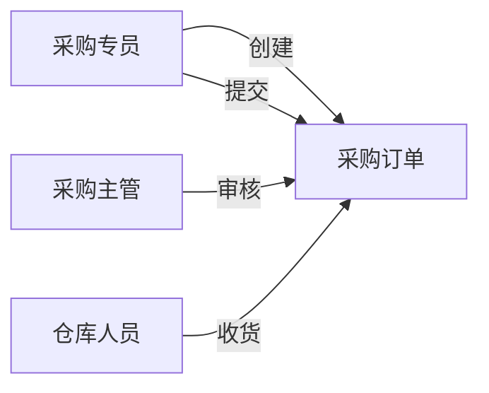

# 业务用例

本目录存放业务用例文档，从**用户/角色视角**描述"谁在什么情况下做了什么"。业务用例关注的是**业务现实**（人做了什么），不描述系统如何响应。

---

## 与系统用例的区别

| 维度 | 业务用例（本目录） | 系统用例（应用设计层） |
| --- | --- | --- |
| 视角 | 业务现实（人做了什么） | 系统交互（用户操作了什么、系统怎样响应） |
| 粒度 | 粗（流程/业务步骤级） | 细（界面操作级） |
| 前置条件 | 业务前提（如"已有库存"） | 系统前提（如"单据处于已审核状态"） |
| 主要读者 | 业务方、产品经理 | 产品经理、研发、测试 |
| 典型问题 | 这个角色为什么要做这件事？ | 做这件事时系统发生了什么？ |

---

## 应该放什么

- 每个角色/关键业务场景一份用例说明文档
- 每个用例包含：参与者、业务目标、前置条件、主流程、替代流程、业务规则
- 用例图：展示各角色与业务功能之间的关系（Mermaid 或附图）

## 不应该放什么

| 内容 | 应该放哪里 |
| --- | --- |
| 系统如何响应用户操作 | 应用设计/系统用例/ |
| 页面级别的交互步骤 | 应用设计/流程设计/ |
| 字段校验规则 | PRD |
| 权限矩阵 | 应用设计/系统机制/ |

---

## 业务用例文档模板

```markdown
# [业务场景]业务用例

## 用例目录

| 用例编号 | 用例名称 | 主要参与者 | 业务目标 |
| --- | --- | --- | --- |
| BUC-001 | 创建采购订单 | 采购专员 | 发起采购需求，确保物料及时到位 |
| BUC-002 | 审核采购订单 | 采购主管 | 确认采购需求的合理性和合规性 |

---

## BUC-001：创建采购订单

| 项目 | 内容 |
| --- | --- |
| **用例编号** | BUC-001 |
| **用例名称** | 创建采购订单 |
| **主要参与者** | 采购专员 |
| **业务目标** | 根据采购计划或补货需求，创建一份包含商品、数量、价格的采购订单 |
| **前置条件** | 存在未处理完的采购计划或补货需求；采购专员已确认供应商和价格 |
| **后置条件** | 采购订单已创建，处于待提交状态；关联的采购计划被锁定 |
| **触发事件** | 采购专员收到采购需求通知，或定期巡检发现库存低于补货线 |

### 主成功场景

1. 采购专员确认采购需求（来源：采购计划 / 补货建议 / 手工判断）
2. 采购专员选择供应商和采购商品
3. 采购专员填写采购数量、单价、交货日期
4. 采购专员创建采购订单（草稿）

### 替代流程

- A1：无匹配供应商 → 采购专员发起供应商询价流程，暂存草稿
- A2：商品无历史价格 → 采购专员手工填写预估价格，标记为"待确认价格"
- A3：采购量超出供应商库存 → 采购专员拆分订单，或联系供应商备货

### 异常场景

| 编号 | 场景 | 参与者反应 |
| --- | --- | --- |
| E1 | 供应商信息变更 | 采购专员在系统中更新供应商信息后才能下单 |
| E2 | 需求来源撤销 | 采购专员删除草稿或标记为已处理 |

### 业务规则

| 规则编号 | 规则内容 | 来源 |
| --- | --- | --- |
| BR-003 | 同一供应商的同种商品，单日不能重复创建超过 3 张订单 | 采购制度 |
```

---

## 用例图示例



---

## 用例验收清单

| 检查项 | 要求 |
| --- | --- |
| 参与者明确 | 每个用例有明确的主要参与者和业务目标 |
| 前置条件真实 | 前置条件是业务上的前提，不是系统状态 |
| 替代流程覆盖 | 至少覆盖 1-2 个替代路径 |
| 异常考虑 | 关键步骤考虑了常见的业务异常 |
| 与流程模型一致 | 用例的步骤和参与者与流程模型的业务流程一致 |
| 与数据设计一致 | 用例中涉及的业务概念和术语在数据设计中有定义 |

---

## 文档命名建议

```
[角色/场景]业务用例.md         例：采购专员业务用例.md
[项目期次]业务用例汇总.md       例：物料二期业务用例汇总.md
```
