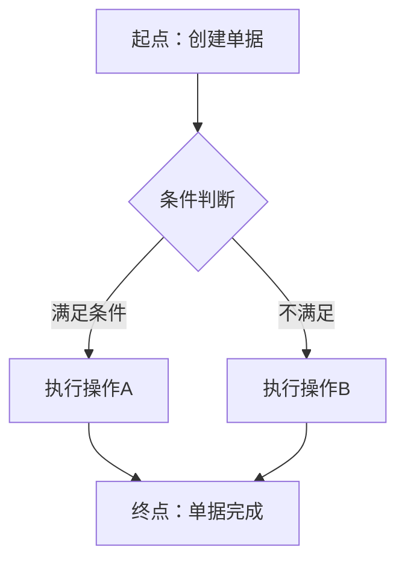
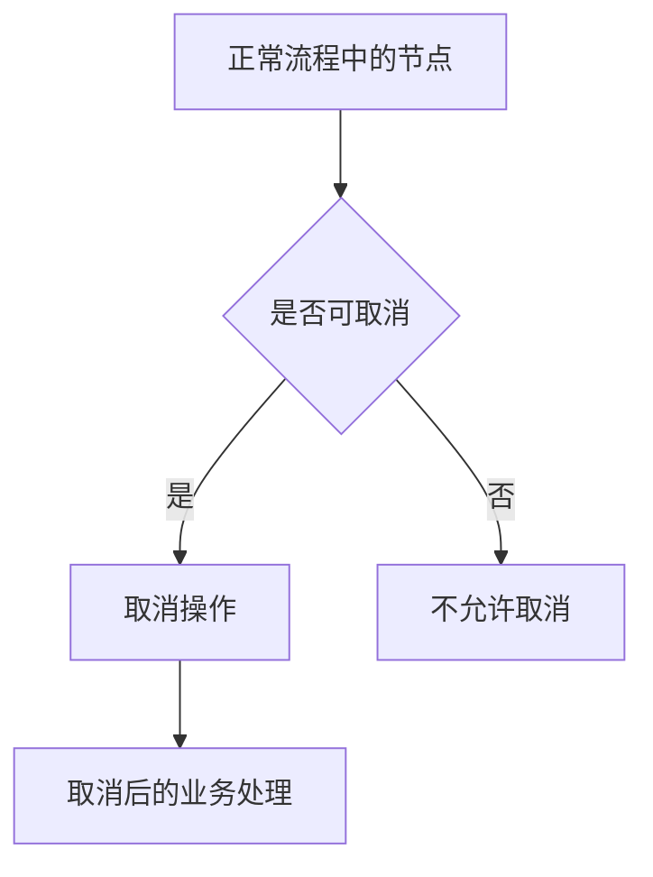

# 流程模型

本目录存放各业务场景的**完整业务流程推演文档**，是业务设计层最核心的产出物。这里的流程关注**业务现实**（谁做了什么、什么条件下做什么），不涉及系统如何响应。

---

## 应该放什么

### 1. 业务主流程文档（核心）

每个业务场景一份文件，覆盖从起点到终点的完整链路。每份文档需包含：

- **正常流程**：业务从开始到结束的标准路径，需标注每一步的操作人、输入、输出和业务规则
- **取消/撤回流程**：哪些环节可以取消或撤回，取消/撤回后的业务后果是什么
- **关闭流程**：业务在什么条件下关闭，关闭后对上下游单据的影响
- **红冲/修正流程**：发生错误时如何修正（红冲重开、差额冲销等），修正后对关联数据的影响
- **异常分支**：关键节点的异常场景及处理方式（缺货、审批驳回、外部系统超时、数据不一致等）

### 2. 业务规则汇总

在流程文档末尾，集中列出该场景涉及的所有业务规则：
- 每项规则有编号和来源（如"根据 XX 会议确认 / XX 制度第 X 条 / 行业规定"）
- 标注状态：已确认 / 待确认 / 已废止

### 3. 时序/交互图（可选）

当业务涉及跨部门、跨系统协作时，用时序图或跨职能泳道图呈现各方的交互关系。

---

## 不应该放什么

| 内容 | 应该放哪里 |
| --- | --- |
| 系统如何响应操作（点了按钮后系统做什么） | 应用设计/流程设计/ |
| 单据的状态机定义 | 应用设计/流程设计/ |
| 字段级校验、枚举值定义 | PRD（字段清单） / 业务设计/数据设计/ |
| 页面布局和控件 | 应用设计/界面设计/ |

---

## 与需求设计/应用设计的分工

```
需求设计/业务流程概要说明（泳道级宏观） 
    → 业务设计/流程模型（步骤级+异常分支推演） 
    → 应用设计/流程设计（系统行为级+状态机）
```

如果业务设计发现需求概要不成立或缺失场景，必须回写需求设计层的范围和功能清单。

---

## 流程文档模板

```markdown
# [场景名称]流程推演

> 业务背景：简要说明本场景的业务背景和目标（1-2 句话）
> 关联单据：[列出涉及的业务单据]

---

## 一、正常流程

### 1.1 流程图



### 1.2 步骤明细

| 步骤 | 操作人（角色） | 操作内容 | 上游输入 | 产出物/输出 | 业务规则 | 备注 |
| --- | --- | --- | --- | --- | --- | --- |
| 1 | 采购专员 | 创建采购订单 | 采购计划 | 采购订单（待提交） | 订单金额 ≤ 授权额度 |  |
| 2 | 采购主管 | 审核采购订单 | 采购订单 | 采购订单（已审核） | 超授权额度需多级审批 |  |
| 3 |  |  |  |  |  |  |

---

## 二、取消/撤回流程

> 说明：什么条件下可以取消/撤回，取消/撤回后在业务上意味着什么

### 2.1 流程图



### 2.2 可取消节点与后果

| 取消节点 | 取消条件 | 取消操作人 | 取消后果 | 对下游的影响 | 是否可恢复 |
| --- | --- | --- | --- | --- | --- |
| 待审核 | 提交人本人 | 采购专员 | 单据作废 | 无（未下发） | 否 |
| 已审核 | 未下推执行 | 采购主管 | 单据作废，释放关联资源 | 未推送的通知单同步作废 | 否 |

---

## 三、关闭流程

> 说明：业务单据在什么条件下关闭，关闭与取消的区别

### 3.1 关闭条件

| 关闭类型 | 触发条件 | 触发人/系统 | 关闭后果 |
| --- | --- | --- | --- |
| 正常关闭 | 全部下推执行完成 | 系统自动 | 业务完结 |
| 强制关闭 | 已审核业务但决定不再执行 | 人工操作 | 放弃剩余可下推量 |

### 3.2 关闭与取消的区别

| 维度 | 取消 | 关闭 |
| --- | --- | --- |
| 时机 | 执行前或执行中 | 执行完成或决定不执行时 |
| 对执行结果 | 不产生执行结果 | 可能已产生部分执行结果 |
| 数据影响 | 单据作废，数据回滚 | 单据归档，数据保留 |

---

## 四、红冲/修正流程

> 说明：发生数据错误时如何修正

### 4.1 错误场景与修正方式

| 错误场景 | 发现时机 | 修正方式 | 对关联单据的影响 | 需审批 | 备注 |
| --- | --- | --- | --- | --- | --- |
| 数量填错 | 已审核未执行 | 撤回修改后重新提交 | 修改后版本号 +1 | 是 |  |
| 单价填错 | 已部分执行 | 红冲原单据，创建新单据 | 已执行部分保留，新单据执行差额 | 是 |  |
|  |  |  |  |  |  |

---

## 五、异常分支

> 列出关键节点的异常场景及业务处理方式

| 异常编号 | 异常场景 | 发生节点 | 业务处理方式 | 对流程的影响 | 待确认 |
| --- | --- | --- | --- | --- | --- |
| E001 | 外部系统未响应 | 下推通知单 | 手动重试 / 超时告警 | 流程挂起 | □ |
| E002 | 库存不足 | 下推入库单 | 缺量执行，差额不补发 | 以实际执行量为准 | □ |
| E003 | 审批人不在岗 | 审核节点 | 转审或代理审批 | 不影响主流程 | □ |

---

## 六、业务规则汇总

> 以上流程中涉及的所有业务规则集中列在此处

| 规则编号 | 规则内容 | 来源 | 状态 |
| --- | --- | --- | --- |
| BR-001 | 订单金额超出授权额度需多级审批 | XX制度第N条 | 已确认 |
| BR-002 |  |  | 待确认 |

---

## 七、与其他文档的关系

| 文档 | 关系 |
| --- | --- |
| 需求设计/需求规格说明书 | 本流程的范围和优先级依据 |
| 业务设计/数据设计 | 本流程涉及的业务实体和术语定义 |
| 业务设计/业务用例 | 本流程的参与者视角验证 |
| 应用设计/流程设计 | 本流程转为系统行为级设计的上游输入 |
| PRD/流程推演 | 本流程合并验收标准后作为 PRD 流程推演的基础 |
```

---

## 流程推演验收清单

| 检查项 | 要求 |
| --- | --- |
| 链路闭环 | 从起点到终点每个步骤都有明确的输入和输出 |
| 正常流程 | 覆盖主成功路径，步骤序号连续 |
| 逆向操作 | 取消、撤回、关闭、红冲场景已覆盖 |
| 异常分支 | 每个关键节点至少考虑一个异常分支 |
| 规则来源 | 每条业务规则标注来源或待确认状态 |
| 跨文档 | 涉及的人员、组织、术语与业务架构和数据设计一致 |
| 废止标记 | 被替换的旧流程在正文同步清理，不能只在标题标注废止 |

---

## 文档命名建议

```
[场景名称]业务流程.md         例：采购正向业务流程.md
[场景名称]取消流程.md         例：采购取消流程.md
[场景名称]异常处理流程.md     例：采购入库异常处理流程.md
```
