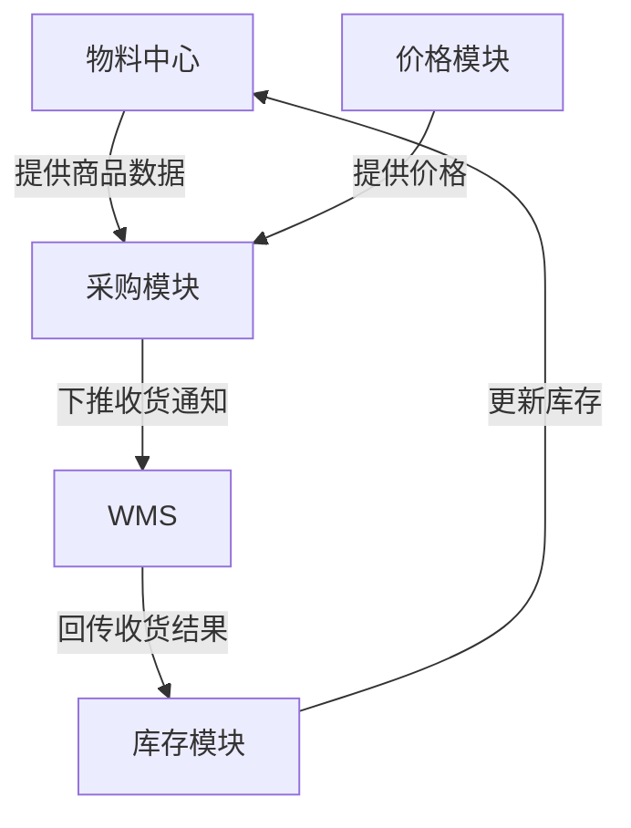

# 应用架构

本目录存放系统应用层的整体架构设计，描述系统由哪些模块组成、模块之间如何协作，是应用设计层的"骨架"。

---

## 应该放什么

- **应用架构图**：各功能模块/子系统的划分与调用关系（如：A集团物料中心、B集团物料中心、价格模块之间的关系）
- **模块职责说明**：每个模块的业务职责边界、负责什么、不负责什么
- **系统集成概览**：与外部系统（WMS、POS、财务系统、SRM）的交互边界和数据流向

## 不应该放什么

| 内容 | 应该放哪里 |
| --- | --- |
| 权限体系、审批流等横切机制 | 系统机制/ |
| 具体的状态机或交互流程 | 流程设计/ |
| 数据库表结构、技术选型 | 技术设计（研发维护） |
| 字段定义、页面交互细节 | PRD |

---

## 与系统机制的区别

- **应用架构**：说清楚"有哪些模块、模块边界在哪"，是静态的结构描述
- **系统机制**：说清楚"权限/审批/日志这些横切关注点如何被所有模块共用"，是动态的规则描述

---

## 文档模板（通用）

```markdown
# [期次名称]应用架构

## 一、模块划分

| 模块名称 | 核心职责 | 主要对接系统 |
| --- | --- | --- |
| 物料中心 | 统一管理商品主数据、分类、规格属性 | 采购模块、库存模块 |
| 采购模块 | 采购订单创建、审核、下发 | 物料中心、供应商系统 |
| 库存模块 | 库存查询、入库、出库、盘点 | 物料中心、WMS |
| 价格模块 | 价格策略管理、定价、折扣计算 | 采购模块、销售模块 |

## 二、应用架构图

> 用 Mermaid 或图片描述各模块的调用关系和数据流向。



## 三、外部系统集成边界

| 外部系统 | 集成方向 | 数据内容 | 触发时机 |
| --- | --- | --- | --- |
| SRM（供应商系统） | SRM → 本系统 | 采购订单、供货单 | 审核后推送 |
| WMS（仓储系统） | 双向 | 收货通知单（下推）/ 收货结果（回传） | 按业务节点 |
| 财务系统 | 本系统 → 财务 | 结算单、成本数据 | 结算周期触发 |
```

---

## 多组织/多集团场景模板

> 适用于需要区分多个集团或租户的中大型系统。通用模板中的模块划分按业务域，多组织场景下额外增加"归属组织"维度。

```markdown
## 一、模块划分（多组织）

| 模块名称 | 归属组织 | 核心职责 | 主要对接系统 |
| --- | --- | --- | --- |
| A集团物料中心 | A集团 | A集团商品主数据管理 | A集团采购模块 |
| B集团物料中心 | B集团 | B集团商品主数据管理 | B集团采购模块 |
| 公共价格模块 | 平台 | 跨集团的统一价格策略 | A/B集团采购模块 |

## 二、数据隔离原则

- 各组织用户只能查看归属本组织的数据
- 跨组织数据在各自的模块中各自可见
- 公共模块的数据对所有组织开放（只读或按权限）
```
```

---

## 文档命名建议

```
[期次名称]应用架构.md
例：物料二期应用架构.md
```
