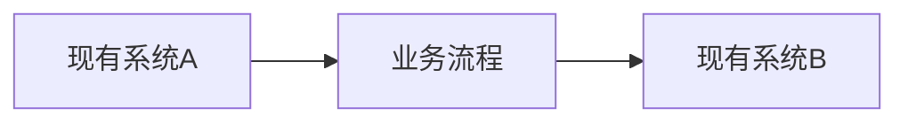

# 需求调研报告

需求调研报告是需求设计阶段的**过程性档案**，记录调研活动的完整过程和原始素材，是需求规格说明书的前置输入和溯源依据。

---

## 报告结构

### 1. 调研基本信息

| 项目 | 内容 |
| --- | --- |
| 项目名称 |  |
| 调研时间 |  |
| 调研地点 |  |
| 参与人员 |  |
| 版本号 |  |

**用语与缩写说明**（重要术语在此统一定义，全文沿用）

| 术语/缩写 | 含义 |
| --- | --- |
|  |  |

---

### 2. 调研方法与过程

> 说明采用了哪些调研方式，帮助读者理解信息来源的完整性和可信度。

- **面谈**：与哪些角色访谈，时间，主要议题
- **问卷**：是否发放问卷，回收情况
- **现状访谈**：到现场观察业务流程的记录
- **表单收集**：收集到哪些原始表格、报表

---

### 3. 调研成果

#### 3.1 现状构成图

> 用图形化方式呈现客户现有业务流程与系统边界（可嵌入 Mermaid 流程图或附图）。

#### 3.2 访谈记录

> 文字整理的访谈要点，包含痛点、期望与约束。每次访谈单独一条记录。

**访谈记录 #1**

- **时间**：
- **对象**：
- **主要痛点**：
- **期望与诉求**：
- **已知约束**：

#### 3.3 既存表单

> 收集到的原始表格、报表样例，作为需求佐证。

- [表单名称]：说明用途，附原件或截图

---

### 4. 开放问题与待确认事项

> 调研过程中尚未得到明确答案的问题，交由需求评审会确认。

| 编号 | 问题描述 | 相关方 | 状态 |
| --- | --- | --- | --- |
| Q001 |  |  | 待确认 |

---

## 与其他文档的关系

| 方向 | 说明 |
| --- | --- |
| **输出到** | 需求规格说明书（以本报告为输入，提炼结构化需求） |
| **输出到** | 业务/功能需求一览表（本报告的功能诉求经整理后进入清单） |
