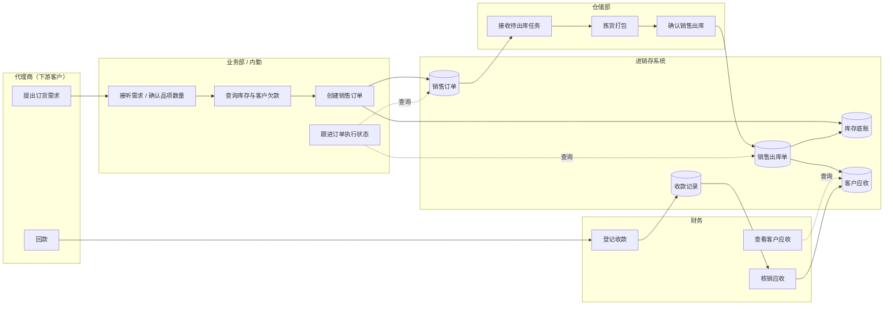

# 销售管理需求规格说明书

> 文档定位：需求设计阶段基线文档，回答销售管理模块"做什么、不做什么、优先级是什么"。  
> 版本：v1.1 | 状态：待评审（演示 Mock 口径已冻结，见 `context/05-销售管理演示Mock口径.md`）

---

## 一、需求背景

强盛科技是一家贸易型企业，经营模式为**区域总代 + 前店后仓批发**，下游覆盖 30+ 地级市代理商，活跃 SKU 约 1500+。根据业务频次判断，**代理商接单与批发开单占日单量约 80%**，是主营收入的核心来源；仓库出货直接影响履约与库存准确性；客户收款登记则影响现金流与后续放货决策。

在一期"最小可运行基础进销存闭环"的目标下，销售管理不是孤立的录单功能，而是串联**客户下单意图 → 销售开单 → 仓库出库 → 应收形成 → 收款登记**的主链路枢纽。当前业务靠电话/QQ/微信接单，内勤跟单、仓储发货、财务收尾各自为政，缺少统一底账。若销售侧订单录不进、状态看不清、出库与库存不同步、客户欠款说不清，采购回补、库存管理、往来收付款都无法建立在可信数据之上。

因此，销售管理是一期进销存中**优先级最高、必须优先跑通**的业务模块之一，其需求基线应聚焦批发主链路，而非一次性覆盖电商、复杂信用管控或完整财务核算。

---

## 二、当前痛点

| 痛点编号 | 痛点 | 影响 | 背景依据 |
|---|---|---|---|
| P01 | 录单前需人工问价格、问库存、问客户欠款，无统一数据可查 | 开单慢、报价不一致、容易超卖或误承诺 | `context/02-强盛科技业务背景.md` 开单侧 |
| P02 | 同一客户不同业务员容易报出不同价格 | 客户信任受损、毛利口径混乱、事后对账困难 | `context/02-强盛科技业务背景.md` 开单侧 |
| P03 | 订单录入后状态不透明，不知道谁在跟、跟到哪了 | 跟单协调成本高、代理商催货无据可查 | `context/02-强盛科技业务背景.md` 开单侧 |
| P04 | 销售认为"有货"，仓库实际不一定能发，库存口径不一致 | 承诺无法履约、客户投诉、重复沟通 | `context/02-强盛科技业务背景.md` 发货侧；`context/01-什么是进销存系统.md` 库存三口径 |
| P05 | 发货动作与库存变化未强绑定 | 账实不符、库存底账不可信 | `context/02-强盛科技业务背景.md` 发货侧 |
| P06 | 短少、坏货、漏发后无标准处理流程 | 纠纷难追溯、补发/退款口径不统一 | `context/02-强盛科技业务背景.md` 发货侧 |
| P07 | 应收应付看不清，不知道客户欠多少、欠了多久 | 放货决策缺依据、催收无抓手 | `context/02-强盛科技业务背景.md` 财务侧 |
| P08 | 回款登记与历史欠款核销效率低，私人转账认款困难 | 财务被动收尾、一笔款对应多单时处理混乱 | `context/02-强盛科技业务背景.md` 财务侧；`context/03-进销存上下游关联系统.md` 代理商回款场景 |

---

## 三、本期范围

| 范围类型 | 内容 | 说明 |
|---|---|---|
| **本期做** | 批发销售订单的创建、查询与状态跟进 | 承接代理商/批发客户需求，作为销售执行层单据的来源 |
| **本期做** | 基于销售订单创建销售出库单，仓库按单拣货发货 | 遵循"订单层 → 执行层"两层单据架构，库存变动发生在执行层 |
| **本期做** | 销售出库与库存占用/扣减联动 | 录单与发货阶段能反映库存三口径（现存、占用、可用），避免销售与仓库口径不一致 |
| **本期做** | 销售出库后形成客户应收，支持应收/欠款查询 | 进销存做到往来层，支撑录单前查欠款、发货后看应收 |
| **本期做** | 销售场景下的收款登记及与应收的关联核销 | 与往来管理协同，解决回款登记效率问题；不做自动认款 |
| **本期做** | 销售退货及退货入库（基础能力） | 频次为中/中低，但一期需具备基本售后闭环，避免只进不退 |
| **本期做** | 销售侧基础查询（订单、出库、客户销售往来） | 满足内勤跟单、业务查单、财务对账的基本查看需求 |
| **本期做** | 销售订单单级审核后出库 | 订单审核通过进入待出库并占用库存，方可创建销售出库单 |
| **本期做** | 分批出库与缺量完结 | 一张订单可多次出库；客户接受少发时，未出库部分可完结且不再形成应收 |
| **本期做** | 销售退货须关联原销售出库单 | 已出库后不可直接取消订单，须走退货单 → 退货入库 |
| **本期做** | 收款人工关联多张应收 | 财务收款时可手工勾选多笔应收核销；不自动分摊 |
| **明确不做** | 无销售订单直接创建销售出库单 | 一期批发主链路强制「先订单、后出库」 |
| **明确不做** | 无单销售退货 | 退货必须关联原出库执行结果 |
| **明确不做** | 完整财务总账、凭证、科目核算 | 财务记账仅作为内部业务环节，进销存止于应收应付与收付款登记 |
| **明确不做** | 电商平台订单接口（淘宝/京东等）与代理商在线商城 | 代理商当前通过电话/QQ/微信下单，电商代发非一期主营盘 |
| **明确不做** | 银行/支付流水自动认款 | 私人转账、一笔款对应多单等场景需人工登记与核销 |
| **明确不做** | 信用额度自动硬拦截 | 一期信用仅作查询与提醒，不做超额度自动阻断下单/出库 |
| **明确不做** | 复杂审批流、多级售价审批、自动补货与安全库存预警 | 一期优先"录得进、查得到、流转得通" |
| **明确不做** | PDA 扫码仓储、复杂经营分析报表 | 仓储以基础作业为主；分析依赖数据先入库 |
| **明确不做** | 零售收银 | 由零售管理模块独立承载，与销售管理共用库存底账 |

---

## 四、销售管理的业务目标

### 4.1 目标需求（要解决什么问题）

| 目标需求 | 说明 |
|---|---|
| T01 主链路数字化 | 让代理商批发业务从"口头下单 + 人工跟单"进入系统留痕，形成可查询、可协同的销售主链路 |
| T02 库存承诺可信 | 开单与发货前能看清可用库存，出库与库存变动强绑定，减少"销售说有货、仓库发不出" |
| T03 往来可视 | 客户欠多少、欠了多久可查；发货后应收形成；回款可登记并与应收关联 |
| T04 最小闭环优先 | 一期先跑通高频主链路，不追求复杂规则与智能分析 |

### 4.2 业务需求（业务上要做到什么）

| 业务需求 | 对应目标 | 说明 |
|---|---|---|
| B01 接单录单标准化 | T01 | 内勤/业务部能将代理商需求录入销售订单，关键业务信息可追溯 |
| B02 跟单过程可见 | T01 | 订单执行进度对内勤、业务、仓储可见，减少重复沟通 |
| B03 订单驱动出库 | T01、T02 | 仓库按销售订单生成并执行销售出库，执行层单据基于订单层创建 |
| B04 库存联动一致 | T02 | 订单占用与出库扣减反映统一库存底账，与门店零售、采购入库共用库存 |
| B05 发货结果回写 | T02 | 出库确认后回写订单履约进度，支撑部分发货、多次发货等常见批发场景 |
| B06 应收自动生成 | T03 | 销售出库确认后形成客户应收，可供财务与业务查询 |
| B07 回款登记核销 | T03 | 客户回款可登记，并与应收建立关联，支撑基础核销 |
| B08 基础售后处理 | T04 | 支持销售退货及退货入库，避免售后无单可查 |

### 4.3 功能需求（系统需要提供什么能力）

| 功能需求 | 对应业务需求 | 说明 |
|---|---|---|
| F01 销售订单管理 | B01、B02 | 创建、查询、跟进销售订单 |
| F02 销售出库管理 | B03、B05 | 基于订单创建出库单，确认发货 |
| F03 库存占用与出库联动 | B04 | 订单/出库与库存三口径联动 |
| F04 客户欠款/应收查询 | B06 | 录单前、发货后均可查询客户往来 |
| F05 销售应收形成 | B06 | 出库确认后生成应收记录 |
| F06 收款登记（销售场景） | B07 | 登记客户回款并与应收关联 |
| F07 销售退货处理 | B08 | 退货单及退货入库的基础处理能力 |
| F08 销售基础查询统计 | B02、T04 | 订单、出库、客户销售往来的列表查询 |

> 功能编号与优先级详见《销售管理业务功能需求一览表》。

---

## 五、业务流程概要

以下为宏观泳道级流程，仅描述主路径，不展开异常分支与逆向流程细节。

**流程要点（需求层约束）：**

1. **客户下单**：当前以电话/QQ/微信为主，系统侧体现为内勤/业务录入销售订单，不要求一期建设代理商自助下单门户。
2. **销售开单**：销售订单为计划层单据，需能关联客户、商品、数量、价格等核心业务信息；录单前应能查询客户欠款与可用库存。
3. **仓库出库**：销售出库为执行层单据，须基于销售订单创建；出库确认后驱动库存扣减。
4. **应收形成**：销售出库确认后，系统形成客户应收，供财务与业务查询。
5. **收款登记**：财务根据客户回款进行收款登记，并与应收建立关联，完成基础核销。

---

## 六、已冻结口径（演示 Mock）

> 以下口径已通过 `context/05-销售管理演示Mock口径.md` 冻结，供课堂演示与后续设计引用。性质为**演示假设**，正式评审前仍可由业务方调整。

| 问题编号 | 原待确认问题 | 冻结口径 | Mock 依据 |
|---|---|---|---|
| Q01 | 销售订单是否必须审核后才能出库？ | **是。** 单级审核通过后进入「待出库」，审核通过即占用库存 | `context/04`、`context/05` §一 |
| Q02 | 是否允许无单直接开出库单？ | **一期不允许。** 批发必须「先订单、后出库」 | `context/05` §一 |
| Q03 | 销售价格如何取值？ | **客户批发价 → 标准批发价 → 手工改价（留痕）**；一期不做最近成交价、不做改价审批 | `context/05` §一、§三 |
| Q04 | 是否支持分批/多次出库？ | **是，常态。** 支持缺量完结，未出库部分不再形成应收 | `context/04` 固定案例、`context/05` §四 |
| Q05 | 短少/漏发/坏货如何处理？ | 短少→缺量完结；漏发→异常登记+补出库；坏货→异常登记+退货链路 | `context/05` §一、§五 |
| Q06 | 退货是否必须关联原出库单？ | **必须关联。** 不允许无单退货；已出库不可直接取消订单 | `context/04`、`context/05` §五 |
| Q07 | 一笔收款能否核销多张应收？ | **支持人工勾选多张应收核销**；余额可记预收；不自动认款、不自动分摊 | `context/05` §一、§六 |
| Q08 | 零售是否纳入本模块？ | **不纳入。** 零售管理模块独立出需求基线，共用库存底账 | `context/04`、`context/05` §一 |

### 演示用固定案例（数据推演）

| 项目 | Mock 值 |
|---|---|
| 客户 | 深圳华南代理商（CUS-SZ-001） |
| 商品 | 蓝牙耳机保护壳（SKU-3C-0888） |
| 订单数量 | 100 件 |
| 含税单价 | ¥50 |
| 第一次出库 | 40 件 → 应收 ¥2,000 |
| 第二次实发 | 55 件（计划 60）→ 应收 ¥2,750 |
| 缺量完结 | 5 件，**不计入应收** |
| 累计应收 | **¥4,750**（95 件 × ¥50） |

完整主数据与异常/收款案例见 `context/05-销售管理演示Mock口径.md`。

---

*本文档为需求设计层产出。详细流程推演、异常分支、状态机、字段清单见后续业务设计与 PRD。*
